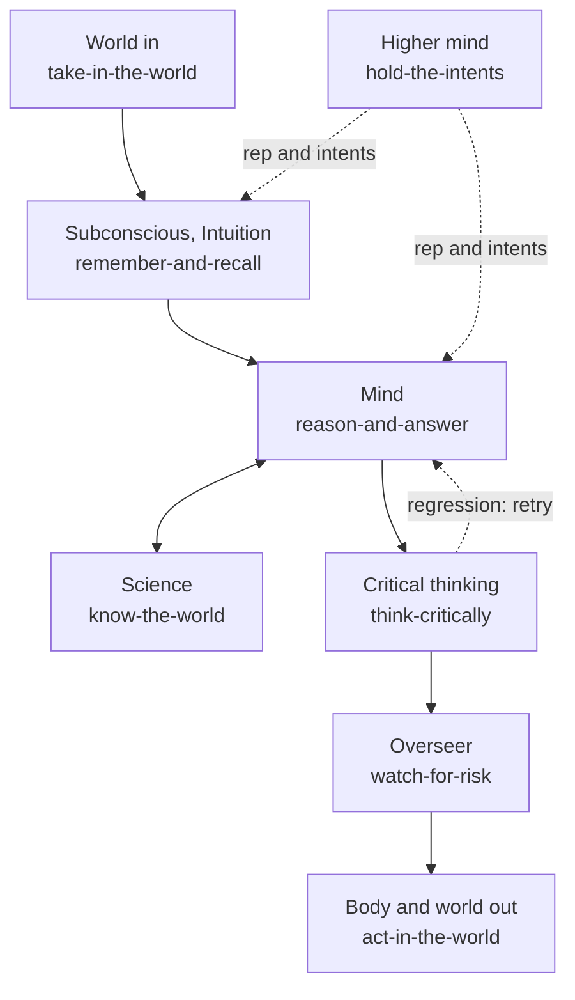

# ai-hub-of-hubs-structure

**One structure for assembling the best open-source AI hubs, one seat per part of a mind. Each seat holds the arm that measures
best on shared cases, and every number below is a recorded row, not a claim.** Production-proven in
[Quest AI Runner](https://github.com/SpiritualData/quest-ai-runner); the arms, cases and results are here to check.

<!-- headline:start -->
**33 alternatives measured across 8 areas, from 448 researched candidates.**

| Area | Alternatives measured | Which |
|---|---|---|
| Memory store | 1 | `local_card_store` |
| RAG retrieval | 4 | `bm25`, `bm25@analyzer=english`, `hybrid`, `vector` |
| LLM routing and failover | 2 | `multi_provider`, `tier_selector` |
| LLMs (model quality and cost) | 12 | `claude_haiku`, `claude_opus`, `claude_sonnet`, `deepseek`, `deepseek_flash`, `deepseek_v4_pro`, `gemini`, `gemini_2_5_flash`, `gemini_2_5_flash_lite`, `gpt_5_mini`, `gpt_5_nano`, `openai` |
| Web search APIs | 2 | `gemini`, `provider` |
| Scholarly search | 6 | `openalex`, `openalex_keywords`, `openalex_keywords_model`, `openalex_semantic`, `openalex_semantic_and_web`, `web_research` |
| Coding agents | 3 | `fast_edit`, `stream_json_goal_runner`, `subprocess_goal_runner` |
| Guardrails and oversight | 3 | `consent_gate`, `overseer`, `two_stage` |

Counted: distinct arms with a recorded run on the same cases as their rivals. Not counted: baselines and floors (such as `none` and `single_provider`) and single-scenario mechanics checks ([how we measure](docs/explanation/how-we-measure.md#what-counts-as-an-alternative)).
<!-- headline:end -->

## Use it in one line

```python
import os, hubofhubs
system = hubofhubs.assemble(environ=os.environ)   # every seat whose selected arm needs nothing more from you
```

Today this builds `card-store`, `choose-a-model-tier`, `read-registry-freshness`, `score-hub-connections` and `watch-for-risk`.
Every other seat lands in `system.pending` with one line saying what to pass: `arms={seat: <arm>}` where none is selected yet,
`options={seat: {...}}` or a key variable, or `provided={seat: <your object>}` ([quickstart](docs/how-to/register-a-second-consumer.md); the hub reads no environment itself).

## Evidence

One row per recorded check, generated by `python3 scripts/status.py` from the recorded results. The lead column says whether the selected
arm's lead is significant (test and p-value) or a best guess, not yet significant. Public research ([what it says](docs/explanation/what-public-research-says.md)) is shown beside our numbers, never added into them.

<!-- evidence:start -->
| Check (solution, part of the mind) | What it does | Common-sense check | Cases and source | Selected arm | Pass rate (95% interval) | Cost per passing case | Lead: significant or best guess? | What public research says |
|---|---|---|---|---|---|---|---|---|
| `card-store`, Subconscious, Intuition | Keep and find cards for any consumer, with no service to run. | A stored card is found again by its words, and adding the same id twice loses nothing. | 35 written add-and-search cases (this repo) | local_card_store | 100.0% (90.1% to 100.0%), 35/35 | $0 | best guess, not yet significant: no rival measured on the same cases, so no lead to test | [no public task resembles this job](docs/explanation/what-public-research-says.md#seats-where-no-public-evidence-applies); no graded public number for this arm |
| `context-assembler`, Subconscious, Intuition | Find the passages that bear on a request, for any consumer that keeps knowledge to draw on. | A document that answers the query is among the top five results. | 323 test queries of BEIR NFCorpus, the whole public test split | bm25 | 61.9% (56.5% to 67.0%), 200/323 | $0 | significant lead: bm25@analyzer=english beats it (McNemar p=0.0768; 208/323, $0 per pass); vector beats it (McNemar p=0.288; 205/323, $0 per pass); the selected arm is the floor and selection is pending | [hybrid fusion then rerank favoured (grade B)](docs/explanation/what-public-research-says.md#context-assembler-find-the-passage-a-request-needs); graded public numbers for this arm: B, D |
| `context-assembler`, Subconscious, Intuition | Find the passages that bear on a request, for any consumer that keeps knowledge to draw on. | The research paper a query was made from is among the top five results (an easy known-item check: it shows whether an arm fails | not which is cleverer). | bm25 | 100.0% (98.7% to 100.0%), 300/300 | $0 | best guess, not yet significant: not separated from bm25@analyzer=english (paired test p=, 0 of 300 cases differ); not separated from hybrid (paired test p=, 0 of 300 cases differ); ahead of vector (Fisher p=0.373) | [{n} title and sentence queries over a sample of research papers (private corpus, method only)](docs/explanation/what-public-research-says.md#hybrid fusion then rerank favoured (grade B)); graded public numbers for this arm: B, D |
| `choose-a-model-tier`, Mind | Choose the cheapest model that does the job at each tier, for any product that calls models. | The model picked for each tier is the one with the most passing work per dollar. | 36 written tier cases with the prices on file (this repo) | tier_selector | 100.0% (90.4% to 100.0%), 36/36 | $0 | best guess, not yet significant: no rival measured on the same cases, so no lead to test | [routing cuts cost per its authors (grade D)](docs/explanation/what-public-research-says.md#choose-a-model-tier-tier-selection); no graded public number for this arm |
| `model-call`, Mind | Ask a model a question at the tier that fits, for any consumer. | A question asked at a tier is answered by the model that tier names. | 30 written tier cases with a fake provider (this repo) | via_call_a_model | 100.0% (88.6% to 100.0%), 30/30 | $0 | best guess, not yet significant: no rival measured on the same cases, so no lead to test | [no public task resembles this job](docs/explanation/what-public-research-says.md#seats-where-no-public-evidence-applies); no graded public number for this arm |
| `call-a-model`, Mind | Reach any model vendor through one interface, for any consumer that calls models. | When the first provider fails, a healthy one answers; a bad request is not hidden. | 30 written failure cases with fake providers (this repo) | multi_provider | 100.0% (88.6% to 100.0%), 30/30 | $0 | significant lead: ahead of single_provider (McNemar p=3.81e-06) | [no independent study found](docs/explanation/what-public-research-says.md#call-a-model-vendor-models-router-failover); no graded public number for this arm |
| `call-a-model`, Mind | Reach any model vendor through one interface, for any consumer that calls models. | Each vendor's cheapest model gets the right final answer on school maths word problems. | 50 problems sampled from GSM8K test (public) | none: arms are complementary, not ranked | deepseek 94.0% (83.8% to 97.9%), 47/50; gemini 100.0% (92.9% to 100.0%), 50/50; openai 92.0% (81.2% to 96.8%), 46/50 | deepseek $0.0001638; gemini $0.000158; openai $0.0002848 | not ranked: The vendor arms are evidence for choosing a model per tier, not rivals for one seat. | [vendor indexes shortlist only](docs/explanation/what-public-research-says.md#call-a-model-vendor-models-router-failover); no graded public number for this arm |
| `call-a-model`, Mind | Reach any model vendor through one interface, for any consumer that calls models. | Each model gets the exact final integer on hard competition maths, with one prompt for every model. | 30 problems of AIME 2025 I and II (public, published by the MAA) | none: arms are complementary, not ranked | claude_haiku 100.0% (88.6% to 100.0%), 30/30; claude_opus 96.7% (83.3% to 99.4%), 29/30; claude_sonnet 90.0% (74.4% to 96.5%), 27/30; deepseek_flash 93.3% (78.7% to 98.2%), 28/30; deepseek_v4_pro 100.0% (43.9% to 100.0%), 3/3; gemini_2_5_flash 66.7% (48.8% to 80.8%), 20/30; gemini_2_5_flash_lite 56.7% (39.2% to 72.6%), 17/30; gpt_5_mini 90.0% (74.4% to 96.5%), 27/30; gpt_5_nano 66.7% (48.8% to 80.8%), 20/30 | claude_haiku 1 model calls (no price); claude_opus 1.03 model calls (no price); claude_sonnet 1.11 model calls (no price); deepseek_flash $0.007732; deepseek_v4_pro $0.0416; gemini_2_5_flash $0.06069; gemini_2_5_flash_lite $0.01591; gpt_5_mini $0.01458; gpt_5_nano $0.006135 | not ranked: The models are evidence for choosing a model per tier, not rivals for one seat. The problems were public from February 2025, so later models may have seen them: read each rate as an upper bound. API arms are capped at 32,768 output tokens; Gemini no-answer failures (6 and 11 of 30) are probably that cap. | [MathArena runs the same problems independently (see the public rows)](docs/explanation/what-public-research-says.md#call-a-model-vendor-models-router-failover); no graded public number for this arm |
| `search-backend`, World | Run a web search through any service, for any consumer that needs sources. | A top-five search hit comes from a page or site that holds the answer. | 40 questions sampled from SimpleQA (public) | gemini | 80.0% (65.2% to 89.5%), 32/40 | $5.625e-05 | significant lead: ahead of provider (McNemar p=5.48e-06) | [no engine shown best; a close independent test (grade C)](docs/explanation/what-public-research-says.md#search-backend-web-search-hits-containing-the-source); no graded public number for this arm |
| `know-the-world`, Science | Support claims with sources a reader can check, for anyone who asks an AI a factual or research question. | The paper that answers a research question is among what the arm returns. | 40 questions sampled from LitSearch (public) | web_research | 15.0% (7.1% to 29.1%), 6/40 | $0.0006333 | significant lead: ahead of openalex (McNemar p=0.547); ahead of openalex_keywords (McNemar p=0.906); ahead of openalex_keywords_model (McNemar p=0.906); openalex_semantic beats it (McNemar p=0.219; 12/40, $0 per pass); openalex_semantic_and_web beats it (McNemar p=0.0879; 15/40, $0.0002267 per pass); the selected arm is the floor and selection is pending | [meaning-based search over papers beats keywords (grade B to C)](docs/explanation/what-public-research-says.md#know-the-world-find-papers-for-a-research-question); no graded public number for this arm |
| `know-the-world`, Science | Support claims with sources a reader can check, for anyone who asks an AI a factual or research question. | The paper that answers a research question is among what the arm returns. | 150 questions sampled from LitSearch (public), the 40 of the first stage and 110 more | web_research | 8.0% (4.6% to 13.5%), 12/150 | $0.001108 | significant lead: openalex_semantic beats it (McNemar p=1.62e-08; 50/150, $0 per pass); openalex_semantic_and_web beats it (McNemar p=2.84e-09; 47/150, $0.0002809 per pass); the selected arm is the floor and selection is pending | [meaning-based search over papers beats keywords (grade B to C)](docs/explanation/what-public-research-says.md#know-the-world-find-papers-for-a-research-question); no graded public number for this arm |
| `act-in-the-world`, Body | Make intended changes in the world and no unrequested ones, for any product that lets an AI act. | A small coding task counts as done only when its own tests pass afterwards. | 30 tasks sampled from HumanEval (public) | fast_edit | 96.7% (83.3% to 99.4%), 29/30 | $0.0001793 | significant lead: ahead of none (McNemar p=5.59e-09); stream_json_goal_runner beats it (McNemar p=1; 30/30, $0.005207 per pass); subprocess_goal_runner beats it (McNemar p=1; 30/30, $0.004987 per pass); the selected arm is the floor and selection is pending | [thin pipelines can match agents on small edits (grade D)](docs/explanation/what-public-research-says.md#act-in-the-world-coding-and-file-edit-goals); no graded public number for this arm |
| `watch-for-risk`, Overseer | Stop irreversible or human-only steps before they happen, without slowing ordinary work, for any product that lets an AI act. | Steps a person should authorize are stopped and ordinary steps are let through. | 36 written step digests, plainly worded (this repo) | overseer | 91.7% (78.2% to 97.1%), 33/36 | $7.576e-05 | significant lead: consent_gate beats it (McNemar p=0.375; 36/36, $0 per pass); ahead of none (McNemar p=0.00223); two_stage beats it (McNemar p=1; 34/36, $2.059e-05 per pass); the selected arm is the floor and selection is pending | [monitors miss ambiguous cases (grade B)](docs/explanation/what-public-research-says.md#watch-for-risk-overseer-versus-none); no graded public number for this arm |
| `watch-for-risk`, Overseer | Stop irreversible or human-only steps before they happen, without slowing ordinary work, for any product that lets an AI act. | Risky steps described indirectly are stopped, and ordinary steps that only sound risky pass. | 24 written step digests with indirect wording (this repo) | overseer | 95.8% (79.8% to 99.3%), 23/24 | $6.957e-05 | significant lead: ahead of consent_gate (McNemar p=0.0703); ahead of none (McNemar p=0.00513); ahead of two_stage (McNemar p=0.109) | [monitors miss ambiguous cases (grade B)](docs/explanation/what-public-research-says.md#watch-for-risk-overseer-versus-none); no graded public number for this arm |
| `read-registry-freshness`, Learning | Show maintainers which parts of the hub have gone stale. | A research date is read as the right number of days old and stale areas are named. | 41 written date cases (this repo) | registry_scan | 100.0% (91.4% to 100.0%), 41/41 | $0 | best guess, not yet significant: no rival measured on the same cases, so no lead to test | [no public task resembles this job](docs/explanation/what-public-research-says.md#seats-where-no-public-evidence-applies); no graded public number for this arm |
| `score-hub-connections`, Hands | Show a consumer how much of its integration is a hub connection and how much is hand-wired. | A fake integration added by configuration alone counts as needing zero code. | 33 written binding cases (this repo) | hub_of_hubs_scorer | 100.0% (89.6% to 100.0%), 33/33 | $0 | best guess, not yet significant: no rival measured on the same cases, so no lead to test | [no public task resembles this job](docs/explanation/what-public-research-says.md#seats-where-no-public-evidence-applies); no graded public number for this arm |
| `assemble-the-whole`, The whole being | Give any consumer a working system from one line of configuration. | Every seat builds, or says exactly what to pass, and no arm fails to build. | 57 written assembly cases (this repo) | zero_config (best guess, none selected) | 100.0% (93.7% to 100.0%), 57/57 | $0 | best guess, not yet significant: only one arm measured, no test possible | [no public task resembles this job](docs/explanation/what-public-research-says.md#seats-where-no-public-evidence-applies); no graded public number for this arm |
| `context-assembler` | Find the passages that bear on a request, for any consumer that keeps knowledge to draw on. | No plain-words description yet: add a row to docs/reference/evidence-labels.csv. | 300 cases | bm25 | 85.7% (81.2% to 89.2%), 257/300 | $0 | best guess, not yet significant: bm25@analyzer=english beats it (McNemar p=0.00664; 270/300, $0 per pass); not separated from composite (paired test p=, 0 of 300 cases differ); not separated from hybrid (paired test p=, 0 of 300 cases differ); hybrid@vector_weight=1.0 beats it (McNemar p=2.98e-08; 284/300, $1.056e-06 per pass); vector beats it (McNemar p=1.82e-11; 295/300, $1.017e-06 per pass); the selected arm is the floor and selection is pending | not linked yet; graded public numbers for this arm: B, D |

The arm with the highest result at the latest comparable stage is used. A lead is labelled significant when a one-sided exact paired test on the same cases gives p below 0.05 after Holm's correction, and otherwise a best guess, not yet significant, with the number of cases the arms disagree on. Every arm of every check is in [docs/reference/evidence-by-arm.md](docs/reference/evidence-by-arm.md).
<!-- evidence:end -->

## How we measure

Every arm of a check runs on the same cases with the same budget, and we record pass rate with its 95% Wilson interval, cost per
passing case and seconds per case. The arm with the highest result at the latest comparable stage is used by default, and its lead
is labelled significant (one-sided exact paired test, p below 0.05 after Holm's correction) or a best guess, not yet significant.
Others' measurements are graded and shown beside ours, never inside them ([how we measure](docs/explanation/how-we-measure.md), [public evidence](docs/explanation/public-evidence.md)). All documentation: [docs/README.md](docs/README.md).

## What is not measured yet

Named seats and arms with no recorded run, and why. `esoi leaderboard` flags rows recorded before later edits to the measured code.

<!-- unmeasured:start -->
- **`hold-the-intents`** (Higher mind): not measured. No public task represents a hierarchy of intents, and no cases are written yet.
- **`take-in-the-world`** (World): measured in part. Only web search is measured; agent harnesses, tools and MCP servers have no check yet.
- **`remember-and-recall`** (Subconscious, Intuition): measured in part. Context assembly and the card store are measured; memory as a whole, such as scope isolation, has no check yet.
- **`reason-and-answer`** (Mind): measured in part. Only tier choice, provider failover, vendor answers and hard maths (AIME 2025) are measured; planning and answering live in Quest AI Runner and have no check here yet.
- **`think-critically`** (Critical thinking): not measured. Code exists (hubofhubs/critique) but no arm is recorded and no check is written. The research page names a public candidate.
- **`act-in-the-world`** (Body): measured in part. Only file-editing goals are measured; writing through MCP operations has no check.
- **`assemble-the-whole`** (The whole being): measured in part. One scenario, with no rival, so there is no lead to test.
- **`stay-current`** (Learning): measured in part. The freshness reading is measured; the weekly research itself is run by the consumer's autopilot and is not an arm here.
- **`keep-it-generic`** (Character): not measured. Enforced by a text scan in the tests, not by a recorded run, and no arm is recorded.
- **`connect-any-integration`** (Hands): measured in part. Connection scoring is measured; the zero-code connect flow for a real integration is not run end to end here.
- **`act-in-the-world`**, arms with no run: `acp_deep_runner` (file_edit_goals). The agent binary it needs is not installed where we measure.
- **`search-backend`**, arms with no run: `searxng`, `brave`, `serper`, `tavily`. The arm needs a key or a self-hosted instance that is not set where we measure.
- **`context-assembler`**, arms with no run: `hybrid`, `composite`. Embedding the corpus was not authorized for the public stage.
- **`context-assembler`**, arms with no run: `composite` (context_assembler_papers). Not run yet; bm25, vector and hybrid were run.
<!-- unmeasured:end -->

## The idea, as a mind

A request enters from the world, the subconscious admits what bears on the goal, and the mind works on it, asking science for
evidence. Critical thinking holds the result to its metric, the overseer checks the risk, and the body acts; the higher mind
chooses whose long view grounds the work.



## The seats

A seat is a narrow interface (a `typing.Protocol`); an arm is an open-source hub, a combination or a plain fallback that fills it. A
broad seat is broken into narrower solutions with their own metric, such as `choose-a-model-tier` under the Mind. Every area and
candidate has a dated source in [docs/reference/registry.md](docs/reference/registry.md) and is researched again within 90 days ([refresh](docs/how-to/refresh-the-registry.md)).

<!-- seats:start -->
| Seat | Part of the mind | Areas | Built on now | Candidates researched | Oldest research |
|---|---|---|---|---|---|
| hold-the-intents | Higher mind | 1 | 0 | 10 | 2026-10-30 |
| take-in-the-world | World | 7 | 1 | 36 | 2026-10-30 |
| remember-and-recall | Subconscious, Intuition | 10 | 8 | 69 | 2026-10-30 |
| reason-and-answer | Mind | 7 | 1 | 45 | 2026-10-30 |
| know-the-world | Science | 10 | 2 | 73 | 2026-10-30 |
| think-critically | Critical thinking | 4 | 4 | 18 | 2026-10-30 |
| act-in-the-world | Body | 20 | 5 | 133 | 2026-10-30 |
| watch-for-risk | Overseer | 5 | 5 | 29 | 2026-10-30 |
| assemble-the-whole | The whole being | 3 | 1 | 6 | 2026-10-30 |
| stay-current | Learning | 3 | 2 | 17 | 2026-10-30 |
| keep-it-generic | Character | 3 | 2 | 12 | 2026-10-30 |
| connect-any-integration | Hands | 0 | 0 | 0 | none |

73 areas and 448 researched candidates in all; every area is listed in [docs/reference/registry.md](docs/reference/registry.md).
<!-- seats:end -->

## For a consumer

Install by path or git (`pip install -e ../ai-hub-of-hubs-structure`, or `pip install "hubofhubs @ git+https://github.com/SpiritualData/ai-hub-of-hubs-structure.git@main"`),
register any part you own (`hubofhubs.register`), then assemble. To score your own integration, build a `Binding` and call
`evaluate`; the hub never imports the consumer. Record and registry checks are in [CLAUDE.md](CLAUDE.md#checks).
Pin selections: `esoi lock` holds the arms you use until you choose to move ([how to](https://github.com/JoshuaMathias/evolvable-structure/blob/main/docs/how-to/pin-selections-for-production.md)); the hub itself follows the latest selection.

## License

Apache-2.0, matching Quest AI Runner. See `LICENSE`.
