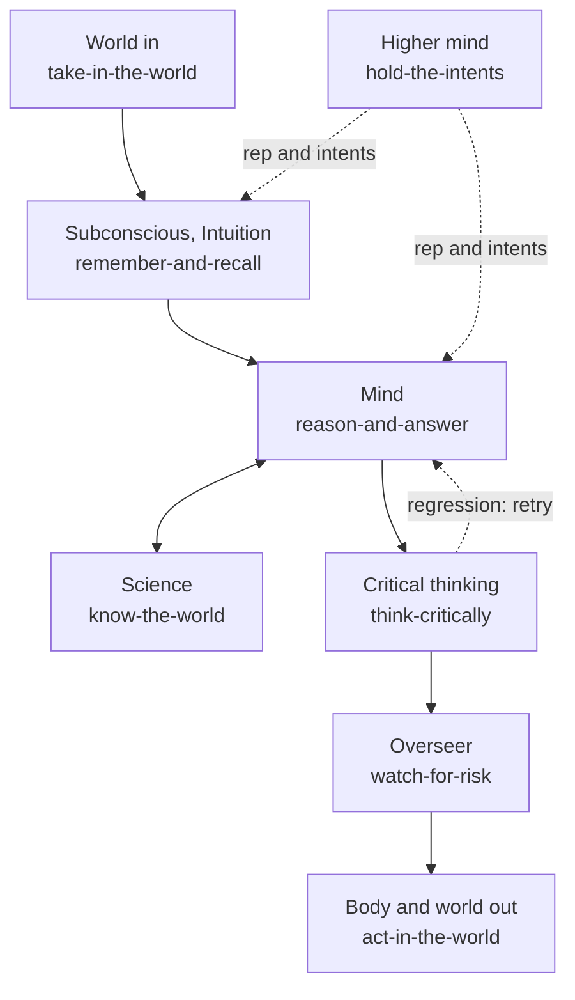

# ai-hub-of-hubs-structure

**The best of the best hubs for AI intelligence, assembled, evaluated and refreshed weekly. Production-proven in Quest AI Runner.**

A consumer that connects one hub gains everything the hub supports, with no code per integration. This repository holds the
seats of an AI mind, the registry of hubs that can fill them, the scorer that reads the registry with a consumer's code, and the
ESOI records that define them.

## Not a list

A list of hubs says what exists. This repository is an assembled, evaluated structure:

- **Seats.** One narrow interface per part of an AI mind (memory, models, tools, risk, and so on).
- **Arms.** Open-source hubs, combinations of them, or a plain fallback. Arms compete for a seat on the same cases.
- **Assembly.** Configuration in, working system out: the winning arms are wired together.
- **Selection by metric.** A seat holds the arm that measures best. Taste never picks.
- **Weekly refresh.** Every area is researched and compared again before its research is 90 days old.

## The idea, as a mind

A request enters from the world, the subconscious admits only what bears on the goal, and the mind works on it, asking
science for evidence. Critical thinking holds the result to its metric, the overseer checks the risk, and then the body
acts. The higher mind above it chooses whose long view grounds the work.



Hub code stays in its own project. This repository holds the seats, the registry, the scorer and the ESOI records.

## What is here

| Path | What it is |
|---|---|
| `esoi/` | the ESOI records: intent, problems, ideals, seats (solutions), implementations, metrics |
| `ai_hub_of_hubs/registry/` | the registry: areas and their hubs, researched candidates, each consumer's hub connections and hand-wired services |
| `ai_hub_of_hubs/` | the scorer: `Binding`, `evaluate`, the static vendor-branch scan, the case generator, the page renderer |
| `ai_hub_of_hubs/examples/` | a lane config with one aggregator connection and no per-app entry |
| `docs/` | [connect a hub](docs/connect-a-hub.md), [search API entries](docs/search-api-entries.md), [the weekly refresh](docs/refresh.md) |
| `scripts/status.py` | rewrites the table below from the registry |

## The registry

One row per area. The seat says which part of the mind the area serves. Candidates are researched with dated sources in
`hub_findings.csv`.

<!-- seats:start -->
| Area | Seat | Built on | Candidates | Researched |
|---|---|---|---|---|
| agent_harness | act-in-the-world | Claude Code CLI, Agent Client Protocol agents (claude-agent-acp) | OpenCode; Goose; OpenHands; Codex CLI | 2026-10-29 |
| tools_mcp | act-in-the-world | Model Context Protocol Python SDK | Official MCP Registry; PulseMCP subregistry; GitHub MCP directory | 2026-10-29 |
| web_search | know-the-world | SearXNG, Serper, Brave Search API, Tavily, Gemini Google Search grounding | Firecrawl; Crawl4AI; Exa; self-hosted SearXNG with MCP | 2026-10-29 |
| world | take-in-the-world | none | Activepieces; Pipedream; Composio; n8n | 2026-10-29 |
| context_assembly | remember-and-recall | bm25s, Qdrant and fastembed | Haystack; LlamaIndex; LightRAG | 2026-10-29 |
| science | know-the-world | none | OpenAlex API; Semantic Scholar API; PaperQA2; community scholarly MCP servers | 2026-10-29 |
| model_providers | reason-and-answer | none | LiteLLM; Portkey gateway; OpenRouter | 2026-10-29 |
| memory | remember-and-recall | none | Mem0; Letta; Graphiti; Cognee | 2026-10-29 |
| evals | stay-current | esoi (evolvable-structure Python tools) | Inspect AI; promptfoo; DeepEval; Ragas | 2026-10-29 |
| voice | take-in-the-world | none | Pipecat; LiveKit Agents; TEN Framework | 2026-10-29 |
<!-- seats:end -->

Regenerate with `python3 scripts/status.py` (rewritten in place, never appended).

## How a consumer uses it

Import it the way the ESOI library is imported: a sibling checkout on `PYTHONPATH`, or install it.

```bash
PYTHONPATH=../ai-hub-of-hubs-structure python3 -c "import ai_hub_of_hubs"      # sibling checkout
pip install -e ../ai-hub-of-hubs-structure                                     # or by path
pip install "ai-hub-of-hubs-structure @ git+https://github.com/SpiritualData/ai-hub-of-hubs-structure.git@main"
```

The consumer builds a `Binding` (its root, which of its solutions fill which area, its core folder, its ESOI records, and
one probe per area that registers a fake hub through the area's configuration entry) and calls `evaluate`. The result is
eight checks per area and a combined score. The hub never imports the consumer.

## Selection and refresh

Each seat holds the arm that measures best on its metric (`esoi select`). Each area is researched again every week, oldest
first, by the consumer's autopilot using [the refresh instruction](docs/refresh.md); research older than 90 days counts as stale.

## Quest AI Runner

[Quest AI Runner](https://github.com/SpiritualData/quest-ai-runner) (QAR) is the production consumer. It keeps what is
specific to Quest: its adapters, its bindings (which of its modules fills which area), its prompts and the grounding of
answers in a person's goals. Its `hub_of_hubs` component hands those bindings to this scorer and records the result.

## Records and checks

```bash
PYTHONPATH=../evolvable-structure/implementations/python python3 -m esoi check
python3 -m pytest tests/test_registry.py tests/test_status.py
```

## License

Apache-2.0, matching Quest AI Runner. See `LICENSE`.
