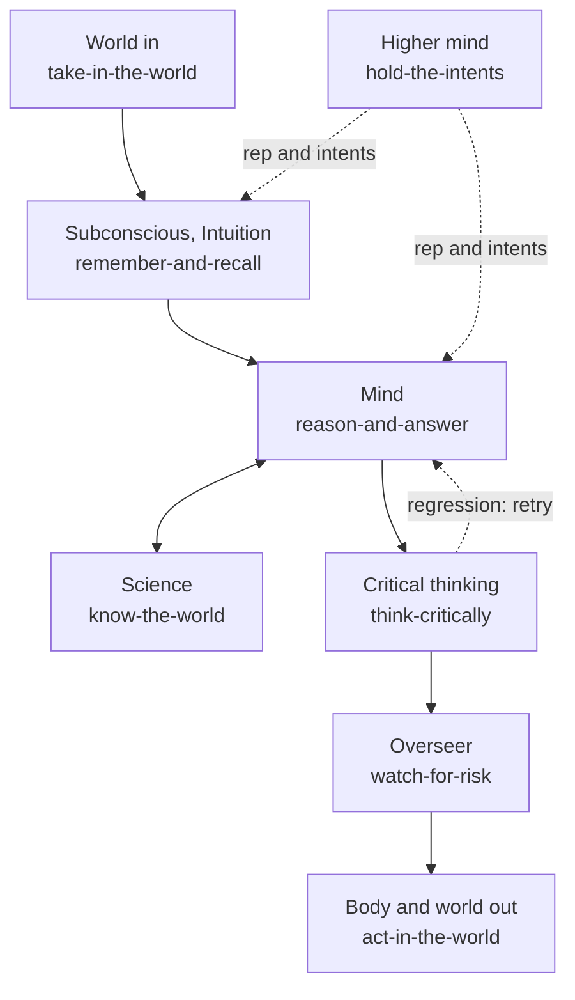
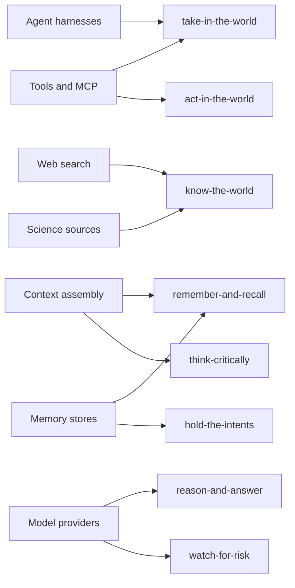

# ai-hub-of-hubs-structure

**The best of the best hubs for AI intelligence, assembled, evaluated and refreshed weekly. Production-proven in Quest AI Runner.**

Status: seed. The structure is specified as [ESOI](https://github.com/JoshuaMathias/evolvable-structure) records in
`esoi/`; the wording is a draft that the owner has not confirmed, and no seat has an arm yet.

## Not a list

A list of hubs says what exists. This repository is an assembled, evaluated structure:

- **Seats.** One narrow interface per part of an AI mind (memory, models, tools, risk, and so on).
- **Arms.** Open-source hubs, combinations of them, or a plain fallback. Arms compete for a seat on the same cases.
- **Assembly.** Configuration in, working system out: the winning arms are wired together for you.
- **Selection by metric.** A seat holds the arm that measures best. Taste never picks.
- **Weekly refresh.** Every seat is researched and compared again each week, so a pick that stops being best is replaced.

## The idea, as a mind

A request enters from the world, the subconscious admits only what bears on the goal, and the mind works on it, asking
science for evidence. Critical thinking holds the result to its metric, the overseer checks the risk, and then the body
acts. The higher mind above it chooses whose long view grounds the work.



Each seat is filled from hubs: ready-made tools, services and data sources. The hub code stays in its own project; this
repository holds the seats, the shared cases, thin adapters, the assembly, default prompts as editable data, and the
weekly refresh.



## Relation to Quest AI Runner

[Quest AI Runner](https://github.com/SpiritualData/quest-ai-runner) (QAR) is the production consumer. Its own intent
implements this one. It keeps what is specific to Quest: its prompts, its configuration and the grounding of answers in a
person's goals. It imports this repository for each seat. Nothing is moved out of QAR yet.

## Status

<!-- status:start -->
6 problems, 6 ideals, 11 seats, 11 draft metrics, 0 arms.

| Seat | Arms | Selected by metric |
|---|---|---|
| hold-the-intents | 0 | no arm yet |
| take-in-the-world | 0 | no arm yet |
| remember-and-recall | 0 | no arm yet |
| reason-and-answer | 0 | no arm yet |
| know-the-world | 0 | no arm yet |
| think-critically | 0 | no arm yet |
| act-in-the-world | 0 | no arm yet |
| watch-for-risk | 0 | no arm yet |
| assemble-the-whole | 0 | no arm yet |
| stay-current | 0 | no arm yet |
| keep-it-generic | 0 | no arm yet |
<!-- status:end -->

Regenerate with `python3 scripts/status.py` (rewritten in place between the markers, never grows). Test with
`python3 -m pytest tests/test_status.py`.

## Records and checks

The ESOI library is the shared standard both repositories import. With a checkout of it beside this one:

```bash
PYTHONPATH=../evolvable-structure/implementations/python python3 -m esoi check
```

Known remaining failure: `implementations.csv` has no records, because no arm exists yet. It clears when the first real
arm is recorded.

## License

Apache-2.0, matching Quest AI Runner. See `LICENSE`.
