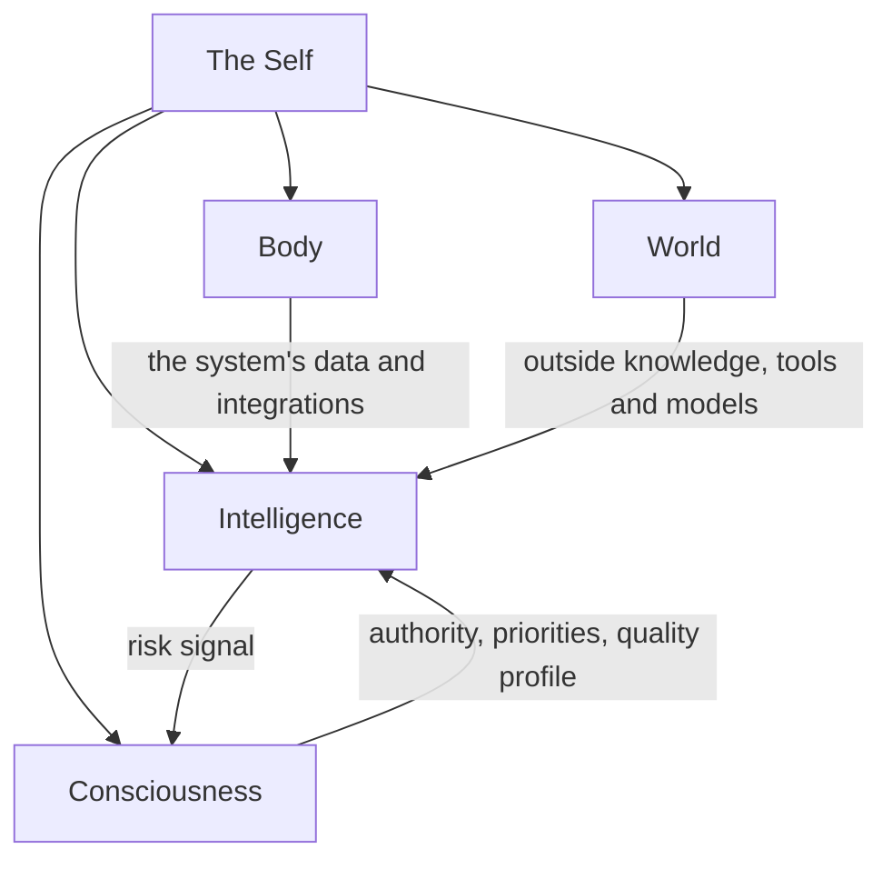

# AI Hub of Hubs Structure

**AI builders have consistent interfaces for whatever the current best AI solutions are, to adapt only what is unique to their project.**

**Every day, the structure identifies the latest AI tools, code and models, measures each one as an alternative for the job (solution) it could do, and automatically uses the alternative that job's metric picks: a newcomer takes over when it wins clearly on the cases that decide, and a near tie keeps the cheaper one.**

In plain words: an AI that helps people needs many jobs done well, such as understanding the request, finding the right information, searching the web, calling a model, editing files, deciding when to ask a person, and checking that the goal was met. For each job this project keeps several competing ways of doing it, tests them against the same cases, and uses the one the metric picks. When a better way wins clearly, it takes over and nothing you wrote has to change. Built for and used by [Quest AI Runner](https://github.com/SpiritualData/quest-ai-runner).

```bash
pip install "hubofhubs[web,gemini,bm25] @ git+https://github.com/SpiritualData/ai-hub-of-hubs-structure.git@v0.7.1"
```

```pycon
>>> import hubofhubs, pathlib
>>> records = pathlib.Path(hubofhubs.__file__).parent        # the hub's own records: the files Body declares as the system's data
>>> system = hubofhubs.assemble(options={"internal-context": {"root": str(records)}}, environ={})   # no key, no network
>>> result = system["the-self"].respond("Explain what Judgment Calls decides for a person")
>>> print("[file the_consciousness/judgment_calls/README.md]" in result.answer)   # the answer is built from the files the retriever picked
True
```

That request ran the whole flow offline. Consciousness represented the person, Body declared its source, the Subconscious read it through Internal Context, the Context Retriever picked the files that bear on the request, the Mind planned and wrote from them, Critical Thinking checked the result, and the run was kept in Body's run store. `result.steps` lists what each part did. The defaults are chosen by recorded evals, and a lockfile pins them; when a better implementation wins, the selection changes and every caller written like this stays the same.

Next:
1. Call any id the same way, `hubofhubs.run("card-store", "rust release")`; compare with other frameworks in [compared](docs/explanation/compared.md). `hubofhubs.needs("hub-of-hubs")` lists what your setup lacks, and `result.steps` of the whole hub lists what every part did.
2. Override only what differs: `arms={"web-search": "serper"}`, `options={...}` or `provided={"card-store": obj}`; pin the defaults with `lock="esoi.lock.json"`, made by `esoi lock`.

A question that needs the live web (for example `what is the latest Rust version?`) uses the web-search part, which needs a free Gemini key (`GEMINI_API_KEY`, from https://aistudio.google.com/apikey); the default context retriever needs only the standard library. A call that cannot run yet raises `esoi.Pending` naming the exact key, install or network access (every arm that reaches a service declares `network(...)`, so an offline run, with `ESOI_OFFLINE=1`, is pending instead of attempting the call).

## Why use it

You do not choose a framework, a model or a search service and then keep rewiring when something better appears. You ask for a job by its id, and the hub runs whichever alternative that job's metric currently picks on its own cases. When a new tool is measured and wins clearly, the selection changes and your code stays the same. Nothing is chosen on reputation: every row below is a recorded run.

<!-- counts:start -->
**66 solutions** in the full hierarchy, with **171 alternative implementations** and **94 metrics**; 65 of the solutions have an implementation selected, and where rivals have been measured the selection follows the metric.
<!-- counts:end -->

### Alternatives compared where people ask most

Each table ranks the alternatives of one area on their latest recorded run, best first. The in-use marker follows each area's deciding stage, which can lag the newest runs. These are the hub's own measurements on the cases named in each area's page, not public leaderboards; small case counts mean close rows are not proven different. Every other area is on the [leaderboard](docs/reference/leaderboard.md) and in [what is measured today](docs/reference/status.md).

<!-- compared:start -->
#### AI harnesses

The loop that carries out a long task: Claude Code, opencode, the hub's own loops. Score: Hard tasks finished, with their cost and time in the score.

| # | Alternative | Model | Result | Cost per case | In use |
|---|---|---|---|---|---|
| 1 | Claude Code, steerable session (provider=anthropic, tier=fast) | claude-haiku-5-5 | score 1.00, 9 of 9 cases | $0.0086 |  |
| 2 | opencode in the hub's wrapper (provider=anthropic, tier=fast) | claude-haiku-5-5 | score 0.89, 8 of 9 cases | $0.0072 |  |
| 3 | opencode, one shot (provider=anthropic, tier=fast) | claude-haiku-5-5 | score 0.89, 8 of 9 cases | $0.0081 |  |
| 4 | Hub's frame on the model's own tool loop (provider=anthropic, tier=fast) | claude-haiku-5-5 | score 0.89, 8 of 9 cases | $0.0075 | selected |

7 compared on the same 9 cases; latest run 2026-11-11.

In use: Hub's frame on the model's own tool loop (provider=anthropic, tier=fast). On the 27 pooled cases that decide it, the leader passed 25 and this one 24, a gap that is not significant, and this one costs less per case, so it stays until a rival wins clearly.

#### Terminal UIs

The screen a person works in: how a session is drawn and steered. Score: Scripted terminal sessions drawn and steered right, then how readable the screen is.

| # | Alternative | Result | Cost per case | In use |
|---|---|---|---|---|
| 1 | opencode client session (the stock opencode terminal draws the hub over its own HTTP API) | score 0.96, 5 of 6 cases | free | selected |
| 2 | ACP client session (an existing agent terminal draws the hub) | score 0.92, 5 of 6 cases | free |  |
| 3 | Live session (reference terminal) | score 0.89, 5 of 6 cases | free |  |

6 compared on the same 6 cases; latest run 2026-11-12.

#### Context management: finding the right files

The Subconscious picks what a request needs from the files, cards and memory. Score: The needed text is among what is shown within a token budget, with little noise.

| # | Alternative | Result | Cost per case | In use |
|---|---|---|---|---|
| 1 | BM25 over chunk text | score 0.66, 203 of 395 cases | free | selected |
| 2 | BM25F over path, title and body | score 0.63, 187 of 395 cases | free |  |
| 3 | BM25F and dense by rank fusion | score 0.60, 169 of 395 cases | free |  |

16 compared on the same 395 cases; latest run 2026-11-04.

#### Context management: cards built from files

The cards that let the Subconscious recall a folder. Score: The file a task needs is among the first three a builder's cards show.

| # | Alternative | Result | Cost per case | In use |
|---|---|---|---|---|
| 1 | Import graph topic cards | score 0.61, 112 of 252 cases | free | selected |
| 2 | Cochange topic cards | score 0.58, 102 of 252 cases | free |  |
| 3 | Topic cards replay | score 0.42, 42 of 252 cases | free |  |

9 compared on the same 252 cases; latest run 2026-11-04.

#### Models for the tiers: the fast tier

Which model does the fast roles (classification, choosing files) as well as the tier above. Score: The pooled cases of the fast roles, with cost in the score.

| # | Alternative | Model | Result | Cost per case | In use |
|---|---|---|---|---|---|
| 1 | `tier_arm` (candidate=3, tier=fast) | gpt-6-luna | 96%, 108 of 112 cases | $0.0001 |  |
| 2 | `tier_arm` (tier=fast) | claude-haiku-5-5 | 96%, 108 of 112 cases | $0.0004 |  |
| 3 | `tier_arm` (tier=balanced) | claude-sonnet-5-5 | 96%, 107 of 112 cases | $0.0061 |  |

5 compared on the same 112 cases; latest run 2026-11-10.

In use: none of these rows directly; Model Tier Chooser picks among them by its own metric, and these rows are the hub's own check of the candidates.

#### Models for the tiers: hard reasoning

How current models do exact-answer competition maths, one prompt for all. Score: Problems with the right final answer.

| # | Alternative | Model | Result | Cost per case | In use |
|---|---|---|---|---|---|
| 1 | `claude_haiku` | claude-haiku-5-5 | 100%, 30 of 30 cases | - |  |
| 2 | `claude_opus` | claude-opus-5-5 | 97%, 29 of 30 cases | - |  |
| 3 | `deepseek_flash` | deepseek-flash | 93%, 28 of 30 cases | $0.0072 |  |

8 compared on the same 30 cases; latest run 2026-10-31.

In use: none of these rows directly; Model Tier Chooser picks among them by its own metric, and these rows are the hub's own check of the candidates.
<!-- compared:end -->

## The hub as a mind

The hub is drawn as a mind so you can follow one request through it. Five containers hold the parts. Each is named for the kind of change that moves its scores:

- **The Self** keeps all the parts working as one honest whole.
- **Body** is the particular system the AI lives in: where its data is, where its requests come from, which integrations it already depends on.
- **Intelligence** works out what success means, finds information, plans, writes and checks, keeps a longer view across requests, and starts standing work when it is due.
- **World** is everything outside the system: models, web search, science, tools. Its scores change when the outside changes.
- **Consciousness** is the people the AI works for: who it acts as, when it asks them, what it learns from them.

A request flows from Consciousness (who is asking, with what authority) to Intelligence (understand, plan, act, check), drawing data from Body and tools from World.



### What each part is for

**The Self**
- **Integrity**: what the system says about itself and what it did matches the record.
- **Role Understanding**: every part has a role in the whole that people and the Assembler can read.
- **Assembler**: builds the whole from the best-scoring option for every part, with no glue code from you.

**Body**
- **Internal Context**: tells the AI what your system knows: where its data lives, whose it is, the configuration and secrets its tools need, and the record of each run.
- **Intake Sources**: where your requests come from (chat, queued tasks, meeting transcripts).
- **Hands**: makes the integrations your system already depends on usable by the AI.
- **Card Store**: keeps short cards of knowledge and finds them again.

**Intelligence**
- **Mind**: turns one request into a plan and a response. Its parts are Context Intake (one view of what is known), Planner (splits the request and replans from what failed), Delegation (hands work on with its authority, budget and done-standard), and Response Writer.
- **Higher Mind**: keeps the AI working toward what matters beyond the request in front of it: Long-Term Memory, Objectives and Guidance.
- **Subconscious**: finds and prepares the information a request needs, without crossing into another person's data: Context Retriever, Cards From Files and Intuition (useful things that surface unasked).
- **Critical Thinking**: says what success means and checks it was reached: Metric Translation, Goal Completion, Response Quality and ESOI Application (keeps the system's own specs and scores improving).
- **Nervous System**: one risk signal before steps that cannot be undone or that belong to a person.
- **Proactivity**: starts standing work when it is due, without being asked: by calendar period in the person's own time zone, a requested run, an event or elapsed time. With Prioritization it is the foundation of an autopilot ([build one](docs/how-to/build-an-autopilot-on-the-hub.md)).

**World**
- **Tools**: the best tool of each kind (web search, reading and editing files, connected systems, agent sessions) without wiring each one.
- **Model Plumbing**: one measured path to a model, so cost and failover are chosen once.
- **Science**: public science a reader can check.
- **Learning**: keeps what the hub recommends current with the outside.

**Consciousness**
- **Representatives**: an AI acts for a person within the authority that person gave.
- **Judgment Calls**: asks a person only when they would want to be asked, and decides how.
- **Feedback Learning**: a correction given once changes behaviour afterwards.
- **Prioritization**: turns the priorities a person states or implies into scores the system can optimize, and orders three things for them with a reason for each place: the work the AI starts unasked, the asks it puts to the person (what they unblock first, no more at once than a batch limit) and the person's goals (the milestones of their solutions).
- **Request Intake**: takes in each request once, from wherever the system listens.

Every part is reached by its id, such as `hubofhubs.run("card-store", "rust")`. The full table of parts, with their research, is on [the mind map](docs/explanation/the-mind-map.md).

## Every id the same way

```pycon
>>> import hubofhubs
>>> from hubofhubs.api import CardStore, Card
>>> store = hubofhubs.run(CardStore)          # the typed, ready handle
>>> store.add(Card("rust-1-91", "Rust 1.91 was released on 2025-10-30."))
'rust-1-91'
>>> hubofhubs.run("card-store", "rust", provided={"card-store": store})
[Card(id='rust-1-91', text='Rust 1.91 was released on 2025-10-30.', source='', tags=())]
```

Each id is reached through a declared interface. The call builds the implementation its metric selected and passes your input to it.
Ids are listed in [esoi/README.md](esoi/README.md); [tutorial](docs/tutorials/assemble-and-run-your-first-seat.md).

## The front door

Import from one place. Every part is reached by `hubofhubs.run("<id>", ...)` or by its typed handle `hubofhubs.run(Interface)`, and every interface, result type and helper you may need is a name in `hubofhubs.api` (`from hubofhubs.api import CardStore, Card, DeepRunner`). Never import a path inside the hub, such as `hubofhubs.the_world.tools.deep`: parts move as the hub improves, and a name in `hubofhubs.api` keeps working because only its entry in that file changes. `hubofhubs.api.__all__` lists every public name.

## In a terminal

```
ahohs                                    # a prompt: type a goal, watch it work, type a follow-up to continue the session
ahohs work "add a changelog entry"       # run a goal in this folder
ahohs work --resume SESSION --harness stream          # continue a session an earlier run named
ahohs work --harness native --tier balanced "..."     # choose the harness (native, stream, loop) and the tier
ahohs work --max-spend 5 --max-time 30m "..."         # ceilings (or unlimited); a soft limit wraps the run up, a hard limit stops it resumably
ahohs chat                               # talk to the whole hub line by line
```

Keys while it works: Esc stops and keeps the session, a typed line steers, Tab shows the structure tree (Up, Down, Right and Left move through it and open a solution), `?` lists the keys. A consumer binds `hubofhubs.api.WorkTerminal` to its own harnesses and commands: [talk to the hub in a terminal](docs/how-to/talk-to-the-hub-in-a-terminal.md).

## What is measured

Each implementation is scored on the cases of its own solution, and the one that wins on those cases is selected; when the leader's margin is not significant, the cheaper one stays. The recorded numbers, which parts have no run yet and the leaderboard of every alternative are on [what is measured today](docs/reference/status.md) and in [how we measure](docs/explanation/how-we-measure.md).

## For a consumer

Install, register a part you own and score your integration: [register a second consumer](docs/how-to/register-a-second-consumer.md).
To use the hub's solutions as your application's own jobs, adopt them by reference, specialize the ones that need your data and add your own arms: [adopt the hub](docs/how-to/adopt-the-hub.md).
To add an implementation, see [CONTRIBUTING.md](CONTRIBUTING.md). All documentation: [docs/README.md](docs/README.md). Apache-2.0 (`LICENSE`).
