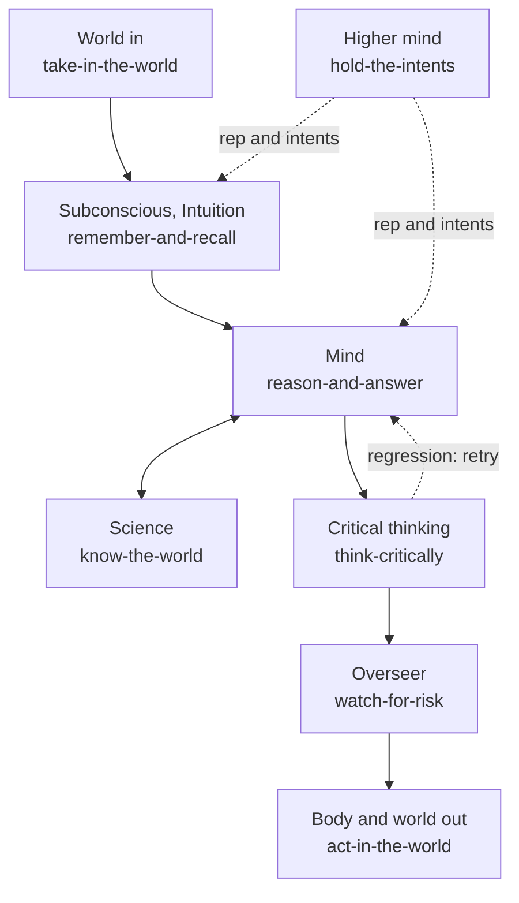

# ai-hub-of-hubs-structure

**The best of the best hubs for AI intelligence, assembled, evaluated and refreshed weekly. Production-proven in Quest AI Runner.**

A consumer that connects one hub gains everything the hub supports, with no code per integration. This repository holds the
seats of an AI mind, the registry of hubs that can fill them, the scorer that reads the registry with a consumer's code, and the
ESOI records that define them.

## Not a list

A list of hubs says what exists. This repository is an assembled, evaluated structure:

- **Seats.** One narrow interface per part of an AI mind (memory, models, tools, risk, and so on).
- **Arms.** Open-source hubs, combinations of them, or a plain fallback. Arms compete for a seat on the same cases.
- **Assembly.** Configuration in, working system out: the winning arms are wired together.
- **Selection by metric.** A seat holds the arm that measures best. Taste never picks.
- **Weekly refresh.** Every area is researched and compared again before its research is 90 days old.

## The idea, as a mind

A request enters from the world, the subconscious admits only what bears on the goal, and the mind works on it, asking
science for evidence. Critical thinking holds the result to its metric, the overseer checks the risk, and then the body
acts. The higher mind above it chooses whose long view grounds the work.



This repository holds the seats, the registry, the scorer, the ESOI records and the code that wires arms into seats. Its core is the standard library plus `esoi`; each arm's third-party library is a per-library extra ([resolution design](docs/resolution-design.md)).

## What is here

| Path | What it is |
|---|---|
| `esoi/` | the ESOI records: intent, problems, ideals, seats (solutions), implementations, metrics |
| `hubofhubs/registry/` | the registry: areas and their hubs, researched candidates, each consumer's hub connections and hand-wired services |
| `hubofhubs/` | the scorer (`Binding`, `evaluate`, the vendor-branch scan, the case generator, the page renderer) and the assembly: `seats.py` (Protocols), `resolution.py` (the hub's one `esoi.assemble.Assembler` and its public names; the assembly itself is the library's), `cardstore.py` (the default card store) |
| `hubofhubs/examples/` | a lane config with one aggregator connection and no per-app entry |
| `hubofhubs/tiers.py` | per-tier model selection by passing work per cost, credits counted as cost ([how](docs/tier-selection.md)) |
| `docs/` | [quickstart](docs/quickstart.md), [connect a hub](docs/connect-a-hub.md), [search API entries](docs/search-api-entries.md), [the weekly refresh](docs/refresh.md) |
| `scripts/status.py` | rewrites the seat table below and `docs/registry.md` from the registry |
| `scripts/sync_uses.py` | checks (or writes) `uses_solution_ids` from typed constructor parameters, and the dependency graph |

## The registry

A broad seat is broken into sub-solution areas, each compared on its own metric. The table counts areas per seat;
[docs/registry.md](docs/registry.md) lists every area with its candidates, and `hub_findings.csv` holds each candidate with a
dated source.

<!-- seats:start -->
| Seat | Part of the mind | Areas | Built on now | Candidates researched | Oldest research |
|---|---|---|---|---|---|
| hold-the-intents | Higher mind | 1 | 0 | 10 | 2026-10-30 |
| take-in-the-world | World | 7 | 1 | 36 | 2026-10-30 |
| remember-and-recall | Subconscious, Intuition | 10 | 8 | 66 | 2026-10-30 |
| reason-and-answer | Mind | 6 | 1 | 39 | 2026-10-30 |
| know-the-world | Science | 10 | 2 | 71 | 2026-10-30 |
| think-critically | Critical thinking | 4 | 4 | 18 | 2026-10-30 |
| act-in-the-world | Body | 20 | 5 | 133 | 2026-10-30 |
| watch-for-risk | Overseer | 5 | 5 | 28 | 2026-10-30 |
| assemble-the-whole | The whole being | 3 | 1 | 6 | 2026-10-30 |
| stay-current | Learning | 3 | 2 | 17 | 2026-10-30 |
| keep-it-generic | Character | 3 | 2 | 12 | 2026-10-30 |
| connect-any-integration | Hands | 0 | 0 | 0 | none |

72 areas and 436 researched candidates in all; every area is listed in [docs/registry.md](docs/registry.md).
<!-- seats:end -->

Regenerate both with `python3 scripts/status.py` (rewritten in place, never appended).

## How a consumer uses it

Import it the way the ESOI library is imported: a sibling checkout on `PYTHONPATH`, or install it.

```bash
PYTHONPATH=../ai-hub-of-hubs-structure python3 -c "import hubofhubs"      # sibling checkout
pip install -e ../ai-hub-of-hubs-structure                                     # or by path
pip install "hubofhubs @ git+https://github.com/SpiritualData/ai-hub-of-hubs-structure.git@main"
```

The consumer builds a `Binding` (its root, which of its solutions fill which area, its core folder, its ESOI records, and
one probe per area that registers a fake hub through the area's configuration entry) and calls `evaluate`. The result is
eight checks per area (an area the consumer does not bind counts as not yet connected) and a combined score. The hub never imports the consumer.

To use the parts themselves, a consumer registers any part it owns under its own name (`hubofhubs.register`), builds a
`AssemblyConfig` and calls `hubofhubs.assemble(config, provided={...})` ([quickstart](docs/quickstart.md)). The hub reads no
environment: settings are `AssemblyConfig` fields, and a name is never an import path.

## Selection and refresh

Each seat holds the arm that measures best on its metric (`esoi select`). Each area is researched again every week, oldest
first, by the consumer's autopilot using [the refresh instruction](docs/refresh.md); research older than 90 days counts as stale.

## Quest AI Runner

[Quest AI Runner](https://github.com/SpiritualData/quest-ai-runner) (QAR) is the production consumer. It keeps what is
specific to Quest: its adapters, its bindings (which of its modules fills which area), its prompts and the grounding of
answers in a person's goals. Its `hub_of_hubs` component hands those bindings to this scorer and records the result.

## Records and checks

The commands that check the records, the registry and the import boundary are in [CLAUDE.md](CLAUDE.md#checks).

## License

Apache-2.0, matching Quest AI Runner. See `LICENSE`.
