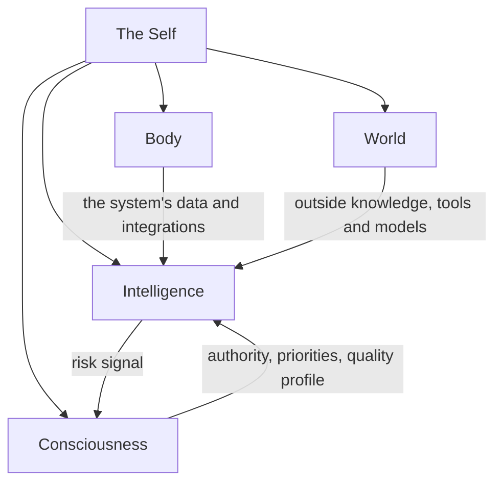

# AI Hub of Hubs Structure

**Anyone building AI intelligence can assemble a working system from the best open-source parts available, chosen by measurement and kept current every week, without writing the glue themselves.**

In plain words: an AI that helps people needs many jobs done well, such as understanding the request, finding the right information, searching the web, calling a model, editing files, deciding when to ask a person, and checking that the goal was met. For each job this project keeps several competing ways of doing it, tests them against the same cases, and uses the one that scores best. When a better way appears, it takes over and nothing you wrote has to change. Built for and used by [Quest AI Runner](https://github.com/SpiritualData/quest-ai-runner).

```bash
pip install "hubofhubs[web,gemini,bm25] @ git+https://github.com/SpiritualData/ai-hub-of-hubs-structure.git@v0.2.0"
```

```pycon
>>> import hubofhubs
>>> print(hubofhubs.run("hub-of-hubs", "what is the latest Rust release?"))   # the whole hub; with GEMINI_API_KEY set
The latest stable release of Rust is version 1.99.1
```

The defaults are chosen by recorded evals, and a lockfile pins them. When a better implementation wins, the selection changes and every
caller written like this stays the same. The live answer (run on 2026-11-03, about 10 seconds, one free search call) cites its sources (https://blog.rust-lang.org/releases/latest/ and https://releases.rs/).

Next:
1. Call any id the same way, `hubofhubs.run("card-store", "rust release")`; compare with other frameworks in [compared](docs/explanation/compared.md). `hubofhubs.needs("hub-of-hubs")` lists what your setup lacks, and `result.steps` of the whole hub says `no arm yet` for each part that has none.
2. Override only what differs: `arms={"web-search": "serper"}`, `options={...}` or `provided={"card-store": obj}`; pin the defaults with `lock="esoi.lock.json"`, made by `esoi lock`.

The whole hub needs a free Gemini key (`GEMINI_API_KEY`, from https://aistudio.google.com/apikey) and the `bm25` extra named in the install line, which the default context retriever uses. A call that cannot run yet raises `esoi.entry.Pending` naming the exact key, install or network access (every arm that reaches a service declares `network(...)`, so an offline run, with `ESOI_OFFLINE=1`, is pending instead of attempting the call).

## The hub as a mind

The hub is drawn as a mind so you can follow one request through it. Five containers hold the parts. Each is named for the kind of change that moves its scores:

- **The Self** keeps all the parts working as one honest whole.
- **Body** is the particular system the AI lives in: where its data is, where its requests come from, which tools it may use.
- **Intelligence** turns a request into a response: it works out what success means, finds information, plans, writes, and checks.
- **World** is everything outside the system: models, web search, science, tools. Its scores change when the outside changes.
- **Consciousness** is the people the AI works for: who it acts as, when it asks them, what it learns from them.

A request flows from Consciousness (who is asking, with what authority) to Intelligence (understand, plan, act, check), drawing data from Body and tools from World. A part with no implementation yet says so in the result instead of inventing one.



### What each part is for

**The Self**
- **Integrity**: what the system says about itself and what it did matches the record.
- **Role Understanding**: every part has a role in the whole that people and the Assembler can read.
- **Assembler**: builds the whole from the best-scoring option for every part, with no glue code from you.

**Body**
- **Internal Context**: tells the AI what your system knows: where its data lives, whose it is, the configuration and secrets its tools need, and the record of each run.
- **Intake Sources**: where your requests come from (chat, queued tasks, meeting transcripts).
- **Hands**: makes the integrations your system already depends on usable by the AI.
- **Card Store**: keeps short cards of knowledge and finds them again.

**Intelligence**
- **Mind**: turns one request into a plan and a response. Its parts are Context Intake (one view of what is known), Planner (splits the request and replans from what failed), Delegation (hands work on with its authority, budget and done-standard), and Response Writer.
- **Higher Mind**: keeps the AI working toward what matters beyond the request in front of it: Long-Term Memory, Objectives and Guidance.
- **Subconscious**: finds and prepares the information a request needs, without crossing into another person's data: Context Retriever, Cards From Files and Intuition (useful things that surface unasked).
- **Critical Thinking**: says what success means and checks it was reached: Metric Translation, Goal Completion, Response Quality and ESOI Application (keeps the system's own specs and scores improving).
- **Nervous System**: one risk signal before steps that cannot be undone or that belong to a person.
- **Proactivity**: starts standing work when it is due, without being asked.

**World**
- **Tools**: the best tool of each kind (web search, reading and editing files, connected systems, agent sessions) without wiring each one.
- **Model Plumbing**: one measured path to a model, so cost and failover are chosen once.
- **Science**: public science a reader can check.
- **Learning**: keeps what the hub recommends current with the outside.

**Consciousness**
- **Representatives**: an AI acts for a person within the authority that person gave.
- **Judgment Calls**: asks a person only when they would want to be asked, and decides how.
- **Feedback Learning**: a correction given once changes behaviour afterwards.
- **Prioritization**: turns the priorities a person implies into scores the system can optimize.
- **Request Intake**: takes in each request once, from wherever the system listens.

Every part is reached by its id, such as `hubofhubs.run("card-store", "rust")`. The full table of parts, with their research, is on [the mind map](docs/explanation/the-mind-map.md).

## Every id the same way

```pycon
>>> import hubofhubs
>>> from hubofhubs.seats import CardStore
>>> from hubofhubs.the_body.internal_context.card_store.card import Card
>>> store = hubofhubs.run(CardStore)          # the typed, ready handle
>>> store.add(Card("rust-1-91", "Rust 1.91 was released on 2025-10-30."))
'rust-1-91'
>>> hubofhubs.run("card-store", "rust", provided={"card-store": store})
[Card(id='rust-1-91', text='Rust 1.91 was released on 2025-10-30.', source='', tags=())]
```

Each id is reached through a declared interface. The call builds the implementation its metric selected and passes your input to it.
Ids are listed in [esoi/README.md](esoi/README.md); [tutorial](docs/tutorials/assemble-and-run-your-first-seat.md).

## What is measured

Every implementation is scored on cases written for its job, and the highest score on all cases is selected. The recorded numbers, which parts have no run yet and the leaderboard of every alternative are on [what is measured today](docs/reference/status.md) and in [how we measure](docs/explanation/how-we-measure.md).

## For a consumer

Install, register a part you own and score your integration: [register a second consumer](docs/how-to/register-a-second-consumer.md).
To add an implementation, see [CONTRIBUTING.md](CONTRIBUTING.md). All documentation: [docs/README.md](docs/README.md). Apache-2.0, matching Quest AI Runner (`LICENSE`).
