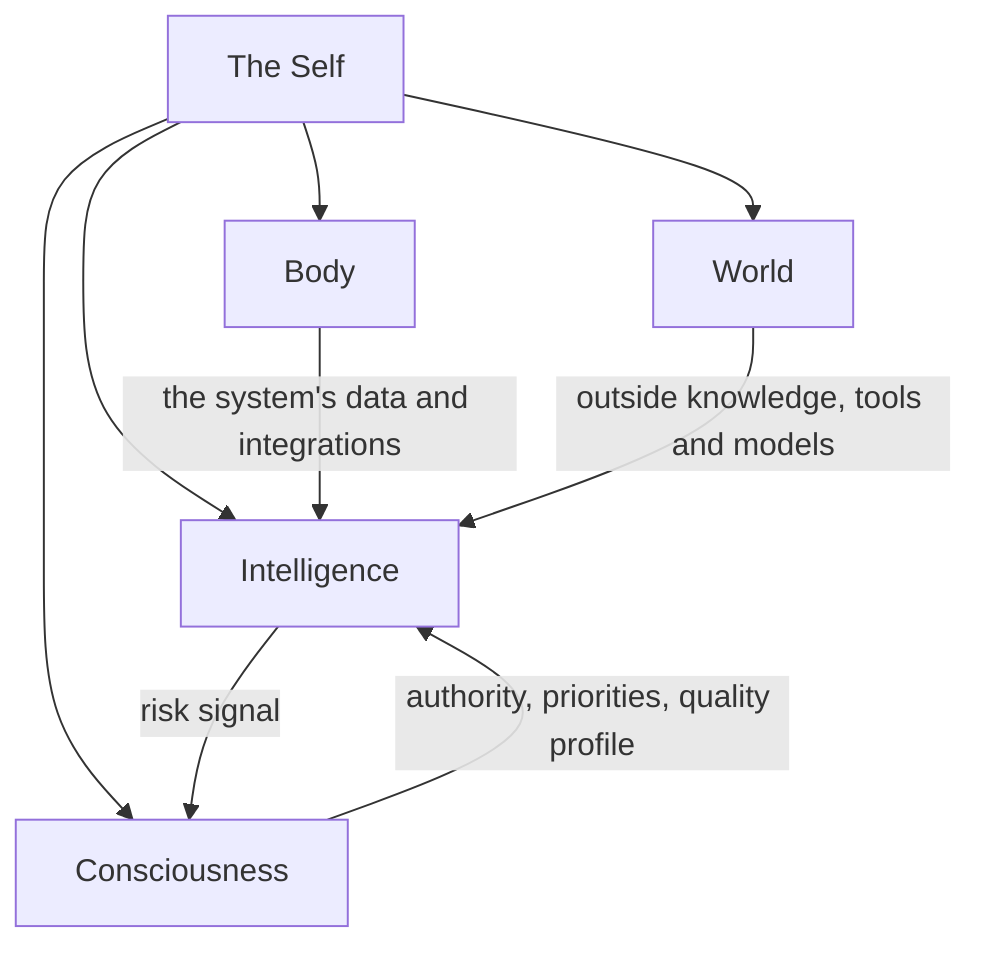

# AI Hub of Hubs Structure

**Anyone building AI intelligence can assemble a working system from the best open-source parts available, chosen by measurement and kept current every week, without writing the glue themselves.**

In plain words: an AI that helps people needs many jobs done well, such as understanding the request, finding the right information, searching the web, calling a model, editing files, deciding when to ask a person, and checking that the goal was met. For each job this project keeps several competing ways of doing it, tests them against the same cases, and uses the one that scores best. When a better way appears, it takes over and nothing you wrote has to change. Built for and used by [Quest AI Runner](https://github.com/SpiritualData/quest-ai-runner).

```bash
pip install "hubofhubs[web,gemini,bm25] @ git+https://github.com/SpiritualData/ai-hub-of-hubs-structure.git@v0.2.0"
```

```pycon
>>> import hubofhubs
>>> print(hubofhubs.run("hub-of-hubs", "what is the latest Rust release?"))   # the whole hub; with GEMINI_API_KEY set
The latest stable release of Rust is version 1.99.1
```

The defaults are chosen by recorded evals, and a lockfile pins them. When a better implementation wins, the selection changes and every
caller written like this stays the same. The live answer (run on 2026-11-03, about 10 seconds, one free search call) cites its sources (https://blog.rust-lang.org/releases/latest/ and https://releases.rs/).

Next:
1. Call any id the same way, `hubofhubs.run("card-store", "rust release")`; compare with other frameworks in [compared](docs/explanation/compared.md). `hubofhubs.needs("hub-of-hubs")` lists what your setup lacks, and `result.steps` of the whole hub says `no arm yet` for each part that has none.
2. Override only what differs: `arms={"web-search": "serper"}`, `options={...}` or `provided={"card-store": obj}`; pin the defaults with `lock="esoi.lock.json"`, made by `esoi lock`.

The whole hub needs a free Gemini key (`GEMINI_API_KEY`, from https://aistudio.google.com/apikey) and the `bm25` extra named in the install line, which the default context retriever uses. A call that cannot run yet raises `esoi.entry.Pending` naming the exact key, install or network access (every arm that reaches a service declares `network(...)`, so an offline run, with `ESOI_OFFLINE=1`, is pending instead of attempting the call).

## The hub as a mind

The hub is drawn as a mind so you can follow one request through it. Five containers hold the parts. Each is named for the kind of change that moves its scores:

- **The Self** keeps all the parts working as one honest whole.
- **Body** is the particular system the AI lives in: where its data is, where its requests come from, which tools it may use.
- **Intelligence** turns a request into a response: it works out what success means, finds information, plans, writes, and checks.
- **World** is everything outside the system: models, web search, science, tools. Its scores change when the outside changes.
- **Consciousness** is the people the AI works for: who it acts as, when it asks them, what it learns from them.

A request flows from Consciousness (who is asking, with what authority) to Intelligence (understand, plan, act, check), drawing data from Body and tools from World. A part with no implementation yet says so in the result instead of inventing one.



<!-- containers:start -->
| Container | What it evolves | Parts | Call with |
|---|---|---|---|
| The Self | The integration, coherence and role understanding of all the parts. | Integrity, Role Understanding, Assembler | `the-self` |
| Body | The AI system's form and its internal context. | Internal Context, Intake Sources, Hands | `the-body` |
| Intelligence | How information is processed for one request. | Mind, Higher Mind, Subconscious, Critical Thinking, Nervous System, Proactivity | `the-intelligence` |
| World | Awareness of the outside and interaction with it. | Science, Tools, Model Plumbing, Learning | `the-world` |
| Consciousness | The humans who interact with the system. | Representatives, Judgment Calls, Feedback Learning, Human Prioritization, Request Intake | `the-consciousness` |
<!-- containers:end -->

### What each part is for

**The Self**
- **Integrity**: what the system says about itself and what it did matches the record.
- **Role Understanding**: every part has a role in the whole that people and the Assembler can read.
- **Assembler**: builds the whole from the best-scoring option for every part, with no glue code from you.

**Body**
- **Internal Context**: tells the AI what your system knows: where its data lives, whose it is, the configuration and secrets its tools need, and the record of each run.
- **Intake Sources**: where your requests come from (chat, queued tasks, meeting transcripts).
- **Hands**: makes the integrations your system already depends on usable by the AI.
- **Card Store**: keeps short cards of knowledge and finds them again.

**Intelligence**
- **Mind**: turns one request into a plan and a response. Its parts are Context Intake (one view of what is known), Request Planner (splits the request and replans from what failed), Work Delegation (hands work on with its authority, budget and done-standard), and Response Writer.
- **Higher Mind**: keeps the AI working toward what matters beyond the request in front of it: Long-Term Memory, Objectives and Planner Guidance.
- **Subconscious**: finds and prepares the information a request needs, without crossing into another person's data: Context Retriever, Cards From Files and Intuition (useful things that surface unasked).
- **Critical Thinking**: says what success means and checks it was reached: Metric Translation, Goal Completion, Response Quality and ESOI Application (keeps the system's own specs and scores improving).
- **Nervous System**: one risk signal before steps that cannot be undone or that belong to a person.
- **Proactivity**: starts standing work when it is due, without being asked.

**World**
- **Tools**: the best tool of each kind (web search, reading and editing files, connected systems, agent sessions) without wiring each one.
- **Model Plumbing**: one measured path to a model, so cost and failover are chosen once.
- **Science**: public science a reader can check.
- **Learning**: keeps what the hub recommends current with the outside.

**Consciousness**
- **Representatives**: an AI acts for a person within the authority that person gave.
- **Judgment Calls**: asks a person only when they would want to be asked, and decides how.
- **Feedback Learning**: a correction given once changes behaviour afterwards.
- **Human Prioritization**: turns the priorities a person implies into scores the system can optimize.
- **Request Intake**: takes in each request once, from wherever the system listens.

Every part is reached by its id, such as `hubofhubs.run("card-store", "rust")`. The full table of parts, with their research, is on [the mind map](docs/explanation/the-mind-map.md).

## Every id the same way

```pycon
>>> import hubofhubs
>>> from hubofhubs.seats import CardStore
>>> from hubofhubs.card import Card
>>> store = hubofhubs.run(CardStore)          # the typed, ready handle
>>> store.add(Card("rust-1-91", "Rust 1.91 was released on 2025-10-30."))
'rust-1-91'
>>> hubofhubs.run("card-store", "rust", provided={"card-store": store})
[Card(id='rust-1-91', text='Rust 1.91 was released on 2025-10-30.', source='', tags=())]
```

Each id is reached through a declared interface. The call builds the implementation its metric selected and passes your input to it.
Ids are listed in [esoi/README.md](esoi/README.md); [tutorial](docs/tutorials/assemble-and-run-your-first-seat.md).

<!-- headline:start -->
**66 alternatives measured across 13 areas, from 456 researched candidates.**

| Area | Alternatives measured | Which |
|---|---|---|
| RAG retrieval | 16 | `abstaining_affinity`, `abstaining_aware`, `abstaining_fenced`, `abstaining_hybrid`, `abstaining_learned`, `abstaining_recency`, `bm25_body`, `bm25_fielded`, `bm25_whole_files`, `dense_bge_small`, `feature_rerank`, `feature_rerank_no_priors`, `hybrid_rrf`, `learned_rerank`, `live_scan`, `lsi` |
| LLM routing and failover | 2 | `multi_provider`, `single_provider` |
| LLMs (model quality and cost) | 13 | `claude_cli`, `claude_haiku`, `claude_opus`, `claude_sonnet`, `deepseek`, `deepseek_flash`, `deepseek_v4_pro`, `gemini`, `gemini_2_5_flash`, `gemini_2_5_flash_lite`, `gpt_5_mini`, `gpt_5_nano`, `openai` |
| Web search APIs | 2 | `gemini`, `provider` |
| Scholarly search | 6 | `openalex`, `openalex_keywords`, `openalex_keywords_model`, `openalex_semantic`, `openalex_semantic_and_web`, `web_research` |
| Coding agents | 4 | `fast_edit`, `none`, `stream_json_goal_runner`, `subprocess_goal_runner` |
| Guardrails and oversight | 4 | `consent_gate`, `none`, `overseer`, `two_stage` |
| Planning and delegation | 2 | `cue_router`, `one_piece` |
| Response writing | 1 | `cited_results` |
| Goal completion | 2 | `evidence_standard`, `nonempty` |
| Asking judgment | 2 | `ask_every_time`, `severity_policy` |
| Proactivity | 2 | `calendar_and_events`, `elapsed_hours` |
| Card building | 10 | `cochange_topic_cards`, `file_plus_topic_cards`, `graphify_files`, `import_graph_topic_cards`, `llm_topic_cards`, `one_card`, `one_card_per_folder`, `per_file_symbols`, `topic_cards_replay`, `two_cards` |

Of 11 seats with rival arms on the same cases, 11 hold the arm with the highest result on all cases at the deciding stage. The claims are in-sample (the same cases chose the arm and report it): 0 of 11 selected arms are significantly ahead of every rival, two-sided. Counted: distinct arms with a recorded run on the same cases as their rivals. Diagnostic bounds (such as `none` and `single_provider`) are counted, because they are ranked on the same number as every arm; conformance tests, which have no rival, are not ([how we measure](docs/explanation/how-we-measure.md#what-counts-as-an-alternative)).
<!-- headline:end -->

## Evidence

Defaults are chosen by the highest result on the cases that chose them, and every row below is a recorded result. One row per recorded
check, generated by `python3 scripts/status.py`. The lead column says whether the selected arm's lead is significant (test and p-value)
or a best guess, not yet significant. Public research ([what it says](docs/explanation/what-public-research-says.md)) is shown beside our
numbers, never added into them. How the cases and tests work: [how we measure](docs/explanation/how-we-measure.md).

<!-- evidence:start -->
| Seat | Deciding check, stage | Selected arm | Pass rate on all cases (95% interval) | n | Cost per passing case | Median seconds | Two-sided result against each rival |
|---|---|---|---|---|---|---|---|
| Context Retriever (`context-retriever`) | What a request needs is among the units shown within a token budget, in order, with little noise, and nothing is shown when nothing is needed. (free) | bm25_body | 51.4% (46.5% to 56.3%), 203/395, balanced score 0.6582 | 395 | $0 | 0 (median) | ahead of abstaining_affinity (two-sided sign test p=8.32e-32); ahead of abstaining_aware (two-sided sign test p=5.64e-31); ahead of abstaining_fenced (two-sided sign test p=8.32e-32); ahead of abstaining_hybrid (two-sided sign test p=5.79e-32); ahead of abstaining_learned (two-sided sign test p=3.5e-35); ahead of abstaining_recency (two-sided sign test p=5.79e-32); ahead of bm25_fielded (two-sided sign test p=0.00779); ahead of bm25_whole_files (two-sided sign test p=2.83e-29); ahead of dense_bge_small (two-sided sign test p=2.29e-16); ahead of feature_rerank (two-sided sign test p=7.14e-26); ahead of feature_rerank_no_priors (two-sided sign test p=1.34e-23); ahead of hybrid_rrf (two-sided sign test p=5.09e-17); ahead of learned_rerank (two-sided sign test p=1.35e-24); ahead of live_scan (two-sided sign test p=1.07e-103); ahead of lsi (two-sided sign test p=1.53e-19) |
| Vendor Model Caller, Mind (`vendor-model-caller`) | When the first provider fails, a healthy one answers; a bad request is not hidden. (offline) | multi_provider | 100.0% (88.6% to 100.0%), 30/30 | 30 | $0 | 0 (median) | ahead of single_provider (two-sided McNemar p=7.63e-06) |
| Web Search, World (`web-search`) | A top-five search hit comes from a page or site that holds the answer. (whole) | gemini | 80.0% (65.2% to 89.5%), 32/40 | 40 | $5.625e-05 | 2 (median) | ahead of provider (two-sided McNemar p=1.1e-05) |
| Science (`the-science`) | The paper that answers a research question is among what the arm returns. (offline) | openalex_semantic | 30.0% (18.1% to 45.4%), 12/40 | 40 | $0 | 2 (median) | ahead of openalex, not significant (two-sided McNemar p=0.019); ahead of openalex_keywords, not significant (two-sided McNemar p=0.0234); ahead of openalex_keywords_model, not significant (two-sided McNemar p=0.0234); ahead of openalex_semantic_and_web (two-sided sign test p=6.2e-31); ahead of web_research (two-sided sign test p=1.12e-25) |
| File Editing (`file-editing`) | A small coding task counts as done only when its own tests pass afterwards. (whole) | fast_edit | 96.7% (83.3% to 99.4%), 29/30, balanced score 0.9718 | 30 | $0.0001793 | 1.8 (median) | none: best guess, no per-case rows to test (none 0.298 against fast_edit 0.972); stream_json_goal_runner: best guess, no per-case rows to test (stream_json_goal_runner 0.938 against fast_edit 0.972); subprocess_goal_runner: best guess, no per-case rows to test (subprocess_goal_runner 0.923 against fast_edit 0.972) |
| Nervous System (`nervous-system`) | Steps a person should authorize are stopped and ordinary steps are let through. (offline) | consent_gate | 88.3% (77.8% to 94.2%), 53/60, balanced score 0.9183 | 60 | $0 | 0 (median) | ahead of none (two-sided sign test p=0.000102); ahead of overseer, not significant (two-sided Fisher p=0.479); ahead of two_stage, not significant (two-sided Fisher p=0.493) |
| Request Planner (`request-planner`) | A request goes to the worker that the seat owning that kind of request measures on, or to none. (free) | cue_router | 79.0% (68.9% to 86.5%), 64/81 | 81 | $0 | 0 (median) | ahead of one_piece (two-sided McNemar p=1.05e-08) |
| Response Writer (`response-writer`) | The response says the answer, names only links the results hold and says plainly what was not done. (free) | cited_results | 100.0% (92.0% to 100.0%), 44/44 | 44 | $0 | 0 (median) | no rival measured on the same cases |
| Goal Completion (`goal-completion`) | A goal is called met only when the outcome is present, complete as declared and holds every requirement. (free) | evidence_standard | 100.0% (78.5% to 100.0%), 14/14 | 14 | $0 | 0 (median) | ahead of nonempty, not significant (two-sided McNemar p=0.25) |
| Judgment Calls (`judgment-calls`) | The decision is to ask when a person should authorize a step and to proceed otherwise, within each person's own limits. (free) | severity_policy | 100.0% (94.9% to 100.0%), 72/72 | 72 | $0 | 0 (median) | ahead of ask_every_time, not significant (two-sided McNemar p=0.125) |
| Proactivity (`the-proactivity`) | The schedules that are due are named by calendar period in their own zone, by a requested run or by an event. (free) | calendar_and_events | 100.0% (82.4% to 100.0%), 18/18 | 18 | $0 | 0 (median) | ahead of elapsed_hours (two-sided McNemar p=0.00781) |
| Cards From Files, Subconscious (`cards-from-files`) | The file a task needs is among the first three files a builder's cards show. (free) | import_graph_topic_cards | 44.4% (38.4% to 50.6%), 112/252, balanced score 0.6093 | 252 | $0 | 0.1 (median) | ahead of cochange_topic_cards, not significant (two-sided sign test p=0.492); ahead of file_plus_topic_cards, not significant (two-sided sign test p=0.362); ahead of llm_topic_cards (two-sided sign test p=3.68e-05); ahead of one_card (two-sided sign test p=9.59e-70); ahead of one_card_per_folder (two-sided sign test p=1.63e-36); ahead of per_file_symbols, not significant (two-sided sign test p=0.492); ahead of topic_cards_replay (two-sided sign test p=0.00328); ahead of two_cards (two-sided sign test p=2.76e-70) |

Conformance tests (cases written in this repo, no rival, not counted as alternatives): Card Store, Subconscious (`card-store`) 35/35, Model Tier Chooser, Mind (`model-tier-chooser`) 36/36, Model Plumbing (`model-plumbing`) 30/30, Research Freshness Reader, Learning (`research-freshness-reader`) 41/41, Hands (`the-hands`) 33/33, Assembler (`the-assembler`) 68/68. The arm with the highest result at the deciding stage on all cases is selected (an exact tie keeps the incumbent), and the same cases give the rate, interval and test, so each claim is in-sample. A lead is significant when the two-sided exact McNemar test gives p below 0.05 after Holm's correction across rivals, with alpha divided by the number of stages the pair was run at; otherwise it is a best guess, not yet significant. Where a seat's metric is a balanced score, arms are ranked by that score. Cost per passing case is the whole run's recorded spend over its passes. Every check and every arm: [leaderboard](docs/reference/leaderboard.md), [evidence by arm](docs/reference/evidence-by-arm.md).
<!-- evidence:end -->

## What has no recorded run

Named areas and implementations with no recorded run, and why. `esoi leaderboard` flags rows recorded before later edits to the measured code.

<!-- unmeasured:start -->
- **Integrity** (`system-integrity`): not measured. The audit of vendor wording runs as a scan in the tests, and no run of it is recorded.
- **Assembler** (`the-assembler`): measured in part. One scenario, with no rival, so there is no lead to test.
- **Internal Context** (`internal-context`): not measured. no check is written yet
- **Intake Sources** (`intake-sources`): not measured. no check is written yet
- **Mind** (`the-mind`): measured in part. Tier choice, provider failover, vendor answers, hard maths, request planning, response writing, goal completion, judgment calls and proactivity are measured; Context Intake, Work Delegation and Metric Translation have conformance tests only, with no rival.
- **Higher Mind** (`higher-mind`): not measured. no check is written yet
- **Subconscious** (`the-subconscious`): measured in part. Retrieval over files, cards and memory and the card builders are measured; scope isolation across people has no check here yet.
- **Critical Thinking** (`critical-thinking`): not measured. no check is written yet
- **World** (`the-world`): measured in part. Web search and Science are measured; agent harnesses, tools and MCP servers have no check yet.
- **Tools** (`the-tools`): not measured. no check is written yet
- **Learning** (`the-learning`): measured in part. The freshness reading is measured; the weekly research itself is run by the consumer's autopilot and is not an arm here.
- **Representatives** (`the-representatives`): not measured. no check is written yet
- **Request Intake** (`request-intake`): not measured. no check is written yet
- **Seats defined and empty**, with no arm and no check yet: Role Understanding, Hands, Long-Term Memory, Objectives, Planner Guidance, Intuition, ESOI Application, Feedback Learning, Human Prioritization.
- **Context Retriever** (`context-retriever`), arms with no run: Model reranker (`llm_rerank`) (context_retrieval). Not run: a paid arm, one model call per request. Sized by the full set (253 requests, about 2,400 input and 30 output tokens each at the claude-haiku-5-5 price in tier_prices.csv): about 0.07 dollars for one recording, then replays from the cassette are free; on a Claude Code subscription it is counted in calls. Record it with `esoi run context_retrieval --impl llm_rerank --cassette DIR --record` when the free stage shows a gap a reranker could close.
- **Web Search** (`web-search`), arms with no run: SearXNG metasearch (`searxng`) (search_backend), Brave Search API (`brave`) (search_backend), Serper Google search (`serper`) (search_backend), Tavily search API (`tavily`) (search_backend). The arm needs a key or a self-hosted instance that is not set where we measure.
- **Delegated Agent Sessions** (`delegated-agent-sessions`), arms with no run: Agent Client Protocol runner (`acp_deep_runner`) (file_edit_goals). The agent binary it needs is not installed where we measure.
<!-- unmeasured:end -->

## For a consumer

Install, register a part you own and score your integration: [register a second consumer](docs/how-to/register-a-second-consumer.md).
To add an implementation, see [CONTRIBUTING.md](CONTRIBUTING.md). All documentation: [docs/README.md](docs/README.md). Apache-2.0, matching Quest AI Runner (`LICENSE`).
