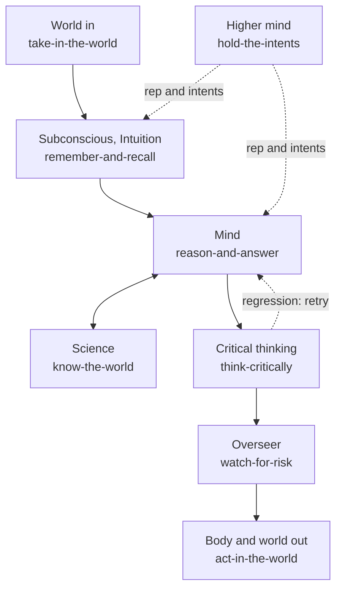

# ai-hub-of-hubs-structure

**One structure for assembling the best open-source AI hubs, one seat per part of a mind. Each seat holds the arm that measures
best on shared cases, and every number below is a recorded row, not a claim.** Built for and used by
[Quest AI Runner](https://github.com/SpiritualData/quest-ai-runner); the arms, cases and results are here to check.

<!-- headline:start -->
**34 alternatives measured across 7 areas, from 448 researched candidates.**

| Area | Alternatives measured | Which |
|---|---|---|
| RAG retrieval | 6 | `bm25`, `bm25@analyzer=english`, `composite`, `hybrid`, `hybrid@vector_weight=1.0`, `vector` |
| LLM routing and failover | 1 | `multi_provider` |
| LLMs (model quality and cost) | 13 | `claude_cli`, `claude_haiku`, `claude_opus`, `claude_sonnet`, `deepseek`, `deepseek_flash`, `deepseek_v4_pro`, `gemini`, `gemini_2_5_flash`, `gemini_2_5_flash_lite`, `gpt_5_mini`, `gpt_5_nano`, `openai` |
| Web search APIs | 2 | `gemini`, `provider` |
| Scholarly search | 6 | `openalex`, `openalex_keywords`, `openalex_keywords_model`, `openalex_semantic`, `openalex_semantic_and_web`, `web_research` |
| Coding agents | 3 | `fast_edit`, `stream_json_goal_runner`, `subprocess_goal_runner` |
| Guardrails and oversight | 3 | `consent_gate`, `overseer`, `two_stage` |

Of 6 seats with rival arms on the same cases, 6 hold the arm with the highest result on all cases at the deciding stage. The claims are in-sample (the same cases chose the arm and report it): 0 of 6 selected arms are significantly ahead of every rival, two-sided. Counted: distinct arms with a recorded run on the same cases as their rivals. Not counted: baselines and floors (such as `none` and `single_provider`) and conformance tests, which have no rival ([how we measure](docs/explanation/how-we-measure.md#what-counts-as-an-alternative)).
<!-- headline:end -->

## Use it in one line

```python
import hubofhubs
result = hubofhubs.run("what is the latest Rust release?")         # a question in, a Result out; nothing to wire
print(result.answer[:52], "...")                                     # live run, 2026-11-01:
# The latest stable release of Rust is version 1.99.1 ...
print(result.arms, [i["url"] for i in result.items[:2]])
# {'search-backend': 'gemini'} ['https://blog.rust-lang.org/releases/latest/', 'https://releases.rs/']
```

You get the best-scoring implementation for every part of an AI system, chosen by measured results, with no wiring. The question was
answered from the live web by the selected search arm, and the version matches the stable line of the cited releases.rs page. The `Result` holds `answer`, `items` (the sources),
`trace` (the work done), `arms`, `tokens`, `note` and `events` (a terminal draws them live via `on_event=`). `seat="model"` asks the model alone (the result says it has no sources),
`"papers"` and `"recall"` name other parts, and `ahohs run "<input>" --json` is the same call from a shell. What next:
1. See what your setup still needs: `hubofhubs.needs()` lists the missing key or install per selected arm (`run` stops with a `Needs` error naming the same).
2. Override just one part: `hubofhubs.run(text, arms={"search-backend": "serper"})`.
3. Pin the choice with `lock="esoi.lock.json"` (from `esoi lock`) so production changes when you decide.
[Tutorial](docs/tutorials/assemble-and-run-your-first-seat.md); `hubofhubs.assemble()` builds every part that needs nothing more from you.

## Evidence

One row per recorded check, generated by `python3 scripts/status.py` from the recorded results. The lead column says whether the selected
arm's lead is significant (test and p-value) or a best guess, not yet significant. Public research ([what it says](docs/explanation/what-public-research-says.md)) is shown beside our numbers, never added into them. How the cases and tests work: [how we measure](docs/explanation/how-we-measure.md).

<!-- evidence:start -->
| Seat | Deciding check, stage | Selected arm | Pass rate on all cases (95% interval) | n | Cost per passing case | Median seconds | Two-sided result against each rival |
|---|---|---|---|---|---|---|---|
| `context-assembler`, Subconscious, Intuition | A document that answers the query is among the top five results. (offline) | bm25@analyzer=english | 64.4% (59.0% to 69.4%), 208/323 | 323 | $0 | 0.3 (median) | ahead of bm25, not significant (two-sided McNemar p=0.154); ahead of vector, not significant (two-sided McNemar p=0.78) |
| `call-a-model`, Mind | When the first provider fails, a healthy one answers; a bad request is not hidden. (offline) | multi_provider | 100.0% (88.6% to 100.0%), 30/30 | 30 | $0 | 0 (median) | ahead of single_provider (two-sided McNemar p=7.63e-06) |
| `search-backend`, World | A top-five search hit comes from a page or site that holds the answer. (whole) | gemini | 80.0% (65.2% to 89.5%), 32/40 | 40 | $5.625e-05 | 2 (median) | ahead of provider (two-sided McNemar p=1.1e-05) |
| `know-the-world`, Science | The paper that answers a research question is among what the arm returns. (offline) | openalex_semantic | 34.7% (27.5% to 42.6%), 52/150 | 150 | $0 | 2 (median) | ahead of openalex_semantic_and_web, not significant (two-sided McNemar p=0.664); ahead of web_research (two-sided McNemar p=4.08e-06) |
| `act-in-the-world`, Body | A small coding task counts as done only when its own tests pass afterwards. (whole) | fast_edit | 96.7% (83.3% to 99.4%), 29/30, balanced score 0.9718 | 30 | $0.0001793 | 1.8 (median) | none: best guess, no per-case rows to test (none 0.298 against fast_edit 0.972); stream_json_goal_runner: best guess, no per-case rows to test (stream_json_goal_runner 0.938 against fast_edit 0.972); subprocess_goal_runner: best guess, no per-case rows to test (subprocess_goal_runner 0.923 against fast_edit 0.972) |
| `watch-for-risk`, Overseer | Steps a person should authorize are stopped and ordinary steps are let through. (offline) | consent_gate | 100.0% (90.4% to 100.0%), 36/36 | 36 | $0 | 0 (median) | ahead of none (two-sided McNemar p=2.29e-05); ahead of overseer, not significant (two-sided McNemar p=0.5); ahead of two_stage, not significant (two-sided McNemar p=0.5) |

Conformance tests (cases written in this repo, no rival, not counted as alternatives): `card-store` 35/35, `choose-a-model-tier` 36/36, `model-call` 30/30, `read-registry-freshness` 41/41, `score-hub-connections` 33/33, `assemble-the-whole` 68/68. The arm with the highest result at the deciding stage on all cases is selected (an exact tie keeps the incumbent), and the same cases give the rate, interval and test, so each claim is in-sample. A lead is significant when the two-sided exact McNemar test gives p below 0.05 after Holm's correction across rivals, with alpha divided by the number of stages the pair was run at; otherwise it is a best guess, not yet significant. Where a seat's metric is a balanced score, arms are ranked by that score. Cost per passing case is the whole run's recorded spend over its passes. Every check and every arm: [leaderboard](docs/reference/leaderboard.md), [evidence by arm](docs/reference/evidence-by-arm.md).
<!-- evidence:end -->

## What is not measured yet

Named seats and arms with no recorded run, and why. `esoi leaderboard` flags rows recorded before later edits to the measured code.

<!-- unmeasured:start -->
- **`take-in-the-world`** (World): measured in part. Only web search is measured; agent harnesses, tools and MCP servers have no check yet.
- **`remember-and-recall`** (Subconscious, Intuition): measured in part. Context assembly and the card store are measured; memory as a whole, such as scope isolation, has no check yet.
- **`reason-and-answer`** (Mind): measured in part. Only tier choice, provider failover, vendor answers and hard maths (AIME 2025) are measured; planning and answering live in Quest AI Runner and have no check here yet.
- **`think-critically`** (Critical thinking): not measured. One arm exists (links held to their evidence): no run of it is recorded and no cases are written yet. The research page names a public candidate.
- **`act-in-the-world`** (Body): measured in part. Only file-editing goals are measured; writing through MCP operations has no check.
- **`assemble-the-whole`** (The whole being): measured in part. One scenario, with no rival, so there is no lead to test.
- **`stay-current`** (Learning): measured in part. The freshness reading is measured; the weekly research itself is run by the consumer's autopilot and is not an arm here.
- **`keep-it-generic`** (Character): not measured. The audit of vendor wording runs as a scan in the tests, and no run of it is recorded.
- **`connect-any-integration`** (Hands): measured in part. Connection scoring is measured; the zero-code connect flow for a real integration is not run end to end here.
- **`act-in-the-world`**, arms with no run: `acp_deep_runner` (file_edit_goals). The agent binary it needs is not installed where we measure.
- **`search-backend`**, arms with no run: `searxng`, `brave`, `serper`, `tavily`. The arm needs a key or a self-hosted instance that is not set where we measure.
- **`context-assembler`**, arms with no run: `hybrid`, `composite`. Embedding the corpus was not authorized for the public stage.
- **`context-assembler`**, arms with no run: `composite` (context_assembler_papers). Not run yet; bm25, vector and hybrid were run.
- **`cards-from-files`**, arms with no run: `llm_topic_cards`. No run is recorded yet.
- **`cards-from-files`**, arms with no run: `per_file_symbols`, `graphify_files`. Not built yet: recorded in step 5b with the component.
<!-- unmeasured:end -->

## The idea, as a mind

A request enters from the world, the subconscious admits what bears on the goal, and the mind works on it, asking science for
evidence. Critical thinking holds the result to its metric, the overseer checks the risk, and the body acts; the higher mind
chooses whose long view grounds the work.



## The seats

A seat is a narrow interface (a `typing.Protocol`); an arm is an open-source hub, a combination or a plain fallback that fills it. A
broad seat is broken into narrower solutions with their own metric, such as `choose-a-model-tier` under the Mind. Every area and
candidate has a dated source in [docs/reference/registry.md](docs/reference/registry.md) and is researched again within 90 days ([refresh](docs/how-to/refresh-the-registry.md)).

<!-- seats:start -->
| Seat | Part of the mind | Areas | Built on now | Candidates researched | Oldest research |
|---|---|---|---|---|---|
| take-in-the-world | World | 7 | 1 | 36 | 2026-10-30 |
| remember-and-recall | Subconscious, Intuition | 10 | 8 | 69 | 2026-10-30 |
| reason-and-answer | Mind | 8 | 1 | 55 | 2026-10-30 |
| know-the-world | Science | 10 | 2 | 73 | 2026-10-30 |
| think-critically | Critical thinking | 4 | 4 | 18 | 2026-10-30 |
| act-in-the-world | Body | 20 | 5 | 133 | 2026-10-30 |
| watch-for-risk | Overseer | 5 | 5 | 29 | 2026-10-30 |
| assemble-the-whole | The whole being | 3 | 1 | 6 | 2026-10-30 |
| stay-current | Learning | 3 | 2 | 17 | 2026-10-30 |
| keep-it-generic | Character | 3 | 2 | 12 | 2026-10-30 |
| connect-any-integration | Hands | 0 | 0 | 0 | none |

73 areas and 448 researched candidates in all; every area is listed in [../reference/registry.md](../reference/registry.md).
<!-- seats:end -->

## For a consumer
Install, register a part you own and score your integration: [register a second consumer](docs/how-to/register-a-second-consumer.md); checks are in [CLAUDE.md](CLAUDE.md#checks). All documentation: [docs/README.md](docs/README.md).

## License
Apache-2.0, matching Quest AI Runner (`LICENSE`).
