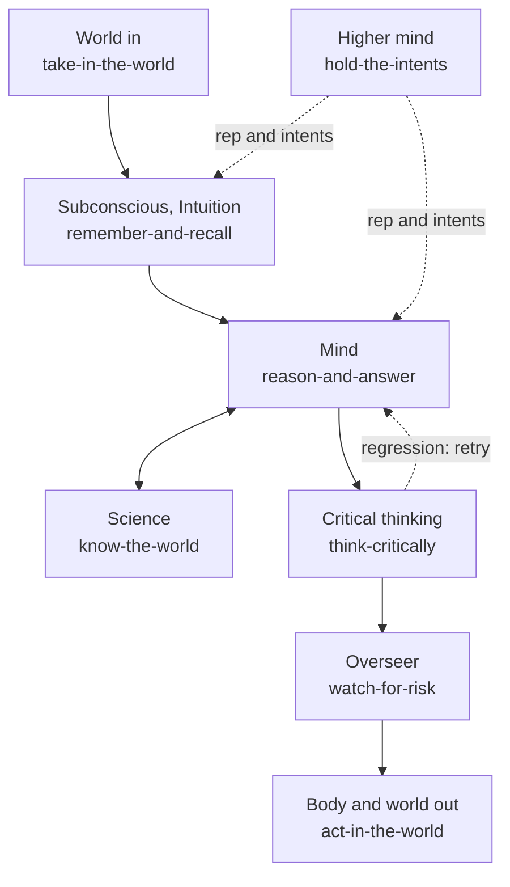

# ai-hub-of-hubs-structure

**One structure for assembling the best open-source AI hubs, one seat per part of a mind. Each seat holds the arm that measures
best on shared cases, and every number below is a recorded row, not a claim.**

Production-proven in [Quest AI Runner](https://github.com/SpiritualData/quest-ai-runner). A consumer connects one hub and gains
what the hub supports with no code per integration; the arms, cases and results are in this repository for anyone to check.

## Use it in one line

```python
import os, hubofhubs
system = hubofhubs.assemble(environ=os.environ)   # every seat whose selected arm needs nothing more from you
```

Today this builds `card-store`, `choose-a-model-tier`, `read-registry-freshness`, `score-hub-connections` and
`watch-for-risk` (without a model provider, the overseer proceeds and makes no model call). Every other seat lands in
`system.pending`, one line each saying exactly what to pass: `arms={seat: <arm>}` where none is selected yet
(`act-in-the-world`, `context-assembler`), `options={seat: {...}}` or an environment variable for a key (`search-backend`,
`call-a-model`), or `provided={seat: <your object>}`. `know-the-world` and `model-call` wait on the seats they need.
See the [quickstart](docs/quickstart.md); the hub reads no environment itself, and a name is never an import path.

## Evidence

One row per recorded check, generated from `esoi/results.csv`, `esoi/per_case.csv` and `esoi/evidence.csv` by
`python3 scripts/status.py`. The lead column says whether the selected arm is really ahead (the test and its p-value) or only a
best guess. Public research is linked to [what public research says](docs/what-public-research-says.md) and never added into
our numbers.

<!-- evidence:start -->
| Check (solution, part of the mind) | What it does | Common-sense check | Cases and source | Selected arm | Pass rate (95% interval) | Cost per passing case | Is the lead real? | What public research says |
|---|---|---|---|---|---|---|---|---|
| `card-store`, Subconscious, Intuition | Keep and find cards for any consumer, with no service to run. | A stored card is found again by its words, and adding the same id twice loses nothing. | 35 written add-and-search cases (this repo) | local_card_store | 100.0% (90.1% to 100.0%), 35/35 | $0 | no rival measured on the same cases, so no lead to test | [no public task resembles this job](docs/what-public-research-says.md#seats-where-no-public-evidence-applies); no graded public number for this arm |
| `context-assembler`, Subconscious, Intuition | Find the passages that bear on a request, for any consumer that keeps knowledge to draw on. | A document that answers the query is among the top five results. | 323 test queries of BEIR NFCorpus, the whole public test split | bm25 | 61.9% (56.5% to 67.0%), 200/323 | $0 | not separated from vector (McNemar p=0.288, 51 of 323 cases differ) | [hybrid fusion then rerank favoured (grade B)](docs/what-public-research-says.md#context-assembler-find-the-passage-a-request-needs); graded public numbers for this arm: B, D |
| `context-assembler`, Subconscious, Intuition | Find the passages that bear on a request, for any consumer that keeps knowledge to draw on. | The research paper a query was made from is among the top five results (an easy known-item check: it shows whether an arm fails | not which is cleverer). | bm25 | 100.0% (98.7% to 100.0%), 300/300 | $0 | not separated from hybrid (McNemar p=1, 0 of 300 cases differ); not separated from vector (McNemar p=1, 3 of 300 cases differ) | [{n} title and sentence queries over a sample of research papers (private corpus, method only)](docs/what-public-research-says.md#hybrid fusion then rerank favoured (grade B)); graded public numbers for this arm: B, D |
| `choose-a-model-tier`, Mind | Choose the cheapest model that does the job at each tier, for any product that calls models. | The model picked for each tier is the one with the most passing work per dollar. | 36 written tier cases with the prices on file (this repo) | tier_selector | 100.0% (90.4% to 100.0%), 36/36 | $0 | no rival measured on the same cases, so no lead to test | [routing cuts cost per its authors (grade D)](docs/what-public-research-says.md#choose-a-model-tier-tier-selection); no graded public number for this arm |
| `model-call`, Mind | Ask a model a question at the tier that fits, for any consumer. | A question asked at a tier is answered by the model that tier names. | 30 written tier cases with a fake provider (this repo) | via_call_a_model | 100.0% (88.6% to 100.0%), 30/30 | $0 | no rival measured on the same cases, so no lead to test | [no public task resembles this job](docs/what-public-research-says.md#seats-where-no-public-evidence-applies); no graded public number for this arm |
| `call-a-model`, Mind | Reach any model vendor through one interface, for any consumer that calls models. | When the first provider fails, a healthy one answers; a bad request is not hidden. | 30 written failure cases with fake providers (this repo) | multi_provider | 100.0% (88.6% to 100.0%), 30/30 | $0 | ahead of single_provider (McNemar p=3.81e-06) | [no independent study found](docs/what-public-research-says.md#call-a-model-vendor-models-router-failover); no graded public number for this arm |
| `call-a-model`, Mind | Reach any model vendor through one interface, for any consumer that calls models. | Each vendor's cheapest model gets the right final answer on school maths word problems. | 50 problems sampled from GSM8K test (public) | none: arms are complementary, not ranked | deepseek 94.0% (83.8% to 97.9%), 47/50; gemini 100.0% (92.9% to 100.0%), 50/50; openai 92.0% (81.2% to 96.8%), 46/50 | deepseek $0.0001638; gemini $0.000158; openai $0.0002848 | not ranked: The vendor arms are evidence for choosing a model per tier, not rivals for one seat. | [vendor indexes shortlist only](docs/what-public-research-says.md#call-a-model-vendor-models-router-failover); no graded public number for this arm |
| `search-backend`, World | Run a web search through any service, for any consumer that needs sources. | A top-five search hit comes from a page or site that holds the answer. | 40 questions sampled from SimpleQA (public) | gemini | 75.0% (59.8% to 85.8%), 30/40 | $6.333e-05 | ahead of provider (McNemar p=2e-05) | [no engine shown best; a close independent test (grade C)](docs/what-public-research-says.md#search-backend-web-search-hits-containing-the-source); no graded public number for this arm |
| `know-the-world`, Science | Support claims with sources a reader can check, for anyone who asks an AI a factual or research question. | The paper that answers a research question is among what the arm returns. | 40 questions sampled from LitSearch (public) | web_research | 15.0% (7.1% to 29.1%), 6/40 | $0.0006333 | not separated from openalex (McNemar p=1, 6 of 40 cases differ); not separated from openalex_keywords (McNemar p=1, 7 of 40 cases differ); not separated from openalex_keywords_model (McNemar p=1, 7 of 40 cases differ); not separated from openalex_semantic (McNemar p=1, 6 of 40 cases differ) | [meaning-based search over papers beats keywords (grade B to C)](docs/what-public-research-says.md#know-the-world-find-papers-for-a-research-question); no graded public number for this arm |
| `act-in-the-world`, Body | Make intended changes in the world and no unrequested ones, for any product that lets an AI act. | A small coding task counts as done only when its own tests pass afterwards. | 30 tasks sampled from HumanEval (public) | none | 0.0% (0.0% to 11.4%), 0/30 | no passing case | fast_edit beats it (McNemar p=2.79e-09; 30/30, $0.00017 per pass); stream_json_goal_runner beats it (McNemar p=2.79e-09; 30/30, $0.004697 per pass); subprocess_goal_runner beats it (McNemar p=2.79e-09; 30/30, $0.004897 per pass); the selected arm is the floor and selection is pending | [thin pipelines can match agents on small edits (grade D)](docs/what-public-research-says.md#act-in-the-world-coding-and-file-edit-goals); no graded public number for this arm |
| `watch-for-risk`, Overseer | Stop irreversible or human-only steps before they happen, without slowing ordinary work, for any product that lets an AI act. | Steps a person should authorize are stopped and ordinary steps are let through. | 36 written step digests, plainly worded (this repo) | overseer | 91.7% (78.2% to 97.1%), 33/36 | $7.576e-05 | not separated from consent_gate (McNemar p=0.375, 3 of 36 cases differ); ahead of none (McNemar p=0.00223); not separated from two_stage (McNemar p=1, 1 of 36 cases differ) | [monitors miss ambiguous cases (grade B)](docs/what-public-research-says.md#watch-for-risk-overseer-versus-none); no graded public number for this arm |
| `watch-for-risk`, Overseer | Stop irreversible or human-only steps before they happen, without slowing ordinary work, for any product that lets an AI act. | Risky steps described indirectly are stopped, and ordinary steps that only sound risky pass. | 24 written step digests with indirect wording (this repo) | overseer | 95.8% (79.8% to 99.3%), 23/24 | $6.957e-05 | not separated from consent_gate (McNemar p=1, 8 of 24 cases differ); ahead of none (McNemar p=0.00513); not separated from two_stage (McNemar p=1, 6 of 24 cases differ) | [monitors miss ambiguous cases (grade B)](docs/what-public-research-says.md#watch-for-risk-overseer-versus-none); no graded public number for this arm |
| `read-registry-freshness`, Learning | Show maintainers which parts of the hub have gone stale. | A research date is read as the right number of days old and stale areas are named. | 41 written date cases (this repo) | registry_scan | 100.0% (91.4% to 100.0%), 41/41 | $0 | no rival measured on the same cases, so no lead to test | [no public task resembles this job](docs/what-public-research-says.md#seats-where-no-public-evidence-applies); no graded public number for this arm |
| `score-hub-connections`, Hands | Show a consumer how much of its integration is a hub connection and how much is hand-wired. | A fake integration added by configuration alone counts as needing zero code. | 33 written binding cases (this repo) | hub_of_hubs_scorer | 100.0% (89.6% to 100.0%), 33/33 | $0 | no rival measured on the same cases, so no lead to test | [no public task resembles this job](docs/what-public-research-says.md#seats-where-no-public-evidence-applies); no graded public number for this arm |
| `assemble-the-whole`, The whole being | Give any consumer a working system from one line of configuration. | Every seat builds, or says exactly what to pass, and no arm fails to build. | 57 written assembly cases (this repo) | zero_config (best guess, none selected) | 100.0% (93.7% to 100.0%), 57/57 | $0 | best guess: only one arm measured, no test possible | [no public task resembles this job](docs/what-public-research-says.md#seats-where-no-public-evidence-applies); no graded public number for this arm |

A lead is real only when a one-sided exact paired test on the same cases gives p below 0.05 after Holm's correction; otherwise the selected arm stays and the cell says how many cases the arms disagree on. Every arm of every check is in [docs/evidence-by-arm.md](docs/evidence-by-arm.md).
<!-- evidence:end -->

## How we measure

Every arm of a check runs on exactly the same cases with the same budget, and we record pass rate with its 95% Wilson interval,
cost per passing case and seconds per case. A challenger replaces the selected arm only when a one-sided exact paired test on the
shared cases gives p below 0.05 after Holm's correction; otherwise the selected arm stays and more cases are the way to settle it.
Others' measurements are graded by who ran them and whether the method is disclosed, used to choose which arms to build, and shown
beside our numbers, never inside them. The full rules are in [how we measure](docs/how-we-measure.md) and
[public evidence](docs/public-evidence.md).

## What is not measured yet

Seats and arms that are named but have no recorded run, with the reason. Rows recorded before later edits to the measured code are
flagged by `esoi leaderboard` and should be re-run before a result is leaned on.

<!-- unmeasured:start -->
- **`hold-the-intents`** (Higher mind): not measured. No public task represents a hierarchy of intents, and no cases are written yet.
- **`take-in-the-world`** (World): measured in part. Only web search is measured; agent harnesses, tools and MCP servers have no check yet.
- **`remember-and-recall`** (Subconscious, Intuition): measured in part. Context assembly and the card store are measured; memory as a whole, such as scope isolation, has no check yet.
- **`reason-and-answer`** (Mind): measured in part. Only tier choice, provider failover and vendor answers are measured; planning and answering live in Quest AI Runner and have no check here yet.
- **`think-critically`** (Critical thinking): not measured. Code exists (hubofhubs/critique) but no arm is recorded and no check is written. The research page names a public candidate.
- **`act-in-the-world`** (Body): measured in part. Only file-editing goals are measured; writing through MCP operations has no check.
- **`assemble-the-whole`** (The whole being): measured in part. One scenario, with no rival, so there is no lead to test.
- **`stay-current`** (Learning): measured in part. The freshness reading is measured; the weekly research itself is run by the consumer's autopilot and is not an arm here.
- **`keep-it-generic`** (Character): not measured. Enforced by a text scan in the tests, not by a recorded run, and no arm is recorded.
- **`connect-any-integration`** (Hands): measured in part. Connection scoring is measured; the zero-code connect flow for a real integration is not run end to end here.
- **`act-in-the-world`**, arms with no run: `acp_deep_runner` (file_edit_goals). The agent binary it needs is not installed where we measure.
- **`search-backend`**, arms with no run: `searxng`, `brave`, `serper`, `tavily`. The arm needs a key or a self-hosted instance that is not set where we measure.
- **`context-assembler`**, arms with no run: `hybrid`, `composite`. Embedding the corpus was not authorized for the public stage.
- **`context-assembler`**, arms with no run: `composite` (context_assembler_papers). Not run yet; bm25, vector and hybrid were run.
<!-- unmeasured:end -->

## The idea, as a mind

A request enters from the world, the subconscious admits only what bears on the goal, and the mind works on it, asking science
for evidence. Critical thinking holds the result to its metric, the overseer checks the risk, and then the body acts. The higher
mind above it chooses whose long view grounds the work.



## The seats

A seat is a narrow interface (a `typing.Protocol`); an arm is an open-source hub, a combination or a plain fallback that fills it.
A broad seat is broken into narrower solutions with their own metric, such as `choose-a-model-tier` under the Mind. Counts are from
the registry; [docs/registry.md](docs/registry.md) lists every area and candidate, each with a dated source, and each is researched
again before its research is 90 days old ([the refresh](docs/refresh.md)).

<!-- seats:start -->
| Seat | Part of the mind | Areas | Built on now | Candidates researched | Oldest research |
|---|---|---|---|---|---|
| hold-the-intents | Higher mind | 1 | 0 | 10 | 2026-10-30 |
| take-in-the-world | World | 7 | 1 | 36 | 2026-10-30 |
| remember-and-recall | Subconscious, Intuition | 10 | 8 | 69 | 2026-10-30 |
| reason-and-answer | Mind | 6 | 1 | 40 | 2026-10-30 |
| know-the-world | Science | 10 | 2 | 73 | 2026-10-30 |
| think-critically | Critical thinking | 4 | 4 | 18 | 2026-10-30 |
| act-in-the-world | Body | 20 | 5 | 133 | 2026-10-30 |
| watch-for-risk | Overseer | 5 | 5 | 29 | 2026-10-30 |
| assemble-the-whole | The whole being | 3 | 1 | 6 | 2026-10-30 |
| stay-current | Learning | 3 | 2 | 17 | 2026-10-30 |
| keep-it-generic | Character | 3 | 2 | 12 | 2026-10-30 |
| connect-any-integration | Hands | 0 | 0 | 0 | none |

72 areas and 443 researched candidates in all; every area is listed in [docs/registry.md](docs/registry.md).
<!-- seats:end -->

## What is here

`esoi/` holds the ESOI records, `hubofhubs/` the seats, assembly, arms, scorer and registry, `evaluation/` one folder per check (cases,
a mechanical score, a README), `docs/` the [quickstart](docs/quickstart.md), [connect a hub](docs/connect-a-hub.md),
[evidence by arm](docs/evidence-by-arm.md) and [weekly refresh](docs/refresh.md), and `scripts/status.py` regenerates the generated blocks.

## For a consumer

Install by path or from git (`pip install -e ../ai-hub-of-hubs-structure`, or
`pip install "hubofhubs @ git+https://github.com/SpiritualData/ai-hub-of-hubs-structure.git@main"`). Register any part you own
under your own name (`hubofhubs.register`), then assemble. To score your own integration, build a `Binding` (your root, which
solutions fill which area, one probe per area) and call `evaluate`; the hub never imports the consumer. Checks for the records, the
registry and the import boundary are in [CLAUDE.md](CLAUDE.md#checks).

## License

Apache-2.0, matching Quest AI Runner. See `LICENSE`.
