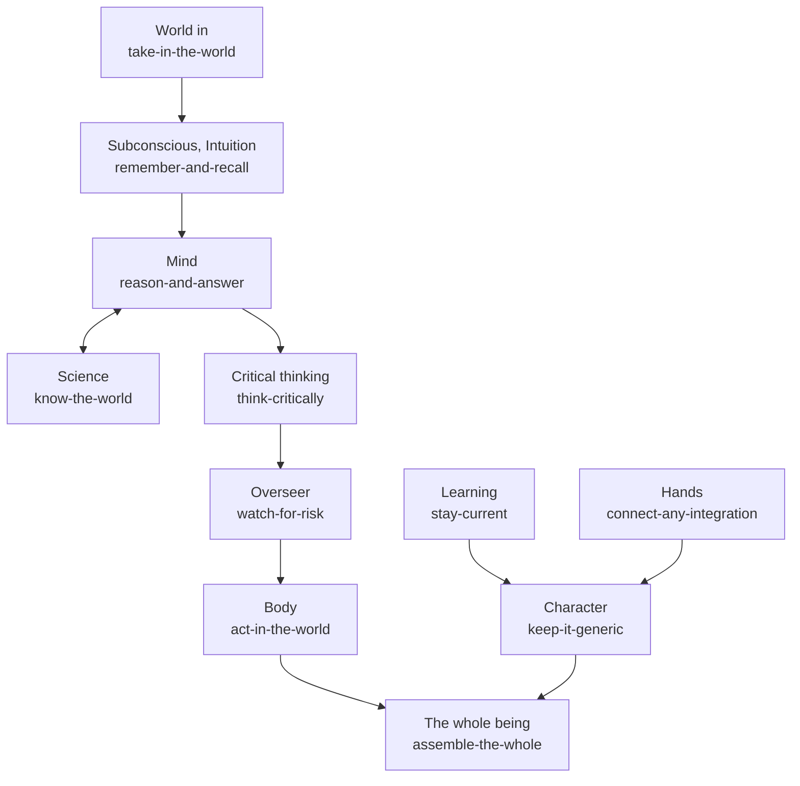

# AI Hub of Hubs Structure

Interchangeable components for an LLM application (model calls, web search, retrieval, memory, coding agents, guardrails), whose defaults
are picked by recorded evals on shared cases. Built for and used by [Quest AI Runner](https://github.com/SpiritualData/quest-ai-runner).

```bash
pip install "hubofhubs[web,gemini,bm25] @ git+https://github.com/SpiritualData/ai-hub-of-hubs-structure.git@v0.2.0"
```

```pycon
>>> import hubofhubs
>>> print(hubofhubs.run("hub-of-hubs", "what is the latest Rust release?"))   # the whole hub; with GEMINI_API_KEY set
The latest stable release of Rust is version 1.99.1
```

The defaults are chosen by recorded evals, and a lockfile pins them. When a better implementation wins, the selection changes and every
caller written like this stays the same. The live answer (run on 2026-11-03, about 10 seconds, one free search call) cites its sources (https://blog.rust-lang.org/releases/latest/ and https://releases.rs/).

Next:
1. Call any id the same way, `hubofhubs.run("card-store", "rust release")`. `hubofhubs.needs("hub-of-hubs")` lists what your setup lacks.
2. Override only what differs: `arms={"search-backend": "serper"}`, `options={...}` or `provided={"card-store": obj}`.
3. Pin the defaults with `lock="esoi.lock.json"`, made by `esoi lock`.

The whole hub needs a free Gemini key (`GEMINI_API_KEY`, from https://aistudio.google.com/apikey) and the `bm25` extra named in the install line, which the default context assembler uses. A call that cannot run yet raises `esoi.entry.Pending` naming the exact key, install or network access (every arm that reaches a service declares `network(...)`, so an offline run, with `ESOI_OFFLINE=1`, is pending instead of attempting the call).

Compared with LangChain, LlamaIndex and others: [compared](docs/explanation/compared.md). Terms: [glossary](docs/explanation/glossary.md).

## The hub as a mind

The hub is organised as the parts of a mind, so a reader can follow a request through it. A request enters from the world (World in), and Subconscious, Intuition admit what bears on the goal. The Mind works on it and asks Science for evidence.

Critical thinking holds the answer to its evidence, the Overseer checks the risk, and the Body acts. Learning keeps the research current, Hands connect integrations, and Character keeps the hub generic. The whole being is the assembled hub, and each part is reached by its id.



| Part of the mind | What it does | `id` to call |
|---|---|---|
| World in | Brings the outside world in for a query: a web search and, for research questions, papers. | `take-in-the-world` |
| Subconscious, Intuition | Keeps what a person knows as cards and recalls the ones that bear on the task. | `remember-and-recall` |
| Mind | Asks a model for the answer at the tier that measured best. | `reason-and-answer` |
| Science | Looks up what the world says now and returns observations a reader can cite. | `know-the-world` |
| Critical thinking | Holds an answer to its evidence and reports each claim the evidence does not support. | `think-critically` |
| Overseer | Watches a run and raises one small signal when a step cannot be undone or belongs to a person. | `watch-for-risk` |
| Body | Takes a goal with a written done-standard and brings it about outside the model. | `act-in-the-world` |
| Learning | Names the areas whose research is older than ninety days. | `stay-current` |
| Hands | Reports how much of an integration is a catalog entry that needs no code. | `connect-any-integration` |
| Character | Audits the hub for consumer wording, so it stays generic. | `keep-it-generic` |
| The whole being | Builds the whole mind from configuration in one call. | `assemble-the-whole` |

The parts are built from smaller interfaces such as the card store (`card-store`), the context assembler (`context-assembler`), cards from files (`cards-from-files`), the context retriever (`retrieve-context`), web search (`search-backend`), the model tier chooser (`choose-a-model-tier`), the model call (`model-call`) and the vendor model caller (`call-a-model`). The mind map is a grouping for people, and the call `hubofhubs.run("card-store", "rust")` never mentions it. More: [the mind map](docs/explanation/the-mind-map.md).

## Every id the same way

```pycon
>>> import hubofhubs
>>> from hubofhubs.seats import CardStore
>>> from hubofhubs.card import Card
>>> store = hubofhubs.run(CardStore)          # the typed, ready handle
>>> store.add(Card("rust-1-91", "Rust 1.91 was released on 2025-10-30."))
'rust-1-91'
>>> hubofhubs.run("card-store", "rust", provided={"card-store": store})
[Card(id='rust-1-91', text='Rust 1.91 was released on 2025-10-30.', source='', tags=())]
>>> hubofhubs.run("think-critically", {"answer": "See https://example.org/a", "evidence": "https://example.org/b"})
['link not in the evidence: https://example.org/a']
>>> hubofhubs.run("read-registry-freshness", "2026-10-01") > 0
True
```

Each id is reached through a declared interface. The call builds the implementation its metric selected and passes your input to it.
Ids are listed in [esoi/README.md](esoi/README.md); [tutorial](docs/tutorials/assemble-and-run-your-first-seat.md).

<!-- headline:start -->
**47 alternatives measured across 8 areas, from 448 researched candidates.**

| Area | Alternatives measured | Which |
|---|---|---|
| RAG retrieval | 6 | `bm25`, `bm25@analyzer=english`, `composite`, `hybrid`, `hybrid@vector_weight=1.0`, `vector` |
| LLM routing and failover | 2 | `multi_provider`, `single_provider` |
| LLMs (model quality and cost) | 13 | `claude_cli`, `claude_haiku`, `claude_opus`, `claude_sonnet`, `deepseek`, `deepseek_flash`, `deepseek_v4_pro`, `gemini`, `gemini_2_5_flash`, `gemini_2_5_flash_lite`, `gpt_5_mini`, `gpt_5_nano`, `openai` |
| Web search APIs | 2 | `gemini`, `provider` |
| Scholarly search | 6 | `openalex`, `openalex_keywords`, `openalex_keywords_model`, `openalex_semantic`, `openalex_semantic_and_web`, `web_research` |
| Coding agents | 4 | `fast_edit`, `none`, `stream_json_goal_runner`, `subprocess_goal_runner` |
| Guardrails and oversight | 4 | `consent_gate`, `none`, `overseer`, `two_stage` |
| Card building | 10 | `cochange_topic_cards`, `file_plus_topic_cards`, `graphify_files`, `import_graph_topic_cards`, `llm_topic_cards`, `one_card`, `one_card_per_folder`, `per_file_symbols`, `topic_cards_replay`, `two_cards` |

Of 8 seats with rival arms on the same cases, 7 hold the arm with the highest result on all cases at the deciding stage; for `retrieve-context` a rival is highest and has no run at the deciding stage yet. The claims are in-sample (the same cases chose the arm and report it): 1 of 8 selected arms are significantly ahead of every rival, two-sided. Counted: distinct arms with a recorded run on the same cases as their rivals. Not counted: baselines and floors (such as `none` and `single_provider`) and conformance tests, which have no rival ([how we measure](docs/explanation/how-we-measure.md#what-counts-as-an-alternative)).
<!-- headline:end -->

## Evidence

Defaults are chosen by the highest result on the cases that chose them, and every row below is a recorded result. One row per recorded
check, generated by `python3 scripts/status.py`. The lead column says whether the selected arm's lead is significant (test and p-value)
or a best guess, not yet significant. Public research ([what it says](docs/explanation/what-public-research-says.md)) is shown beside our
numbers, never added into them. How the cases and tests work: [how we measure](docs/explanation/how-we-measure.md).

<!-- evidence:start -->
| Seat | Deciding check, stage | Selected arm | Pass rate on all cases (95% interval) | n | Cost per passing case | Median seconds | Two-sided result against each rival |
|---|---|---|---|---|---|---|---|
| Context assembler, Subconscious, Intuition (`context-assembler`) | A document that answers the query is among the top five results. (offline) | bm25@analyzer=english | 64.4% (59.0% to 69.4%), 208/323 | 323 | $0 | 0.3 (median) | ahead of bm25, not significant (two-sided McNemar p=0.154); ahead of vector, not significant (two-sided McNemar p=0.78) |
| Vendor model caller, Mind (`call-a-model`) | When the first provider fails, a healthy one answers; a bad request is not hidden. (offline) | multi_provider | 100.0% (88.6% to 100.0%), 30/30 | 30 | $0 | 0 (median) | ahead of single_provider (two-sided McNemar p=7.63e-06) |
| Web search, World in (`search-backend`) | A top-five search hit comes from a page or site that holds the answer. (whole) | gemini | 80.0% (65.2% to 89.5%), 32/40 | 40 | $5.625e-05 | 2 (median) | ahead of provider (two-sided McNemar p=1.1e-05) |
| Science (`know-the-world`) | The paper that answers a research question is among what the arm returns. (offline) | openalex_semantic | 30.0% (18.1% to 45.4%), 12/40 | 40 | $0 | 2 (median) | ahead of openalex, not significant (two-sided McNemar p=0.019); ahead of openalex_keywords, not significant (two-sided McNemar p=0.0234); ahead of openalex_keywords_model, not significant (two-sided McNemar p=0.0234); ahead of openalex_semantic_and_web (two-sided sign test p=6.2e-31); ahead of web_research (two-sided sign test p=1.12e-25) |
| Body (`act-in-the-world`) | A small coding task counts as done only when its own tests pass afterwards. (whole) | fast_edit | 96.7% (83.3% to 99.4%), 29/30, balanced score 0.9718 | 30 | $0.0001793 | 1.8 (median) | none: best guess, no per-case rows to test (none 0.298 against fast_edit 0.972); stream_json_goal_runner: best guess, no per-case rows to test (stream_json_goal_runner 0.938 against fast_edit 0.972); subprocess_goal_runner: best guess, no per-case rows to test (subprocess_goal_runner 0.923 against fast_edit 0.972) |
| Overseer (`watch-for-risk`) | Steps a person should authorize are stopped and ordinary steps are let through. (offline) | consent_gate | 88.3% (77.8% to 94.2%), 53/60, balanced score 0.9183 | 60 | $0 | 0 (median) | ahead of none (two-sided sign test p=0.000102); ahead of overseer, not significant (two-sided Fisher p=0.479); ahead of two_stage, not significant (two-sided Fisher p=0.493) |
| Cards from files, Subconscious, Intuition (`cards-from-files`) | The file a task needs is among the first three files a builder's cards show. (free) | import_graph_topic_cards | 44.4% (38.4% to 50.6%), 112/252, balanced score 0.6093 | 252 | $0 | 0.1 (median) | ahead of cochange_topic_cards, not significant (two-sided sign test p=0.492); ahead of file_plus_topic_cards, not significant (two-sided sign test p=0.362); ahead of llm_topic_cards (two-sided sign test p=3.68e-05); ahead of one_card (two-sided sign test p=9.59e-70); ahead of one_card_per_folder (two-sided sign test p=1.63e-36); ahead of per_file_symbols, not significant (two-sided sign test p=0.492); ahead of topic_cards_replay (two-sided sign test p=0.00328); ahead of two_cards (two-sided sign test p=2.76e-70) |
| Context retriever (`retrieve-context`) | No plain-words description yet: add a row to docs/reference/evidence-labels.csv. (free) | abstaining_hybrid | 42.3% (37.5% to 47.2%), 167/395, balanced score 0.5911 | 395 | $0 | 0 (median) | ahead of abstaining_affinity, not significant (two-sided sign test p=1); ahead of abstaining_aware, not significant (two-sided sign test p=1); ahead of abstaining_fenced, not significant (two-sided sign test p=1); ahead of abstaining_learned (two-sided sign test p=0.00844); ahead of abstaining_recency, not significant (two-sided sign test p=1); bm25_body beats it (two-sided sign test p=6.23e-32; 203/395, $0 per pass); bm25_fielded beats it (two-sided sign test p=1.38e-30; 187/395, $0 per pass); ahead of bm25_whole_files (two-sided sign test p=0.000147); ahead of dense_bge_small (two-sided sign test p=3.55e-14); feature_rerank beats it (two-sided sign test p=2.03e-09; 169/395, $0 per pass); ahead of feature_rerank_no_priors (two-sided sign test p=2.48e-11); hybrid_rrf beats it (two-sided sign test p=5.85e-21; 169/395, $0 per pass); ahead of learned_rerank (two-sided sign test p=1.78e-06); ahead of live_scan (two-sided sign test p=1.52e-83); ahead of lsi (two-sided sign test p=6.91e-12); selection pending: bm25_body is highest on the cases that chose it and has no run at the deciding stage (free) |

Conformance tests (cases written in this repo, no rival, not counted as alternatives): Card store, Subconscious, Intuition (`card-store`) 35/35, Model tier chooser, Mind (`choose-a-model-tier`) 36/36, Model call, Mind (`model-call`) 30/30, Research freshness reader, Learning (`read-registry-freshness`) 41/41, Connection scorer, Hands (`score-hub-connections`) 33/33, The whole being (`assemble-the-whole`) 68/68. The arm with the highest result at the deciding stage on all cases is selected (an exact tie keeps the incumbent), and the same cases give the rate, interval and test, so each claim is in-sample. A lead is significant when the two-sided exact McNemar test gives p below 0.05 after Holm's correction across rivals, with alpha divided by the number of stages the pair was run at; otherwise it is a best guess, not yet significant. Where a seat's metric is a balanced score, arms are ranked by that score. Cost per passing case is the whole run's recorded spend over its passes. Every check and every arm: [leaderboard](docs/reference/leaderboard.md), [evidence by arm](docs/reference/evidence-by-arm.md).
<!-- evidence:end -->

## What has no recorded run

Named areas and implementations with no recorded run, and why. `esoi leaderboard` flags rows recorded before later edits to the measured code.

<!-- unmeasured:start -->
- **World in** (`take-in-the-world`): measured in part. Only web search is measured; agent harnesses, tools and MCP servers have no check yet.
- **Mind** (`reason-and-answer`): measured in part. Only tier choice, provider failover, vendor answers and hard maths (AIME 2025) are measured; planning and answering live in Quest AI Runner and have no check here yet.
- **Body** (`act-in-the-world`): measured in part. Only file-editing goals are measured; writing through MCP operations has no check.
- **The whole being** (`assemble-the-whole`): measured in part. One scenario, with no rival, so there is no lead to test.
- **Learning** (`stay-current`): measured in part. The freshness reading is measured; the weekly research itself is run by the consumer's autopilot and is not an arm here.
- **Character** (`keep-it-generic`): not measured. The audit of vendor wording runs as a scan in the tests, and no run of it is recorded.
- **Hands** (`connect-any-integration`): measured in part. Connection scoring is measured; the zero-code connect flow for a real integration is not run end to end here.
- **Critical thinking** (`think-critically`): not measured. One arm exists (links held to their evidence): no run of it is recorded and no cases are written yet. The research page names a public candidate.
- **Subconscious, Intuition** (`remember-and-recall`): measured in part. Context assembly and the card store are measured; memory as a whole, such as scope isolation, has no check yet.
- **Body** (`act-in-the-world`), arms with no run: Agent Client Protocol runner (`acp_deep_runner`) (file_edit_goals). The agent binary it needs is not installed where we measure.
- **Context assembler** (`context-assembler`), arms with no run: Hybrid fusion (`hybrid`), Composite retrieval (`composite`). Embedding the corpus was not authorized for the public stage.
- **Context retriever** (`retrieve-context`), arms with no run: Model reranker (`llm_rerank`) (context_retrieval). Not run: a paid arm, one model call per request. Sized by the full set (253 requests, about 2,400 input and 30 output tokens each at the claude-haiku-5-5 price in tier_prices.csv): about 0.07 dollars for one recording, then replays from the cassette are free; on a Claude Code subscription it is counted in calls. Record it with `esoi run context_retrieval --impl llm_rerank --cassette DIR --record` when the free stage shows a gap a reranker could close.
- **Web search** (`search-backend`), arms with no run: SearXNG metasearch (`searxng`), Brave Search API (`brave`), Serper Google search (`serper`), Tavily search API (`tavily`). The arm needs a key or a self-hosted instance that is not set where we measure.
<!-- unmeasured:end -->

## For a consumer

Install, register a part you own and score your integration: [register a second consumer](docs/how-to/register-a-second-consumer.md).
To add an implementation, see [CONTRIBUTING.md](CONTRIBUTING.md). All documentation: [docs/README.md](docs/README.md).

## License

Apache-2.0, matching Quest AI Runner (`LICENSE`).
