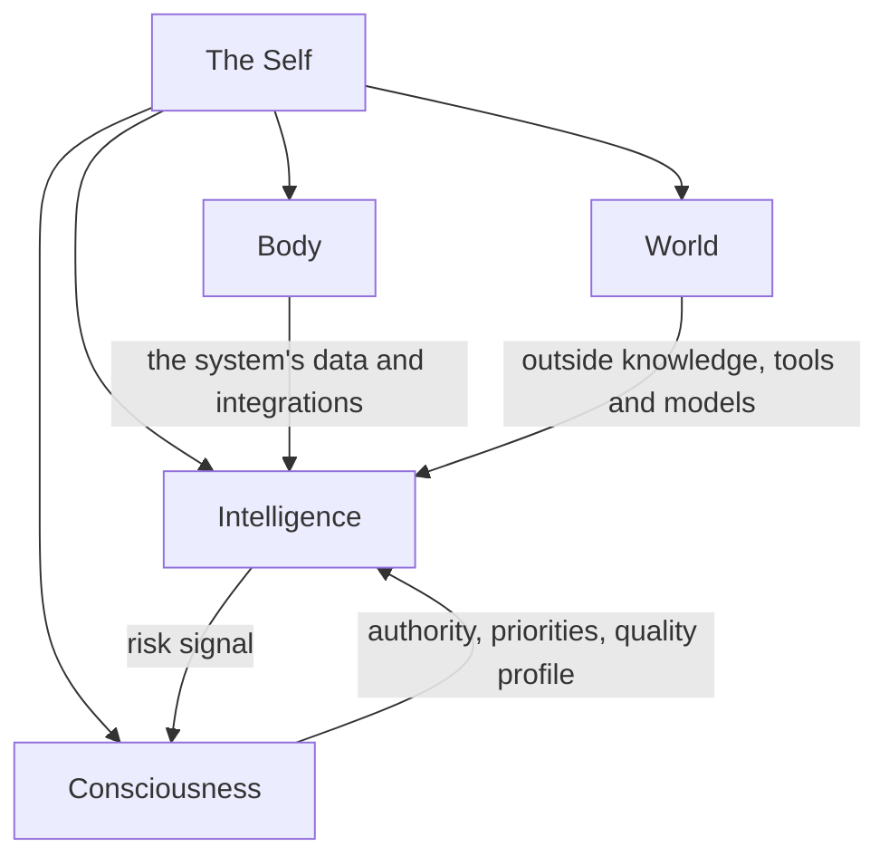

# The mind map

The hub is organised as a mind. It is a grouping for people; the interfaces do not depend on it, and a call such as
`hubofhubs.run("card-store", "rust")` never mentions it.

The picture is one request. The Mind is a stream of consciousness focused on the goal of that request: what the planning and responding
AI can see for it, and how it outputs plans, requests and communications. The Subconscious finds and prepares information for the Mind,
the Body holds the system's own internal context, and the World is everything outside the system.

## Five containers

Each container is named for the kind of change that moves its metrics, and each is a solution whose implementation composes its parts. Every
solution states its role: what it is responsible for, what it is not, and which sibling owns that.

- **The Self** keeps the parts working as one whole. Integrity keeps the hub generic, with claims that match evidence and records that match
  code. Role Understanding says what each part is for. The Assembler builds the whole from configuration in one call. Its metric is
  Integrated Efficiency: is the system's total value justified by the cost of its components, found by taking out LLM calls, components and
  top-level solutions one at a time, and counting the size of each task's instructions.
- **Body** is the AI system's form and internal context, and its metrics change with the system's data model or code. Every Body solution is
  specified to expect adaptation to a particular system. Internal Context declares where the system's data lives and which World tool reads
  and writes it: local files at a standard location through File Editing by default, or the system's own tool. It holds the Card Store and
  Cards From Files. Hands makes sure the system's enduring integrations, such as an enterprise system's own AI tool registry, LLM platform
  and guardrails, are accessible to the AI and used by it. The models and guardrails themselves come from World.
- **Intelligence** is how information is processed for one request, and its metrics change with machine learning task accuracy. The Mind takes
  context in through Context Intake, breaks the request into pieces with the Planner, hands each piece to the right worker through Delegation
  only when that is necessary (carrying the Representative's authority and a sub-goal done-standard), and outputs plans, requests and
  communications through the Response Writer. Higher Mind keeps the long view: Long-Term Memory, Objectives and Guidance. The Subconscious
  finds and prepares information for the Mind with Intuition, the Context Assembler and the Context Retriever. Critical Thinking turns a request
  into a metric with a target through Metric Translation, applies ESOI through ESOI Application, and checks the result with Goal Completion and
  Response Quality, which are separate solutions. The Nervous System raises a risk signal with a severity and a reason.
- **World** is awareness of the outside and interaction with it, and its metrics change with outside systems. Science returns observations a
  reader can cite. Tools groups what the AI can use by category, and every implementation of a category does the same job: Web Search, File
  Editing, Connected System Operations, Delegated Agent Sessions and Personal Data Locations. Model Plumbing is the one way every part asks a
  model, and Learning keeps the hub's research current.
- **Consciousness** is the humans who interact with the system, and its metrics change with alignment to humans or policies. Representatives are
  AI personas. Judgment Calls decides, for each person, whether to ask, proceed or decline, and the decision may go to a human, another agent or
  a delegate. Feedback Learning applies feedback to specs and metrics and never to prompts. Prioritization translates the priorities a person
  states or implies into ESOI. Their metrics are separate and their implementation may be shared.

## The flow

The Self responds to one request in this order. Consciousness gives the Representative. Intelligence reads the long view, translates the request
into a target, has the Subconscious prepare, and runs the Mind with the Nervous System signal and Judgment Calls before a risky piece. Then
Critical Thinking checks the goal and judges the response against a quality profile, and Feedback Learning applies feedback when there is some.
The flow is code (`respond` in The Self and the composition of each container), every step calls the entry point of its solution, and a step
whose solution has no arm yet is reported as pending with the reason and not faked.

Response Quality judges against a profile: a named set of criteria with weights and targets, resolved for each request from the Representative,
Guidance and Prioritization, with a researched default profile as the fallback.

## Two contracts between containers

The Nervous System and Judgment Calls share one signal contract. The Nervous System raises a risk signal with a severity and a reason, and
Judgment Calls turns it into a decision for one person: ask, proceed or decline. Feedback adjusts that person's thresholds, so the two never
drift apart.

The Mind has one intake with two sources. What the Subconscious prepares from the system's internal context and what World brings in through
Science and Tools reach the Mind the same way, through Context Intake.

## The parts

The table below is generated from the records. Names lead, each part says what it is inside, and the id is the handle a call uses.

<!-- seats:start -->
| Part of the mind | Inside | Areas | Built on now | Candidates researched | Oldest research | Call with |
|---|---|---|---|---|---|---|
| The Self | the hub | 0 | 0 | 0 | none | `the-self` |
| Integrity | The Self | 3 | 2 | 12 | 2026-10-30 | `system-integrity` |
| Role Understanding | The Self | 0 | 0 | 0 | none | `role-understanding` |
| Assembler | The Self | 3 | 1 | 6 | 2026-10-30 | `the-assembler` |
| Body | the hub | 0 | 0 | 0 | none | `the-body` |
| Internal Context | Body | 0 | 0 | 0 | none | `internal-context` |
| Card Store | Internal Context | 0 | 0 | 0 | none | `card-store` |
| Intake Sources | Body | 0 | 0 | 0 | none | `intake-sources` |
| Hands | Body | 0 | 0 | 0 | none | `the-hands` |
| Intelligence | the hub | 0 | 0 | 0 | none | `the-intelligence` |
| Mind | Intelligence | 8 | 1 | 55 | 2026-10-30 | `the-mind` |
| Context Intake | Mind | 0 | 0 | 0 | none | `context-intake` |
| Request Planner | Mind | 0 | 0 | 0 | none | `request-planner` |
| Work Delegation | Mind | 0 | 0 | 0 | none | `work-delegation` |
| Response Writer | Mind | 0 | 0 | 0 | none | `response-writer` |
| Higher Mind | Intelligence | 0 | 0 | 0 | none | `higher-mind` |
| Long-Term Memory | Higher Mind | 0 | 0 | 0 | none | `long-term-memory` |
| Objectives | Higher Mind | 0 | 0 | 0 | none | `live-objectives` |
| Planner Guidance | Higher Mind | 0 | 0 | 0 | none | `planner-guidance` |
| Subconscious | Intelligence | 10 | 8 | 69 | 2026-10-30 | `the-subconscious` |
| Intuition | Subconscious | 0 | 0 | 0 | none | `the-intuition` |
| Cards From Files | Subconscious | 0 | 0 | 0 | none | `cards-from-files` |
| Context Retriever | Subconscious | 0 | 0 | 0 | none | `context-retriever` |
| Critical Thinking | Intelligence | 0 | 0 | 0 | none | `critical-thinking` |
| ESOI Application | Critical Thinking | 0 | 0 | 0 | none | `esoi-application` |
| Metric Translation | Critical Thinking | 0 | 0 | 0 | none | `metric-translation` |
| Goal Completion | Critical Thinking | 0 | 0 | 0 | none | `goal-completion` |
| Response Quality | Critical Thinking | 5 | 5 | 26 | 2026-10-30 | `response-quality` |
| Nervous System | Intelligence | 5 | 5 | 29 | 2026-10-30 | `nervous-system` |
| Proactivity | Intelligence | 0 | 0 | 0 | none | `the-proactivity` |
| World | the hub | 7 | 1 | 36 | 2026-10-30 | `the-world` |
| Science | World | 10 | 2 | 73 | 2026-10-30 | `the-science` |
| Tools | World | 0 | 0 | 0 | none | `the-tools` |
| Web Search | Tools | 0 | 0 | 0 | none | `web-search` |
| File Reading | Tools | 0 | 0 | 0 | none | `read-files` |
| File Editing | Tools | 2 | 2 | 10 | 2026-10-30 | `file-editing` |
| Connected System Operations | Tools | 10 | 2 | 59 | 2026-10-30 | `connected-system-operations` |
| Delegated Agent Sessions | Tools | 8 | 1 | 64 | 2026-10-30 | `delegated-agent-sessions` |
| Model Plumbing | World | 0 | 0 | 0 | none | `model-plumbing` |
| Model Tier Chooser | Model Plumbing | 0 | 0 | 0 | none | `model-tier-chooser` |
| Vendor Model Caller | Model Plumbing | 0 | 0 | 0 | none | `vendor-model-caller` |
| Learning | World | 3 | 2 | 17 | 2026-10-30 | `the-learning` |
| Research Freshness Reader | Learning | 0 | 0 | 0 | none | `research-freshness-reader` |
| Consciousness | the hub | 0 | 0 | 0 | none | `the-consciousness` |
| Representatives | Consciousness | 0 | 0 | 0 | none | `the-representatives` |
| Judgment Calls | Consciousness | 0 | 0 | 0 | none | `judgment-calls` |
| Feedback Learning | Consciousness | 0 | 0 | 0 | none | `feedback-learning` |
| Human Prioritization | Consciousness | 0 | 0 | 0 | none | `human-prioritization` |
| Request Intake | Consciousness | 0 | 0 | 0 | none | `request-intake` |

74 areas and 456 researched candidates in all; every area is listed in [../reference/registry.md](../reference/registry.md).
<!-- seats:end -->
