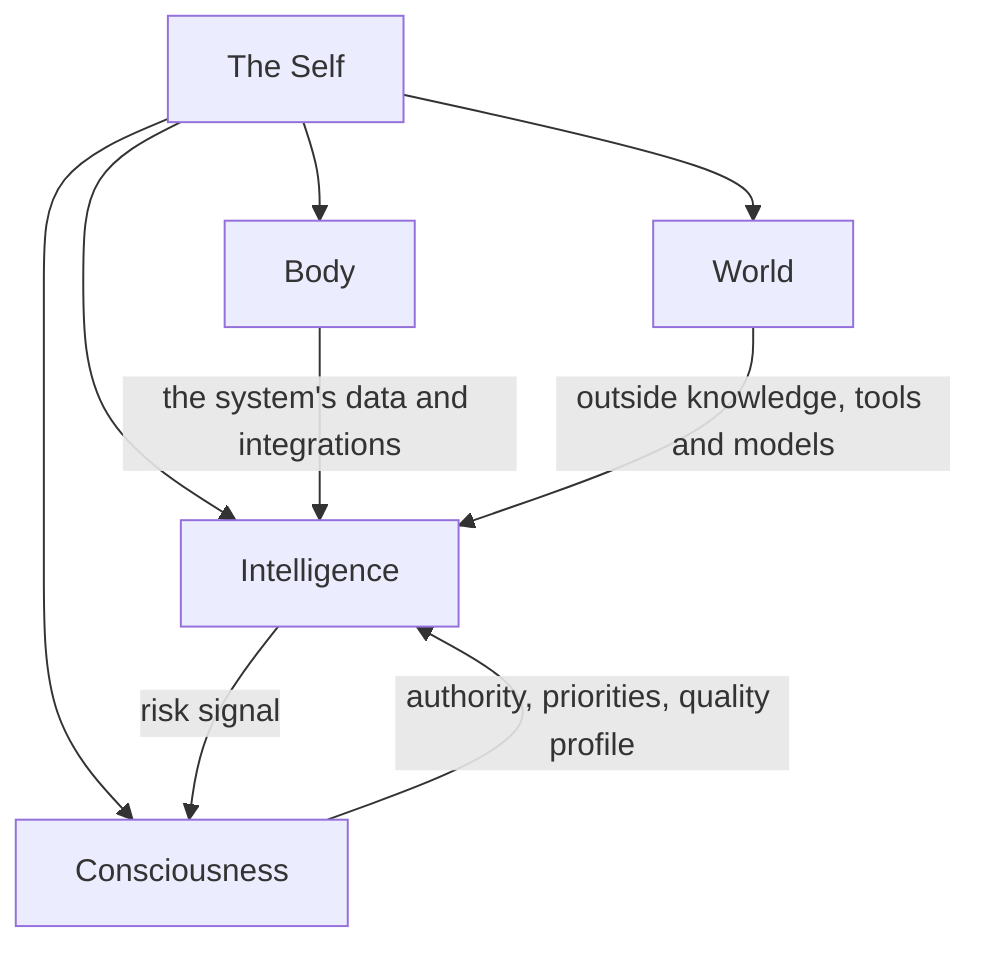

# The mind map

The hub is organised as a mind. It is a grouping for people; the interfaces do not depend on it, and a call such as
`hubofhubs.run("card-store", "rust")` never mentions it.

The picture is one request. The Mind is a stream of consciousness focused on the goal of that request: what the planning and responding
AI can see for it, and how it outputs plans, requests and communications. The Subconscious finds and prepares information for the Mind,
the Body holds the system's own internal context, and the World is everything outside the system.

## Five containers

Each container is named for the kind of change that moves its metrics, and each is a solution whose implementation composes its parts. Every
solution states its role: what it is responsible for, what it is not, and which sibling owns that.

- **The Self** keeps the parts working as one whole. Integrity keeps the hub generic, with claims that match evidence and records that match code,
  and audits what the system says about itself and what it did against the run record. Role Understanding says what each part is for. The
  Assembler builds the whole from configuration in one call. Its metric is Integrated Efficiency: is the system's total value justified by the
  cost of its components, found by taking out LLM calls, components and top-level solutions one at a time. It weighs completion, honest reporting
  and cost; keeping consent is not its job but Consciousness's.
- **Body** is the AI system's form and internal context, and its metrics change with the system's data model or code. Every Body solution is
  specified to expect adaptation to a particular system. Internal Context declares where the system's data lives and which World tool reads it:
  local files in a folder the system names, read through File Reading by default, or the system's own tool. The Subconscious reads the system's
  context only through Internal Context, which holds the Card Store and keeps each run's record in a run store apart from the cards. Intake
  Sources declares where requests come from. Hands makes sure the system's enduring integrations, such as an enterprise system's own AI tool
  registry, LLM platform and guardrails, are accessible to the AI and used by it. The models and guardrails themselves come from World.
- **Intelligence** is how information is processed, and its metrics change with machine learning task accuracy. Four of its solutions have parts
  of their own. The Mind takes context in through Context Intake (what the Subconscious prepared, what the World brought and the instructions
  that apply to the request, chosen within a token budget), breaks the request into pieces with the Planner, hands each piece to the right worker
  through Delegation only when that is necessary (carrying the Representative's authority and a sub-goal done-standard), and outputs plans,
  requests and communications through the Response Writer. Higher Mind keeps the long view across requests: Long-Term Memory, Objectives and
  Guidance. The Subconscious finds and prepares information for the Mind: Cards From Files builds cards, the Context Retriever picks what bears on
  the request and Intuition offers what comes to mind unasked. Critical Thinking turns a request into a metric with a target through Metric
  Translation, applies ESOI through ESOI Application, and checks the result with Goal Completion and Response Quality, which are separate
  solutions. The Nervous System raises one risk signal with a severity and a reason, and Proactivity says what is due without being asked.
- **World** is awareness of the outside and interaction with it, and its metrics change with outside systems. Science returns observations a
  reader can cite. Tools groups what the AI can use by category, and every implementation of a category does the same job: Web Search, File
  Reading, File Editing, Connected System Operations and Delegated Agent Sessions. Model Plumbing is the one way every part asks a model (the Model
  Tier Chooser picks the model, the Vendor Model Caller reaches the vendor), and Learning reports which of the hub's research is out of date.
- **Consciousness** is the humans who interact with the system, and its metrics change with alignment to humans or policies. Representatives are
  AI personas that carry a person's authority and data scope. Request Intake takes in what people ask, from the sources Body declares. Judgment
  Calls decides, for each person, whether to ask, proceed or decline, and the decision may go to a human, another agent or a delegate. It also
  holds the consent the person has set: a step that needs the person never proceeds without a decision. Feedback Learning applies a person's
  feedback to specs and metrics. Prioritization translates the priorities a person states or implies into ESOI. Their metrics are separate and
  their implementation may be shared.

## The flow

The Self responds to one request in this order. Consciousness gives the Representative. Body says where the system's data lives. Intelligence
reads the long view, translates the request into a target, has the Subconscious prepare from what Internal Context returns, and runs the Mind
with the Nervous System signal and Judgment Calls before a risky piece. Then Critical Thinking checks the goal and judges the response against a
quality profile; an unmet goal returns to the Planner within the request's budget, and when the budget or the authority runs out it goes to
Judgment Calls. Body keeps the run record and Integrity audits it, and Feedback Learning applies feedback when there is some. The flow is code
(`respond` in The Self and the `flow.py` of each container), every step calls the entry point of its solution, and a step whose solution has no
arm yet is reported as pending with the reason and not faked.

Response Quality judges against a profile: a named set of criteria with weights and targets, resolved for each request from the Representative,
Guidance and Prioritization, with a researched default profile as the fallback.

## Two contracts between containers

The Nervous System and Judgment Calls share one signal contract. The Nervous System raises a risk signal with a severity and a reason, and
Judgment Calls turns it into a decision for one person: ask, proceed or decline. Feedback adjusts that person's thresholds, so the two never
drift apart.

The Mind has one intake with three sources. What the Subconscious prepares from the system's internal context, what World brings in through
Science and Tools, and the instructions that apply to the request reach the Mind the same way, through Context Intake.

## The parts

The table below is generated from the records. Names lead, each part says what it is inside, and the id is the handle a call uses.

<!-- seats:start -->
| Part of the mind | Inside | Areas | Built on now | Candidates researched | Oldest research | Call with |
|---|---|---|---|---|---|---|
| The Self | the hub | 0 | 0 | 0 | none | `the-self` |
| Integrity | The Self | 3 | 2 | 12 | 2026-10-30 | `system-integrity` |
| Role Understanding | The Self | 0 | 0 | 0 | none | `role-understanding` |
| Assembler | The Self | 3 | 1 | 6 | 2026-10-30 | `the-assembler` |
| Body | the hub | 0 | 0 | 0 | none | `the-body` |
| Internal Context | Body | 0 | 0 | 0 | none | `internal-context` |
| Card Store | Internal Context | 0 | 0 | 0 | none | `card-store` |
| Intake Sources | Body | 0 | 0 | 0 | none | `intake-sources` |
| Hands | Body | 0 | 0 | 0 | none | `the-hands` |
| Intelligence | the hub | 0 | 0 | 0 | none | `the-intelligence` |
| Mind | Intelligence | 7 | 1 | 49 | 2026-10-30 | `the-mind` |
| Context Intake | Mind | 0 | 0 | 0 | none | `context-intake` |
| Planner | Mind | 0 | 0 | 0 | none | `planner` |
| Delegation | Mind | 1 | 0 | 11 | 2026-10-30 | `delegation` |
| Response Writer | Mind | 0 | 0 | 0 | none | `response-writer` |
| Route a Request | Mind | 0 | 0 | 0 | none | `route-a-request` |
| Resolve a Reference | Mind | 0 | 0 | 0 | none | `resolve-a-reference` |
| Higher Mind | Intelligence | 0 | 0 | 0 | none | `higher-mind` |
| Long-Term Memory | Higher Mind | 0 | 0 | 0 | none | `long-term-memory` |
| Objectives | Higher Mind | 0 | 0 | 0 | none | `live-objectives` |
| Guidance | Higher Mind | 0 | 0 | 0 | none | `guidance` |
| Subconscious | Intelligence | 11 | 8 | 79 | 2026-10-30 | `the-subconscious` |
| Intuition | Subconscious | 0 | 0 | 0 | none | `the-intuition` |
| Cards From Files | Local File Context | 0 | 0 | 0 | none | `cards-from-files` |
| Context Retriever | Subconscious | 0 | 0 | 0 | none | `context-retriever` |
| Relevant Solutions | Subconscious | 0 | 0 | 0 | none | `relevant-solutions` |
| Local File Context | Subconscious | 0 | 0 | 0 | none | `local-file-context` |
| Folder View | Local File Context | 0 | 0 | 0 | none | `folder-view` |
| Critical Thinking | Intelligence | 0 | 0 | 0 | none | `critical-thinking` |
| ESOI Application | Critical Thinking | 0 | 0 | 0 | none | `esoi-application` |
| Metric Translation | Critical Thinking | 0 | 0 | 0 | none | `metric-translation` |
| Goal Completion | Critical Thinking | 0 | 0 | 0 | none | `goal-completion` |
| Response Quality | Critical Thinking | 5 | 5 | 32 | 2026-10-30 | `response-quality` |
| Decision Check | Critical Thinking | 0 | 0 | 0 | none | `decision-check` |
| Metric Upkeep | Critical Thinking | 0 | 0 | 0 | none | `metric-upkeep` |
| Solution Passes | Critical Thinking | 0 | 0 | 0 | none | `solution-passes` |
| Nervous System | Intelligence | 4 | 4 | 26 | 2026-10-30 | `nervous-system` |
| Proactivity | Intelligence | 0 | 0 | 0 | none | `proactivity` |
| World | the hub | 7 | 1 | 37 | 2026-10-30 | `the-world` |
| Science | World | 10 | 2 | 74 | 2026-10-30 | `the-science` |
| Tools | World | 0 | 0 | 0 | none | `the-tools` |
| Web Search | Tools | 0 | 0 | 0 | none | `web-search` |
| File Reading | Tools | 0 | 0 | 0 | none | `read-files` |
| File Editing | Tools | 2 | 2 | 10 | 2026-10-30 | `file-editing` |
| Connected System Operations | Tools | 10 | 2 | 59 | 2026-10-30 | `connected-system-operations` |
| Delegated Agent Sessions | Tools | 6 | 1 | 50 | 2026-10-30 | `delegated-agent-sessions` |
| Command Execution | Tools | 1 | 0 | 7 | 2026-10-30 | `command-execution` |
| Agent Action Format | Tools | 1 | 1 | 6 | 2026-11-10 | `agent-action-format` |
| Model Plumbing | World | 0 | 0 | 0 | none | `model-plumbing` |
| Model Tier Chooser | Model Plumbing | 0 | 0 | 0 | none | `model-tier-chooser` |
| Vendor Model Caller | Model Plumbing | 0 | 0 | 0 | none | `vendor-model-caller` |
| Learning | World | 3 | 2 | 17 | 2026-10-30 | `the-learning` |
| Research Freshness Reader | Learning | 0 | 0 | 0 | none | `research-freshness-reader` |
| Consciousness | the hub | 0 | 0 | 0 | none | `the-consciousness` |
| Representatives | Consciousness | 0 | 0 | 0 | none | `the-representatives` |
| Judgment Calls | Consciousness | 1 | 1 | 4 | 2026-10-30 | `judgment-calls` |
| Feedback Learning | Consciousness | 0 | 0 | 0 | none | `feedback-learning` |
| Prioritization | Consciousness | 0 | 0 | 0 | none | `prioritization` |
| Request Intake | Consciousness | 0 | 0 | 0 | none | `request-intake` |
| AI Session Experience | Consciousness | 0 | 0 | 0 | none | `ai-session-experience` |
| Terminal Experience | AI Session Experience | 1 | 1 | 14 | 2026-11-10 | `terminal-session` |
| Frontend Interface | AI Session Experience | 0 | 0 | 0 | none | `frontend-interface` |
| Structure In View | AI Session Experience | 0 | 0 | 0 | none | `structure-in-view` |

76 areas and 493 researched candidates in all; every area is listed in [../reference/registry.md](../reference/registry.md).
<!-- seats:end -->
