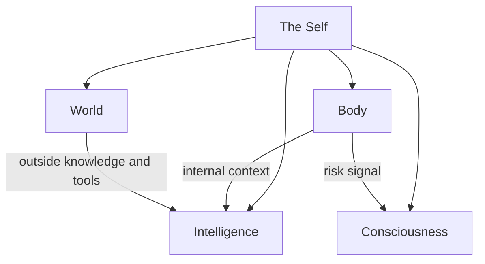

# The mind map

The hub is organised as a mind. It is a grouping for people; the interfaces do not depend on it, and a call such as
`hubofhubs.run("card-store", "rust")` never mentions it.

The picture is one request. The Mind is a stream of consciousness focused on the goal of that request: what the planning and responding
AI can see for it, and how it outputs plans, requests and communications. The Subconscious finds and prepares information for the Mind,
the Body holds the system's own internal context, and the World is everything outside the system.

## Five containers

Each container is named for the kind of evolution it holds, and each is a solution whose implementation composes its parts.

- **The Self** is the integration, coherence and role understanding of all the parts. Integrity keeps the hub generic, with claims that
  match evidence and records that match code. Role Understanding says what each part is for. The Assembler builds the whole from
  configuration in one call. Model Plumbing is the one way every part asks a model: the Model Tier Chooser picks the model for a tier, the
  Model Call asks it, and the Vendor Model Caller reaches the vendor and steps to the next provider when one fails.
- **Body** is the AI system's form and internal context, so the hub applies to a particular system by providing adapters or declaring the
  system's internal APIs, databases and files. Internal Context holds the Card Store and Cards From Files, and its default is local files
  at a standard location. Learning keeps research current through the Research Freshness Reader. The Nervous System raises a risk signal
  before a step that cannot be undone or belongs to a person. Hands is broad code that makes it easy for AI to use tools, make changes in
  the world or get knowledge without being one specific integration, and the Connection Scorer measures how much code an integration
  needs. Acting carries a goal out against a written done-standard.
- **Intelligence** is how information is processed for one request. The Mind has one intake, and two sources feed it: the
  Subconscious, which finds and prepares internal context, and the World, through Science and Tools. The Assembler wires both to the Mind.
  The Subconscious holds Intuition, the Context Assembler and the Context Retriever. The Higher Mind keeps the long view through Long-Term
  Memory, Long-Term Context and Objectives. Critical Thinking holds an answer to its evidence.
- **World** is awareness of the outside and interaction with it. Science returns observations a reader can cite. Tools groups what the AI can
  use by category: a category is a solution and an integration is one of its implementations. Web Search is the category built today, and
  Personal Data Locations records where a person keeps their own data as a fact about the setup, not as a contest between integrations.
- **Consciousness** is the humans who interact with the system. Representatives are AI personas. Asking Judgment learns, for each person,
  when to ask and when not to. Feedback Learning lets a person's feedback change how the representative acts.

## Two contracts between containers

The Nervous System and Asking Judgment share one signal contract. The Nervous System raises a risk signal with a severity and a reason, and
Asking Judgment turns it into a decision for one person: ask, proceed or decline. Feedback adjusts that person's thresholds, so the two never
drift apart.

The Mind has one intake with two sources. What the Subconscious prepares from the system's internal context and what the World brings
in through Science and Tools reach the Mind the same way, and the Assembler wires them.

## The parts

The table below is generated from the records. Names lead, each part says what it is inside, and the id is the handle a call uses.

<!-- seats:start -->
| Part of the mind | Inside | Areas | Built on now | Candidates researched | Oldest research | Call with |
|---|---|---|---|---|---|---|
| The Self | the hub | 0 | 0 | 0 | none | `the-self` |
| Integrity | The Self | 3 | 2 | 12 | 2026-10-30 | `keep-it-generic` |
| Role Understanding | The Self | 0 | 0 | 0 | none | `role-understanding` |
| Assembler | The Self | 3 | 1 | 6 | 2026-10-30 | `assemble-the-whole` |
| Model Plumbing | The Self | 0 | 0 | 0 | none | `model-plumbing` |
| Model Tier Chooser | Model Plumbing | 0 | 0 | 0 | none | `choose-a-model-tier` |
| Model Call | Model Plumbing | 0 | 0 | 0 | none | `model-call` |
| Vendor Model Caller | Model Plumbing | 0 | 0 | 0 | none | `call-a-model` |
| Body | the hub | 0 | 0 | 0 | none | `the-body` |
| Internal Context | Body | 0 | 0 | 0 | none | `internal-context` |
| Card Store | Internal Context | 0 | 0 | 0 | none | `card-store` |
| Cards From Files | Internal Context | 0 | 0 | 0 | none | `cards-from-files` |
| Learning | Body | 3 | 2 | 17 | 2026-10-30 | `stay-current` |
| Research Freshness Reader | Learning | 0 | 0 | 0 | none | `read-registry-freshness` |
| Nervous System | Body | 5 | 5 | 29 | 2026-10-30 | `watch-for-risk` |
| Hands | Body | 0 | 0 | 0 | none | `connect-any-integration` |
| Connection Scorer | Hands | 0 | 0 | 0 | none | `score-hub-connections` |
| Acting | Body | 20 | 5 | 133 | 2026-10-30 | `act-in-the-world` |
| Intelligence | the hub | 0 | 0 | 0 | none | `the-intelligence` |
| Mind | Intelligence | 8 | 1 | 55 | 2026-10-30 | `reason-and-answer` |
| Higher Mind | Intelligence | 0 | 0 | 0 | none | `higher-mind` |
| Long-Term Memory | Higher Mind | 0 | 0 | 0 | none | `long-term-memory` |
| Long-Term Context | Higher Mind | 0 | 0 | 0 | none | `long-term-context` |
| Objectives | Higher Mind | 0 | 0 | 0 | none | `hold-objectives` |
| Subconscious | Intelligence | 10 | 8 | 69 | 2026-10-30 | `remember-and-recall` |
| Intuition | Subconscious | 0 | 0 | 0 | none | `offer-intuition` |
| Context Assembler | Subconscious | 0 | 0 | 0 | none | `context-assembler` |
| Context Retriever | Subconscious | 0 | 0 | 0 | none | `retrieve-context` |
| Critical Thinking | Intelligence | 4 | 4 | 18 | 2026-10-30 | `think-critically` |
| World | the hub | 7 | 1 | 36 | 2026-10-30 | `take-in-the-world` |
| Science | World | 10 | 2 | 73 | 2026-10-30 | `know-the-world` |
| Tools | World | 0 | 0 | 0 | none | `use-tools` |
| Web Search | Tools | 0 | 0 | 0 | none | `search-backend` |
| Personal Data Locations | Tools | 0 | 0 | 0 | none | `personal-data-locations` |
| Consciousness | the hub | 0 | 0 | 0 | none | `the-consciousness` |
| Representatives | Consciousness | 0 | 0 | 0 | none | `ai-representatives` |
| Asking Judgment | Consciousness | 0 | 0 | 0 | none | `asking-judgment` |
| Feedback Learning | Consciousness | 0 | 0 | 0 | none | `feedback-learning` |

73 areas and 448 researched candidates in all; every area is listed in [../reference/registry.md](../reference/registry.md).
<!-- seats:end -->
