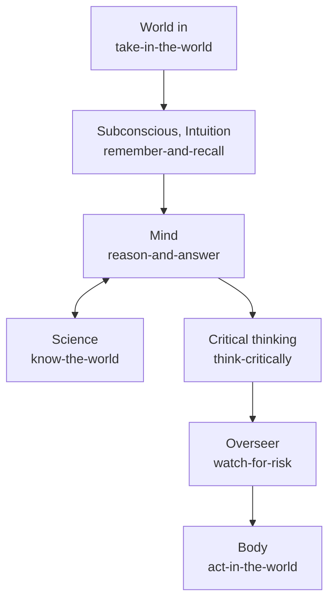

# The mind map

One way to read the hub's parts is as parts of a mind. It is a grouping for people; the interfaces do not depend on it, and a call
such as `hubofhubs.run("card-store", "rust")` never mentions it.

A request enters from the world (World in). Subconscious and Intuition admit what bears on the goal. The Mind works on it and asks
Science for evidence. Critical thinking holds the result to its evidence, the Overseer checks the risk, and the Body acts. Learning keeps the
registry current, Hands connect integrations, Character keeps the hub generic, and the whole being is the assembled hub.
The Higher mind seat was dissolved: its research area now sits under reason-and-answer.

The table below is generated from the records.

<!-- seats:start -->
| Seat | Part of the mind | Areas | Built on now | Candidates researched | Oldest research |
|---|---|---|---|---|---|
| take-in-the-world | World | 7 | 1 | 36 | 2026-10-30 |
| remember-and-recall | Subconscious, Intuition | 10 | 8 | 69 | 2026-10-30 |
| reason-and-answer | Mind | 8 | 1 | 55 | 2026-10-30 |
| know-the-world | Science | 10 | 2 | 73 | 2026-10-30 |
| think-critically | Critical thinking | 4 | 4 | 18 | 2026-10-30 |
| act-in-the-world | Body | 20 | 5 | 133 | 2026-10-30 |
| watch-for-risk | Overseer | 5 | 5 | 29 | 2026-10-30 |
| assemble-the-whole | The whole being | 3 | 1 | 6 | 2026-10-30 |
| stay-current | Learning | 3 | 2 | 17 | 2026-10-30 |
| keep-it-generic | Character | 3 | 2 | 12 | 2026-10-30 |
| connect-any-integration | Hands | 0 | 0 | 0 | none |

73 areas and 448 researched candidates in all; every area is listed in [../reference/registry.md](../reference/registry.md).
<!-- seats:end -->
