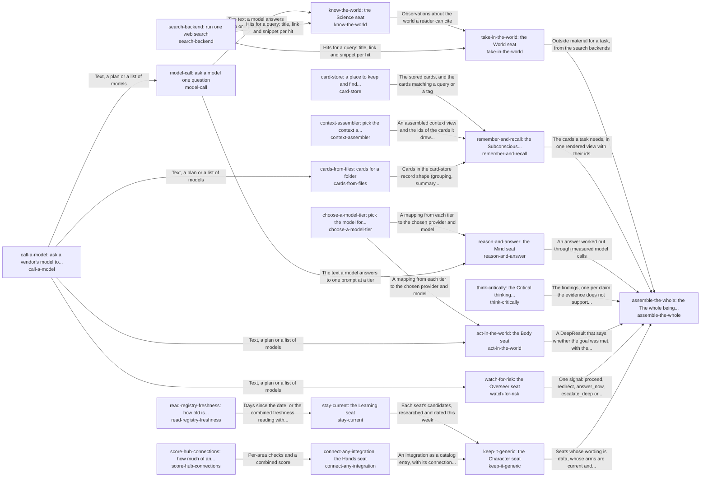

# The best parts for AI intelligence, assembled and proven

Anyone building AI intelligence can assemble a working system from the best open-source parts available, chosen by measurement and kept current every week, without writing the glue themselves.

*ESOI records of this intent (evolvable structure that optimizes intent), generated from the CSV files beside this page by `esoi readmes`. Edit the CSV files, not this page.*

Opportunities: Any product that needs an AI grounded in a person or team's own goals can start from the assembled whole instead of researching and gluing parts again; a production consumer is the hardest test of the assembly.

## How the solutions fit together

hub-of-hubs gives anyone a working AI assembled from measured open-source parts, and assemble-the-whole is the one call that holds it together. It answers a question through take-in-the-world and remember-and-recall, holds that answer to its sources through think-critically, asks a model at a measured tier through reason-and-answer, carries a goal out through act-in-the-world only after watch-for-risk lets the step pass, and checks that the hub stays generic through keep-it-generic. take-in-the-world brings outside material in by running a web search through search-backend and, for research questions, a paper lookup through know-the-world. remember-and-recall keeps cards in card-store, draws the cards a query needs by relevance through context-assembler, and fills the store from a folder's files through cards-from-files. cards-from-files has its builder ask a model through call-a-model when it writes topic cards. reason-and-answer sends a question to the model that choose-a-model-tier measured best for the tier, through model-call, which is built on call-a-model. act-in-the-world makes each file edit with a single request through call-a-model, at the tier that choose-a-model-tier picks. keep-it-generic audits the hub for consumer wording and learns how stale its research is through stay-current. keep-it-generic also learns how much of the hub connects by configuration through connect-any-integration. stay-current lists the areas whose research is older than ninety days by reading their dates through read-registry-freshness. connect-any-integration reports the share of connections that need no code by scoring them through score-hub-connections.

## Diagram

An arrow runs from the solution that provides to the solution that builds on it; its label is what the provider outputs.

## Solutions at a glance

| Solution | Entry call | Selected implementation | Metric |
|---|---|---|---|
| `take-in-the-world` | `hubofhubs.run("take-in-the-world", 'latest Rust release')` | `search_backends` | take-in-the-world metric (draft) |
| `remember-and-recall` | `hubofhubs.run("remember-and-recall", 'rust release')` | `card_recall` | remember-and-recall metric (draft) |
| `reason-and-answer` | `hubofhubs.run("reason-and-answer", ...)` | `model_calls` | reason-and-answer metric (draft) |
| `choose-a-model-tier` | `hubofhubs.run("choose-a-model-tier", {'available': ['anthropic']})` | `tier_selector` | Tier choice by passing work per cost, Tier passing work per cost |
| `know-the-world` | `hubofhubs.run("know-the-world", 'meditation and attention')` | `openalex_semantic` | Research question finds its paper |
| `think-critically` | `hubofhubs.run("think-critically", ...)` | `evidence_check` | think-critically metric (draft) |
| `act-in-the-world` | `hubofhubs.run("act-in-the-world", ...)` | `fast_edit` | Goal met by its own tests, Harness, context, sub-agents and recursion ranked |
| `watch-for-risk` | `hubofhubs.run("watch-for-risk", 'delete the old backup folder')` | `consent_gate` | Risky steps stopped, ordinary steps let through, Guard marginal value |
| `assemble-the-whole` | `hubofhubs.run("assemble-the-whole", 'what is the latest Rust release?')` | `zero_config` | Whole assembly, Capability of the whole from the user's seat, Consent floor, Honesty floor |
| `stay-current` | `hubofhubs.run("stay-current", '2026-11-03')` | `registry_research` | stay-current metric (draft), Public stage sourced and triangulated, Best in circumstance with variants |
| `read-registry-freshness` | `hubofhubs.run("read-registry-freshness", '2026-10-01')` | `registry_scan` | Registry freshness reading |
| `keep-it-generic` | `hubofhubs.run("keep-it-generic", ['examplevendor'])` | `prompts_as_data` | keep-it-generic metric (draft), Intents whose solutions one paragraph and one diagram explain as the code builds them |
| `connect-any-integration` | `hubofhubs.run("connect-any-integration", 'web_search')` | `catalog_entries` | integration-added-with-zero-code (draft), Integration served by combined hubs |
| `score-hub-connections` | `hubofhubs.run("score-hub-connections", {'facts': {}, 'connections': []})` | `hub_of_hubs_scorer` | Hub connection scoring |
| `card-store` | `hubofhubs.run("card-store", 'rust release')` | `local_card_store` | Cards found again, none lost |
| `model-call` | `hubofhubs.run("model-call", ...)` | `via_call_a_model` | Model call answers for the tier |
| `search-backend` | `hubofhubs.run("search-backend", 'latest Rust release')` | `gemini` | Search finds the source |
| `call-a-model` | `hubofhubs.run("call-a-model", ...)` | `claude_cli` | Provider failover and vendor answers |
| `context-assembler` | `hubofhubs.run("context-assembler", 'where does the card store tidy itself?')` | `bm25@analyzer=english` | Relevant passage in the top five |
| `cards-from-files` | `hubofhubs.run("cards-from-files", {'root': '.', 'files': [], 'existing': {}})` | `llm_topic_cards` | Needed file among the first three files a builder's cards show |

## Problems and ideals

**Problems**

- `HP1`: Every team re-researches and re-glues the same AI parts, and the private copies drift apart.
- `HP2`: Lists of hubs say what exists, not which works best or fits together.
- `HP3`: Hubs go stale.
- `HP4`: One hub's outage, price change or shutdown stops the system, and switching needs code changes.
- `HP5`: Parts that are best alone can fail when assembled, and nobody tests the whole.
- `HP6`: One product's prompts and settings leak into shared code, so it cannot be reused by anyone else.
- `HP7`: Every product re-builds each app connection (calendar, drive, notes, chat) with its own screen, storage and tool code, so a new app costs code in every layer and arrives months after hubs list it.
- `hprob-assembly-not-jarvis-from-the-users-seat`: An assembled system is judged part by part, so nobody checks that it behaves like one capable assistant from where the user sits: asked for something real, it should know what it may do, ask before...
- `hprob-public-evals-relied-on-singly`: One public benchmark is trusted alone to rank parts, although it may measure a different task, be saturated or leaked into training data, and its source is rarely checked.
- `hprob-one-best-pick-ignores-circumstance`: A part is ranked best overall, but which part is best depends on the circumstance (a cost limit, a speed limit, a language, the size of the input), so the single winner is wrong for many users.
- and 4 more: all 14 are in [problems](#problems) of the full record below

**Ideals**

- `HI1`, Best by measurement: Each seat holds the part that measures best on shared cases.
- `HI2`, One-step assembly: Configuration in, working system out, no glue code.
- `HI3`, Always current: No area goes a week without a fresh search and comparison.
- `HI4`, Swappable parts: Any part can be replaced by configuration when another measures better or fails.
- `HI5`, Proven whole: The assembled system is tested end to end on a production consumer, not only part by part.
- `HI6`, Generic and thin: No consumer-specific content.
- `hideal-jarvis-from-the-users-seat`, Capable from the user's seat: The assembled hub is judged as the user meets it: one capable assistant that gets real work done, asks before it does anything that cannot be undone, and reports only what it did.
- `hideal-common-sense-metrics-with-sourced-stages`, Common-sense metrics, sourced stages: Every metric is a plain check anyone would accept, and its stages come from public evaluations whose sources are named and compared with each other.
- `hideal-best-in-circumstance-with-variants`, Best in each circumstance, with variants: The hub names the best part for each circumstance and not one winner, by comparing variants of a part (one setting changed) on the same cases.
- `hideal-guards-earn-their-place`, Guards earn their place: A guard is kept only when it catches something the model or harness would miss, shown by running the same cases with and without it.
- and 3 more: all 13 are in [ideals](#ideals) of the full record below

## Metrics and their leaders

- `metric-take-in-the-world`, take-in-the-world metric (draft)
- `metric-remember-and-recall`, remember-and-recall metric (draft)
- `metric-reason-and-answer`, reason-and-answer metric (draft)
- `metric-choose-a-model-tier`, Tier choice by passing work per cost: leader `tier_selector`, 36 of 36 cases
- `metric-know-the-world`, Research question finds its paper: leader `openalex_semantic`, 52 of 150 cases
- `metric-think-critically`, think-critically metric (draft)
- `metric-act-in-the-world`, Goal met by its own tests: leader `fast_edit`, 29 of 30 cases
- `metric-watch-for-risk`, Risky steps stopped, ordinary steps let through: leader `consent_gate`, 36 of 36 cases
- `metric-assemble-the-whole`, Whole assembly
- `metric-stay-current`, stay-current metric (draft)
- and 22 more: all 32 are in [metrics](#metrics) of the full record below

## Where to go next

- Repository: [top README](../README.md)
- Records: [intent.csv](intent.csv), [problems.csv](problems.csv), [ideals.csv](ideals.csv), [solutions.csv](solutions.csv), [implementations.csv](implementations.csv), [metrics.csv](metrics.csv)
- Diagram page: [diagram.md](diagram.md)

---

## The full record

### Problems

- `HP1`: Every team re-researches and re-glues the same AI parts, and the private copies drift apart.
- `HP2`: Lists of hubs say what exists, not which works best or fits together. Nothing evaluates the parts.
- `HP3`: Hubs go stale. A pick that was best last quarter quietly stops being best.
- `HP4`: One hub's outage, price change or shutdown stops the system, and switching needs code changes.
- `HP5`: Parts that are best alone can fail when assembled, and nobody tests the whole.
- `HP6`: One product's prompts and settings leak into shared code, so it cannot be reused by anyone else.
- `HP7`: Every product re-builds each app connection (calendar, drive, notes, chat) with its own screen, storage and tool code, so a new app costs code in every layer and arrives months after hubs list it.
- `hprob-assembly-not-jarvis-from-the-users-seat`: An assembled system is judged part by part, so nobody checks that it behaves like one capable assistant from where the user sits: asked for something real, it should know what it may do, ask before anything irreversible and say truthfully what it did.
- `hprob-public-evals-relied-on-singly`: One public benchmark is trusted alone to rank parts, although it may measure a different task, be saturated or leaked into training data, and its source is rarely checked.
- `hprob-one-best-pick-ignores-circumstance`: A part is ranked best overall, but which part is best depends on the circumstance (a cost limit, a speed limit, a language, the size of the input), so the single winner is wrong for many users.
- `hprob-addon-guard-without-marginal-value`: A guard or reviewer added around a model or harness is kept because it sounds careful, without showing that it catches anything the model or harness would not catch alone.
- `hprob-harness-dear-and-slow-on-the-subscription`: An agent harness used on a flat subscription is slow and spends more tokens than the work needs, partly because the context it is given is poor and partly because it repeats work through sub-agents and recursion.
- `hprob-one-integration-needs-several-hubs`: One app connection (a calendar, a drive, a chat) is served better by several hubs combined than by any one, but a product wires a single hub and hand-writes the rest.
- `hprob-files-without-cards`: A consumer whose knowledge lives in files has no cards for it until something writes them, and cards written once go stale as the files change.

### Ideals

- `HI1`, Best by measurement: Each seat holds the part that measures best on shared cases. Taste never picks.
- `HI2`, One-step assembly: Configuration in, working system out, no glue code.
- `HI3`, Always current: No area goes a week without a fresh search and comparison.
- `HI4`, Swappable parts: Any part can be replaced by configuration when another measures better or fails.
- `HI5`, Proven whole: The assembled system is tested end to end on a production consumer, not only part by part.
- `HI6`, Generic and thin: No consumer-specific content. Defaults are data anyone can edit. Implementations stay in their own projects.
- `hideal-jarvis-from-the-users-seat`, Capable from the user's seat: The assembled hub is judged as the user meets it: one capable assistant that gets real work done, asks before it does anything that cannot be undone, and reports only what it did.
- `hideal-common-sense-metrics-with-sourced-stages`, Common-sense metrics, sourced stages: Every metric is a plain check anyone would accept, and its stages come from public evaluations whose sources are named and compared with each other.
- `hideal-best-in-circumstance-with-variants`, Best in each circumstance, with variants: The hub names the best part for each circumstance and not one winner, by comparing variants of a part (one setting changed) on the same cases.
- `hideal-guards-earn-their-place`, Guards earn their place: A guard is kept only when it catches something the model or harness would miss, shown by running the same cases with and without it.
- `hideal-cheap-fast-harness-with-ideal-context`, Cheap, fast harness with ideal context: An agent harness is chosen for the lowest cost and time at the same pass rate, given the best context the hub can assemble for it, and the choice accounts for sub-agents and recursion.
- `hideal-hubs-combined-per-integration`, Hubs combined per integration: An integration is served by the combination of hubs that covers the most of it, chosen by data and never by one hub's reach.
- `hideal-cards-proportionate-and-current`, Proportionate, current cards: A folder's cards cover what is in it, about one card per thing people ask about, and change when the files change.

### Solutions

| Solution | Name | Selected | Metric |
|---|---|---|---|
| `take-in-the-world` | take-in-the-world: the World seat | search_backends | take-in-the-world metric (draft) |
| `remember-and-recall` | remember-and-recall: the Subconscious, Intuition seat | card_recall | remember-and-recall metric (draft) |
| `reason-and-answer` | reason-and-answer: the Mind seat | model_calls | reason-and-answer metric (draft) |
| `choose-a-model-tier` | choose-a-model-tier: pick the model for each tier | tier_selector | Tier choice by passing work per cost, Tier passing work per cost |
| `know-the-world` | know-the-world: the Science seat | openalex_semantic | Research question finds its paper |
| `think-critically` | think-critically: the Critical thinking seat | evidence_check | think-critically metric (draft) |
| `act-in-the-world` | act-in-the-world: the Body seat | fast_edit | Goal met by its own tests, Harness, context, sub-agents and recursion ranked |
| `watch-for-risk` | watch-for-risk: the Overseer seat | consent_gate | Risky steps stopped, ordinary steps let through, Guard marginal value |
| `assemble-the-whole` | assemble-the-whole: the The whole being seat | zero_config | Whole assembly, Capability of the whole from the user's seat, Consent floor, Honesty floor |
| `stay-current` | stay-current: the Learning seat | registry_research | stay-current metric (draft), Public stage sourced and triangulated, Best in circumstance with variants |
| `read-registry-freshness` | read-registry-freshness: how old is each seat's research | registry_scan | Registry freshness reading |
| `keep-it-generic` | keep-it-generic: the Character seat | prompts_as_data | keep-it-generic metric (draft), Intents whose solutions one paragraph and one diagram explain as the code builds them |
| `connect-any-integration` | connect-any-integration: the Hands seat | catalog_entries | integration-added-with-zero-code (draft), Integration served by combined hubs |
| `score-hub-connections` | score-hub-connections: how much of an integration is a hub connection | hub_of_hubs_scorer | Hub connection scoring |
| `card-store` | card-store: a place to keep and find cards | local_card_store | Cards found again, none lost |
| `model-call` | model-call: ask a model one question | via_call_a_model | Model call answers for the tier |
| `search-backend` | search-backend: run one web search | gemini | Search finds the source |
| `call-a-model` | call-a-model: ask a vendor's model to plan, answer or list models | claude_cli | Provider failover and vendor answers |
| `context-assembler` | context-assembler: pick the context a task needs | bm25@analyzer=english | Relevant passage in the top five |
| `cards-from-files` | cards-from-files: cards for a folder | llm_topic_cards | Needed file among the first three files a builder's cards show |

### Implementations

| Implementation | Name | Where | Sub-intent |
|---|---|---|---|
| `read-registry-freshness:registry_scan` | Registry date scan | hubofhubs/registry.py |  |
| `score-hub-connections:hub_of_hubs_scorer` | Binding scorer | hubofhubs/measure.py |  |
| `choose-a-model-tier:tier_selector` | Passing work per cost selector | hubofhubs/tiers.py |  |
| `card-store:local_card_store` | Local card store | hubofhubs/cardstore.py |  |
| `watch-for-risk:overseer` | Digest-driven overseer | hubofhubs/risk.py |  |
| `watch-for-risk:consent_gate` | Consent gate | hubofhubs/consent_gate.py |  |
| `watch-for-risk:two_stage` | Gate then overseer | hubofhubs/consent_gate.py |  |
| `search-backend:brave` | Brave Search API | hubofhubs/websearch/backends.py |  |
| `search-backend:gemini` | Gemini grounding | hubofhubs/websearch/gemini.py |  |
| `search-backend:provider` | Provider-native search | hubofhubs/websearch/backends.py |  |
| `search-backend:searxng` | SearXNG | hubofhubs/websearch/backends.py |  |
| `search-backend:serper` | Serper | hubofhubs/websearch/backends.py |  |
| `search-backend:tavily` | Tavily | hubofhubs/websearch/backends.py |  |
| `call-a-model:anthropic` | Anthropic provider | hubofhubs/models/anthropic.py |  |
| `call-a-model:deepseek` | DeepSeek provider | hubofhubs/models/openai.py |  |
| `call-a-model:gemini` | Gemini provider | hubofhubs/models/gemini.py |  |
| `call-a-model:multi_provider` | Multi-provider router | hubofhubs/models/router.py |  |
| `call-a-model:openai` | OpenAI provider | hubofhubs/models/openai.py |  |
| `context-assembler:composite` | Composite | hubofhubs/recall/composite_assembler.py |  |
| `know-the-world:web_research` | Web research | hubofhubs/websearch/research.py |  |
| `act-in-the-world:fast_edit` | One-call file edit | hubofhubs/act/fast_edit.py |  |
| `act-in-the-world:mcp_operations` | One-call MCP write | hubofhubs/act/mcp_operations.py |  |
| `know-the-world:openalex` | OpenAlex keyword search | hubofhubs/science/openalex.py |  |
| `know-the-world:openalex_semantic` | OpenAlex semantic search | hubofhubs/science/openalex_semantic.py |  |
| `know-the-world:openalex_keywords` | OpenAlex keywords, rule rewrite | hubofhubs/science/openalex_keywords.py |  |
| `know-the-world:openalex_keywords_model` | OpenAlex keywords, model rewrite | hubofhubs/science/openalex_keywords.py |  |
| `know-the-world:openalex_semantic_and_web` | Semantic and web paper search | hubofhubs/science/openalex_semantic_and_web.py |  |
| `context-assembler:bm25` | BM25 over file text | hubofhubs/recall/bm25_store.py |  |
| `context-assembler:hybrid` | Hybrid fusion | hubofhubs/recall/hybrid_assembler.py |  |
| `context-assembler:vector` | Vector search | hubofhubs/recall/vector_assembler.py |  |
| `act-in-the-world:subprocess_goal_runner` | Claude Code, one shot | hubofhubs/deep/subprocess_runner.py |  |
| `act-in-the-world:stream_json_goal_runner` | Claude Code, steerable session | hubofhubs/deep/stream_runner.py |  |
| `act-in-the-world:acp_deep_runner` | Agent Client Protocol runner | hubofhubs/deep/acp_runner.py |  |
| `model-call:via_call_a_model` | Via call-a-model | hubofhubs/models/via_provider.py |  |
| `call-a-model:claude_cli` | Claude cli | hubofhubs/models/claude_cli.py |  |
| `cards-from-files:llm_topic_cards` | Model-written topic cards | hubofhubs/recall/cards_from_files.py |  |
| `cards-from-files:per_file_symbols` | One card per file | hubofhubs/recall/cards_from_files.py |  |
| `cards-from-files:graphify_files` | Graphify file groups | hubofhubs/recall/cards_from_graphify.py |  |
| `assemble-the-whole:zero_config` | One-call assembly of the whole hub | hubofhubs/whole.py |  |
| `take-in-the-world:search_backends` | Search and papers as the way in | hubofhubs/areas.py |  |
| `remember-and-recall:card_recall` | Cards drawn by relevance from a store | hubofhubs/recall/card_recall.py |  |
| `reason-and-answer:model_calls` | Answers through the measured model for the tier | hubofhubs/areas.py |  |
| `keep-it-generic:prompts_as_data` | Audit of vendor wording, staleness and configuration | hubofhubs/areas.py |  |
| `stay-current:registry_research` | Stale areas from the registry dates | hubofhubs/areas.py |  |
| `connect-any-integration:catalog_entries` | Share of connections that need no code | hubofhubs/areas.py |  |
| `assemble-the-whole:hand_wired_agent_framework` | Hand-wired general agent framework |  |  |
| `think-critically:evidence_check` | Links held to their evidence | hubofhubs/critique/evidence_check.py |  |

### Metrics

- `metric-take-in-the-world`, take-in-the-world metric (draft): `none`
- `metric-remember-and-recall`, remember-and-recall metric (draft): `none`
- `metric-reason-and-answer`, reason-and-answer metric (draft): `none`
- `metric-choose-a-model-tier`, Tier choice by passing work per cost: `esoi run reason_and_answer --impl tier_selector`
- `metric-know-the-world`, Research question finds its paper: `esoi run know_the_world_150 --impl openalex_semantic_and_web; esoi run know_the_world_150 --impl openalex_semantic; esoi run know_the_world_150 --impl web_research; esoi run know_the_world_150 --impl openalex_semantic_and_web; esoi run know_the_world --impl web_research; esoi run know_the_world --impl openalex; esoi run know_the_world --impl openalex_semantic; esoi run know_the_world --impl openalex_keywords; esoi run know_the_world --impl openalex_keywords_model; esoi run know_the_world --impl openalex_semantic_and_web`
- `metric-think-critically`, think-critically metric (draft): `none`
- `metric-act-in-the-world`, Goal met by its own tests: `esoi run file_edit_goals --impl fast_edit; esoi run file_edit_goals --impl subprocess_goal_runner; esoi run file_edit_goals --impl stream_json_goal_runner; esoi run file_edit_goals --impl acp_deep_runner; esoi run file_edit_goals --impl none`
- `metric-watch-for-risk`, Risky steps stopped, ordinary steps let through: `esoi run watch_for_risk --impl overseer; esoi run watch_for_risk --impl none; esoi run watch_for_risk --impl consent_gate; esoi run watch_for_risk --impl two_stage; esoi run watch_for_risk_ambiguous --impl overseer; esoi run watch_for_risk_ambiguous --impl none; esoi run watch_for_risk_ambiguous --impl consent_gate; esoi run watch_for_risk_ambiguous --impl two_stage`
- `metric-assemble-the-whole`, Whole assembly: `none`
- `metric-stay-current`, stay-current metric (draft): `none`
- `metric-read-registry-freshness`, Registry freshness reading: `esoi run stay_current --impl registry_scan`
- `metric-keep-it-generic`, keep-it-generic metric (draft): `none`
- `metric-integration-added-with-zero-code`, integration-added-with-zero-code (draft): `none`
- `metric-score-hub-connections`, Hub connection scoring: `esoi run connect_any_integration --impl hub_of_hubs_scorer`
- `metric-integration-availability-lag`, integration-availability-lag (draft): `none`
- `metric-integration-credential-isolation`, integration-credential-isolation (draft): `none`
- `metric-tier-passing-work-per-cost`, Tier passing work per cost: `python3 -m pytest tests/test_tiers.py`
- `metric-card-store`, Cards found again, none lost: `esoi run card_store --impl local_card_store`
- `metric-model-call`, Model call answers for the tier: `esoi run model_call --impl via_call_a_model`
- `metric-search-backend`, Search finds the source: `esoi run search_backend --impl gemini; esoi run search_backend --impl provider; esoi run search_backend --impl searxng; esoi run search_backend --impl brave; esoi run search_backend --impl serper; esoi run search_backend --impl tavily`
- `metric-context-assembler`, Relevant passage in the top five: `esoi run context_assembler --impl bm25; esoi run context_assembler --impl vector; esoi run context_assembler --impl hybrid; esoi run context_assembler --impl composite; esoi run context_assembler_papers --impl bm25; esoi run context_assembler_papers --impl vector; esoi run context_assembler_papers --impl hybrid; esoi run context_assembler_papers --impl composite; esoi run context_assembler_paraphrase --impl bm25; esoi run context_assembler_paraphrase --impl vector; esoi run context_assembler_paraphrase --impl hybrid; esoi run context_assembler_paraphrase --impl composite`
- `metric-hub-jarvis-ness`, Capability of the whole from the user's seat: `none`
- `metric-hub-jarvis-floor-consent`, Consent floor: `none`
- `metric-hub-jarvis-floor-honesty`, Honesty floor: `none`
- `metric-public-stage-sourced-and-triangulated`, Public stage sourced and triangulated: `none`
- `metric-best-in-circumstance-with-variants`, Best in circumstance with variants: `none`
- `metric-guard-marginal-value-over-native-and-harness`, Guard marginal value: `python3 -m pytest tests/test_risk.py`
- `metric-harness-context-subagents-recursion-ranked`, Harness, context, sub-agents and recursion ranked: `python3 -m pytest tests/test_deep_session_subagents.py`
- `metric-integration-served-by-combined-hubs`, Integration served by combined hubs: `none`
- `metric-call-a-model`, Provider failover and vendor answers: `esoi run provider_failover --impl multi_provider; esoi run call_a_model --impl gemini; esoi run call_a_model --impl openai; esoi run call_a_model --impl deepseek; esoi run model_quality_aime --impl claude_haiku; esoi run model_quality_aime --impl claude_sonnet; esoi run model_quality_aime --impl claude_opus; esoi run model_quality_aime --impl gemini_2_5_flash_lite; esoi run model_quality_aime --impl gemini_2_5_flash; esoi run model_quality_aime --impl gpt_5_nano; esoi run model_quality_aime --impl gpt_5_mini; esoi run model_quality_aime --impl deepseek_flash`
- `metric-cards-from-files`, Needed file among the first three files a builder's cards show: `esoi run cards_from_files --impl llm_topic_cards; esoi run cards_from_files --impl per_file_symbols; esoi run cards_from_files --impl graphify_files`
- `metric-solution-coherence`, Intents whose solutions one paragraph and one diagram explain as the code builds them: `python3 -m esoi.coherence --gate`
