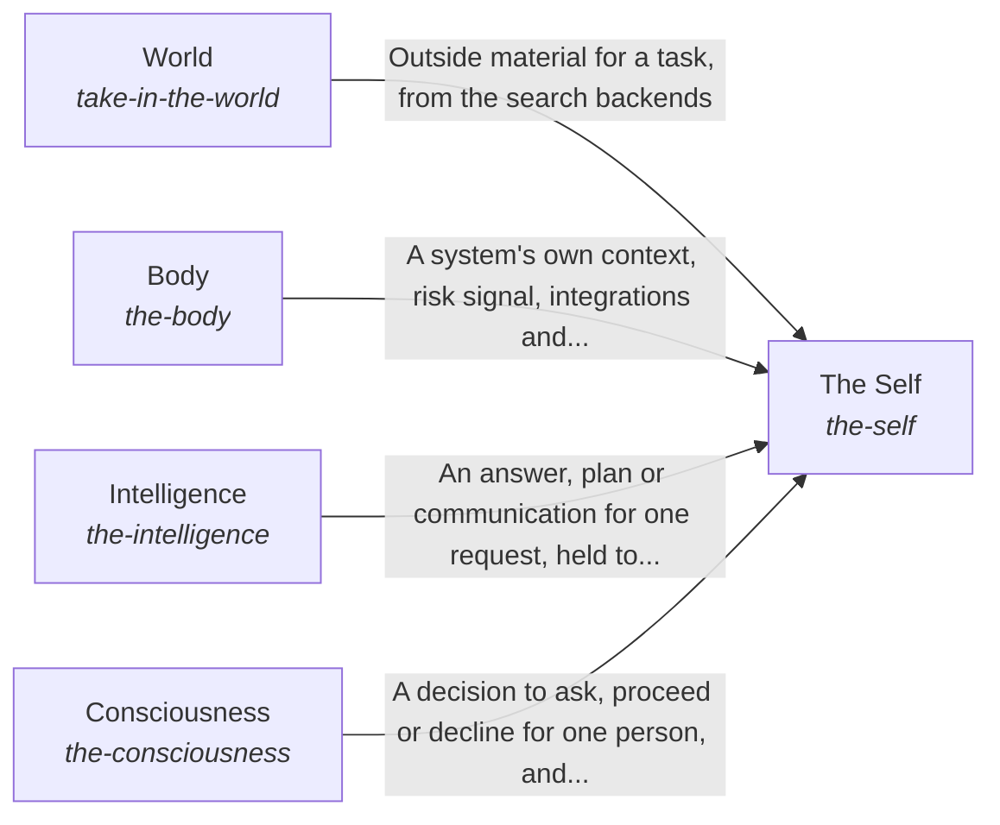

# The best parts for AI intelligence, assembled and proven

Anyone building AI intelligence can assemble a working system from the best open-source parts available, chosen by measurement and kept current every week, without writing the glue themselves.

*ESOI records of this intent (evolvable structure that optimizes intent), generated from the CSV files beside this page by `esoi readmes`. Edit the CSV files, not this page.*

Opportunities: Any product that needs an AI grounded in a person or team's own goals can start from the assembled whole instead of researching and gluing parts again; a production consumer is the hardest test of the assembly.

## How the solutions fit together

hub-of-hubs gives anyone a working AI assembled from measured open-source parts, and The Self is the whole that keeps its five kinds of part working as one. It gives the system a form and its own context through Body. It finds, prepares and answers for one request through Intelligence. It reaches what is outside the system through World. It learns when to ask the people it works for through Consciousness.

## Diagram

An arrow runs from the solution that provides to the solution that builds on it; its label is what the provider outputs.

## Solutions at a glance

| Solution | Handle | Entry call | Selected implementation | Metric |
|---|---|---|---|---|
| World | `take-in-the-world` | `hubofhubs.run("take-in-the-world", 'latest Rust release')` | Search and papers as the way in (`search_backends`) | Task pass rate and cost per passing task |
| The Self | `the-self` | `hubofhubs.run("the-self", 'what is the latest Rust release?')` | Answers through the Assembler and reaches the other containers (`composition`) | The assembled whole answers a real request |
| Body | `the-body` | no entry declared | Composition of the form and internal context (`composition`) | A system applies the hub to itself |
| Intelligence | `the-intelligence` | no entry declared | Composition of the processing of information (`composition`) | A request is answered from what bears on it |
| Consciousness | `the-consciousness` | no entry declared | Composition of the adaptation to humans (`composition`) | A representative asks when the person would want to be asked |

## Problems and ideals

**Problems**

- Every team re-researches and re-glues the same AI parts, and the private copies drift apart. (`HP1`)
- Lists of hubs say what exists, not which works best or fits together. (`HP2`)
- One hub's outage, price change or shutdown stops the system, and switching needs code changes. (`HP4`)
- Parts that are best alone can fail when assembled, and nobody tests the whole. (`HP5`)
- The form and internal context of an AI system are wired for one product, so another system cannot give the hub its own APIs, databases and files without rewriting the parts. (`hprob-system-form-wired-to-one-product`)
- A request is answered from whatever happened to be nearby, so the AI sees too much to use or too little to answer. (`hprob-one-request-answered-from-too-much-or-too-little`)
- An AI treats every person alike, so it asks the person who wanted it to proceed and acts without asking the person who wanted to be asked. (`hprob-ai-treats-every-person-alike`)

**Ideals**

- Best by measurement (`HI1`): Each seat holds the part that measures best on shared cases.
- One-step assembly (`HI2`): Configuration in, working system out, no glue code.
- Always current (`HI3`): No area goes a week without a fresh search and comparison.
- Swappable parts (`HI4`): Any part can be replaced by configuration when another measures better or fails.
- Proven whole (`HI5`): The assembled system is tested end to end on a production consumer, not only part by part.
- Generic and thin (`HI6`): No consumer-specific content.

## Metrics and their leaders

- Task pass rate and cost per passing task (`metric-take-in-the-world`)
- The assembled whole answers a real request (`metric-the-self`)
- A system applies the hub to itself (`metric-the-body`)
- A request is answered from what bears on it (`metric-the-intelligence`)
- A representative asks when the person would want to be asked (`metric-the-consciousness`)

## Where to go next

- Sub-intent: [The form and internal context of a system](../hubofhubs/the_body/README.md) (The AI system has a form and its own internal context, and the hub applies to a particular system by providing adapters or declaring the system's internal APIs, databases and files.)
- Sub-intent: [Adapting to the humans the system works with](../hubofhubs/the_consciousness/README.md) (The AI representatives of a team learn each person's way: when to ask that person and when not to, and how that person wants the work done, from the person's own feedback.)
- Sub-intent: [Processing information for one request](../hubofhubs/the_intelligence/README.md) (One request is answered from what the AI can see for it: the information is found and prepared, the answer is reasoned and held to its evidence, and the long view is kept across requests.)
- Sub-intent: [The parts working as one whole](../hubofhubs/the_self/README.md) (The parts of the system work as one whole: each part knows its role, what the system claims matches its evidence, its records match its code, and one call builds the parts from configuration.)
- Sub-intent: [Awareness of the outside and interaction with it](../hubofhubs/the_world/README.md) (The AI knows what is outside the system and can interact with it: it brings in knowledge a reader can check and uses the right tool for each kind of need.)
- Repository: [top README](../README.md)
- Records beside the code: [hubofhubs](../hubofhubs/README.md)
- Records: [intent.csv](intent.csv)
- Diagram page: [diagram.md](diagram.md)

---

## The full record

### Problems

- Every team re-researches and re-glues the same AI parts, and the private copies drift apart. (`HP1`)
- Lists of hubs say what exists, not which works best or fits together. (`HP2`)
- One hub's outage, price change or shutdown stops the system, and switching needs code changes. (`HP4`)
- Parts that are best alone can fail when assembled, and nobody tests the whole. (`HP5`)
- The form and internal context of an AI system are wired for one product, so another system cannot give the hub its own APIs, databases and files without rewriting the parts. (`hprob-system-form-wired-to-one-product`)
- A request is answered from whatever happened to be nearby, so the AI sees too much to use or too little to answer. (`hprob-one-request-answered-from-too-much-or-too-little`)
- An AI treats every person alike, so it asks the person who wanted it to proceed and acts without asking the person who wanted to be asked. (`hprob-ai-treats-every-person-alike`)

### Ideals

- Best by measurement (`HI1`): Each seat holds the part that measures best on shared cases.
- One-step assembly (`HI2`): Configuration in, working system out, no glue code.
- Always current (`HI3`): No area goes a week without a fresh search and comparison.
- Swappable parts (`HI4`): Any part can be replaced by configuration when another measures better or fails.
- Proven whole (`HI5`): The assembled system is tested end to end on a production consumer, not only part by part.
- Generic and thin (`HI6`): No consumer-specific content.

### Solutions

| Solution | Handle | Selected | Metric |
|---|---|---|---|
| World | `take-in-the-world` | Search and papers as the way in (`search_backends`) | Task pass rate and cost per passing task |
| The Self | `the-self` | Answers through the Assembler and reaches the other containers (`composition`) | The assembled whole answers a real request |
| Body | `the-body` | Composition of the form and internal context (`composition`) | A system applies the hub to itself |
| Intelligence | `the-intelligence` | Composition of the processing of information (`composition`) | A request is answered from what bears on it |
| Consciousness | `the-consciousness` | Composition of the adaptation to humans (`composition`) | A representative asks when the person would want to be asked |

### Implementations

| Implementation | Handle | Where | Sub-intent |
|---|---|---|---|
| Search and papers as the way in | `take-in-the-world:search_backends` | [hubofhubs/areas.py](../hubofhubs/areas.py) |  |
| Hand-wired general agent framework | `the-self:hand_wired_agent_framework` |  |  |
| The parts of the world | `take-in-the-world:parts` |  | [the_world](the_world/README.md) |
| Answers through the Assembler and reaches the other containers | `the-self:composition` | [hubofhubs/whole.py](../hubofhubs/whole.py) |  |
| The parts of the system | `the-self:parts` |  | [the_self](the_self/README.md) |
| Composition of the form and internal context | `the-body:composition` |  | [the_body](the_body/README.md) |
| Composition of the processing of information | `the-intelligence:composition` |  | [the_intelligence](the_intelligence/README.md) |
| Composition of the adaptation to humans | `the-consciousness:composition` |  | [the_consciousness](the_consciousness/README.md) |

### Metrics

- Task pass rate and cost per passing task (`metric-take-in-the-world`): `none`
- The assembled whole answers a real request (`metric-the-self`): `none`
- A system applies the hub to itself (`metric-the-body`): `none`
- A request is answered from what bears on it (`metric-the-intelligence`): `none`
- A representative asks when the person would want to be asked (`metric-the-consciousness`): `none`
