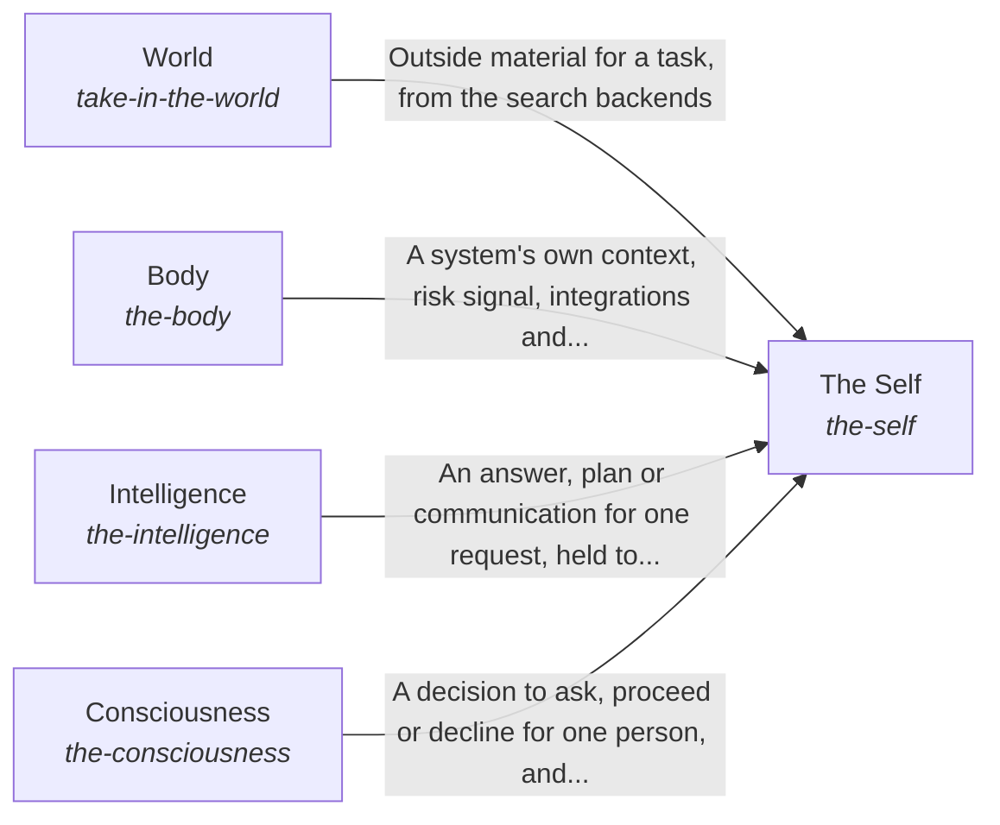

These are ESOI records rendered as a diagram (evolvable structure that optimizes intent). This page is generated from the solutions' outputs and the implementations' `uses_solution_ids` by `esoi diagram`; edit those records, not this page.

# Solution diagram: The best parts for AI intelligence, assembled and proven

hub-of-hubs gives anyone a working AI assembled from measured open-source parts, and The Self is the whole that keeps its five kinds of part working as one. It gives the system a form and its own context through Body. It finds, prepares and answers for one request through Intelligence. It reaches what is outside the system through World. It learns when to ask the people it works for through Consciousness.

An arrow runs from the solution that provides to the solution that builds on it; its label is what the provider outputs.

