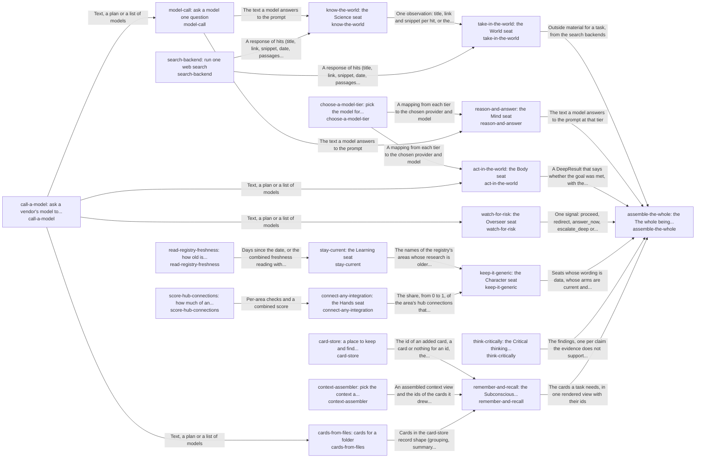

These are ESOI records rendered as a diagram (evolvable structure that optimizes intent). This page is generated from the solutions' outputs and the implementations' `uses_solution_ids` by `esoi diagram`; edit those records, not this page.

# Solution diagram: The best parts for AI intelligence, assembled and proven

hub-of-hubs gives anyone a working AI assembled from measured open-source parts, and assemble-the-whole is the one call that holds it together. It answers a question through take-in-the-world and remember-and-recall, holds that answer to its sources through think-critically, asks a model at a measured tier through reason-and-answer, carries a goal out through act-in-the-world only after watch-for-risk lets the step pass, and checks that the hub stays generic through keep-it-generic. take-in-the-world brings outside material in by running a web search through search-backend and, for research questions, a paper lookup through know-the-world. remember-and-recall keeps cards in card-store, draws the cards a query needs by relevance through context-assembler, and fills the store from a folder's files through cards-from-files. cards-from-files groups a folder's files into topic cards by which files import each other, so it writes them without asking a model. reason-and-answer sends a question to the model that choose-a-model-tier measured best for the tier, through model-call, which is built on call-a-model. act-in-the-world makes each file edit with a single request through call-a-model, at the tier that choose-a-model-tier picks. keep-it-generic audits the hub for consumer wording and learns how stale its research is through stay-current. keep-it-generic also learns how much of the hub connects by configuration through connect-any-integration. stay-current lists the areas whose research is older than ninety days by reading their dates through read-registry-freshness. connect-any-integration reports the share of connections that need no code by scoring them through score-hub-connections.

An arrow runs from the solution that provides to the solution that builds on it; its label is what the provider outputs.

