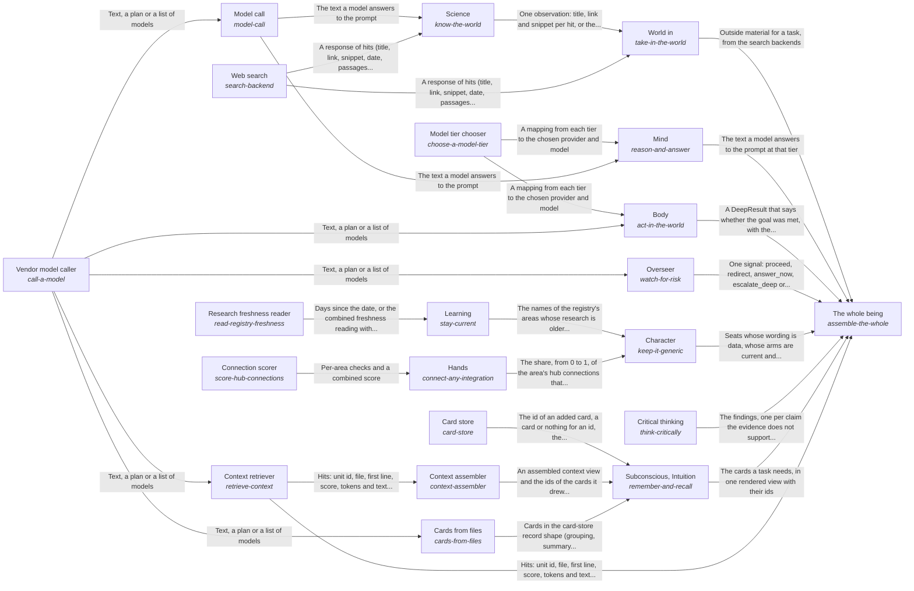

These are ESOI records rendered as a diagram (evolvable structure that optimizes intent). This page is generated from the solutions' outputs and the implementations' `uses_solution_ids` by `esoi diagram`; edit those records, not this page.

# Solution diagram: The best parts for AI intelligence, assembled and proven

hub-of-hubs gives anyone a working AI assembled from measured open-source parts, and The whole being is the one call that holds the mind together. A request enters through World in, which brings outside material in by running a web search and, for research questions, a paper lookup through Science. Subconscious, Intuition keeps what is known as cards in the card store, draws the cards a query needs by relevance through the context assembler, and fills the store from a folder's files through cards from files, which groups the files by which import each other and so writes cards without asking a model. The context retriever shows a task the pieces of a folder's files it needs, within a token budget or not at all, and feeds the context assembler. The Mind answers by sending the question to the model that the model tier chooser measured best for the tier, through the model call, which is built on the vendor model caller. Critical thinking then holds that answer to its sources, and the Overseer lets a step pass only when it is safe to take. The Body carries a goal out outside the model, making each file edit with a single request through the vendor model caller at the tier the chooser picks. Character checks that the hub stays generic: it audits for consumer wording, learns how stale the research is through Learning, which reads the dates through the research freshness reader, and learns how much of the hub connects by configuration through Hands, which reports the share of connections that need no code by scoring them through the connection scorer.

An arrow runs from the solution that provides to the solution that builds on it; its label is what the provider outputs.

