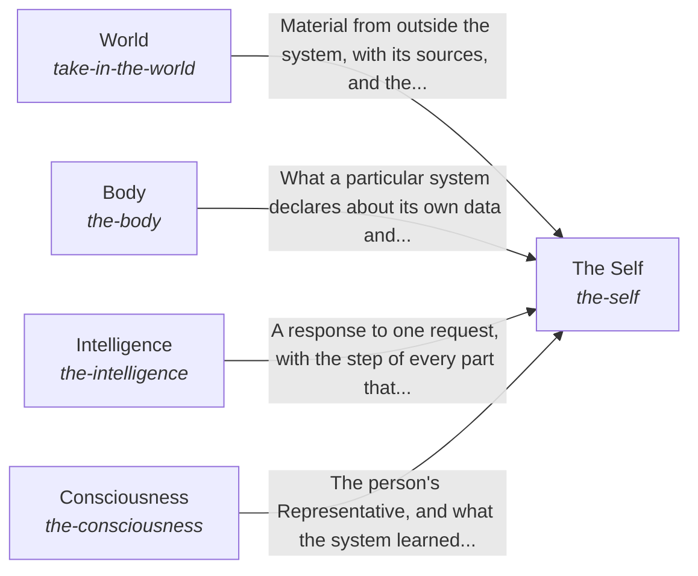

These are ESOI records rendered as a diagram (evolvable structure that optimizes intent). This page is generated from the solutions' outputs and the implementations' `uses_solution_ids` by `esoi diagram`; edit those records, not this page.

# Solution diagram: The best parts for AI intelligence, assembled and proven

hub-of-hubs gives anyone a working AI assembled from measured open-source parts, and The Self is the whole that keeps its five kinds of part working as one. To respond to a request, The Self asks for the person's authority and preferences from Consciousness, asks where the system's data lives from Body, passes the request on for processing to Intelligence, and reaches what is outside the system through World. The Self then asks Consciousness to learn from the person's feedback.

An arrow runs from the solution that provides to the solution that builds on it; its label is what the provider outputs.

