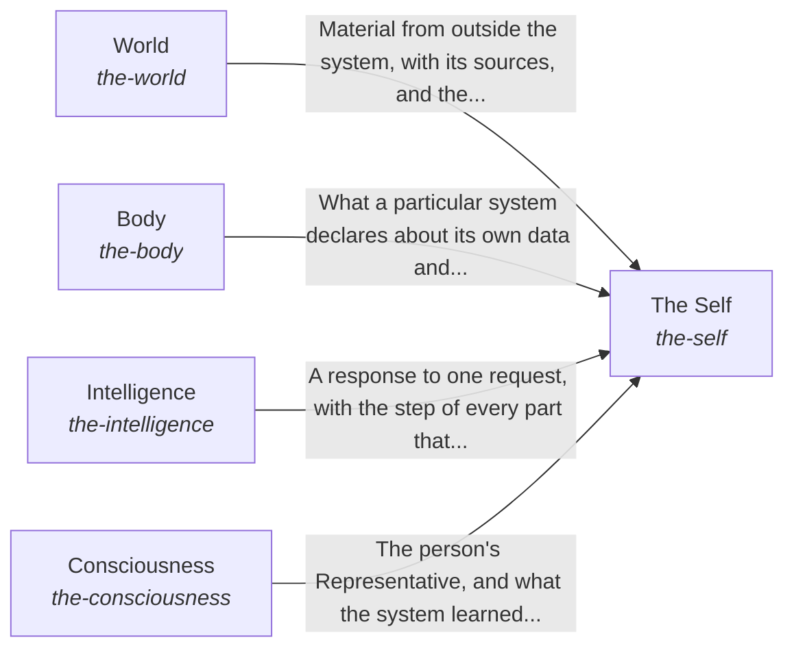

# hubofhubs

*ESOI records kept beside the code in `hubofhubs`, generated from the CSV files in this folder by `esoi readmes`. Edit the CSV files, not this page.*

Anyone building AI intelligence can assemble a working system from the best open-source parts available, chosen by measurement and kept current every week, without writing the glue themselves.

These are the solutions of [The best parts for AI intelligence, assembled and proven](../esoi/README.md).

## How the solutions fit together

hub-of-hubs gives anyone a working AI assembled from measured open-source parts, and The Self is the whole that keeps its five kinds of part working as one. To respond to a request, The Self asks for the person's authority and preferences from Consciousness, asks where the system's data lives from Body, passes the request on for processing to Intelligence, and asks World how current the research is. The Self then keeps the run record in Body and asks Consciousness to learn from the person's feedback.

## Overview diagram

An arrow runs from the solution that provides to the solution that builds on it; its label is what the provider outputs.

## World (`the-world`)

Bring in what is outside the system and let the AI act on it through the best available tool.

- Entry call: `hubofhubs.run("the-world", 'latest Rust release')`
- Selected implementation: Search and papers through the tools (`composition`)
- Metric: Task pass rate and cost per passing task
- Implemented by: [`hubofhubs/areas.py`](areas.py), [`hubofhubs/terminal/__init__.py`](terminal/__init__.py), [`hubofhubs/terminal/asks.py`](terminal/asks.py), [`hubofhubs/terminal/blocks.py`](terminal/blocks.py), [`hubofhubs/terminal/render.py`](terminal/render.py), [`hubofhubs/terminal/stopped.py`](terminal/stopped.py), [`hubofhubs/terminal/strings.py`](terminal/strings.py), [`hubofhubs/terminal/trail.py`](terminal/trail.py) and 3 more

## The Self (`the-self`)

Keep every part working as one whole for one request.

- Entry call: `hubofhubs.run("the-self", ...)`
- Selected implementation: Responds through every container (`composition`)
- Metric: The assembled whole answers a real request, Integrated efficiency of the whole, Integrated efficiency of the whole
- Implemented by: [`.env.example`](../.env.example), [`hubofhubs/__init__.py`](__init__.py), [`hubofhubs/areas.py`](areas.py), [`hubofhubs/arm_needs.py`](arm_needs.py), [`hubofhubs/binding.py`](binding.py), [`hubofhubs/card.py`](card.py), [`hubofhubs/cardstore.py`](cardstore.py), [`hubofhubs/cases.py`](cases.py) and 47 more

## Body (`the-body`)

Let the hub apply to one particular system by declaring where its data lives, where its requests come from and which of its integrations the AI may use, and keep the run record, the configuration...

- Entry call: `hubofhubs.run("the-body", '')`
- Selected implementation: Declared sources and enduring integrations (`composition`)
- Metric: A system applies the hub to itself
- Implemented by: [`.env.example`](../.env.example), [`hubofhubs/__init__.py`](__init__.py), [`hubofhubs/areas.py`](areas.py), [`hubofhubs/arm_needs.py`](arm_needs.py), [`hubofhubs/binding.py`](binding.py), [`hubofhubs/card.py`](card.py), [`hubofhubs/cardstore.py`](cardstore.py), [`hubofhubs/cases.py`](cases.py) and 47 more

## Intelligence (`the-intelligence`)

Turn one request and what is known into a response that meets its goal.

- Entry call: `hubofhubs.run("the-intelligence", ...)`
- Selected implementation: One request through the long view, the target, the Mind and the checks (`composition`)
- Metric: A request is answered from what bears on it
- Implemented by: [`.env.example`](../.env.example), [`hubofhubs/__init__.py`](__init__.py), [`hubofhubs/areas.py`](areas.py), [`hubofhubs/arm_needs.py`](arm_needs.py), [`hubofhubs/binding.py`](binding.py), [`hubofhubs/card.py`](card.py), [`hubofhubs/cardstore.py`](cardstore.py), [`hubofhubs/cases.py`](cases.py) and 47 more

## Consciousness (`the-consciousness`)

Keep the system aligned with the humans and policies it works for.

- Entry call: `hubofhubs.run("the-consciousness", '')`
- Selected implementation: Representative, priorities and feedback (`composition`)
- Metric: A representative asks when the person would want to be asked
- Implemented by: [`.env.example`](../.env.example), [`hubofhubs/__init__.py`](__init__.py), [`hubofhubs/areas.py`](areas.py), [`hubofhubs/arm_needs.py`](arm_needs.py), [`hubofhubs/binding.py`](binding.py), [`hubofhubs/card.py`](card.py), [`hubofhubs/cardstore.py`](cardstore.py), [`hubofhubs/cases.py`](cases.py) and 47 more

## Diagram

An arrow runs from the solution that provides to the solution that builds on it; its label is what the provider outputs.

## Implementations

| Implementation | Handle | Code | Selected |
|---|---|---|---|
| Hand-wired general agent framework | `the-self:hand_wired_agent_framework` | no code yet |  |
| Responds through every container | `the-self:composition` | [`hubofhubs/whole.py`](whole.py) | selected |
| Declared sources and enduring integrations | `the-body:composition` | [`hubofhubs/flows.py`](flows.py) | selected |
| One request through the long view, the target, the Mind and the checks | `the-intelligence:composition` | [`hubofhubs/flows.py`](flows.py) | selected |
| Representative, priorities and feedback | `the-consciousness:composition` | [`hubofhubs/flows.py`](flows.py) | selected |
| The parts of the system | `the-self:parts` | no code yet |  |
| Search and papers through the tools | `the-world:composition` | [`hubofhubs/areas.py`](areas.py) | selected |

## Metrics

- Task pass rate and cost per passing task (`metric-the-world`)
- The assembled whole answers a real request (`metric-the-self`)
- A system applies the hub to itself (`metric-the-body`)
- A request is answered from what bears on it (`metric-the-intelligence`)
- A representative asks when the person would want to be asked (`metric-the-consciousness`)
- Integrated efficiency of the whole (`metric-integrated-efficiency`)

## Problems

- Parts re-glued by every team (`HP1`): Every team re-researches and re-glues the same AI parts, and the private copies drift apart.
- No evaluation of the parts (`HP2`): Lists of hubs say what exists, not which works best or fits together.
- One hub outage stops the system (`HP4`): One hub's outage, price change or shutdown stops the system, and switching needs code changes.
- The whole is never tested (`HP5`): Parts that are best alone can fail when assembled, and nobody tests the whole.
- Form wired to one product (`hprob-system-form-wired-to-one-product`): The form and internal context of an AI system are wired for one product, so another system cannot give the hub its own APIs, databases and files without rewriting the parts.
- Too much or too little context (`hprob-one-request-answered-from-too-much-or-too-little`): A request is answered from whatever happened to be nearby, so the AI sees too much to use or too little to answer.
- Every person treated alike (`hprob-ai-treats-every-person-alike`): An AI treats every person alike, so it asks the person who wanted it to proceed and acts without asking the person who wanted to be asked.

## Ideals

- Best by measurement (`HI1`): Each seat holds the part that measures best on shared cases.
- One-step assembly (`HI2`): Configuration in, working system out, no glue code.
- Always current (`HI3`): No area goes a week without a fresh search and comparison.
- Swappable parts (`HI4`): Any part can be replaced by configuration when another measures better or fails.
- Proven whole (`HI5`): The assembled system is tested end to end on a production consumer, not only part by part.
- Generic and thin (`HI6`): No consumer-specific content.

## Where to go next

- Intent: [The best parts for AI intelligence, assembled and proven](../esoi/README.md)
- Repository: [top README](../README.md)
