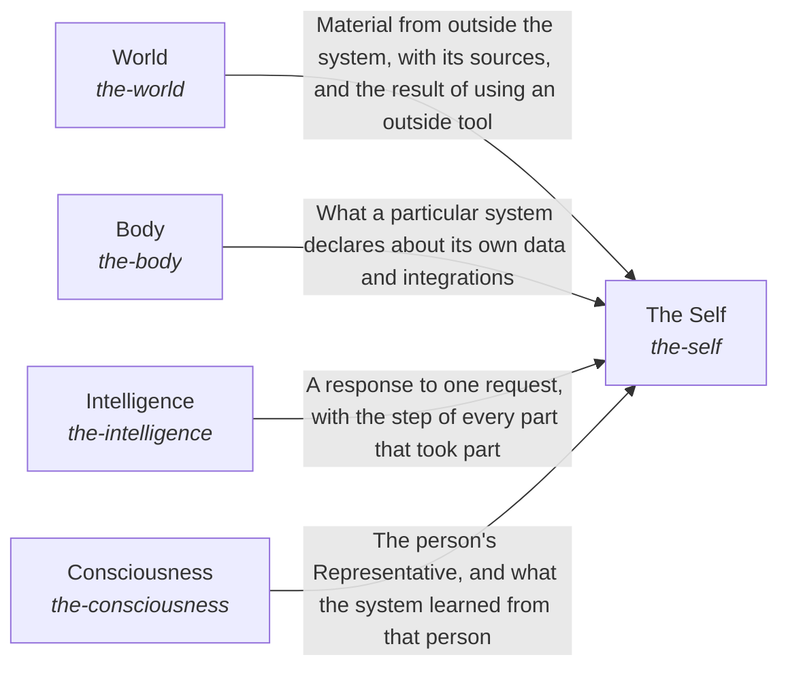

# hubofhubs

*ESOI records kept beside the code in `hubofhubs`, generated from the CSV files in this folder by `esoi readmes`. Edit the CSV files, not this page.*

AI builders have consistent interfaces for whatever the current best AI solutions are, to adapt only what is unique to their project.

These are the solutions of [The best parts for AI intelligence, assembled and proven](../esoi/README.md).

## How the solutions fit together

The AI Hub of Hubs gives anyone a working AI assembled from measured open-source parts, and The Self is the whole that keeps its five kinds of part working as one. To respond to a request, The Self asks Consciousness for the person's authority and preferences, asks Body where the system's data lives, and passes the request to Intelligence, which draws tools, models and outside knowledge from World. The Self then keeps the run record in Body, has Integrity audit it, and asks Consciousness to learn from the person's feedback. When asked for its health, The Self reports on itself, and for the research it asks World how current it is.

## Overview diagram

An arrow runs from the solution that provides to the solution that builds on it; its label is what the provider outputs.

## World (`the-world`)

Bring in what is outside the system and let the AI act on it through the best available tool.

- Entry call: `hubofhubs.run("the-world", 'latest Rust version')`
- Selected implementation: Search and papers through the tools (`composition`)
- Metric: Task pass rate and cost per passing task
- Implemented by: [`hubofhubs/the_world/__init__.py`](the_world/__init__.py), [`hubofhubs/the_world/flow.py`](the_world/flow.py), [`hubofhubs/the_world/interface.py`](the_world/interface.py), [`hubofhubs/the_world/learning/__init__.py`](the_world/learning/__init__.py), [`hubofhubs/the_world/learning/interface.py`](the_world/learning/interface.py), [`hubofhubs/the_world/learning/registry_research.py`](the_world/learning/registry_research.py), [`hubofhubs/the_world/learning/research_freshness_reader/__init__.py`](the_world/learning/research_freshness_reader/__init__.py), [`hubofhubs/the_world/learning/research_freshness_reader/interface.py`](the_world/learning/research_freshness_reader/interface.py) and 122 more

## The Self (`the-self`)

Keep every part working as one whole for one request.

- Entry call: `hubofhubs.run("the-self", ...)`
- Selected implementation: Responds through every container (`composition`)
- Metric: The assembled whole answers a real request, Integrated efficiency of the whole
- Implemented by: [`hubofhubs/the_self/__init__.py`](the_self/__init__.py), [`hubofhubs/the_self/assembler/__init__.py`](the_self/assembler/__init__.py), [`hubofhubs/the_self/assembler/arm_needs.py`](the_self/assembler/arm_needs.py), [`hubofhubs/the_self/assembler/cli.py`](the_self/assembler/cli.py), [`hubofhubs/the_self/assembler/interface.py`](the_self/assembler/interface.py), [`hubofhubs/the_self/assembler/oneline.py`](the_self/assembler/oneline.py), [`hubofhubs/the_self/assembler/resolution.py`](the_self/assembler/resolution.py), [`hubofhubs/the_self/assembler/tests/test_safe_loading.py`](the_self/assembler/tests/test_safe_loading.py) and 20 more

## Body (`the-body`)

Let the hub apply to one particular system by declaring where its data lives, where its requests come from and which of its integrations the AI may use, and keep the run record, the configuration, the environment variables, the secrets and the stored authentication the tools need.

- Entry call: `hubofhubs.run("the-body", '')`
- Selected implementation: Declared sources and enduring integrations (`composition`)
- Metric: A system applies the hub to itself
- Implemented by: [`hubofhubs/the_body/__init__.py`](the_body/__init__.py), [`hubofhubs/the_body/filemodes.py`](the_body/filemodes.py), [`hubofhubs/the_body/flow.py`](the_body/flow.py), [`hubofhubs/the_body/hands/__init__.py`](the_body/hands/__init__.py), [`hubofhubs/the_body/hands/interface.py`](the_body/hands/interface.py), [`hubofhubs/the_body/intake_sources/__init__.py`](the_body/intake_sources/__init__.py), [`hubofhubs/the_body/intake_sources/interface.py`](the_body/intake_sources/interface.py), [`hubofhubs/the_body/intake_sources/queue.py`](the_body/intake_sources/queue.py) and 62 more

## Intelligence (`the-intelligence`)

Turn one request and what is known into a response that meets its goal.

- Entry call: `hubofhubs.run("the-intelligence", ...)`
- Selected implementation: One request through the long view, the target, the Mind and the checks (`composition`)
- Metric: A request is answered from what bears on it
- Implemented by: [`hubofhubs/the_intelligence/__init__.py`](the_intelligence/__init__.py), [`hubofhubs/the_intelligence/critical_thinking/__init__.py`](the_intelligence/critical_thinking/__init__.py), [`hubofhubs/the_intelligence/critical_thinking/esoi_application/__init__.py`](the_intelligence/critical_thinking/esoi_application/__init__.py), [`hubofhubs/the_intelligence/critical_thinking/esoi_application/interface.py`](the_intelligence/critical_thinking/esoi_application/interface.py), [`hubofhubs/the_intelligence/critical_thinking/flow.py`](the_intelligence/critical_thinking/flow.py), [`hubofhubs/the_intelligence/critical_thinking/goal_completion/__init__.py`](the_intelligence/critical_thinking/goal_completion/__init__.py), [`hubofhubs/the_intelligence/critical_thinking/goal_completion/done_evidence.py`](the_intelligence/critical_thinking/goal_completion/done_evidence.py), [`hubofhubs/the_intelligence/critical_thinking/goal_completion/goal_completion.py`](the_intelligence/critical_thinking/goal_completion/goal_completion.py) and 141 more

## Consciousness (`the-consciousness`)

Keep the system aligned with the humans and policies it works for.

- Entry call: `hubofhubs.run("the-consciousness", '')`
- Selected implementation: Representative, priorities and feedback (`composition`)
- Metric: A representative asks when the person would want to be asked
- Implemented by: [`docs/reference/work-trace-event.schema.json`](../docs/reference/work-trace-event.schema.json), [`hubofhubs/the_consciousness/__init__.py`](the_consciousness/__init__.py), [`hubofhubs/the_consciousness/feedback_learning/__init__.py`](the_consciousness/feedback_learning/__init__.py), [`hubofhubs/the_consciousness/feedback_learning/interface.py`](the_consciousness/feedback_learning/interface.py), [`hubofhubs/the_consciousness/flow.py`](the_consciousness/flow.py), [`hubofhubs/the_consciousness/interface.py`](the_consciousness/interface.py), [`hubofhubs/the_consciousness/judgment_calls/__init__.py`](the_consciousness/judgment_calls/__init__.py), [`hubofhubs/the_consciousness/judgment_calls/interface.py`](the_consciousness/judgment_calls/interface.py) and 27 more

## Diagram

An arrow runs from the solution that provides to the solution that builds on it; its label is what the provider outputs.

## Implementations

| Implementation | Handle | Code | Selected |
|---|---|---|---|
| Hand-wired general agent framework | `the-self:hand_wired_agent_framework` | no code yet |  |
| Responds through every container | `the-self:composition` | [`hubofhubs/the_self/respond.py`](the_self/respond.py) | selected |
| Declared sources and enduring integrations | `the-body:composition` | [`hubofhubs/the_body/flow.py`](the_body/flow.py) | selected |
| One request through the long view, the target, the Mind and the checks | `the-intelligence:composition` | [`hubofhubs/the_intelligence/flow.py`](the_intelligence/flow.py) | selected |
| Representative, priorities and feedback | `the-consciousness:composition` | [`hubofhubs/the_consciousness/flow.py`](the_consciousness/flow.py) | selected |
| Search and papers through the tools | `the-world:composition` | [`hubofhubs/the_world/flow.py`](the_world/flow.py) | selected |

## Metrics

- Task pass rate and cost per passing task (`metric-the-world`)
- The assembled whole answers a real request (`metric-the-self`)
- A system applies the hub to itself (`metric-the-body`)
- A request is answered from what bears on it (`metric-the-intelligence`)
- A representative asks when the person would want to be asked (`metric-the-consciousness`)
- Integrated efficiency of the whole (`metric-integrated-efficiency`)

## Problems

- Parts re-glued by every team (`HP1`): Many teams research and wire up the same open-source AI parts on their own, and their private versions drift apart.
- Parts not compared on the job at hand (`HP2`): Lists of hubs say what exists, not which works best for a given job or how well parts work together.
- Wired to one hub (`HP4`): When a system is wired to one hub, that hub's outage, price change or shutdown can stop the system or raise its cost, and switching usually means changing code.
- Parts not judged by what they add to the whole (`HP5`): Each part is usually tuned and chosen on its own, so a part can be kept for how well it does alone even when the whole gains little from it or pays more for it.
- Form wired to one product (`hprob-system-form-wired-to-one-product`): AI systems are usually built around one product's data, so another system cannot give the hub its own APIs, databases and files without rewriting parts.
- Too much or too little context (`hprob-one-request-answered-from-too-much-or-too-little`): A request is often answered from whatever context is at hand (the recent chat, a fixed set of files), so the AI sees too much to use well or too little to answer.
- Every person treated alike (`hprob-ai-treats-every-person-alike`): Most AI assistants use the same rule for every person, so they ask a person who wanted them to go ahead and act without asking a person who wanted to be asked.

## Ideals

- The best option for each case is in use (`HI1`): The implementations selected for solutions always reflect the best alternative available across all known resources and methods.
- One-step assembly (`HI2`): Anyone gets a working system from the best parts without writing glue code.
- Always current (`HI3`): What the hub recommends reflects the best parts available now.
- Swappable parts (`HI4`): When a better part appears or a part fails, the system keeps working with the better or the working one, and no caller changes.
- Every part earns its place in the whole (`HI5`): The assembled whole does real work well for its users, and every part in it adds more to the whole than it costs.
- Generic and thin (`HI6`): Any team can use the hub as it is, and can change any default without forking it.

## Where to go next

- Intent: [The best parts for AI intelligence, assembled and proven](../esoi/README.md)
- Down: [hubofhubs/the_body/intake_sources](the_body/intake_sources/README.md)
- Down: [hubofhubs/the_body/internal_context](the_body/internal_context/README.md)
- Down: [hubofhubs/the_consciousness/judgment_calls](the_consciousness/judgment_calls/README.md)
- Down: [hubofhubs/the_consciousness/prioritization](the_consciousness/prioritization/README.md)
- Down: [hubofhubs/the_consciousness/representatives](the_consciousness/representatives/README.md)
- Down: [hubofhubs/the_consciousness/request_intake](the_consciousness/request_intake/README.md)
- Down: [hubofhubs/the_intelligence/nervous_system](the_intelligence/nervous_system/README.md)
- Down: [hubofhubs/the_intelligence/proactivity](the_intelligence/proactivity/README.md)
- Down: [hubofhubs/the_self/assembler](the_self/assembler/README.md)
- Down: [hubofhubs/the_self/integrity](the_self/integrity/README.md)
- Down: [hubofhubs/the_world/learning](the_world/learning/README.md)
- Down: [hubofhubs/the_world/science](the_world/science/README.md)
- Down: [hubofhubs/the_intelligence/critical_thinking/goal_completion](the_intelligence/critical_thinking/goal_completion/README.md)
- Down: [hubofhubs/the_intelligence/critical_thinking/metric_translation](the_intelligence/critical_thinking/metric_translation/README.md)
- Down: [hubofhubs/the_intelligence/critical_thinking/response_quality](the_intelligence/critical_thinking/response_quality/README.md)
- Down: [hubofhubs/the_intelligence/mind/context_intake](the_intelligence/mind/context_intake/README.md)
- Down: [hubofhubs/the_intelligence/mind/delegation](the_intelligence/mind/delegation/README.md)
- Down: [hubofhubs/the_intelligence/mind/planner](the_intelligence/mind/planner/README.md)
- Down: [hubofhubs/the_intelligence/mind/response_writer](the_intelligence/mind/response_writer/README.md)
- Down: [hubofhubs/the_intelligence/subconscious/cards_from_files](the_intelligence/subconscious/cards_from_files/README.md)
- Down: [hubofhubs/the_intelligence/subconscious/context_retriever](the_intelligence/subconscious/context_retriever/README.md)
- Down: [hubofhubs/the_world/model_plumbing/model_tier_chooser](the_world/model_plumbing/model_tier_chooser/README.md)
- Down: [hubofhubs/the_world/model_plumbing/vendor_model_caller](the_world/model_plumbing/vendor_model_caller/README.md)
- Down: [hubofhubs/the_world/tools/connected_system_operations](the_world/tools/connected_system_operations/README.md)
- Down: [hubofhubs/the_world/tools/delegated_agent_sessions](the_world/tools/delegated_agent_sessions/README.md)
- Down: [hubofhubs/the_world/tools/file_editing](the_world/tools/file_editing/README.md)
- Down: [hubofhubs/the_world/tools/file_reading](the_world/tools/file_reading/README.md)
- Down: [hubofhubs/the_world/tools/web_search](the_world/tools/web_search/README.md)
- Repository: [top README](../README.md)
