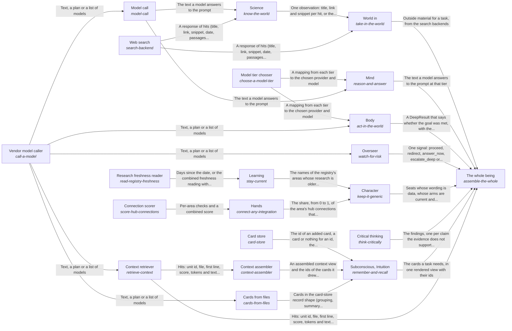

# hubofhubs

*ESOI records kept beside the code in `hubofhubs`, generated from the CSV files in this folder by `esoi readmes`. Edit the CSV files, not this page.*

## World in (`take-in-the-world`)

Connect any AI to tools, search and data sources without writing code for each one.

- Entry call: `hubofhubs.run("take-in-the-world", 'latest Rust release')`
- Selected implementation: `search_backends`
- Metric: Task pass rate and cost per passing task
- Implemented by: [`hubofhubs/areas.py`](areas.py), [`hubofhubs/terminal/__init__.py`](terminal/__init__.py), [`hubofhubs/terminal/asks.py`](terminal/asks.py), [`hubofhubs/terminal/blocks.py`](terminal/blocks.py), [`hubofhubs/terminal/render.py`](terminal/render.py), [`hubofhubs/terminal/stopped.py`](terminal/stopped.py), [`hubofhubs/terminal/strings.py`](terminal/strings.py), [`hubofhubs/terminal/trail.py`](terminal/trail.py) and 3 more

## Mind (`reason-and-answer`)

Reason to a good answer at the lowest cost that still passes, for any product that needs an AI that plans and answers.

- Entry call: `hubofhubs.run("reason-and-answer", ...)`
- Selected implementation: `model_calls`
- Metric: Answer quality per dollar and per second
- Implemented by: [`docs/reference/work-trace-event.schema.json`](../docs/reference/work-trace-event.schema.json), [`hubofhubs/areas.py`](areas.py), [`hubofhubs/models/__init__.py`](models/__init__.py), [`hubofhubs/models/anthropic.py`](models/anthropic.py), [`hubofhubs/models/claude_cli.py`](models/claude_cli.py), [`hubofhubs/models/family.py`](models/family.py), [`hubofhubs/models/gemini.py`](models/gemini.py), [`hubofhubs/models/layers.py`](models/layers.py) and 46 more

## Model tier chooser (`choose-a-model-tier`)

Choose the cheapest model that does the job at each tier, for any product that calls models.

- Entry call: `hubofhubs.run("choose-a-model-tier", {'available': ['anthropic']})`
- Selected implementation: `tier_selector`
- Metric: Tier choice by passing work per cost, Tier passing work per cost, Model quality on hard maths, Vendor arms answer
- Implemented by: [`.env.example`](../.env.example), [`hubofhubs/__init__.py`](__init__.py), [`hubofhubs/areas.py`](areas.py), [`hubofhubs/arm_needs.py`](arm_needs.py), [`hubofhubs/binding.py`](binding.py), [`hubofhubs/card.py`](card.py), [`hubofhubs/cardstore.py`](cardstore.py), [`hubofhubs/cases.py`](cases.py) and 41 more

## Science (`know-the-world`)

Support claims with sources a reader can check, for anyone who asks an AI a factual or research question.

- Entry call: `hubofhubs.run("know-the-world", 'meditation and attention')`
- Selected implementation: `openalex_semantic`
- Metric: Research question finds its paper
- Implemented by: [`hubofhubs/science/__init__.py`](science/__init__.py), [`hubofhubs/science/citations.py`](science/citations.py), [`hubofhubs/science/crossref.py`](science/crossref.py), [`hubofhubs/science/openalex.py`](science/openalex.py), [`hubofhubs/science/openalex_keywords.py`](science/openalex_keywords.py), [`hubofhubs/science/openalex_semantic.py`](science/openalex_semantic.py), [`hubofhubs/science/openalex_semantic_and_web.py`](science/openalex_semantic_and_web.py), [`hubofhubs/science/transport.py`](science/transport.py) and 8 more

## Body (`act-in-the-world`)

Make intended changes in the world and no unrequested ones, for any product that lets an AI act.

- Entry call: `hubofhubs.run("act-in-the-world", ...)`
- Selected implementation: `fast_edit`
- Metric: Goal met by its own tests, Harness, context, sub-agents and recursion ranked
- Implemented by: [`hubofhubs/act/__init__.py`](act/__init__.py), [`hubofhubs/act/editblock.py`](act/editblock.py), [`hubofhubs/act/execution_record.py`](act/execution_record.py), [`hubofhubs/act/fast_edit.py`](act/fast_edit.py), [`hubofhubs/act/folder_writer.py`](act/folder_writer.py), [`hubofhubs/act/mcp_client.py`](act/mcp_client.py), [`hubofhubs/act/mcp_operations.py`](act/mcp_operations.py), [`hubofhubs/act/secret_redaction.py`](act/secret_redaction.py) and 30 more

## Overseer (`watch-for-risk`)

Stop irreversible or human-only steps before they happen, without slowing ordinary work, for any product that lets an AI act.

- Entry call: `hubofhubs.run("watch-for-risk", 'delete the old backup folder')`
- Selected implementation: `consent_gate`
- Metric: Risky steps stopped, ordinary steps let through, Guard marginal value
- Implemented by: [`.env.example`](../.env.example), [`hubofhubs/__init__.py`](__init__.py), [`hubofhubs/areas.py`](areas.py), [`hubofhubs/arm_needs.py`](arm_needs.py), [`hubofhubs/binding.py`](binding.py), [`hubofhubs/card.py`](card.py), [`hubofhubs/cardstore.py`](cardstore.py), [`hubofhubs/cases.py`](cases.py) and 41 more

## The whole being (`assemble-the-whole`)

Give any consumer a working system from one line of configuration.

- Entry call: `hubofhubs.run("assemble-the-whole", 'what is the latest Rust release?')`
- Selected implementation: `zero_config`
- Metric: Whole assembly, Capability of the whole from the user's seat, Consent floor, Honesty floor
- Implemented by: [`.gitignore`](../.gitignore), [`CHANGELOG.md`](../CHANGELOG.md), [`CLAUDE.md`](../CLAUDE.md), [`CONTRIBUTING.md`](../CONTRIBUTING.md), [`LICENSE`](../LICENSE), [`NOTICE`](../NOTICE), [`esoi.toml`](../esoi.toml), [`esoi/COMPONENTS.md`](../esoi/COMPONENTS.md) and 181 more

## Learning (`stay-current`)

Keep every seat's candidates current for anyone who relies on the hub.

- Entry call: `hubofhubs.run("stay-current", '2026-11-03')`
- Selected implementation: `registry_research`
- Metric: Days since each seat was researched, Public stage sourced and triangulated, Best in circumstance with variants
- Implemented by: [`hubofhubs/areas.py`](areas.py)

## Research freshness reader (`read-registry-freshness`)

Show maintainers which parts of the hub have gone stale.

- Entry call: `hubofhubs.run("read-registry-freshness", '2026-10-01')`
- Selected implementation: `registry_scan`
- Metric: Registry freshness reading
- Implemented by: [`.env.example`](../.env.example), [`docs/explanation/compared.md`](../docs/explanation/compared.md), [`docs/explanation/glossary.md`](../docs/explanation/glossary.md), [`docs/explanation/how-we-measure.md`](../docs/explanation/how-we-measure.md), [`docs/explanation/public-evidence.md`](../docs/explanation/public-evidence.md), [`docs/explanation/resolution-design.md`](../docs/explanation/resolution-design.md), [`docs/explanation/science-search.md`](../docs/explanation/science-search.md), [`docs/explanation/terminal-harness.md`](../docs/explanation/terminal-harness.md) and 95 more

## Character (`keep-it-generic`)

Keep the hub usable by any consumer, with no wording or settings of one product in it.

- Entry call: `hubofhubs.run("keep-it-generic", ['examplevendor'])`
- Selected implementation: `prompts_as_data`
- Metric: Consumer-specific strings found by scan, Intents whose solutions one paragraph and one diagram explain as the code builds them
- Implemented by: [`hubofhubs/areas.py`](areas.py)

## Hands (`connect-any-integration`)

Let users connect the apps they use with zero code per integration, for any product built on the hub.

- Entry call: `hubofhubs.run("connect-any-integration", 'web_search')`
- Selected implementation: `catalog_entries`
- Metric: Integration added with zero code, Integration served by combined hubs
- Implemented by: [`hubofhubs/areas.py`](areas.py)

## Connection scorer (`score-hub-connections`)

Show a consumer how much of its integration is a hub connection and how much is hand-wired.

- Entry call: `hubofhubs.run("score-hub-connections", {'facts': {}, 'connections': []})`
- Selected implementation: `hub_of_hubs_scorer`
- Metric: Hub connection scoring
- Implemented by: [`.env.example`](../.env.example), [`docs/explanation/compared.md`](../docs/explanation/compared.md), [`docs/explanation/glossary.md`](../docs/explanation/glossary.md), [`docs/explanation/how-we-measure.md`](../docs/explanation/how-we-measure.md), [`docs/explanation/public-evidence.md`](../docs/explanation/public-evidence.md), [`docs/explanation/resolution-design.md`](../docs/explanation/resolution-design.md), [`docs/explanation/science-search.md`](../docs/explanation/science-search.md), [`docs/explanation/terminal-harness.md`](../docs/explanation/terminal-harness.md) and 87 more

## Card store (`card-store`)

Keep and find cards for any consumer, with no service to run.

- Entry call: `hubofhubs.run("card-store", 'rust release')`
- Selected implementation: `local_card_store`
- Metric: Cards found again, none lost
- Implemented by: [`.env.example`](../.env.example), [`hubofhubs/__init__.py`](__init__.py), [`hubofhubs/areas.py`](areas.py), [`hubofhubs/arm_needs.py`](arm_needs.py), [`hubofhubs/binding.py`](binding.py), [`hubofhubs/card.py`](card.py), [`hubofhubs/cardstore.py`](cardstore.py), [`hubofhubs/cases.py`](cases.py) and 41 more

## Diagram

An arrow runs from the solution that provides to the solution that builds on it; its label is what the provider outputs.

## Implementations

| Implementation | Handle | Code | Selected |
|---|---|---|---|
| Registry date scan | `read-registry-freshness:registry_scan` | [`hubofhubs/registry.py`](registry.py) | selected |
| Binding scorer | `score-hub-connections:hub_of_hubs_scorer` | [`hubofhubs/measure.py`](measure.py) | selected |
| Passing work per cost selector | `choose-a-model-tier:tier_selector` | [`hubofhubs/tiers.py`](tiers.py) | selected |
| Local card store | `card-store:local_card_store` | [`hubofhubs/cardstore.py`](cardstore.py) | selected |
| Digest-driven overseer | `watch-for-risk:overseer` | [`hubofhubs/risk.py`](risk.py) |  |
| Consent gate | `watch-for-risk:consent_gate` | [`hubofhubs/consent_gate.py`](consent_gate.py) | selected |
| Gate then overseer | `watch-for-risk:two_stage` | [`hubofhubs/consent_gate.py`](consent_gate.py) |  |
| One-call assembly of the whole hub | `assemble-the-whole:zero_config` | [`hubofhubs/whole.py`](whole.py) | selected |
| Search and papers as the way in | `take-in-the-world:search_backends` | [`hubofhubs/areas.py`](areas.py) | selected |
| Answers through the measured model for the tier | `reason-and-answer:model_calls` | [`hubofhubs/areas.py`](areas.py) | selected |
| Audit of vendor wording, staleness and configuration | `keep-it-generic:prompts_as_data` | [`hubofhubs/areas.py`](areas.py) | selected |
| Stale areas from the registry dates | `stay-current:registry_research` | [`hubofhubs/areas.py`](areas.py) | selected |
| Share of connections that need no code | `connect-any-integration:catalog_entries` | [`hubofhubs/areas.py`](areas.py) | selected |

## Metrics

- Task pass rate and cost per passing task (`metric-take-in-the-world`)
- Answer quality per dollar and per second (`metric-reason-and-answer`)
- Tier choice by passing work per cost (`metric-choose-a-model-tier`): leader `tier_selector`, 36 of 36 cases
- Research question finds its paper (`metric-know-the-world`): leader `openalex_semantic`, 52 of 150 cases
- Goal met by its own tests (`metric-act-in-the-world`): leader `fast_edit`, 29 of 30 cases
- Risky steps stopped, ordinary steps let through (`metric-watch-for-risk`): leader `two_stage`, 34 of 36 cases
- Whole assembly (`metric-assemble-the-whole`)
- Days since each seat was researched (`metric-stay-current`)
- Registry freshness reading (`metric-read-registry-freshness`): leader `registry_scan`, 41 of 41 cases
- Consumer-specific strings found by scan (`metric-keep-it-generic`)
- Integration added with zero code (`metric-integration-added-with-zero-code`)
- Hub connection scoring (`metric-score-hub-connections`): leader `hub_of_hubs_scorer`, 33 of 33 cases
- Integration available within the weekly refresh (`metric-integration-availability-lag`)
- Integration credentials stay with their user (`metric-integration-credential-isolation`)
- Tier passing work per cost (`metric-tier-passing-work-per-cost`)
- Cards found again, none lost (`metric-card-store`): leader `local_card_store`, 35 of 35 cases
- Capability of the whole from the user's seat (`metric-hub-jarvis-ness`)
- Consent floor (`metric-hub-jarvis-floor-consent`)
- Honesty floor (`metric-hub-jarvis-floor-honesty`)
- Public stage sourced and triangulated (`metric-public-stage-sourced-and-triangulated`)
- Best in circumstance with variants (`metric-best-in-circumstance-with-variants`)
- Guard marginal value (`metric-guard-marginal-value-over-native-and-harness`)
- Harness, context, sub-agents and recursion ranked (`metric-harness-context-subagents-recursion-ranked`)
- Integration served by combined hubs (`metric-integration-served-by-combined-hubs`)
- Intents whose solutions one paragraph and one diagram explain as the code builds them (`metric-solution-coherence`)
- Model quality on hard maths (`metric-model-quality`): leader `deepseek_v4_pro`, 3 of 3 cases
- Vendor arms answer (`metric-vendor-answers`): leader `claude_cli`, 3 of 3 cases

## Problems

- `HP1`: Every team re-researches and re-glues the same AI parts, and the private copies drift apart.
- `HP2`: Lists of hubs say what exists, not which works best or fits together.
- `HP3`: Hubs go stale.
- `HP4`: One hub's outage, price change or shutdown stops the system, and switching needs code changes.
- `HP5`: Parts that are best alone can fail when assembled, and nobody tests the whole.
- `HP6`: One product's prompts and settings leak into shared code, so it cannot be reused by anyone else.
- `HP7`: Every product re-builds each app connection (calendar, drive, notes, chat) with its own screen, storage and tool code, so a new app costs code in every layer and arrives months after hubs list it.
- `hprob-assembly-not-jarvis-from-the-users-seat`: An assembled system is judged part by part, so nobody checks that it behaves like one capable assistant from where the user sits: asked for something real, it should know what it may do, ask before...
- `hprob-public-evals-relied-on-singly`: One public benchmark is trusted alone to rank parts, although it may measure a different task, be saturated or leaked into training data, and its source is rarely checked.
- `hprob-one-best-pick-ignores-circumstance`: A part is ranked best overall, but which part is best depends on the circumstance (a cost limit, a speed limit, a language, the size of the input), so the single winner is wrong for many users.
- `hprob-addon-guard-without-marginal-value`: A guard or reviewer added around a model or harness is kept because it sounds careful, without showing that it catches anything the model or harness would not catch alone.
- `hprob-harness-dear-and-slow-on-the-subscription`: An agent harness used on a flat subscription is slow and spends more tokens than the work needs, partly because the context it is given is poor and partly because it repeats work through sub-agents...
- `hprob-one-integration-needs-several-hubs`: One app connection (a calendar, a drive, a chat) is served better by several hubs combined than by any one, but a product wires a single hub and hand-writes the rest.

## Ideals

- Best by measurement (`HI1`): Each seat holds the part that measures best on shared cases.
- One-step assembly (`HI2`): Configuration in, working system out, no glue code.
- Always current (`HI3`): No area goes a week without a fresh search and comparison.
- Swappable parts (`HI4`): Any part can be replaced by configuration when another measures better or fails.
- Proven whole (`HI5`): The assembled system is tested end to end on a production consumer, not only part by part.
- Generic and thin (`HI6`): No consumer-specific content.
- Capable from the user's seat (`hideal-jarvis-from-the-users-seat`): The assembled hub is judged as the user meets it: one capable assistant that gets real work done, asks before it does anything that cannot be undone, and reports only what it did.
- Common-sense metrics, sourced stages (`hideal-common-sense-metrics-with-sourced-stages`): Every metric is a plain check anyone would accept, and its stages come from public evaluations whose sources are named and compared with each other.
- Best in each circumstance, with variants (`hideal-best-in-circumstance-with-variants`): The hub names the best part for each circumstance and not one winner, by comparing variants of a part (one setting changed) on the same cases.
- Guards earn their place (`hideal-guards-earn-their-place`): A guard is kept only when it catches something the model or harness would miss, shown by running the same cases with and without it.
- Cheap, fast harness with ideal context (`hideal-cheap-fast-harness-with-ideal-context`): An agent harness is chosen for the lowest cost and time at the same pass rate, given the best context the hub can assemble for it, and the choice accounts for sub-agents and recursion.
- Hubs combined per integration (`hideal-hubs-combined-per-integration`): An integration is served by the combination of hubs that covers the most of it, chosen by data and never by one hub's reach.

## Where to go next

- Intent: [The best parts for AI intelligence, assembled and proven](../esoi/README.md)
- Down: [hubofhubs/act](act/README.md)
- Down: [hubofhubs/critique](critique/README.md)
- Down: [hubofhubs/deep](deep/README.md)
- Down: [hubofhubs/models](models/README.md)
- Down: [hubofhubs/recall](recall/README.md)
- Down: [hubofhubs/retrieval](retrieval/README.md)
- Down: [hubofhubs/science](science/README.md)
- Down: [hubofhubs/websearch](websearch/README.md)
- Repository: [top README](../README.md)
