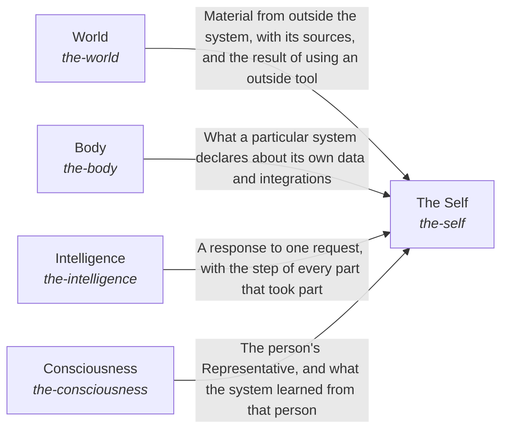

# hubofhubs

Breadcrumb: [Top](../esoi/README.md) > hubofhubs

Part of [The best parts for AI intelligence, assembled and proven](../esoi/README.md)

## World (`the-world`)

Bring in what is outside the system and let the AI act on it through the best available tool.

- Out of scope: What the system keeps internally and which parts of the outside a particular system has declared as its own.
- Delegates to: the-body
- Entry call: `hubofhubs.run("the-world", 'latest Rust version')`
- Selected implementation: Search and papers through the tools (`composition`)
- Metric: Task pass rate and cost per passing task
- Implemented by: [`hubofhubs/the_world/__init__.py`](the_world/__init__.py), [`hubofhubs/the_world/flow.py`](the_world/flow.py), [`hubofhubs/the_world/interface.py`](the_world/interface.py), [`hubofhubs/the_world/learning/__init__.py`](the_world/learning/__init__.py), [`hubofhubs/the_world/learning/interface.py`](the_world/learning/interface.py), [`hubofhubs/the_world/learning/registry_research.py`](the_world/learning/registry_research.py), [`hubofhubs/the_world/learning/research_freshness_reader/__init__.py`](the_world/learning/research_freshness_reader/__init__.py), [`hubofhubs/the_world/learning/research_freshness_reader/interface.py`](the_world/learning/research_freshness_reader/interface.py) and 143 more

## The Self (`the-self`)

Keep every part working as one whole for one request.

- Out of scope: How information is processed, where the system's data lives, what the outside offers and what each person wants.
- Delegates to: the-intelligence, the-body, the-world, the-consciousness
- Entry call: `hubofhubs.run("the-self", ...)`
- Selected implementation: Responds through every container (`composition`)
- Metric: The assembled whole answers a real request, Integrated efficiency of the whole
- Implemented by: [`hubofhubs/the_self/__init__.py`](the_self/__init__.py), [`hubofhubs/the_self/assembler/__init__.py`](the_self/assembler/__init__.py), [`hubofhubs/the_self/assembler/arm_needs.py`](the_self/assembler/arm_needs.py), [`hubofhubs/the_self/assembler/cli.py`](the_self/assembler/cli.py), [`hubofhubs/the_self/assembler/interface.py`](the_self/assembler/interface.py), [`hubofhubs/the_self/assembler/oneline.py`](the_self/assembler/oneline.py), [`hubofhubs/the_self/assembler/resolution.py`](the_self/assembler/resolution.py), [`hubofhubs/the_self/assembler/tests/test_safe_loading.py`](the_self/assembler/tests/test_safe_loading.py) and 22 more

## Body (`the-body`)

Let the hub apply to one particular system by declaring where its data lives, where its requests come from and which of its integrations the AI may use, and keep the run record, the configuration, the environment variables, the secrets and the stored authentication the tools need.

- Out of scope: Reading or writing the data (a World tool does that), finding the right context for a request, and the tools of the outside.
- Delegates to: the-world, the-intelligence
- Entry call: `hubofhubs.run("the-body", '')`
- Selected implementation: Declared sources and enduring integrations (`composition`)
- Metric: A system applies the hub to itself
- Implemented by: [`hubofhubs/the_body/__init__.py`](the_body/__init__.py), [`hubofhubs/the_body/filemodes.py`](the_body/filemodes.py), [`hubofhubs/the_body/flow.py`](the_body/flow.py), [`hubofhubs/the_body/hands/__init__.py`](the_body/hands/__init__.py), [`hubofhubs/the_body/hands/integrations.py`](the_body/hands/integrations.py), [`hubofhubs/the_body/hands/interface.py`](the_body/hands/interface.py), [`hubofhubs/the_body/hands/tests/test_hands.py`](the_body/hands/tests/test_hands.py), [`hubofhubs/the_body/intake_sources/__init__.py`](the_body/intake_sources/__init__.py) and 64 more

## Intelligence (`the-intelligence`)

Turn one request and what is known into a response that meets its goal.

- Out of scope: Where the system's data lives, the tools of the outside, and what a person wants (the Representative carries that).
- Delegates to: the-body, the-world, the-consciousness
- Entry call: `hubofhubs.run("the-intelligence", ...)`
- Selected implementation: One request through the long view, the target, the Mind and the checks (`composition`)
- Metric: A request is answered from what bears on it
- Implemented by: [`hubofhubs/the_intelligence/__init__.py`](the_intelligence/__init__.py), [`hubofhubs/the_intelligence/critical_thinking/__init__.py`](the_intelligence/critical_thinking/__init__.py), [`hubofhubs/the_intelligence/critical_thinking/decision_check/__init__.py`](the_intelligence/critical_thinking/decision_check/__init__.py), [`hubofhubs/the_intelligence/critical_thinking/decision_check/agreement.py`](the_intelligence/critical_thinking/decision_check/agreement.py), [`hubofhubs/the_intelligence/critical_thinking/decision_check/checks.py`](the_intelligence/critical_thinking/decision_check/checks.py), [`hubofhubs/the_intelligence/critical_thinking/decision_check/interface.py`](the_intelligence/critical_thinking/decision_check/interface.py), [`hubofhubs/the_intelligence/critical_thinking/decision_check/mistakes.py`](the_intelligence/critical_thinking/decision_check/mistakes.py), [`hubofhubs/the_intelligence/critical_thinking/decision_check/remainder.py`](the_intelligence/critical_thinking/decision_check/remainder.py) and 220 more

## Consciousness (`the-consciousness`)

Keep the system aligned with the humans and policies it works for.

- Out of scope: Raising the risk signal, judging response quality against a profile, and storing what the system remembers.
- Delegates to: the-intelligence, the-body
- Entry call: `hubofhubs.run("the-consciousness", '')`
- Selected implementation: Representative, priorities and feedback (`composition`)
- Metric: A representative asks when the person would want to be asked
- Implemented by: [`docs/reference/work-trace-event.schema.json`](../docs/reference/work-trace-event.schema.json), [`hubofhubs/the_consciousness/__init__.py`](the_consciousness/__init__.py), [`hubofhubs/the_consciousness/communication.py`](the_consciousness/communication.py), [`hubofhubs/the_consciousness/feedback_learning/__init__.py`](the_consciousness/feedback_learning/__init__.py), [`hubofhubs/the_consciousness/feedback_learning/interface.py`](the_consciousness/feedback_learning/interface.py), [`hubofhubs/the_consciousness/feedback_learning/propose.py`](the_consciousness/feedback_learning/propose.py), [`hubofhubs/the_consciousness/feedback_learning/tests/test_feedback_learning.py`](the_consciousness/feedback_learning/tests/test_feedback_learning.py), [`hubofhubs/the_consciousness/flow.py`](the_consciousness/flow.py) and 43 more

## One level below

- [The form and internal context of a system](the_body/README.md) (sub-intent): The AI system fits the particular system it lives in.
- [Adapting to the humans the system works with](the_consciousness/README.md) (sub-intent): The AI system works in alignment with the humans it serves.
- [How the AI processes information](the_intelligence/README.md) (sub-intent): AI requests are handled in the best way possible, given all relevant information.
- [The parts working as one whole](the_self/README.md) (sub-intent): The parts of the AI system work together as one whole.
- [Awareness of the outside and interaction with it](the_world/README.md) (sub-intent): The AI system optimally learns and interacts with the world outside of it.
- [Hands](the_body/hands/README.md) (solution with implementations): Make the integrations a system already depends on accessible to the AI and actually used.
- [Intake Sources](the_body/intake_sources/README.md) (solution with implementations): Let a system say where its requests come from and read them, without the hub being written for that system.
- [Internal Context](the_body/internal_context/README.md) (solution with implementations and parts below it): Let the AI know what a particular system knows, without the hub being written for that system: the declaration of where its data lives and whether each source belongs to the system or to a person, the configuration its tools need, and the run record the flow writes.
- [Feedback Learning](the_consciousness/feedback_learning/README.md) (solution with implementations): Make what went wrong once change behaviour afterwards: propose edits to specs, metrics and the datasets that measure them, which ESOI Application applies directly unless Judgment Calls decides to ask.
- [Judgment Calls](the_consciousness/judgment_calls/README.md) (solution with implementations): Ask a person only when that person would want to be asked, and decide how: whether the ask blocks or waits, whether it is batched, what may continue meanwhile, and whether a change to specs or a learning step needs an ask at all (by default it does not).
- [Prioritization](the_consciousness/prioritization/README.md) (solution with implementations): Put what competes for a person's attention in the order they would: their work, the asks to them and their goals.
- [Representatives](the_consciousness/representatives/README.md) (solution with implementations): Let an AI act for a person the way that person would want, within the authority the person gave: the worker categories allowed, the data scope (whose data the AI may read), the person's asking policy and quality profile.
- [Request Intake](the_consciousness/request_intake/README.md) (solution with implementations): Take in every request a person makes, once, from wherever the system listens.
- [AI Session Experience](the_consciousness/terminal/README.md) (solution with implementations): Let a person watch, steer, stop and resume the AI while it works, and understand and trust what it did, on any surface and with any harness.
- [Nervous System](the_intelligence/nervous_system/README.md) (solution with implementations): Send one risk signal, a severity and a reason, before irreversible or person-owned steps, without slowing ordinary work and without routing.
- [Proactivity](the_intelligence/proactivity/README.md) (solution with implementations): Let the system start its standing work when it is due, without being asked.
- [Assembler](the_self/assembler/README.md) (solution with implementations): Build the whole from the best-measured arm of every seat and report its coverage, with no glue written by the consumer.
- [Integrity](the_self/integrity/README.md) (solution with implementations): Keep the whole honest and usable by any consumer: what the system says about itself and what it did matches the record.
- [Role Understanding](the_self/role_understanding/README.md) (solution with implementations): Give every part a role in the whole that the part and the Assembler can both read.
- [Learning](the_world/learning/README.md) (solution with implementations and parts below it): Keep what the hub recommends current with the outside.
- [Decision Check](the_intelligence/critical_thinking/decision_check/README.md) (solution with implementations): Give a draft decision to small independent checks that check each other's work, within a declared number of calls.
- [ESOI Application](the_intelligence/critical_thinking/esoi_application/README.md) (solution with implementations): Apply a proposed edit to the system's own specs and metrics exactly as proposed: an AI is the author of the specs, and the edit is applied directly unless Judgment Calls decides to ask.
- [Goal Completion](the_intelligence/critical_thinking/goal_completion/README.md) (solution with implementations): Check that the goal was met.
- [Metric Translation](the_intelligence/critical_thinking/metric_translation/README.md) (solution with implementations): Make what success means for a request explicit and measurable as a goal record: the metric, its target, the done-standard and the budget (attempts, pieces and model calls) that Delegation and Model Plumbing enforce.
- [Metric Upkeep](the_intelligence/critical_thinking/metric_upkeep/README.md) (solution with implementations): Keep every milestone measurable by the AI's own work, so a turn asked to make progress never has the excuse of waiting on a person.
- [Response Quality](the_intelligence/critical_thinking/response_quality/README.md) (solution with implementations): Judge a response against the quality profile that applies to this request.
- [Solution Passes](the_intelligence/critical_thinking/solution_passes/README.md) (solution with implementations): Make every relevant solution judge a request against its own records, at every level of the hierarchy, so durable memory and expertise are never skipped.
- [Guidance](the_intelligence/higher_mind/guidance/README.md) (solution with implementations): Keep the Planner pointed at the longer-term outcome without taking over the request.
- [Long-Term Memory](the_intelligence/higher_mind/long_term_memory/README.md) (solution with implementations): Let the AI keep and recall what happened across requests.
- [Objectives](the_intelligence/higher_mind/objectives/README.md) (solution with implementations): Let the AI keep working toward a goal over many requests and know which objective a request serves.
- [Context Intake](the_intelligence/mind/context_intake/README.md) (solution with implementations): Give the Planner one view of what is known for a request, whatever its source.
- [Delegation](the_intelligence/mind/delegation/README.md) (solution with implementations): Hand work on without losing the authority it was given or the standard that says it is done, enforce the authority, the goal record's budget and cancellation (down to a running agent session), and refuse a piece it may not run with the reason.
- [Planner](the_intelligence/mind/planner/README.md) (solution with implementations): Turn a request into pieces that can be done and checked, each with the worker category that fits it, and replan from what failed.
- [Resolve a Reference](the_intelligence/mind/reference_resolver/README.md) (solution with implementations): Tie a phrase to the thing it names only when it is that thing.
- [Route a Request](the_intelligence/mind/request_router/README.md) (solution with implementations): Understand what a request asks for before the system answers, acts or writes, in one place.
- [Response Writer](the_intelligence/mind/response_writer/README.md) (solution with implementations): Write what the Mind outputs for its reader.
- [Cards From Files](the_intelligence/subconscious/cards_from_files/README.md) (solution with implementations): Propose the cards a folder of files needs, in the card store record shape, for the Subconscious to keep and recall.
- [Context Retriever](the_intelligence/subconscious/context_retriever/README.md) (solution with implementations): Pick, from a corpus of files, cards or memory, the pieces of text a task needs within a token budget.
- [Folder View](the_intelligence/subconscious/folder_view/README.md) (solution with implementations): Choose the files of a working folder a piece of work should be shown first, and never read what is risky or unlikely to help, for any programming language and tool.
- [Intuition](the_intelligence/subconscious/intuition/README.md) (solution with implementations): Let useful information surface unasked.
- [Relevant Solutions](the_intelligence/subconscious/relevant_solutions/README.md) (solution with implementations): Find, for any request, every solution of the consumer's records that deserves its own consideration, so none is skipped.
- [Model Tier Chooser](the_world/model_plumbing/model_tier_chooser/README.md) (solution with implementations): Pick, for each model tier, the model that does the most passing work per cost.
- [Vendor Model Caller](the_world/model_plumbing/vendor_model_caller/README.md) (solution with implementations): Reach one vendor's model, and step to the next provider when one fails.
- [Connected System Operations](the_world/tools/connected_system_operations/README.md) (solution with implementations): Carry out an operation of a connected system on the AI's behalf.
- [Delegated Agent Sessions](the_world/tools/delegated_agent_sessions/README.md) (solution with implementations): Get open-ended work done by an agent in its own session.
- [File Editing](the_world/tools/file_editing/README.md) (solution with implementations): Make the file change that was asked for, and no other.
- [File Reading](the_world/tools/file_reading/README.md) (solution with implementations): Read the files a task or a card builder needs, without leaving the folder it was given.
- [Web Search](the_world/tools/web_search/README.md) (solution with implementations): Run one web search and return its hits with their sources.

## Diagram

An arrow runs from the solution that provides to the solution that builds on it; its label is what the provider outputs.

## Implementations

| Implementation | Handle | Purpose | Code | Selected |
|---|---|---|---|---|
| Hand-wired general agent framework | `the-self:hand_wired_agent_framework` | A team picks a general agent framework (for example LangChain, LlamaIndex or the OpenAI Agents SDK) and writes its own glue for models, search, memory and tools, with each part chosen by taste and tried together by hand. | no code yet |  |
| Responds through every container | `the-self:composition` | Responds to a request through Consciousness, Intelligence and the Body and reaches the outside through World. | [`hubofhubs/the_self/respond.py`](the_self/respond.py) | selected |
| Declared sources and enduring integrations | `the-body:composition` | Describes the form of the system: where its data lives and which enduring integrations the AI may use. | [`hubofhubs/the_body/flow.py`](the_body/flow.py) | selected |
| One request through the long view, the target, the Mind and the checks | `the-intelligence:composition` | Reads the long view, translates the request into a target, runs the Mind, and checks goal completion and response quality. | [`hubofhubs/the_intelligence/flow.py`](the_intelligence/flow.py) | selected |
| Representative, priorities and feedback | `the-consciousness:composition` | Represents a person, resolves priorities and learns from feedback. | [`hubofhubs/the_consciousness/flow.py`](the_consciousness/flow.py) | selected |
| Search and papers through the tools | `the-world:composition` | Brings the outside in through Tools (Web Search) and Science. Model Plumbing and Learning are the other parts of World and have their own entries. | [`hubofhubs/the_world/flow.py`](the_world/flow.py) | selected |

## Metrics

- Task pass rate and cost per passing task (`metric-the-world`)
- The assembled whole answers a real request (`metric-the-self`): leader `whole_hub`, 0 of 6 cases
- A system applies the hub to itself (`metric-the-body`)
- A request is answered from what bears on it (`metric-the-intelligence`)
- A representative asks when the person would want to be asked (`metric-the-consciousness`)
- Integrated efficiency of the whole (`metric-integrated-efficiency`): leader `whole_hub`, 0 of 6 cases

## Problems

- Parts re-glued by every team (`HP1`): Many teams research and wire up the same open-source AI parts on their own, and their private versions drift apart.
- Parts not compared on the job at hand (`HP2`): Lists of hubs say what exists, not which works best for a given job or how well parts work together.
- Wired to one hub (`HP4`): When a system is wired to one hub, that hub's outage, price change or shutdown can stop the system or raise its cost, and switching usually means changing code.
- Parts not judged by what they add to the whole (`HP5`): Each part is usually tuned and chosen on its own, so a part can be kept for how well it does alone even when the whole gains little from it or pays more for it.
- Form wired to one product (`hprob-system-form-wired-to-one-product`): AI systems are usually built around one product's data, so another system cannot give the hub its own APIs, databases and files without rewriting parts.
- Too much or too little context (`hprob-one-request-answered-from-too-much-or-too-little`): A request is often answered from whatever context is at hand (the recent chat, a fixed set of files), so the AI sees too much to use well or too little to answer.
- Every person treated alike (`hprob-ai-treats-every-person-alike`): Most AI assistants use the same rule for every person, so they ask a person who wanted them to go ahead and act without asking a person who wanted to be asked.

## Ideals

- The best option for each case is in use (`HI1`): The implementations selected for solutions always reflect the best alternative available across all known resources and methods.
- One-step assembly (`HI2`): Anyone gets a working system from the best parts without writing glue code.
- Always current (`HI3`): What the hub recommends reflects the best parts available now.
- Swappable parts (`HI4`): When a better part appears or a part fails, the system keeps working with the better or the working one, and no caller changes.
- Every part earns its place in the whole (`HI5`): The assembled whole does real work well for its users, and every part in it adds more to the whole than it costs.
- Generic and thin (`HI6`): Any team can use the hub as it is, and can change any default without forking it.

## Where to go next

- Intent: [The best parts for AI intelligence, assembled and proven](../esoi/README.md)
- Down: [hubofhubs/the_body/hands](the_body/hands/README.md)
- Down: [hubofhubs/the_body/intake_sources](the_body/intake_sources/README.md)
- Down: [hubofhubs/the_body/internal_context](the_body/internal_context/README.md)
- Down: [hubofhubs/the_consciousness/feedback_learning](the_consciousness/feedback_learning/README.md)
- Down: [hubofhubs/the_consciousness/judgment_calls](the_consciousness/judgment_calls/README.md)
- Down: [hubofhubs/the_consciousness/prioritization](the_consciousness/prioritization/README.md)
- Down: [hubofhubs/the_consciousness/representatives](the_consciousness/representatives/README.md)
- Down: [hubofhubs/the_consciousness/request_intake](the_consciousness/request_intake/README.md)
- Down: [hubofhubs/the_consciousness/terminal](the_consciousness/terminal/README.md)
- Down: [hubofhubs/the_intelligence/nervous_system](the_intelligence/nervous_system/README.md)
- Down: [hubofhubs/the_intelligence/proactivity](the_intelligence/proactivity/README.md)
- Down: [hubofhubs/the_self/assembler](the_self/assembler/README.md)
- Down: [hubofhubs/the_self/integrity](the_self/integrity/README.md)
- Down: [hubofhubs/the_self/role_understanding](the_self/role_understanding/README.md)
- Down: [hubofhubs/the_world/learning](the_world/learning/README.md)
- Down: [hubofhubs/the_world/science](the_world/science/README.md)
- Down: [hubofhubs/the_intelligence/critical_thinking/decision_check](the_intelligence/critical_thinking/decision_check/README.md)
- Down: [hubofhubs/the_intelligence/critical_thinking/esoi_application](the_intelligence/critical_thinking/esoi_application/README.md)
- Down: [hubofhubs/the_intelligence/critical_thinking/goal_completion](the_intelligence/critical_thinking/goal_completion/README.md)
- Down: [hubofhubs/the_intelligence/critical_thinking/metric_translation](the_intelligence/critical_thinking/metric_translation/README.md)
- Down: [hubofhubs/the_intelligence/critical_thinking/metric_upkeep](the_intelligence/critical_thinking/metric_upkeep/README.md)
- Down: [hubofhubs/the_intelligence/critical_thinking/response_quality](the_intelligence/critical_thinking/response_quality/README.md)
- Down: [hubofhubs/the_intelligence/critical_thinking/solution_passes](the_intelligence/critical_thinking/solution_passes/README.md)
- Down: [hubofhubs/the_intelligence/higher_mind/guidance](the_intelligence/higher_mind/guidance/README.md)
- Down: [hubofhubs/the_intelligence/higher_mind/long_term_memory](the_intelligence/higher_mind/long_term_memory/README.md)
- Down: [hubofhubs/the_intelligence/higher_mind/objectives](the_intelligence/higher_mind/objectives/README.md)
- Down: [hubofhubs/the_intelligence/mind/context_intake](the_intelligence/mind/context_intake/README.md)
- Down: [hubofhubs/the_intelligence/mind/delegation](the_intelligence/mind/delegation/README.md)
- Down: [hubofhubs/the_intelligence/mind/planner](the_intelligence/mind/planner/README.md)
- Down: [hubofhubs/the_intelligence/mind/reference_resolver](the_intelligence/mind/reference_resolver/README.md)
- Down: [hubofhubs/the_intelligence/mind/request_router](the_intelligence/mind/request_router/README.md)
- Down: [hubofhubs/the_intelligence/mind/response_writer](the_intelligence/mind/response_writer/README.md)
- Down: [hubofhubs/the_intelligence/subconscious/cards_from_files](the_intelligence/subconscious/cards_from_files/README.md)
- Down: [hubofhubs/the_intelligence/subconscious/context_retriever](the_intelligence/subconscious/context_retriever/README.md)
- Down: [hubofhubs/the_intelligence/subconscious/folder_view](the_intelligence/subconscious/folder_view/README.md)
- Down: [hubofhubs/the_intelligence/subconscious/intuition](the_intelligence/subconscious/intuition/README.md)
- Down: [hubofhubs/the_intelligence/subconscious/relevant_solutions](the_intelligence/subconscious/relevant_solutions/README.md)
- Down: [hubofhubs/the_world/model_plumbing/model_tier_chooser](the_world/model_plumbing/model_tier_chooser/README.md)
- Down: [hubofhubs/the_world/model_plumbing/vendor_model_caller](the_world/model_plumbing/vendor_model_caller/README.md)
- Down: [hubofhubs/the_world/tools/connected_system_operations](the_world/tools/connected_system_operations/README.md)
- Down: [hubofhubs/the_world/tools/delegated_agent_sessions](the_world/tools/delegated_agent_sessions/README.md)
- Down: [hubofhubs/the_world/tools/file_editing](the_world/tools/file_editing/README.md)
- Down: [hubofhubs/the_world/tools/file_reading](the_world/tools/file_reading/README.md)
- Down: [hubofhubs/the_world/tools/web_search](the_world/tools/web_search/README.md)
- Repository: [top README](../README.md)

*Generated from the CSV files in this folder by `esoi readmes`. Edit the CSV files, not this page.*
