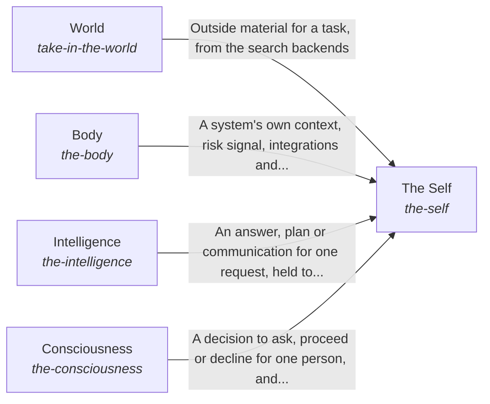

# hubofhubs

*ESOI records kept beside the code in `hubofhubs`, generated from the CSV files in this folder by `esoi readmes`. Edit the CSV files, not this page.*

## World (`take-in-the-world`)

Connect any AI to tools, search and data sources without writing code for each one.

- Entry call: `hubofhubs.run("take-in-the-world", 'latest Rust release')`
- Selected implementation: Search and papers as the way in (`search_backends`)
- Metric: Task pass rate and cost per passing task
- Implemented by: [`hubofhubs/areas.py`](areas.py), [`hubofhubs/terminal/__init__.py`](terminal/__init__.py), [`hubofhubs/terminal/asks.py`](terminal/asks.py), [`hubofhubs/terminal/blocks.py`](terminal/blocks.py), [`hubofhubs/terminal/render.py`](terminal/render.py), [`hubofhubs/terminal/stopped.py`](terminal/stopped.py), [`hubofhubs/terminal/strings.py`](terminal/strings.py), [`hubofhubs/terminal/trail.py`](terminal/trail.py) and 3 more

## The Self (`the-self`)

Keep every part of an AI system working as one coherent whole, for anyone who assembles one from the hub.

- Entry call: `hubofhubs.run("the-self", 'what is the latest Rust release?')`
- Selected implementation: Answers through the Assembler and reaches the other containers (`composition`)
- Metric: The assembled whole answers a real request
- Implemented by: [`hubofhubs/whole.py`](whole.py)

## Body (`the-body`)

Let any product give the AI its own form and context without rewriting the hub's parts.

- Entry call: no entry declared
- Selected implementation: Composition of the form and internal context (`composition`)
- Metric: A system applies the hub to itself

## Intelligence (`the-intelligence`)

Answer each request from what bears on it, at the lowest cost that still passes.

- Entry call: no entry declared
- Selected implementation: Composition of the processing of information (`composition`)
- Metric: A request is answered from what bears on it

## Consciousness (`the-consciousness`)

Let the system adapt to each human it works with, so people are neither interrupted needlessly nor surprised.

- Entry call: no entry declared
- Selected implementation: Composition of the adaptation to humans (`composition`)
- Metric: A representative asks when the person would want to be asked

## Diagram

An arrow runs from the solution that provides to the solution that builds on it; its label is what the provider outputs.

## Implementations

| Implementation | Handle | Code | Selected |
|---|---|---|---|
| Search and papers as the way in | `take-in-the-world:search_backends` | [`hubofhubs/areas.py`](areas.py) | selected |
| Hand-wired general agent framework | `the-self:hand_wired_agent_framework` | no code yet |  |
| The parts of the world | `take-in-the-world:parts` | no code yet |  |
| Answers through the Assembler and reaches the other containers | `the-self:composition` | [`hubofhubs/whole.py`](whole.py) | selected |
| The parts of the system | `the-self:parts` | no code yet |  |
| Composition of the form and internal context | `the-body:composition` | no code yet | selected |
| Composition of the processing of information | `the-intelligence:composition` | no code yet | selected |
| Composition of the adaptation to humans | `the-consciousness:composition` | no code yet | selected |

## Metrics

- Task pass rate and cost per passing task (`metric-take-in-the-world`)
- The assembled whole answers a real request (`metric-the-self`)
- A system applies the hub to itself (`metric-the-body`)
- A request is answered from what bears on it (`metric-the-intelligence`)
- A representative asks when the person would want to be asked (`metric-the-consciousness`)

## Problems

- Every team re-researches and re-glues the same AI parts, and the private copies drift apart. (`HP1`)
- Lists of hubs say what exists, not which works best or fits together. (`HP2`)
- One hub's outage, price change or shutdown stops the system, and switching needs code changes. (`HP4`)
- Parts that are best alone can fail when assembled, and nobody tests the whole. (`HP5`)
- The form and internal context of an AI system are wired for one product, so another system cannot give the hub its own APIs, databases and files without rewriting the parts. (`hprob-system-form-wired-to-one-product`)
- A request is answered from whatever happened to be nearby, so the AI sees too much to use or too little to answer. (`hprob-one-request-answered-from-too-much-or-too-little`)
- An AI treats every person alike, so it asks the person who wanted it to proceed and acts without asking the person who wanted to be asked. (`hprob-ai-treats-every-person-alike`)

## Ideals

- Best by measurement (`HI1`): Each seat holds the part that measures best on shared cases.
- One-step assembly (`HI2`): Configuration in, working system out, no glue code.
- Always current (`HI3`): No area goes a week without a fresh search and comparison.
- Swappable parts (`HI4`): Any part can be replaced by configuration when another measures better or fails.
- Proven whole (`HI5`): The assembled system is tested end to end on a production consumer, not only part by part.
- Generic and thin (`HI6`): No consumer-specific content.

## Where to go next

- Intent: [The best parts for AI intelligence, assembled and proven](../esoi/README.md)
- Repository: [top README](../README.md)
