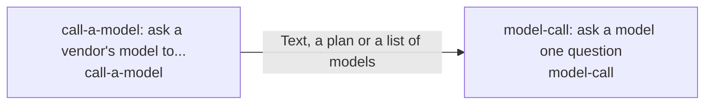

# models

*ESOI records kept beside the code in `hubofhubs/models`, generated from the CSV files in this folder by `esoi readmes`. Edit the CSV files, not this page.*

## model-call: ask a model one question (`model-call`)

Ask a model a question at the tier that fits, for any consumer.

- Entry call: `hubofhubs.run("model-call", ...)`
- Selected implementation: `via_call_a_model`
- Metric: Model call answers for the tier
- Implemented by: [`hubofhubs/models/__init__.py`](__init__.py), [`hubofhubs/models/anthropic.py`](anthropic.py), [`hubofhubs/models/claude_cli.py`](claude_cli.py), [`hubofhubs/models/family.py`](family.py), [`hubofhubs/models/gemini.py`](gemini.py), [`hubofhubs/models/layers.py`](layers.py), [`hubofhubs/models/listing.py`](listing.py), [`hubofhubs/models/openai.py`](openai.py) and 8 more

## call-a-model: ask a vendor's model to plan, answer or list models (`call-a-model`)

Reach any model vendor through one interface, for any consumer that calls models.

- Entry call: `hubofhubs.run("call-a-model", ...)`
- Selected implementation: `claude_cli`
- Metric: Provider failover and vendor answers
- Implemented by: [`hubofhubs/models/__init__.py`](__init__.py), [`hubofhubs/models/anthropic.py`](anthropic.py), [`hubofhubs/models/claude_cli.py`](claude_cli.py), [`hubofhubs/models/family.py`](family.py), [`hubofhubs/models/gemini.py`](gemini.py), [`hubofhubs/models/layers.py`](layers.py), [`hubofhubs/models/listing.py`](listing.py), [`hubofhubs/models/openai.py`](openai.py) and 8 more

## Diagram

An arrow runs from the solution that provides to the solution that builds on it; its label is what the provider outputs.

## Implementations

| Implementation | Name | Code | Selected |
|---|---|---|---|
| `call-a-model:anthropic` | Anthropic provider | [`hubofhubs/models/anthropic.py`](anthropic.py) |  |
| `call-a-model:deepseek` | DeepSeek provider | [`hubofhubs/models/openai.py`](openai.py) |  |
| `call-a-model:gemini` | Gemini provider | [`hubofhubs/models/gemini.py`](gemini.py) |  |
| `call-a-model:multi_provider` | Multi-provider router | [`hubofhubs/models/router.py`](router.py) |  |
| `call-a-model:openai` | OpenAI provider | [`hubofhubs/models/openai.py`](openai.py) |  |
| `model-call:via_call_a_model` | Via call-a-model | [`hubofhubs/models/via_provider.py`](via_provider.py) | selected |
| `call-a-model:claude_cli` | Claude cli | [`hubofhubs/models/claude_cli.py`](claude_cli.py) | selected |

## Metrics

- `metric-model-call`, Model call answers for the tier: leader `via_call_a_model`, 30 of 30 cases
- `metric-call-a-model`, Provider failover and vendor answers: leader `multi_provider`, 30 of 30 cases

## Where to go next

- Up: [hubofhubs](../README.md)
- Intent: [The best parts for AI intelligence, assembled and proven](../../esoi/README.md)
- Repository: [top README](../../README.md)
