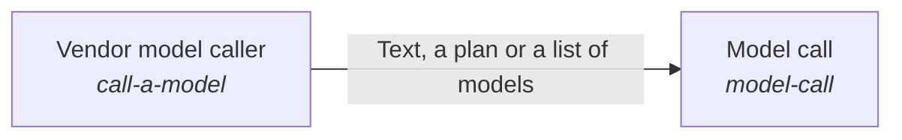

# models

*ESOI records kept beside the code in `hubofhubs/models`, generated from the CSV files in this folder by `esoi readmes`. Edit the CSV files, not this page.*

## Model call (`model-call`)

Ask a model a question at the tier that fits, for any consumer.

- Entry call: `hubofhubs.run("model-call", ...)`
- Selected implementation: `via_call_a_model`
- Metric: Model call answers for the tier
- Implemented by: [`hubofhubs/models/__init__.py`](__init__.py), [`hubofhubs/models/anthropic.py`](anthropic.py), [`hubofhubs/models/claude_cli.py`](claude_cli.py), [`hubofhubs/models/family.py`](family.py), [`hubofhubs/models/gemini.py`](gemini.py), [`hubofhubs/models/layers.py`](layers.py), [`hubofhubs/models/listing.py`](listing.py), [`hubofhubs/models/openai.py`](openai.py) and 8 more

## Vendor model caller (`call-a-model`)

Reach any model vendor through one interface, for any consumer that calls models.

- Entry call: `hubofhubs.run("call-a-model", ...)`
- Selected implementation: `claude_cli`
- Metric: Provider failover
- Implemented by: [`hubofhubs/models/__init__.py`](__init__.py), [`hubofhubs/models/anthropic.py`](anthropic.py), [`hubofhubs/models/claude_cli.py`](claude_cli.py), [`hubofhubs/models/family.py`](family.py), [`hubofhubs/models/gemini.py`](gemini.py), [`hubofhubs/models/layers.py`](layers.py), [`hubofhubs/models/listing.py`](listing.py), [`hubofhubs/models/openai.py`](openai.py) and 8 more

## Diagram

An arrow runs from the solution that provides to the solution that builds on it; its label is what the provider outputs.

## Implementations

| Implementation | Handle | Code | Selected |
|---|---|---|---|
| Anthropic provider | `call-a-model:anthropic` | [`hubofhubs/models/anthropic.py`](anthropic.py) |  |
| DeepSeek provider | `call-a-model:deepseek` | [`hubofhubs/models/openai.py`](openai.py) |  |
| Gemini provider | `call-a-model:gemini` | [`hubofhubs/models/gemini.py`](gemini.py) |  |
| Multi-provider router | `call-a-model:multi_provider` | [`hubofhubs/models/router.py`](router.py) |  |
| OpenAI provider | `call-a-model:openai` | [`hubofhubs/models/openai.py`](openai.py) |  |
| Built on the vendor model caller | `model-call:via_call_a_model` | [`hubofhubs/models/via_provider.py`](via_provider.py) | selected |
| Claude Code CLI | `call-a-model:claude_cli` | [`hubofhubs/models/claude_cli.py`](claude_cli.py) | selected |

## Metrics

- Model call answers for the tier (`metric-model-call`): leader `via_call_a_model`, 30 of 30 cases
- Provider failover (`metric-call-a-model`): leader `multi_provider`, 30 of 30 cases

## Where to go next

- Up: [hubofhubs](../README.md)
- Intent: [The best parts for AI intelligence, assembled and proven](../../esoi/README.md)
- Repository: [top README](../../README.md)
