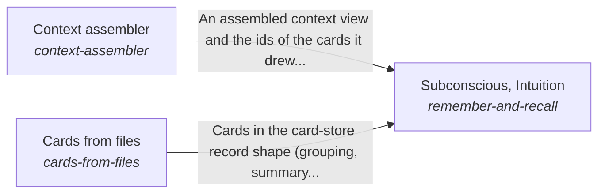

# recall

*ESOI records kept beside the code in `hubofhubs/recall`, generated from the CSV files in this folder by `esoi readmes`. Edit the CSV files, not this page.*

## Subconscious, Intuition (`remember-and-recall`)

Give an AI the context a task needs and nothing from another person's scope.

- Entry call: `hubofhubs.run("remember-and-recall", 'rust release')`
- Selected implementation: `card_recall`
- Metric: Right context admitted, none from another scope
- Implemented by: [`docs/reference/work-trace-event.schema.json`](../../docs/reference/work-trace-event.schema.json), [`hubofhubs/ports/__init__.py`](../ports/__init__.py), [`hubofhubs/ports/context.py`](../ports/context.py), [`hubofhubs/ports/control.py`](../ports/control.py), [`hubofhubs/ports/deep.py`](../ports/deep.py), [`hubofhubs/ports/events.py`](../ports/events.py), [`hubofhubs/ports/model.py`](../ports/model.py), [`hubofhubs/ports/retrieval.py`](../ports/retrieval.py) and 85 more

## Context assembler (`context-assembler`)

Find the passages that bear on a request, for any consumer that keeps knowledge to draw on.

- Entry call: `hubofhubs.run("context-assembler", 'where does the card store tidy itself?')`
- Selected implementation: `bm25@analyzer=english`
- Metric: Relevant passage in the top five
- Implemented by: [`hubofhubs/recall/__init__.py`](__init__.py), [`hubofhubs/recall/affinity_tags.py`](affinity_tags.py), [`hubofhubs/recall/background_pacing.py`](background_pacing.py), [`hubofhubs/recall/bm25_store.py`](bm25_store.py), [`hubofhubs/recall/card_content_render.py`](card_content_render.py), [`hubofhubs/recall/card_limit.py`](card_limit.py), [`hubofhubs/recall/card_limit_report.py`](card_limit_report.py), [`hubofhubs/recall/card_origin.py`](card_origin.py) and 70 more

## Cards from files (`cards-from-files`)

Give any consumer cards for the knowledge it already keeps in files, so recall starts from what is there instead of an empty store.

- Entry call: `hubofhubs.run("cards-from-files", {'root': '.', 'files': [], 'existing': {}})`
- Selected implementation: `import_graph_topic_cards`
- Metric: Balanced score of a builder's cards on file-finding, topic and orientation cases, with the store's size
- Implemented by: [`hubofhubs/recall/__init__.py`](__init__.py), [`hubofhubs/recall/affinity_tags.py`](affinity_tags.py), [`hubofhubs/recall/background_pacing.py`](background_pacing.py), [`hubofhubs/recall/bm25_store.py`](bm25_store.py), [`hubofhubs/recall/card_content_render.py`](card_content_render.py), [`hubofhubs/recall/card_limit.py`](card_limit.py), [`hubofhubs/recall/card_limit_report.py`](card_limit_report.py), [`hubofhubs/recall/card_origin.py`](card_origin.py) and 70 more

## Diagram

An arrow runs from the solution that provides to the solution that builds on it; its label is what the provider outputs.

## Implementations

| Implementation | Handle | Code | Selected |
|---|---|---|---|
| Composite retrieval | `context-assembler:composite` | [`hubofhubs/recall/composite_assembler.py`](composite_assembler.py) |  |
| BM25 over file text | `context-assembler:bm25` | [`hubofhubs/recall/bm25_store.py`](bm25_store.py) |  |
| Hybrid fusion | `context-assembler:hybrid` | [`hubofhubs/recall/hybrid_assembler.py`](hybrid_assembler.py) |  |
| Vector search | `context-assembler:vector` | [`hubofhubs/recall/vector_assembler.py`](vector_assembler.py) |  |
| Model-written topic cards | `cards-from-files:llm_topic_cards` | [`hubofhubs/recall/cards_from_files.py`](cards_from_files.py) |  |
| One card per file | `cards-from-files:per_file_symbols` | [`hubofhubs/recall/cards_from_files.py`](cards_from_files.py) |  |
| Graphify file groups | `cards-from-files:graphify_files` | [`hubofhubs/recall/cards_from_graphify.py`](cards_from_graphify.py) |  |
| Cards drawn by relevance from a store | `remember-and-recall:card_recall` | [`hubofhubs/recall/card_recall.py`](card_recall.py) | selected |
| File plus topic cards | `cards-from-files:file_plus_topic_cards` | [`hubofhubs/recall/cards_from_files.py`](cards_from_files.py) |  |
| Topic cards replay | `cards-from-files:topic_cards_replay` | [`hubofhubs/recall/cards_from_files.py`](cards_from_files.py) |  |
| Cochange topic cards | `cards-from-files:cochange_topic_cards` | [`hubofhubs/recall/cards_from_topics.py`](cards_from_topics.py) |  |
| Import graph topic cards | `cards-from-files:import_graph_topic_cards` | [`hubofhubs/recall/cards_from_topics.py`](cards_from_topics.py) | selected |
| Files through the context retriever | `context-assembler:file_retrieval` | [`hubofhubs/recall/file_retrieval_assembler.py`](file_retrieval_assembler.py) |  |

## Metrics

- Right context admitted, none from another scope (`metric-remember-and-recall`)
- Relevant passage in the top five (`metric-context-assembler`): leader `bm25@analyzer=english`, 208 of 323 cases
- Balanced score of a builder's cards on file-finding, topic and orientation cases, with the store's size (`metric-cards-from-files`): leader `import_graph_topic_cards`, 112 of 252 cases

## Problems

- `hprob-files-without-cards`: A consumer whose knowledge lives in files has no cards for it until something writes them, and cards written once go stale as the files change.

## Ideals

- Proportionate, current cards (`hideal-cards-proportionate-and-current`): A folder's cards cover what is in it, about one card per thing people ask about, and change when the files change.

## Where to go next

- Up: [hubofhubs](../README.md)
- Intent: [The best parts for AI intelligence, assembled and proven](../../esoi/README.md)
- Repository: [top README](../../README.md)
