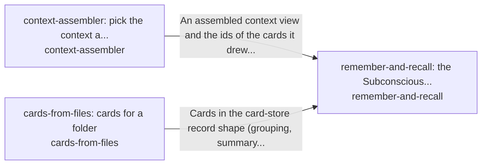

# recall

*ESOI records kept beside the code in `hubofhubs/recall`, generated from the CSV files in this folder by `esoi readmes`. Edit the CSV files, not this page.*

## remember-and-recall: the Subconscious, Intuition seat (`remember-and-recall`)

Give an AI the context a task needs and nothing from another person's scope.

- Entry call: `hubofhubs.run("remember-and-recall", 'rust release')`
- Selected implementation: `card_recall`
- Metric: remember-and-recall metric (draft)
- Implemented by: [`docs/reference/work-trace-event.schema.json`](../../docs/reference/work-trace-event.schema.json), [`hubofhubs/ports/__init__.py`](../ports/__init__.py), [`hubofhubs/ports/context.py`](../ports/context.py), [`hubofhubs/ports/control.py`](../ports/control.py), [`hubofhubs/ports/deep.py`](../ports/deep.py), [`hubofhubs/ports/events.py`](../ports/events.py), [`hubofhubs/ports/model.py`](../ports/model.py), [`hubofhubs/ports/retrieval.py`](../ports/retrieval.py) and 79 more

## context-assembler: pick the context a task needs (`context-assembler`)

Find the passages that bear on a request, for any consumer that keeps knowledge to draw on.

- Entry call: `hubofhubs.run("context-assembler", 'where does the card store tidy itself?')`
- Selected implementation: `bm25@analyzer=english`
- Metric: Relevant passage in the top five
- Implemented by: [`hubofhubs/recall/__init__.py`](__init__.py), [`hubofhubs/recall/background_pacing.py`](background_pacing.py), [`hubofhubs/recall/bm25_store.py`](bm25_store.py), [`hubofhubs/recall/card_content_render.py`](card_content_render.py), [`hubofhubs/recall/card_limit.py`](card_limit.py), [`hubofhubs/recall/card_limit_report.py`](card_limit_report.py), [`hubofhubs/recall/card_origin.py`](card_origin.py), [`hubofhubs/recall/card_recall.py`](card_recall.py) and 64 more

## cards-from-files: cards for a folder (`cards-from-files`)

Give any consumer cards for the knowledge it already keeps in files, so recall starts from what is there instead of an empty store.

- Entry call: `hubofhubs.run("cards-from-files", {'root': '.', 'files': [], 'existing': {}})`
- Selected implementation: `llm_topic_cards`
- Metric: Needed file among the first three files a builder's cards show
- Implemented by: [`hubofhubs/recall/__init__.py`](__init__.py), [`hubofhubs/recall/background_pacing.py`](background_pacing.py), [`hubofhubs/recall/bm25_store.py`](bm25_store.py), [`hubofhubs/recall/card_content_render.py`](card_content_render.py), [`hubofhubs/recall/card_limit.py`](card_limit.py), [`hubofhubs/recall/card_limit_report.py`](card_limit_report.py), [`hubofhubs/recall/card_origin.py`](card_origin.py), [`hubofhubs/recall/card_recall.py`](card_recall.py) and 64 more

## Diagram

An arrow runs from the solution that provides to the solution that builds on it; its label is what the provider outputs.

## Implementations

| Implementation | Name | Code | Selected |
|---|---|---|---|
| `context-assembler:composite` | Composite | [`hubofhubs/recall/composite_assembler.py`](composite_assembler.py) |  |
| `context-assembler:bm25` | BM25 over file text | [`hubofhubs/recall/bm25_store.py`](bm25_store.py) |  |
| `context-assembler:hybrid` | Hybrid fusion | [`hubofhubs/recall/hybrid_assembler.py`](hybrid_assembler.py) |  |
| `context-assembler:vector` | Vector search | [`hubofhubs/recall/vector_assembler.py`](vector_assembler.py) |  |
| `cards-from-files:llm_topic_cards` | Model-written topic cards | [`hubofhubs/recall/cards_from_files.py`](cards_from_files.py) | selected |
| `cards-from-files:per_file_symbols` | One card per file | [`hubofhubs/recall/cards_from_files.py`](cards_from_files.py) |  |
| `cards-from-files:graphify_files` | Graphify file groups | [`hubofhubs/recall/cards_from_graphify.py`](cards_from_graphify.py) |  |
| `remember-and-recall:card_recall` | Cards drawn by relevance from a store | [`hubofhubs/recall/card_recall.py`](card_recall.py) | selected |

## Metrics

- `metric-remember-and-recall`, remember-and-recall metric (draft)
- `metric-context-assembler`, Relevant passage in the top five: leader `bm25@analyzer=english`, 208 of 323 cases
- `metric-cards-from-files`, Needed file among the first three files a builder's cards show: leader `per_file_symbols`, 43 of 63 cases

## Problems

- `hprob-files-without-cards`: A consumer whose knowledge lives in files has no cards for it until something writes them, and cards written once go stale as the files change.

## Ideals

- `hideal-cards-proportionate-and-current`: A folder's cards cover what is in it, about one card per thing people ask about, and change when the files change.

## Where to go next

- Up: [hubofhubs](../README.md)
- Intent: [The best parts for AI intelligence, assembled and proven](../../esoi/README.md)
- Repository: [top README](../../README.md)
