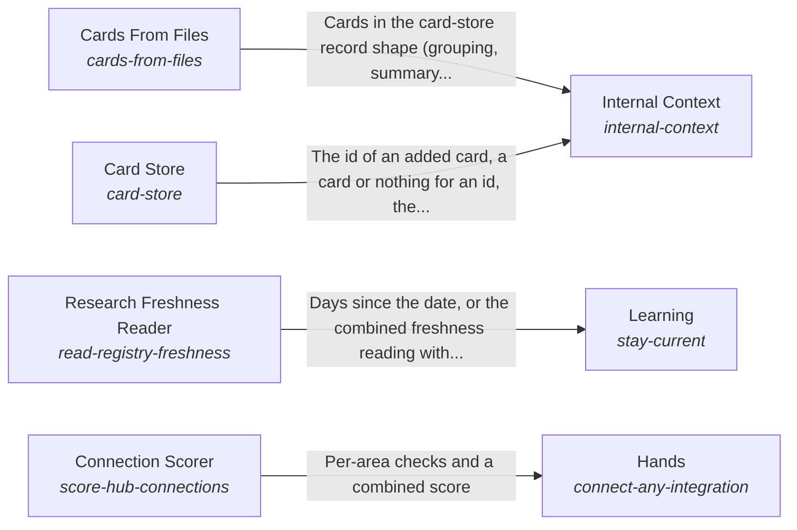

# The form and internal context of a system

The AI system has a form and its own internal context, and the hub applies to a particular system by providing adapters or declaring the system's internal APIs, databases and files.

*ESOI records of this intent (evolvable structure that optimizes intent), generated from the CSV files beside this page by `esoi readmes`. Edit the CSV files, not this page.*

This sub-intent arises as the implementation `the-body:composition` of its parent intent [`hub-of-hubs`](../../esoi/README.md). Opportunities: A system's own knowledge, its research freshness, its risk sense and its way of acting are different kinds of evolution from the one the parent solution measures. Declaring a system's own sources, rather than rewriting parts for it, lets any product adopt the hub.

## How the solutions fit together

Body is the form of the system and the context that belongs to it, and it lets anyone apply the hub to their own system by providing adapters or declaring their APIs and databases. Internal Context keeps what the system knows in Card Store and proposes the cards a folder of files needs through Cards From Files. Learning names the areas whose research is older than ninety days by reading their dates through Research Freshness Reader. Nervous System raises one small signal before a step that cannot be undone or belongs to a person. Hands lets the AI use outside services, change things outside and bring knowledge in without being one specific integration, and it reports how much of that is catalog data through Connection Scorer. Acting takes a goal with a written done-standard and tries to bring it about, and it reports whether the goal was met.

## Diagram

An arrow runs from the solution that provides to the solution that builds on it; its label is what the provider outputs.

## Solutions at a glance

| Solution | Handle | Entry call | Selected implementation | Metric |
|---|---|---|---|---|
| Cards From Files | `cards-from-files` | `hubofhubs.run("cards-from-files", {'root': '.', 'files': [], 'existing': {}})` | Import graph topic cards (`import_graph_topic_cards`) | Balanced score of a builder's cards on file-finding, topic and orientation cases, with the store's size |
| Acting | `act-in-the-world` | `hubofhubs.run("act-in-the-world", ...)` | One-call file edit (`fast_edit`) | Goal met by its own tests, Harness, context, sub-agents and recursion ranked |
| Nervous System | `watch-for-risk` | `hubofhubs.run("watch-for-risk", 'delete the old backup folder')` | Consent gate (`consent_gate`) | Risky steps stopped, ordinary steps let through, Guard marginal value |
| Learning | `stay-current` | `hubofhubs.run("stay-current", '2026-11-03')` | Stale areas from the registry dates (`registry_research`) | Days since each seat was researched, Public stage sourced and triangulated, Best in circumstance with variants |
| Research Freshness Reader | `read-registry-freshness` | `hubofhubs.run("read-registry-freshness", '2026-10-01')` | Registry date scan (`registry_scan`) | Registry freshness reading |
| Hands | `connect-any-integration` | `hubofhubs.run("connect-any-integration", 'web_search')` | Share of connections that need no code (`catalog_entries`) | Integration added with zero code, Integration served by combined hubs, Integration available within the weekly refresh, Integration credentials stay with their user |
| Connection Scorer | `score-hub-connections` | `hubofhubs.run("score-hub-connections", {'facts': {}, 'connections': []})` | Binding scorer (`hub_of_hubs_scorer`) | Hub connection scoring |
| Card Store | `card-store` | `hubofhubs.run("card-store", 'rust release')` | Local card store (`local_card_store`) | Cards found again, none lost |
| Internal Context | `internal-context` | no entry declared | Cards kept and built from files (`composition`) | An internal source reaches the AI through one declaration |

## Problems and ideals

**Problems**

- Hubs go stale. (`HP3`)
- Every product re-builds each app connection (calendar, drive, notes, chat) with its own screen, storage and tool code, so a new app costs code in every layer and arrives months after hubs list it. (`HP7`)
- One public benchmark is trusted alone to rank parts, although it may measure a different task, be saturated or leaked into training data, and its source is rarely checked. (`hprob-public-evals-relied-on-singly`)
- A part is ranked best overall, but which part is best depends on the circumstance (a cost limit, a speed limit, a language, the size of the input), so the single winner is wrong for many users. (`hprob-one-best-pick-ignores-circumstance`)
- A guard or reviewer added around a model or harness is kept because it sounds careful, without showing that it catches anything the model or harness would not catch alone. (`hprob-addon-guard-without-marginal-value`)
- An agent harness used on a flat subscription is slow and spends more tokens than the work needs, partly because the context it is given is poor and partly because it repeats work through sub-agents... (`hprob-harness-dear-and-slow-on-the-subscription`)
- One app connection (a calendar, a drive, a chat) is served better by several hubs combined than by any one, but a product wires a single hub and hand-writes the rest. (`hprob-one-integration-needs-several-hubs`)
- A consumer whose knowledge lives in files has no cards for it until something writes them, and cards written once go stale as the files change. (`hprob-files-without-cards`)
- A system's own knowledge, in its internal APIs, databases and local files, cannot be offered to the AI without code written for that system. (`hprob-system-context-not-declared`)

**Ideals**

- Common-sense metrics, sourced stages (`hideal-common-sense-metrics-with-sourced-stages`): Every metric is a plain check anyone would accept, and its stages come from public evaluations whose sources are named and compared with each other.
- Best in each circumstance, with variants (`hideal-best-in-circumstance-with-variants`): The hub names the best part for each circumstance and not one winner, by comparing variants of a part (one setting changed) on the same cases.
- Guards earn their place (`hideal-guards-earn-their-place`): A guard is kept only when it catches something the model or harness would miss, shown by running the same cases with and without it.
- Cheap, fast harness with ideal context (`hideal-cheap-fast-harness-with-ideal-context`): An agent harness is chosen for the lowest cost and time at the same pass rate, given the best context the hub can assemble for it, and the choice accounts for sub-agents and recursion.
- Hubs combined per integration (`hideal-hubs-combined-per-integration`): An integration is served by the combination of hubs that covers the most of it, chosen by data and never by one hub's reach.
- Proportionate, current cards (`hideal-cards-proportionate-and-current`): A folder's cards cover what is in it, about one card per thing people ask about, and change when the files change.
- A system offers its own context (`hideal-a-system-offers-its-own-context`): A system declares its own sources once, and the hub reads them through adapters; local files work by default.

## Metrics and their leaders

- Goal met by its own tests (`metric-act-in-the-world`): leader `fast_edit`, 29 of 30 cases
- Risky steps stopped, ordinary steps let through (`metric-watch-for-risk`): leader `two_stage`, 34 of 36 cases
- Days since each seat was researched (`metric-stay-current`)
- Registry freshness reading (`metric-read-registry-freshness`): leader `registry_scan`, 41 of 41 cases
- Integration added with zero code (`metric-integration-added-with-zero-code`)
- Hub connection scoring (`metric-score-hub-connections`): leader `hub_of_hubs_scorer`, 33 of 33 cases
- Integration available within the weekly refresh (`metric-integration-availability-lag`)
- Integration credentials stay with their user (`metric-integration-credential-isolation`)
- Cards found again, none lost (`metric-card-store`): leader `local_card_store`, 35 of 35 cases
- Public stage sourced and triangulated (`metric-public-stage-sourced-and-triangulated`)
- and 6 more: all 16 are in [metrics](#metrics) of the full record below

## Where to go next

- Parent intent: [The best parts for AI intelligence, assembled and proven](../../esoi/README.md)
- Repository: [top README](../../README.md)
- Records: [intent.csv](intent.csv), [problems.csv](problems.csv), [ideals.csv](ideals.csv), [solutions.csv](solutions.csv), [implementations.csv](implementations.csv), [metrics.csv](metrics.csv)
- Diagram page: [diagram.md](diagram.md)

---

## The full record

### Problems

- Hubs go stale. (`HP3`)
- Every product re-builds each app connection (calendar, drive, notes, chat) with its own screen, storage and tool code, so a new app costs code in every layer and arrives months after hubs list it. (`HP7`)
- One public benchmark is trusted alone to rank parts, although it may measure a different task, be saturated or leaked into training data, and its source is rarely checked. (`hprob-public-evals-relied-on-singly`)
- A part is ranked best overall, but which part is best depends on the circumstance (a cost limit, a speed limit, a language, the size of the input), so the single winner is wrong for many users. (`hprob-one-best-pick-ignores-circumstance`)
- A guard or reviewer added around a model or harness is kept because it sounds careful, without showing that it catches anything the model or harness would not catch alone. (`hprob-addon-guard-without-marginal-value`)
- An agent harness used on a flat subscription is slow and spends more tokens than the work needs, partly because the context it is given is poor and partly because it repeats work through sub-agents and recursion. (`hprob-harness-dear-and-slow-on-the-subscription`)
- One app connection (a calendar, a drive, a chat) is served better by several hubs combined than by any one, but a product wires a single hub and hand-writes the rest. (`hprob-one-integration-needs-several-hubs`)
- A consumer whose knowledge lives in files has no cards for it until something writes them, and cards written once go stale as the files change. (`hprob-files-without-cards`)
- A system's own knowledge, in its internal APIs, databases and local files, cannot be offered to the AI without code written for that system. (`hprob-system-context-not-declared`)

### Ideals

- Common-sense metrics, sourced stages (`hideal-common-sense-metrics-with-sourced-stages`): Every metric is a plain check anyone would accept, and its stages come from public evaluations whose sources are named and compared with each other.
- Best in each circumstance, with variants (`hideal-best-in-circumstance-with-variants`): The hub names the best part for each circumstance and not one winner, by comparing variants of a part (one setting changed) on the same cases.
- Guards earn their place (`hideal-guards-earn-their-place`): A guard is kept only when it catches something the model or harness would miss, shown by running the same cases with and without it.
- Cheap, fast harness with ideal context (`hideal-cheap-fast-harness-with-ideal-context`): An agent harness is chosen for the lowest cost and time at the same pass rate, given the best context the hub can assemble for it, and the choice accounts for sub-agents and recursion.
- Hubs combined per integration (`hideal-hubs-combined-per-integration`): An integration is served by the combination of hubs that covers the most of it, chosen by data and never by one hub's reach.
- Proportionate, current cards (`hideal-cards-proportionate-and-current`): A folder's cards cover what is in it, about one card per thing people ask about, and change when the files change.
- A system offers its own context (`hideal-a-system-offers-its-own-context`): A system declares its own sources once, and the hub reads them through adapters; local files work by default.

### Solutions

| Solution | Handle | Selected | Metric |
|---|---|---|---|
| Cards From Files | `cards-from-files` | Import graph topic cards (`import_graph_topic_cards`) | Balanced score of a builder's cards on file-finding, topic and orientation cases, with the store's size |
| Acting | `act-in-the-world` | One-call file edit (`fast_edit`) | Goal met by its own tests, Harness, context, sub-agents and recursion ranked |
| Nervous System | `watch-for-risk` | Consent gate (`consent_gate`) | Risky steps stopped, ordinary steps let through, Guard marginal value |
| Learning | `stay-current` | Stale areas from the registry dates (`registry_research`) | Days since each seat was researched, Public stage sourced and triangulated, Best in circumstance with variants |
| Research Freshness Reader | `read-registry-freshness` | Registry date scan (`registry_scan`) | Registry freshness reading |
| Hands | `connect-any-integration` | Share of connections that need no code (`catalog_entries`) | Integration added with zero code, Integration served by combined hubs, Integration available within the weekly refresh, Integration credentials stay with their user |
| Connection Scorer | `score-hub-connections` | Binding scorer (`hub_of_hubs_scorer`) | Hub connection scoring |
| Card Store | `card-store` | Local card store (`local_card_store`) | Cards found again, none lost |
| Internal Context | `internal-context` | Cards kept and built from files (`composition`) | An internal source reaches the AI through one declaration |

### Implementations

| Implementation | Handle | Where | Sub-intent |
|---|---|---|---|
| One-call file edit | `act-in-the-world:fast_edit` | [hubofhubs/act/fast_edit.py](../act/fast_edit.py) |  |
| One-call MCP write | `act-in-the-world:mcp_operations` | [hubofhubs/act/mcp_operations.py](../act/mcp_operations.py) |  |
| Claude Code, one shot | `act-in-the-world:subprocess_goal_runner` | [hubofhubs/deep/subprocess_runner.py](../deep/subprocess_runner.py) |  |
| Claude Code, steerable session | `act-in-the-world:stream_json_goal_runner` | [hubofhubs/deep/stream_runner.py](../deep/stream_runner.py) |  |
| Agent Client Protocol runner | `act-in-the-world:acp_deep_runner` | [hubofhubs/deep/acp_runner.py](../deep/acp_runner.py) |  |
| Registry date scan | `read-registry-freshness:registry_scan` | [hubofhubs/registry.py](../registry.py) |  |
| Binding scorer | `score-hub-connections:hub_of_hubs_scorer` | [hubofhubs/measure.py](../measure.py) |  |
| Local card store | `card-store:local_card_store` | [hubofhubs/cardstore.py](../cardstore.py) |  |
| Digest-driven overseer | `watch-for-risk:overseer` | [hubofhubs/risk.py](../risk.py) |  |
| Consent gate | `watch-for-risk:consent_gate` | [hubofhubs/consent_gate.py](../consent_gate.py) |  |
| Gate then overseer | `watch-for-risk:two_stage` | [hubofhubs/consent_gate.py](../consent_gate.py) |  |
| Stale areas from the registry dates | `stay-current:registry_research` | [hubofhubs/areas.py](../areas.py) |  |
| Share of connections that need no code | `connect-any-integration:catalog_entries` | [hubofhubs/areas.py](../areas.py) |  |
| Model-written topic cards | `cards-from-files:llm_topic_cards` | [hubofhubs/recall/cards_from_files.py](../recall/cards_from_files.py) |  |
| One card per file | `cards-from-files:per_file_symbols` | [hubofhubs/recall/cards_from_files.py](../recall/cards_from_files.py) |  |
| Graphify file groups | `cards-from-files:graphify_files` | [hubofhubs/recall/cards_from_graphify.py](../recall/cards_from_graphify.py) |  |
| File plus topic cards | `cards-from-files:file_plus_topic_cards` | [hubofhubs/recall/cards_from_files.py](../recall/cards_from_files.py) |  |
| Topic cards replay | `cards-from-files:topic_cards_replay` | [hubofhubs/recall/cards_from_files.py](../recall/cards_from_files.py) |  |
| Cochange topic cards | `cards-from-files:cochange_topic_cards` | [hubofhubs/recall/cards_from_topics.py](../recall/cards_from_topics.py) |  |
| Import graph topic cards | `cards-from-files:import_graph_topic_cards` | [hubofhubs/recall/cards_from_topics.py](../recall/cards_from_topics.py) |  |
| Cards kept and built from files | `internal-context:composition` |  |  |

### Metrics

- Goal met by its own tests (`metric-act-in-the-world`): `esoi run file_edit_goals --impl fast_edit; esoi run file_edit_goals --impl subprocess_goal_runner; esoi run file_edit_goals --impl stream_json_goal_runner; esoi run file_edit_goals --impl acp_deep_runner; esoi run file_edit_goals --impl none`
- Risky steps stopped, ordinary steps let through (`metric-watch-for-risk`): `esoi run watch_for_risk --impl overseer; esoi run watch_for_risk --impl none; esoi run watch_for_risk --impl consent_gate; esoi run watch_for_risk --impl two_stage`
- Days since each seat was researched (`metric-stay-current`): `none`
- Registry freshness reading (`metric-read-registry-freshness`): `esoi run stay_current --impl registry_scan`
- Integration added with zero code (`metric-integration-added-with-zero-code`): `none`
- Hub connection scoring (`metric-score-hub-connections`): `esoi run connect_any_integration --impl hub_of_hubs_scorer`
- Integration available within the weekly refresh (`metric-integration-availability-lag`): `none`
- Integration credentials stay with their user (`metric-integration-credential-isolation`): `none`
- Cards found again, none lost (`metric-card-store`): `esoi run card_store --impl local_card_store`
- Public stage sourced and triangulated (`metric-public-stage-sourced-and-triangulated`): `none`
- Best in circumstance with variants (`metric-best-in-circumstance-with-variants`): `none`
- Guard marginal value (`metric-guard-marginal-value-over-native-and-harness`): `python3 -m pytest tests/test_risk.py`
- Harness, context, sub-agents and recursion ranked (`metric-harness-context-subagents-recursion-ranked`): `python3 -m pytest tests/test_deep_session_subagents.py`
- Integration served by combined hubs (`metric-integration-served-by-combined-hubs`): `none`
- Balanced score of a builder's cards on file-finding, topic and orientation cases, with the store's size (`metric-cards-from-files`): `esoi run cards_from_files --impl llm_topic_cards; esoi run cards_from_files --impl topic_cards_replay; esoi run cards_from_files --impl cochange_topic_cards; esoi run cards_from_files --impl import_graph_topic_cards; esoi run cards_from_files --impl file_plus_topic_cards; esoi run cards_from_files --impl per_file_symbols; esoi run cards_from_files --impl graphify_files`
- An internal source reaches the AI through one declaration (`metric-internal-context`): `none`
