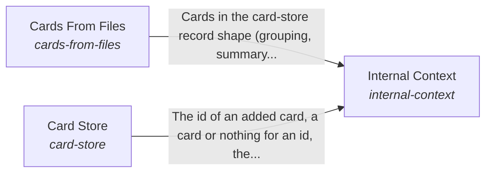

# The form and internal context of a system

The AI system has a form and its own internal context, and the hub applies to a particular system by providing adapters or declaring the system's internal APIs, databases and files.

*ESOI records of this intent (evolvable structure that optimizes intent), generated from the CSV files beside this page by `esoi readmes`. Edit the CSV files, not this page.*

This sub-intent arises as the implementation `the-body:composition` of its parent intent [`hub-of-hubs`](../../esoi/README.md). Opportunities: A system's own data, and the integrations it already governs, are a different kind of evolution from the one the parent solution measures. Declaring a system's own sources, rather than rewriting parts for it, lets any product adopt the hub.

## How the solutions fit together

Body is the form of the system and the context that belongs to it, and it lets anyone apply the hub to their own system by declaring where the data lives and which enduring integrations the AI may use. Internal Context declares where the system's data lives and which outside tool reads it, keeps what the system knows in Card Store, and proposes the cards a folder of files needs through Cards From Files. Hands makes sure that the system's own AI tool registry, LLM platform and guardrails are accessible to the AI and used by it.

## Diagram

An arrow runs from the solution that provides to the solution that builds on it; its label is what the provider outputs.

## Solutions at a glance

| Solution | Handle | Entry call | Selected implementation | Metric |
|---|---|---|---|---|
| Cards From Files | `cards-from-files` | `hubofhubs.run("cards-from-files", {'root': '.', 'files': [], 'existing': {}})` | Import graph topic cards (`import_graph_topic_cards`) | Balanced score of a builder's cards on file-finding, topic and orientation cases, with the store's size |
| Hands | `connect-any-integration` | `hubofhubs.run("connect-any-integration", '')` | none selected | Integration added with zero code, Integration served by combined hubs, Integration available within the weekly refresh, Integration credentials stay with their user, Share of connections that need no code, Share of connections that need no code |
| Card Store | `card-store` | `hubofhubs.run("card-store", 'rust release')` | Local card store (`local_card_store`) | Cards found again, none lost |
| Internal Context | `internal-context` | `hubofhubs.run("internal-context", 'rust release')` | Declared sources, cards kept and built from files (`composition`) | An internal source reaches the AI through one declaration |

## Problems and ideals

**Problems**

- Hubs go stale. (`HP3`)
- Every product re-builds each app connection (calendar, drive, notes, chat) with its own screen, storage and tool code, so a new app costs code in every layer and arrives months after hubs list it. (`HP7`)
- One app connection (a calendar, a drive, a chat) is served better by several hubs combined than by any one, but a product wires a single hub and hand-writes the rest. (`hprob-one-integration-needs-several-hubs`)
- A consumer whose knowledge lives in files has no cards for it until something writes them, and cards written once go stale as the files change. (`hprob-files-without-cards`)
- A system's own knowledge, in its internal APIs, databases and local files, cannot be offered to the AI without code written for that system. (`hprob-system-context-not-declared`)
- A system already has enduring integrations, such as its own AI tool registry, LLM platform and guardrails, and the AI cannot reach them or does not use them. (`hprob-enduring-integrations-unused`)

**Ideals**

- Common-sense metrics, sourced stages (`hideal-common-sense-metrics-with-sourced-stages`): Every metric is a plain check anyone would accept, and its stages come from public evaluations whose sources are named and compared with each other.
- Best in each circumstance, with variants (`hideal-best-in-circumstance-with-variants`): The hub names the best part for each circumstance and not one winner, by comparing variants of a part (one setting changed) on the same cases.
- Guards earn their place (`hideal-guards-earn-their-place`): A guard is kept only when it catches something the model or harness would miss, shown by running the same cases with and without it.
- Cheap, fast harness with ideal context (`hideal-cheap-fast-harness-with-ideal-context`): An agent harness is chosen for the lowest cost and time at the same pass rate, given the best context the hub can assemble for it, and the choice accounts for sub-agents and recursion.
- Hubs combined per integration (`hideal-hubs-combined-per-integration`): An integration is served by the combination of hubs that covers the most of it, chosen by data and never by one hub's reach.
- Proportionate, current cards (`hideal-cards-proportionate-and-current`): A folder's cards cover what is in it, about one card per thing people ask about, and change when the files change.
- A system offers its own context (`hideal-a-system-offers-its-own-context`): A system declares its own sources once, and the hub reads them through adapters; local files work by default.
- Enduring integrations reach the AI (`hideal-enduring-integrations-reach-the-ai`): The integrations a system already governs are accessible to the AI and used by it.

## Metrics and their leaders

- Integration added with zero code (`metric-integration-added-with-zero-code`)
- Integration available within the weekly refresh (`metric-integration-availability-lag`)
- Integration credentials stay with their user (`metric-integration-credential-isolation`)
- Cards found again, none lost (`metric-card-store`): leader `local_card_store`, 35 of 35 cases
- Integration served by combined hubs (`metric-integration-served-by-combined-hubs`)
- Balanced score of a builder's cards on file-finding, topic and orientation cases, with the store's size (`metric-cards-from-files`): leader `import_graph_topic_cards`, 112 of 252 cases
- An internal source reaches the AI through one declaration (`metric-internal-context`)

## Where to go next

- Parent intent: [The best parts for AI intelligence, assembled and proven](../../esoi/README.md)
- Repository: [top README](../../README.md)
- Records: [intent.csv](intent.csv), [problems.csv](problems.csv), [ideals.csv](ideals.csv), [solutions.csv](solutions.csv), [implementations.csv](implementations.csv), [metrics.csv](metrics.csv)
- Diagram page: [diagram.md](diagram.md)

---

## The full record

### Problems

- Hubs go stale. (`HP3`)
- Every product re-builds each app connection (calendar, drive, notes, chat) with its own screen, storage and tool code, so a new app costs code in every layer and arrives months after hubs list it. (`HP7`)
- One app connection (a calendar, a drive, a chat) is served better by several hubs combined than by any one, but a product wires a single hub and hand-writes the rest. (`hprob-one-integration-needs-several-hubs`)
- A consumer whose knowledge lives in files has no cards for it until something writes them, and cards written once go stale as the files change. (`hprob-files-without-cards`)
- A system's own knowledge, in its internal APIs, databases and local files, cannot be offered to the AI without code written for that system. (`hprob-system-context-not-declared`)
- A system already has enduring integrations, such as its own AI tool registry, LLM platform and guardrails, and the AI cannot reach them or does not use them. (`hprob-enduring-integrations-unused`)

### Ideals

- Common-sense metrics, sourced stages (`hideal-common-sense-metrics-with-sourced-stages`): Every metric is a plain check anyone would accept, and its stages come from public evaluations whose sources are named and compared with each other.
- Best in each circumstance, with variants (`hideal-best-in-circumstance-with-variants`): The hub names the best part for each circumstance and not one winner, by comparing variants of a part (one setting changed) on the same cases.
- Guards earn their place (`hideal-guards-earn-their-place`): A guard is kept only when it catches something the model or harness would miss, shown by running the same cases with and without it.
- Cheap, fast harness with ideal context (`hideal-cheap-fast-harness-with-ideal-context`): An agent harness is chosen for the lowest cost and time at the same pass rate, given the best context the hub can assemble for it, and the choice accounts for sub-agents and recursion.
- Hubs combined per integration (`hideal-hubs-combined-per-integration`): An integration is served by the combination of hubs that covers the most of it, chosen by data and never by one hub's reach.
- Proportionate, current cards (`hideal-cards-proportionate-and-current`): A folder's cards cover what is in it, about one card per thing people ask about, and change when the files change.
- A system offers its own context (`hideal-a-system-offers-its-own-context`): A system declares its own sources once, and the hub reads them through adapters; local files work by default.
- Enduring integrations reach the AI (`hideal-enduring-integrations-reach-the-ai`): The integrations a system already governs are accessible to the AI and used by it.

### Solutions

| Solution | Handle | Selected | Metric |
|---|---|---|---|
| Cards From Files | `cards-from-files` | Import graph topic cards (`import_graph_topic_cards`) | Balanced score of a builder's cards on file-finding, topic and orientation cases, with the store's size |
| Hands | `connect-any-integration` | none selected | Integration added with zero code, Integration served by combined hubs, Integration available within the weekly refresh, Integration credentials stay with their user, Share of connections that need no code, Share of connections that need no code |
| Card Store | `card-store` | Local card store (`local_card_store`) | Cards found again, none lost |
| Internal Context | `internal-context` | Declared sources, cards kept and built from files (`composition`) | An internal source reaches the AI through one declaration |

### Implementations

| Implementation | Handle | Where | Sub-intent |
|---|---|---|---|
| Local card store | `card-store:local_card_store` | [hubofhubs/cardstore.py](../cardstore.py) |  |
| Model-written topic cards | `cards-from-files:llm_topic_cards` | [hubofhubs/recall/cards_from_files.py](../recall/cards_from_files.py) |  |
| One card per file | `cards-from-files:per_file_symbols` | [hubofhubs/recall/cards_from_files.py](../recall/cards_from_files.py) |  |
| Graphify file groups | `cards-from-files:graphify_files` | [hubofhubs/recall/cards_from_graphify.py](../recall/cards_from_graphify.py) |  |
| File plus topic cards | `cards-from-files:file_plus_topic_cards` | [hubofhubs/recall/cards_from_files.py](../recall/cards_from_files.py) |  |
| Topic cards replay | `cards-from-files:topic_cards_replay` | [hubofhubs/recall/cards_from_files.py](../recall/cards_from_files.py) |  |
| Cochange topic cards | `cards-from-files:cochange_topic_cards` | [hubofhubs/recall/cards_from_topics.py](../recall/cards_from_topics.py) |  |
| Import graph topic cards | `cards-from-files:import_graph_topic_cards` | [hubofhubs/recall/cards_from_topics.py](../recall/cards_from_topics.py) |  |
| Declared sources, cards kept and built from files | `internal-context:composition` | [hubofhubs/flows.py](../flows.py) |  |

### Metrics

- Integration added with zero code (`metric-integration-added-with-zero-code`): `none`
- Integration available within the weekly refresh (`metric-integration-availability-lag`): `none`
- Integration credentials stay with their user (`metric-integration-credential-isolation`): `none`
- Cards found again, none lost (`metric-card-store`): `esoi run card_store --impl local_card_store`
- Integration served by combined hubs (`metric-integration-served-by-combined-hubs`): `none`
- Balanced score of a builder's cards on file-finding, topic and orientation cases, with the store's size (`metric-cards-from-files`): `esoi run cards_from_files --impl llm_topic_cards; esoi run cards_from_files --impl topic_cards_replay; esoi run cards_from_files --impl cochange_topic_cards; esoi run cards_from_files --impl import_graph_topic_cards; esoi run cards_from_files --impl file_plus_topic_cards; esoi run cards_from_files --impl per_file_symbols; esoi run cards_from_files --impl graphify_files`
- An internal source reaches the AI through one declaration (`metric-internal-context`): `none`
