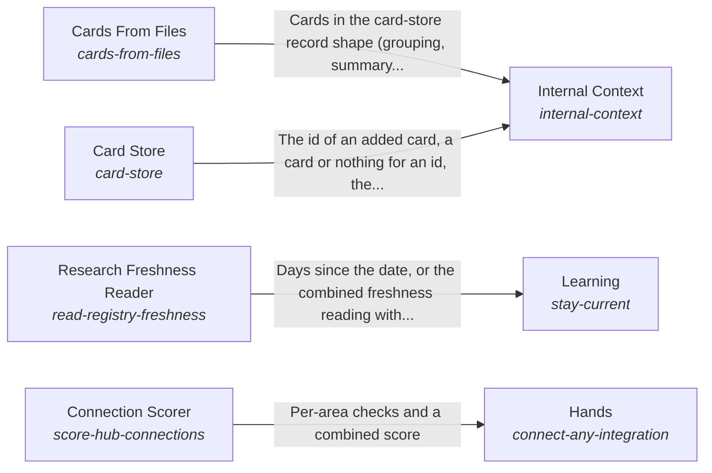

These are ESOI records rendered as a diagram (evolvable structure that optimizes intent). This page is generated from the solutions' outputs and the implementations' `uses_solution_ids` by `esoi diagram`; edit those records, not this page.

# Solution diagram: The form and internal context of a system

Body is the form of the system and the context that belongs to it, and it lets anyone apply the hub to their own system by providing adapters or declaring their APIs and databases. Internal Context keeps what the system knows in Card Store and proposes the cards a folder of files needs through Cards From Files. Learning names the areas whose research is older than ninety days by reading their dates through Research Freshness Reader. Nervous System raises one small signal before a step that cannot be undone or belongs to a person. Hands lets the AI use outside services, change things outside and bring knowledge in without being one specific integration, and it reports how much of that is catalog data through Connection Scorer. Acting takes a goal with a written done-standard and tries to bring it about, and it reports whether the goal was met.

An arrow runs from the solution that provides to the solution that builds on it; its label is what the provider outputs.

