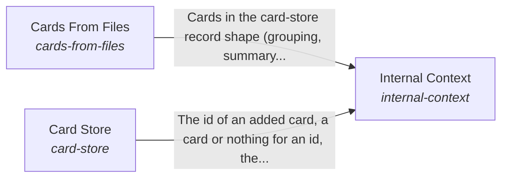

These are ESOI records rendered as a diagram (evolvable structure that optimizes intent). This page is generated from the solutions' outputs and the implementations' `uses_solution_ids` by `esoi diagram`; edit those records, not this page.

# Solution diagram: The form and internal context of a system

Body is the form of the system and the context that belongs to it, and it lets anyone apply the hub to their own system by declaring where the data lives and which enduring integrations the AI may use. Internal Context declares where the system's data lives and which outside tool reads it, keeps what the system knows in Card Store, and proposes the cards a folder of files needs through Cards From Files. Hands makes sure that the system's own AI tool registry, LLM platform and guardrails are accessible to the AI and used by it.

An arrow runs from the solution that provides to the solution that builds on it; its label is what the provider outputs.

