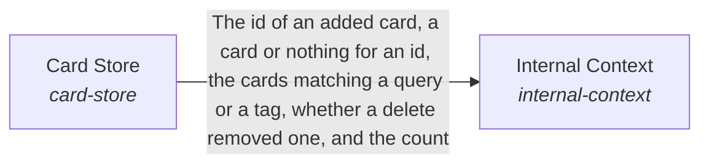

# Internal Context

**Purpose:** Let the AI know what a particular system knows, without the hub being written for that system: the declaration of where its data lives and whether each source belongs to the system or to a person, the configuration its tools need, and the run record the flow writes.

Breadcrumb: [Top](../../../esoi/README.md) > [The form and internal context of a system](../README.md) > Internal Context

Part of [The form and internal context of a system](../README.md)

## Internal Context (`internal-context`)

- Out of scope: Reading or writing files and operations (World tools do that), retaining or recalling memories (Long-Term Memory does that), choosing the context a request needs (Subconscious does that) and proposing cards from files (Cards From Files does that).
- Delegates to: read-files, card-store
- Entry call: `hubofhubs.run("internal-context", 'rust release')`
- Selected implementation: Declared sources, cards kept and built from files (`composition`)
- Metric: An internal source reaches the AI through one declaration
- Implemented by: [`hubofhubs/the_body/__init__.py`](../__init__.py), [`hubofhubs/the_body/filemodes.py`](../filemodes.py), [`hubofhubs/the_body/flow.py`](../flow.py), [`hubofhubs/the_body/hands/__init__.py`](../hands/__init__.py), [`hubofhubs/the_body/hands/interface.py`](../hands/interface.py), [`hubofhubs/the_body/intake_sources/__init__.py`](../intake_sources/__init__.py), [`hubofhubs/the_body/intake_sources/interface.py`](../intake_sources/interface.py), [`hubofhubs/the_body/intake_sources/queue.py`](../intake_sources/queue.py) and 62 more

## One level below

- [Card Store](card_store/README.md) (solution with implementations): Keep cards and find them again.

## Diagram

An arrow runs from the solution that provides to the solution that builds on it; its label is what the provider outputs.

## Implementations

| Implementation | Handle | Purpose | Code | Selected |
|---|---|---|---|---|
| Declared sources, cards kept and built from files | `internal-context:composition` | Reads a system's declared data through the Card Store and proposes cards through Cards From Files. | [`hubofhubs/the_body/internal_context/flow.py`](flow.py) | selected |

## Metrics

- An internal source reaches the AI through one declaration (`metric-internal-context`)

## Where to go next

- Up: [hubofhubs](../../README.md)
- Intent: [The form and internal context of a system](../README.md)
- Down: [hubofhubs/the_body/internal_context/card_store](card_store/README.md)
- Repository: [top README](../../../README.md)

*Generated from the CSV files in this folder by `esoi readmes`. Edit the CSV files, not this page.*
