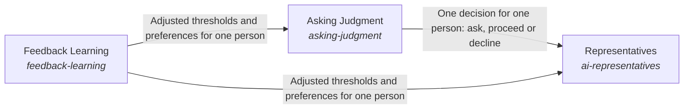

# Adapting to the humans the system works with

The AI representatives of a team learn each person's way: when to ask that person and when not to, and how that person wants the work done, from the person's own feedback.

*ESOI records of this intent (evolvable structure that optimizes intent), generated from the CSV files beside this page by `esoi readmes`. Edit the CSV files, not this page.*

This sub-intent arises as the implementation `the-consciousness:composition` of its parent intent [`hub-of-hubs`](../../esoi/README.md). Opportunities: Learning when to ask, per person, is an opportunity beyond any risk watch: the same step may need a question for one person and none for another. Feedback can then change behaviour without a person repeating a correction.

## How the solutions fit together

Consciousness is where the system adapts to the humans it works with. Representatives are the AI personas that act for a person, and each asks that person through Asking Judgment and improves from what the person says through Feedback Learning. Asking Judgment turns the risk signal of Nervous System into a decision for this person to ask, proceed or decline, and it learns the person's thresholds through Feedback Learning.

## Diagram

An arrow runs from the solution that provides to the solution that builds on it; its label is what the provider outputs.

## Solutions at a glance

| Solution | Handle | Entry call | Selected implementation | Metric |
|---|---|---|---|---|
| Representatives | `ai-representatives` | no entry declared | Representatives built on judgment and feedback (`composition`) | A representative acts as its person would want |
| Asking Judgment | `asking-judgment` | no entry declared | Per-person decision on the shared signal (`composition`) | The decision matches the person's choice |
| Feedback Learning | `feedback-learning` | no entry declared | none selected | A correction given once is followed afterwards |

## Problems and ideals

**Problems**

- The AI asks by a fixed rule, so one person is interrupted for steps they would have allowed and another is surprised by steps they would have wanted to approve. (`hprob-ai-asks-on-one-fixed-rule`)
- A person's correction changes one reply and is forgotten, so the same correction is needed again. (`hprob-feedback-is-forgotten`)

**Ideals**

- Asked only when wanted (`hideal-asked-only-when-the-person-would-want-it`): An AI representative asks a person when that person would want to be asked, and otherwise proceeds or declines.
- One signal contract (`hideal-one-signal-contract`): The risk watch and the asking judgment share one signal: a risk with its severity and reason, then one decision for one person.
- Feedback changes behaviour (`hideal-feedback-changes-behaviour`): A correction given once is followed afterwards, for the person who gave it.

## Metrics and their leaders

- A representative acts as its person would want (`metric-ai-representatives`)
- The decision matches the person's choice (`metric-asking-judgment`)
- A correction given once is followed afterwards (`metric-feedback-learning`)

## Where to go next

- Parent intent: [The best parts for AI intelligence, assembled and proven](../../esoi/README.md)
- Repository: [top README](../../README.md)
- Records: [intent.csv](intent.csv), [problems.csv](problems.csv), [ideals.csv](ideals.csv), [solutions.csv](solutions.csv), [implementations.csv](implementations.csv), [metrics.csv](metrics.csv)
- Diagram page: [diagram.md](diagram.md)

---

## The full record

### Problems

- The AI asks by a fixed rule, so one person is interrupted for steps they would have allowed and another is surprised by steps they would have wanted to approve. (`hprob-ai-asks-on-one-fixed-rule`)
- A person's correction changes one reply and is forgotten, so the same correction is needed again. (`hprob-feedback-is-forgotten`)

### Ideals

- Asked only when wanted (`hideal-asked-only-when-the-person-would-want-it`): An AI representative asks a person when that person would want to be asked, and otherwise proceeds or declines.
- One signal contract (`hideal-one-signal-contract`): The risk watch and the asking judgment share one signal: a risk with its severity and reason, then one decision for one person.
- Feedback changes behaviour (`hideal-feedback-changes-behaviour`): A correction given once is followed afterwards, for the person who gave it.

### Solutions

| Solution | Handle | Selected | Metric |
|---|---|---|---|
| Representatives | `ai-representatives` | Representatives built on judgment and feedback (`composition`) | A representative acts as its person would want |
| Asking Judgment | `asking-judgment` | Per-person decision on the shared signal (`composition`) | The decision matches the person's choice |
| Feedback Learning | `feedback-learning` | none selected | A correction given once is followed afterwards |

### Implementations

| Implementation | Handle | Where | Sub-intent |
|---|---|---|---|
| Representatives built on judgment and feedback | `ai-representatives:composition` |  |  |
| Per-person decision on the shared signal | `asking-judgment:composition` |  |  |

### Metrics

- A representative acts as its person would want (`metric-ai-representatives`): `none`
- The decision matches the person's choice (`metric-asking-judgment`): `none`
- A correction given once is followed afterwards (`metric-feedback-learning`): `none`
