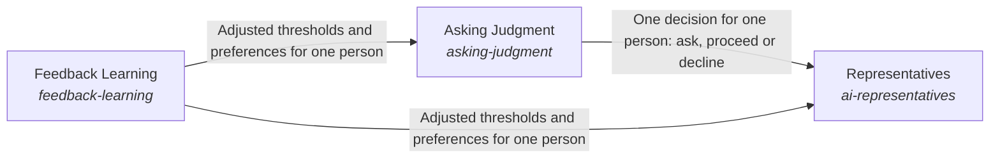

These are ESOI records rendered as a diagram (evolvable structure that optimizes intent). This page is generated from the solutions' outputs and the implementations' `uses_solution_ids` by `esoi diagram`; edit those records, not this page.

# Solution diagram: Adapting to the humans the system works with

Consciousness is where the system adapts to the humans it works with. Representatives are the AI personas that act for a person, and each asks that person through Asking Judgment and improves from what the person says through Feedback Learning. Asking Judgment turns the risk signal of Nervous System into a decision for this person to ask, proceed or decline, and it learns the person's thresholds through Feedback Learning.

An arrow runs from the solution that provides to the solution that builds on it; its label is what the provider outputs.

