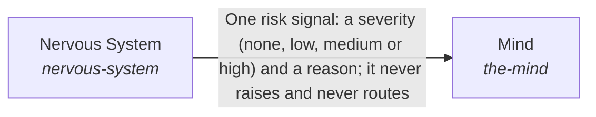

# How the AI processes information

One request is answered from what the AI can see for it: the long view is read, the request becomes a target, the information is found and prepared, the response is planned and written, and the result is checked for goal completion and response quality.

*ESOI records of this intent (evolvable structure that optimizes intent), generated from the CSV files beside this page by `esoi readmes`. Edit the CSV files, not this page.*

This sub-intent arises as the implementation `the-intelligence:composition` of its parent intent [`hub-of-hubs`](../../esoi/README.md). Opportunities: Long-term memory, objectives and guidance, and what comes to mind unasked, are opportunities beyond the parts that answer one request. Turning a request into a measured target, and judging quality against a profile, can each be improved without changing how a single request is answered.

## How the solutions fit together

Intelligence turns one request into a response. Higher Mind keeps the long view through Long-Term Memory, Objectives and Guidance, which gives an infrequent longer-term nudge. Critical Thinking turns the request into a target with a budget through Metric Translation, records it through ESOI Application, and holds the result to it through Goal Completion and Response Quality. Subconscious finds and prepares information through Cards From Files, Context Retriever and Intuition. Mind takes the request in through Context Intake, breaks it into pieces through Planner, passes each piece to a worker through Delegation and writes the response through Response Writer. Mind asks for a signal before a risky piece from Nervous System, and for the decision for the person from Judgment Calls. An unmet goal sends the flow back to the planning step within the request's budget, and when the budget or the authority runs out the flow goes to Judgment Calls. Proactivity says what is due without being asked.

## Diagram

An arrow runs from the solution that provides to the solution that builds on it; its label is what the provider outputs.

## Solutions at a glance

| Solution | Handle | Entry call | Selected implementation | Metric |
|---|---|---|---|---|
| Critical Thinking | `critical-thinking` | `hubofhubs.run("critical-thinking", {'request': 'what is the latest Rust version?'})` | Target, goal and quality in order (`composition`) | Requests with a named problem, ideal and metric |
| Subconscious | `the-subconscious` | `hubofhubs.run("the-subconscious", 'rust release')` | Cards drawn by relevance from a store (`card_recall`) | Right context admitted, none from another scope |
| Mind | `the-mind` | `hubofhubs.run("the-mind", {'request': 'what is the latest Rust version?'})` | The four parts of the Mind in order (`composition`) | Answer quality per dollar and per second |
| Higher Mind | `higher-mind` | `hubofhubs.run("higher-mind", {'request': 'what is the latest Rust version?'})` | Objectives, memory and guidance for one request (`composition`) | The long view survives between requests |
| Nervous System | `nervous-system` | `hubofhubs.run("nervous-system", 'delete the old backup folder')` | Consent gate (`consent_gate`) | Risky steps stopped, ordinary steps let through, Guard marginal value |
| Proactivity | `proactivity` | `hubofhubs.run("proactivity", {'schedules': [], 'now': '2026-07-12T09:00:00Z'})` | Calendar periods and events (`calendar_and_events`) | Schedules due when they should be |

## Problems and ideals

**Problems**

- Guards without proven value (`hprob-addon-guard-without-marginal-value`): A guard or reviewer added around a model or harness is often kept because it seems careful, without evidence that it catches anything the model or harness would miss alone.
- Answers outrun their evidence (`hprob-answers-outrun-their-evidence`): AI answers often claim more than the evidence behind them supports, and the reader cannot tell which claim is unsupported.
- The Mind sees too little or too much (`hprob-the-mind-sees-too-little-or-too-much`): What the planning and responding AI sees for a request is whatever was wired to it: earlier requests and goals are missing, the right information is not found, or too much of it is pasted in.
- The system only reacts (`hprob-system-waits-to-be-asked`): An AI that acts only when asked misses the standing work (a daily review, a weekly report) and the moment something changed, so people must remember to ask.

**Ideals**

- The context a task needs, and little else (`hideal-context-needed-and-little-else`): A task is shown the pieces it needs, in order of need, within a budget, and nothing when it needs nothing.
- Answers draw on inside and outside together (`hideal-one-intake-two-sources`): Every request is answered from the best of what the system knows and what the outside offers, weighed together.
- Answers stay within their evidence (`hideal-answers-stay-within-evidence`): Every claim in an answer is supported by evidence the reader can open, or is marked as unsupported.
- The long view is kept (`hideal-the-long-view-is-kept`): What happened, what stays true and what the AI is working toward survive from one request to the next.
- The Mind sees what the request needs (`hideal-the-mind-sees-what-the-request-needs`): What the Mind sees for a request is fitted to that request, within a budget, and draws on the long view, the system's own data and the outside.
- The system acts on time (`hideal-the-system-acts-on-time`): Standing work happens when it is due, in the person's own time, or when something happens that calls for it, without anyone having to ask.

## Metrics and their leaders

- Requests with a named problem, ideal and metric (`metric-critical-thinking`)
- Answer quality per dollar and per second (`metric-the-mind`)
- Right context admitted, none from another scope (`metric-the-subconscious`)
- The long view survives between requests (`metric-higher-mind`)
- Risky steps stopped, ordinary steps let through (`metric-nervous-system`): leader `two_stage`, 34 of 36 cases
- Guard marginal value (`metric-guard-marginal-value-over-native-and-harness`)
- Schedules due when they should be (`metric-proactivity`): leader `calendar_and_events`, 18 of 18 cases

## Where to go next

- Sub-intent: [Holding a request to a measure](critical_thinking/README.md) (A request becomes a metric with a target and a budget, adjustable while the work runs, and the result is held to it: was the goal met, and is the response good for this person.)
- Sub-intent: [The long view across requests](higher_mind/README.md) (The AI keeps a long view that spans requests: what it remembers, the objectives it is serving, and an infrequent longer-term nudge for the Planner.)
- Sub-intent: [What the Mind sees and does for one request](mind/README.md) (For one request the Mind works from one view of the information, breaks the request into pieces, hands a piece on only when a worker is needed, and writes the plan, request or communication its reader needs.)
- Sub-intent: [Finding and preparing information for the Mind](subconscious/README.md) (The information a request needs is found and prepared before the Mind asks for it, from the system's own cards, its files and what comes to mind unasked.)
- Parent intent: [The best parts for AI intelligence, assembled and proven](../../esoi/README.md)
- Repository: [top README](../../README.md)
- Records beside the code: [hubofhubs/the_intelligence/nervous_system](nervous_system/README.md), [hubofhubs/the_intelligence/proactivity](proactivity/README.md)
- Records: [intent.csv](intent.csv), [problems.csv](problems.csv), [ideals.csv](ideals.csv), [solutions.csv](solutions.csv), [implementations.csv](implementations.csv), [metrics.csv](metrics.csv)
- Diagram page: [diagram.md](diagram.md)

---

## The full record

### Problems

- Guards without proven value (`hprob-addon-guard-without-marginal-value`): A guard or reviewer added around a model or harness is often kept because it seems careful, without evidence that it catches anything the model or harness would miss alone.
- Answers outrun their evidence (`hprob-answers-outrun-their-evidence`): AI answers often claim more than the evidence behind them supports, and the reader cannot tell which claim is unsupported.
- The Mind sees too little or too much (`hprob-the-mind-sees-too-little-or-too-much`): What the planning and responding AI sees for a request is whatever was wired to it: earlier requests and goals are missing, the right information is not found, or too much of it is pasted in.
- The system only reacts (`hprob-system-waits-to-be-asked`): An AI that acts only when asked misses the standing work (a daily review, a weekly report) and the moment something changed, so people must remember to ask.

### Ideals

- The context a task needs, and little else (`hideal-context-needed-and-little-else`): A task is shown the pieces it needs, in order of need, within a budget, and nothing when it needs nothing.
- Answers draw on inside and outside together (`hideal-one-intake-two-sources`): Every request is answered from the best of what the system knows and what the outside offers, weighed together.
- Answers stay within their evidence (`hideal-answers-stay-within-evidence`): Every claim in an answer is supported by evidence the reader can open, or is marked as unsupported.
- The long view is kept (`hideal-the-long-view-is-kept`): What happened, what stays true and what the AI is working toward survive from one request to the next.
- The Mind sees what the request needs (`hideal-the-mind-sees-what-the-request-needs`): What the Mind sees for a request is fitted to that request, within a budget, and draws on the long view, the system's own data and the outside.
- The system acts on time (`hideal-the-system-acts-on-time`): Standing work happens when it is due, in the person's own time, or when something happens that calls for it, without anyone having to ask.

### Solutions

| Solution | Handle | Selected | Metric |
|---|---|---|---|
| Critical Thinking | `critical-thinking` | Target, goal and quality in order (`composition`) | Requests with a named problem, ideal and metric |
| Subconscious | `the-subconscious` | Cards drawn by relevance from a store (`card_recall`) | Right context admitted, none from another scope |
| Mind | `the-mind` | The four parts of the Mind in order (`composition`) | Answer quality per dollar and per second |
| Higher Mind | `higher-mind` | Objectives, memory and guidance for one request (`composition`) | The long view survives between requests |
| Nervous System | `nervous-system` | Consent gate (`consent_gate`) | Risky steps stopped, ordinary steps let through, Guard marginal value |
| Proactivity | `proactivity` | Calendar periods and events (`calendar_and_events`) | Schedules due when they should be |

### Implementations

| Implementation | Handle | Where | Sub-intent |
|---|---|---|---|
| Cards drawn by relevance from a store | `the-subconscious:card_recall` | [hubofhubs/the_intelligence/subconscious/card_recall.py](subconscious/card_recall.py) | [subconscious](subconscious/README.md) |
| Objectives, memory and guidance for one request | `higher-mind:composition` | [hubofhubs/the_intelligence/higher_mind/flow.py](higher_mind/flow.py) | [higher_mind](higher_mind/README.md) |
| The four parts of the Mind in order | `the-mind:composition` | [hubofhubs/the_intelligence/mind/flow.py](mind/flow.py) | [mind](mind/README.md) |
| Target, goal and quality in order | `critical-thinking:composition` | [hubofhubs/the_intelligence/critical_thinking/flow.py](critical_thinking/flow.py) | [critical_thinking](critical_thinking/README.md) |
| Consent gate | `nervous-system:consent_gate` | [hubofhubs/the_intelligence/nervous_system/consent_gate.py](nervous_system/consent_gate.py) |  |
| Calendar periods and events | `proactivity:calendar_and_events` | [hubofhubs/the_intelligence/proactivity/triggers.py](proactivity/triggers.py) |  |
| Elapsed hours | `proactivity:elapsed_hours` | [hubofhubs/the_intelligence/proactivity/triggers.py](proactivity/triggers.py) |  |

### Metrics

- Requests with a named problem, ideal and metric (`metric-critical-thinking`): `none`
- Answer quality per dollar and per second (`metric-the-mind`): `none`
- Right context admitted, none from another scope (`metric-the-subconscious`): `none`
- The long view survives between requests (`metric-higher-mind`): `none`
- Risky steps stopped, ordinary steps let through (`metric-nervous-system`): `esoi run watch_for_risk --impl consent_gate; esoi run watch_for_risk --impl none`
- Guard marginal value (`metric-guard-marginal-value-over-native-and-harness`): `python3 -m pytest tests/test_risk.py`
- Schedules due when they should be (`metric-proactivity`): `esoi run proactivity --impl calendar_and_events; esoi run proactivity --impl elapsed_hours`
