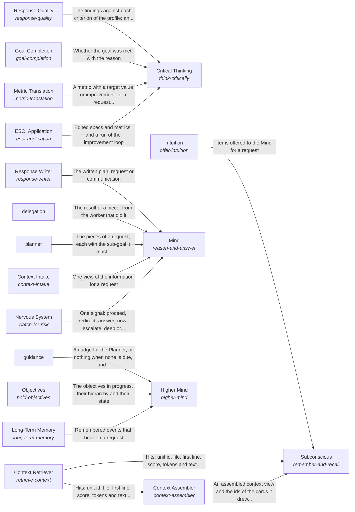

# Processing information for one request

One request is answered from what the AI can see for it: the long view is read, the request becomes a target, the information is found and prepared, the response is planned and written, and the result is checked for goal completion and response quality.

*ESOI records of this intent (evolvable structure that optimizes intent), generated from the CSV files beside this page by `esoi readmes`. Edit the CSV files, not this page.*

This sub-intent arises as the implementation `the-intelligence:composition` of its parent intent [`hub-of-hubs`](../../esoi/README.md). Opportunities: Long-term memory, objectives and guidance, and what comes to mind unasked, are opportunities beyond the parts that answer one request. Turning a request into a measured target, and judging quality against a profile, can each be improved without changing how a single request is answered.

## How the solutions fit together

Intelligence turns one request into a response. Higher Mind keeps the long view through Long-Term Memory, Objectives and Guidance, which gives an infrequent longer-term nudge. Critical Thinking turns the request into a target through Metric Translation, records it through ESOI Application, and holds the result to it through Goal Completion and Response Quality. Subconscious finds and prepares information through Intuition, Context Assembler and Context Retriever. Mind takes the request in through Context Intake, breaks it into pieces through Planner, passes each piece to a worker through Delegation and writes the response through Response Writer. Mind also asks for a signal before a risky piece from Nervous System, and for the decision for the person from Judgment Calls.

## Diagram

An arrow runs from the solution that provides to the solution that builds on it; its label is what the provider outputs.

## Solutions at a glance

| Solution | Handle | Entry call | Selected implementation | Metric |
|---|---|---|---|---|
| Nervous System | `watch-for-risk` | `hubofhubs.run("watch-for-risk", 'delete the old backup folder')` | Consent gate (`consent_gate`) | Risky steps stopped, ordinary steps let through, Guard marginal value |
| Critical Thinking | `think-critically` | `hubofhubs.run("think-critically", {'request': 'what is the latest Rust release?'})` | Target, goal and quality in order (`composition`) | Requests with a named problem, ideal and metric |
| Subconscious | `remember-and-recall` | `hubofhubs.run("remember-and-recall", 'rust release')` | Cards drawn by relevance from a store (`card_recall`) | Right context admitted, none from another scope |
| Context Assembler | `context-assembler` | `hubofhubs.run("context-assembler", 'where does the card store tidy itself?')` | `bm25@analyzer=english` | Relevant passage in the top five |
| Context Retriever | `retrieve-context` | `hubofhubs.run("retrieve-context", ...)` | Hybrid that can say nothing (`abstaining_hybrid`) | Balanced score of retrieval on file, topic, orientation, no-context, memory, public-repository and grouping requests, with the index size and the cost of reading sources |
| Mind | `reason-and-answer` | `hubofhubs.run("reason-and-answer", {'request': 'what is the latest Rust release?'})` | The four parts of the Mind in order (`composition`) | Answer quality per dollar and per second |
| Higher Mind | `higher-mind` | `hubofhubs.run("higher-mind", {'request': 'what is the latest Rust release?'})` | Objectives, memory and guidance for one request (`composition`) | The long view survives between requests |
| Long-Term Memory | `long-term-memory` | `hubofhubs.run("long-term-memory", {'query': 'rust release', 'person': ''})` | none selected | A later request uses what an earlier one learned |
| Objectives | `hold-objectives` | `hubofhubs.run("hold-objectives", {'person': ''})` | none selected | An objective persists until it is met |
| Intuition | `offer-intuition` | `hubofhubs.run("offer-intuition", {'request': 'what is the latest Rust release?'})` | none selected | Unasked items are taken and useful |
| Context Intake | `context-intake` | `hubofhubs.run("context-intake", {'request': 'what is the latest Rust release?'})` | none selected | One view from two sources |
| Planner | `planner` | `hubofhubs.run("planner", {'request': 'what is the latest Rust release?'})` | none selected | Pieces that can be done and checked |
| Delegation | `delegation` | `hubofhubs.run("delegation", {'pieces': [], 'authority': {}})` | none selected | Handoffs with authority and a done-standard |
| Response Writer | `response-writer` | `hubofhubs.run("response-writer", {'results': [], 'profile': None})` | none selected | The response suits its reader |
| Guidance | `guidance` | `hubofhubs.run("guidance", ...)` | none selected | A nudge that helps the Planner |
| ESOI Application | `esoi-application` | `hubofhubs.run("esoi-application", {'change': {}})` | none selected | Specs and metrics improve by the loop |
| Metric Translation | `metric-translation` | `hubofhubs.run("metric-translation", {'request': 'what is the latest Rust release?'})` | none selected | Request to metric with a target |
| Goal Completion | `goal-completion` | `hubofhubs.run("goal-completion", ...)` | none selected | The verdict matches a reviewer |
| Response Quality | `response-quality` | `hubofhubs.run("response-quality", ...)` | Links held to their evidence (`evidence_check`) | Balanced score of a response against its quality profile |

## Problems and ideals

**Problems**

- A guard or reviewer added around a model or harness is kept because it sounds careful, without showing that it catches anything the model or harness would not catch alone. (`hprob-addon-guard-without-marginal-value`)
- A task is shown too much of a codebase, the wrong part of it, or context it never needed, so the model pays for noise or misses the file that matters. (`hprob-context-too-broad-or-missing`)
- What the Mind sees for a request comes from two sources, the system's internal context and the outside, and each product wires both to the Mind its own way. (`hprob-mind-has-two-intakes-wired-by-hand`)
- An answer claims more than the evidence behind it supports, and the reader cannot tell which claim is unsupported. (`hprob-answers-outrun-their-evidence`)
- Each request starts from nothing: what happened before, what stays true and what the AI is working toward are lost between requests. (`hprob-long-view-lost-between-requests`)
- Every task's prompt carries every standing instruction and every correction ever given, so cost grows and quality falls as instructions accumulate. (`hprob-one-prompt-carries-every-instruction`)
- A worker given one piece of a request does not know the authority it carries or what done means for that piece. (`hprob-handoff-loses-authority-and-done-standard`)
- A request is answered without a target, so no one can say whether its goal was met or how much better a second try was. (`hprob-goal-not-turned-into-a-metric`)
- Response quality is judged by one fixed standard, though what counts as high quality depends on the person, the situation and the goals above the request. (`hprob-one-quality-standard-for-everyone`)

**Ideals**

- The context a task needs, and little else (`hideal-context-needed-and-little-else`): A task is shown the pieces it needs, in order of need, within a budget, and nothing when it needs nothing.
- One intake, two sources (`hideal-one-intake-two-sources`): The Mind has one intake fed by the system's internal context and by the outside.
- Answers stay within their evidence (`hideal-answers-stay-within-evidence`): Every claim in an answer is supported by evidence the reader can open, or is marked as unsupported.
- The long view is kept (`hideal-the-long-view-is-kept`): What happened, what stays true and what the AI is working toward survive from one request to the next.
- Only the instructions a task needs (`hideal-only-the-instructions-a-task-needs`): A task is given the instructions that bear on it and no others, and its prompt is an implementation measured on quality and cost.
- Every handoff carries authority and a standard (`hideal-every-handoff-carries-authority-and-done-standard`): Each handoff names the authority it carries and the done-standard of its sub-goal.
- Every request has a target (`hideal-every-request-has-a-target`): Every request and sub-goal has a metric with a target value or an improvement, which rolls up to the objective it serves.
- Quality is judged per profile (`hideal-quality-is-per-profile`): A response is judged against the quality profile of the person and situation, with a researched default when none is given.

## Metrics and their leaders

- Risky steps stopped, ordinary steps let through (`metric-watch-for-risk`): leader `two_stage`, 34 of 36 cases
- Guard marginal value (`metric-guard-marginal-value-over-native-and-harness`)
- Requests with a named problem, ideal and metric (`metric-think-critically`)
- Answer quality per dollar and per second (`metric-reason-and-answer`)
- Right context admitted, none from another scope (`metric-remember-and-recall`)
- Relevant passage in the top five (`metric-context-assembler`): leader `bm25@analyzer=english`, 208 of 323 cases
- Balanced score of retrieval on file, topic, orientation, no-context, memory, public-repository and grouping requests, with the index size and the cost of reading sources (`metric-retrieve-context`): leader `bm25_body`, 203 of 395 cases
- The long view survives between requests (`metric-higher-mind`)
- A later request uses what an earlier one learned (`metric-long-term-memory`)
- An objective persists until it is met (`metric-hold-objectives`)
- and 10 more: all 20 are in [metrics](#metrics) of the full record below

## Where to go next

- Parent intent: [The best parts for AI intelligence, assembled and proven](../../esoi/README.md)
- Repository: [top README](../../README.md)
- Records: [intent.csv](intent.csv), [problems.csv](problems.csv), [ideals.csv](ideals.csv), [solutions.csv](solutions.csv), [implementations.csv](implementations.csv), [metrics.csv](metrics.csv)
- Diagram page: [diagram.md](diagram.md)

---

## The full record

### Problems

- A guard or reviewer added around a model or harness is kept because it sounds careful, without showing that it catches anything the model or harness would not catch alone. (`hprob-addon-guard-without-marginal-value`)
- A task is shown too much of a codebase, the wrong part of it, or context it never needed, so the model pays for noise or misses the file that matters. (`hprob-context-too-broad-or-missing`)
- What the Mind sees for a request comes from two sources, the system's internal context and the outside, and each product wires both to the Mind its own way. (`hprob-mind-has-two-intakes-wired-by-hand`)
- An answer claims more than the evidence behind it supports, and the reader cannot tell which claim is unsupported. (`hprob-answers-outrun-their-evidence`)
- Each request starts from nothing: what happened before, what stays true and what the AI is working toward are lost between requests. (`hprob-long-view-lost-between-requests`)
- Every task's prompt carries every standing instruction and every correction ever given, so cost grows and quality falls as instructions accumulate. (`hprob-one-prompt-carries-every-instruction`)
- A worker given one piece of a request does not know the authority it carries or what done means for that piece. (`hprob-handoff-loses-authority-and-done-standard`)
- A request is answered without a target, so no one can say whether its goal was met or how much better a second try was. (`hprob-goal-not-turned-into-a-metric`)
- Response quality is judged by one fixed standard, though what counts as high quality depends on the person, the situation and the goals above the request. (`hprob-one-quality-standard-for-everyone`)

### Ideals

- The context a task needs, and little else (`hideal-context-needed-and-little-else`): A task is shown the pieces it needs, in order of need, within a budget, and nothing when it needs nothing.
- One intake, two sources (`hideal-one-intake-two-sources`): The Mind has one intake fed by the system's internal context and by the outside.
- Answers stay within their evidence (`hideal-answers-stay-within-evidence`): Every claim in an answer is supported by evidence the reader can open, or is marked as unsupported.
- The long view is kept (`hideal-the-long-view-is-kept`): What happened, what stays true and what the AI is working toward survive from one request to the next.
- Only the instructions a task needs (`hideal-only-the-instructions-a-task-needs`): A task is given the instructions that bear on it and no others, and its prompt is an implementation measured on quality and cost.
- Every handoff carries authority and a standard (`hideal-every-handoff-carries-authority-and-done-standard`): Each handoff names the authority it carries and the done-standard of its sub-goal.
- Every request has a target (`hideal-every-request-has-a-target`): Every request and sub-goal has a metric with a target value or an improvement, which rolls up to the objective it serves.
- Quality is judged per profile (`hideal-quality-is-per-profile`): A response is judged against the quality profile of the person and situation, with a researched default when none is given.

### Solutions

| Solution | Handle | Selected | Metric |
|---|---|---|---|
| Nervous System | `watch-for-risk` | Consent gate (`consent_gate`) | Risky steps stopped, ordinary steps let through, Guard marginal value |
| Critical Thinking | `think-critically` | Target, goal and quality in order (`composition`) | Requests with a named problem, ideal and metric |
| Subconscious | `remember-and-recall` | Cards drawn by relevance from a store (`card_recall`) | Right context admitted, none from another scope |
| Context Assembler | `context-assembler` | `bm25@analyzer=english` | Relevant passage in the top five |
| Context Retriever | `retrieve-context` | Hybrid that can say nothing (`abstaining_hybrid`) | Balanced score of retrieval on file, topic, orientation, no-context, memory, public-repository and grouping requests, with the index size and the cost of reading sources |
| Mind | `reason-and-answer` | The four parts of the Mind in order (`composition`) | Answer quality per dollar and per second |
| Higher Mind | `higher-mind` | Objectives, memory and guidance for one request (`composition`) | The long view survives between requests |
| Long-Term Memory | `long-term-memory` | none selected | A later request uses what an earlier one learned |
| Objectives | `hold-objectives` | none selected | An objective persists until it is met |
| Intuition | `offer-intuition` | none selected | Unasked items are taken and useful |
| Context Intake | `context-intake` | none selected | One view from two sources |
| Planner | `planner` | none selected | Pieces that can be done and checked |
| Delegation | `delegation` | none selected | Handoffs with authority and a done-standard |
| Response Writer | `response-writer` | none selected | The response suits its reader |
| Guidance | `guidance` | none selected | A nudge that helps the Planner |
| ESOI Application | `esoi-application` | none selected | Specs and metrics improve by the loop |
| Metric Translation | `metric-translation` | none selected | Request to metric with a target |
| Goal Completion | `goal-completion` | none selected | The verdict matches a reviewer |
| Response Quality | `response-quality` | Links held to their evidence (`evidence_check`) | Balanced score of a response against its quality profile |

### Implementations

| Implementation | Handle | Where | Sub-intent |
|---|---|---|---|
| Digest-driven overseer | `watch-for-risk:overseer` | [hubofhubs/risk.py](../risk.py) |  |
| Consent gate | `watch-for-risk:consent_gate` | [hubofhubs/consent_gate.py](../consent_gate.py) |  |
| Gate then overseer | `watch-for-risk:two_stage` | [hubofhubs/consent_gate.py](../consent_gate.py) |  |
| Links held to their evidence | `response-quality:evidence_check` | [hubofhubs/critique/evidence_check.py](../critique/evidence_check.py) |  |
| Composite retrieval | `context-assembler:composite` | [hubofhubs/recall/composite_assembler.py](../recall/composite_assembler.py) |  |
| BM25 over file text | `context-assembler:bm25` | [hubofhubs/recall/bm25_store.py](../recall/bm25_store.py) |  |
| Hybrid fusion | `context-assembler:hybrid` | [hubofhubs/recall/hybrid_assembler.py](../recall/hybrid_assembler.py) |  |
| Vector search | `context-assembler:vector` | [hubofhubs/recall/vector_assembler.py](../recall/vector_assembler.py) |  |
| Cards drawn by relevance from a store | `remember-and-recall:card_recall` | [hubofhubs/recall/card_recall.py](../recall/card_recall.py) |  |
| Files through the context retriever | `context-assembler:file_retrieval` | [hubofhubs/recall/file_retrieval_assembler.py](../recall/file_retrieval_assembler.py) |  |
| BM25 over chunk text | `retrieve-context:bm25_body` | [hubofhubs/retrieval/lexical.py](../retrieval/lexical.py) |  |
| BM25F over path, title and body | `retrieve-context:bm25_fielded` | [hubofhubs/retrieval/lexical.py](../retrieval/lexical.py) |  |
| BM25F over whole files | `retrieve-context:bm25_whole_files` | [hubofhubs/retrieval/lexical.py](../retrieval/lexical.py) |  |
| Latent semantic index | `retrieve-context:lsi` | [hubofhubs/retrieval/dense.py](../retrieval/dense.py) |  |
| Dense bge-small vectors | `retrieve-context:dense_bge_small` | [hubofhubs/retrieval/dense.py](../retrieval/dense.py) |  |
| BM25F and dense by rank fusion | `retrieve-context:hybrid_rrf` | [hubofhubs/retrieval/fusion.py](../retrieval/fusion.py) |  |
| Local feature reranker | `retrieve-context:feature_rerank` | [hubofhubs/retrieval/fusion.py](../retrieval/fusion.py) |  |
| Feature reranker without priors | `retrieve-context:feature_rerank_no_priors` | [hubofhubs/retrieval/fusion.py](../retrieval/fusion.py) |  |
| Learned reranker | `retrieve-context:learned_rerank` | [hubofhubs/retrieval/learned.py](../retrieval/learned.py) |  |
| Hybrid that can say nothing | `retrieve-context:abstaining_hybrid` | [hubofhubs/retrieval/abstain.py](../retrieval/abstain.py) |  |
| Learned reranker that can say nothing | `retrieve-context:abstaining_learned` | [hubofhubs/retrieval/abstain.py](../retrieval/abstain.py) |  |
| Model reranker | `retrieve-context:llm_rerank` | [hubofhubs/retrieval/abstain.py](../retrieval/abstain.py) |  |
| Hybrid that prefers newer items | `retrieve-context:abstaining_recency` | [hubofhubs/retrieval/aware.py](../retrieval/aware.py) |  |
| Hybrid with soft affinity to the request's focus | `retrieve-context:abstaining_affinity` | [hubofhubs/retrieval/aware.py](../retrieval/aware.py) |  |
| Hybrid with recency, affinity and supersession | `retrieve-context:abstaining_aware` | [hubofhubs/retrieval/aware.py](../retrieval/aware.py) |  |
| Hybrid behind a hard focus fence | `retrieve-context:abstaining_fenced` | [hubofhubs/retrieval/aware.py](../retrieval/aware.py) |  |
| Scan of the live sources | `retrieve-context:live_scan` | [hubofhubs/retrieval/aware.py](../retrieval/aware.py) |  |
| Objectives, memory and guidance for one request | `higher-mind:composition` | [hubofhubs/flows.py](../flows.py) |  |
| The four parts of the Mind in order | `reason-and-answer:composition` | [hubofhubs/flows.py](../flows.py) |  |
| Target, goal and quality in order | `think-critically:composition` | [hubofhubs/flows.py](../flows.py) |  |

### Metrics

- Risky steps stopped, ordinary steps let through (`metric-watch-for-risk`): `esoi run watch_for_risk --impl overseer; esoi run watch_for_risk --impl none; esoi run watch_for_risk --impl consent_gate; esoi run watch_for_risk --impl two_stage`
- Guard marginal value (`metric-guard-marginal-value-over-native-and-harness`): `python3 -m pytest tests/test_risk.py`
- Requests with a named problem, ideal and metric (`metric-think-critically`): `none`
- Answer quality per dollar and per second (`metric-reason-and-answer`): `none`
- Right context admitted, none from another scope (`metric-remember-and-recall`): `none`
- Relevant passage in the top five (`metric-context-assembler`): `esoi run context_assembler --impl bm25; esoi run context_assembler --impl vector; esoi run context_assembler --impl hybrid; esoi run context_assembler --impl composite`
- Balanced score of retrieval on file, topic, orientation, no-context, memory, public-repository and grouping requests, with the index size and the cost of reading sources (`metric-retrieve-context`): `esoi run context_retrieval --impl bm25_body; esoi run context_retrieval --impl bm25_fielded; esoi run context_retrieval --impl bm25_whole_files; esoi run context_retrieval --impl lsi; esoi run context_retrieval --impl dense_bge_small; esoi run context_retrieval --impl hybrid_rrf; esoi run context_retrieval --impl feature_rerank; esoi run context_retrieval --impl feature_rerank_no_priors; esoi run context_retrieval --impl learned_rerank; esoi run context_retrieval --impl abstaining_hybrid; esoi run context_retrieval --impl abstaining_learned; esoi run context_retrieval --impl abstaining_recency; esoi run context_retrieval --impl abstaining_affinity; esoi run context_retrieval --impl abstaining_aware; esoi run context_retrieval --impl abstaining_fenced; esoi run context_retrieval --impl live_scan; esoi run context_retrieval --impl llm_rerank`
- The long view survives between requests (`metric-higher-mind`): `none`
- A later request uses what an earlier one learned (`metric-long-term-memory`): `none`
- An objective persists until it is met (`metric-hold-objectives`): `none`
- Unasked items are taken and useful (`metric-offer-intuition`): `none`
- One view from two sources (`metric-context-intake`): `none`
- Pieces that can be done and checked (`metric-planner`): `none`
- Handoffs with authority and a done-standard (`metric-delegation`): `none`
- The response suits its reader (`metric-response-writer`): `none`
- A nudge that helps the Planner (`metric-guidance`): `none`
- Specs and metrics improve by the loop (`metric-esoi-application`): `none`
- Request to metric with a target (`metric-metric-translation`): `none`
- The verdict matches a reviewer (`metric-goal-completion`): `none`
- Balanced score of a response against its quality profile (`metric-response-quality`): `none`
