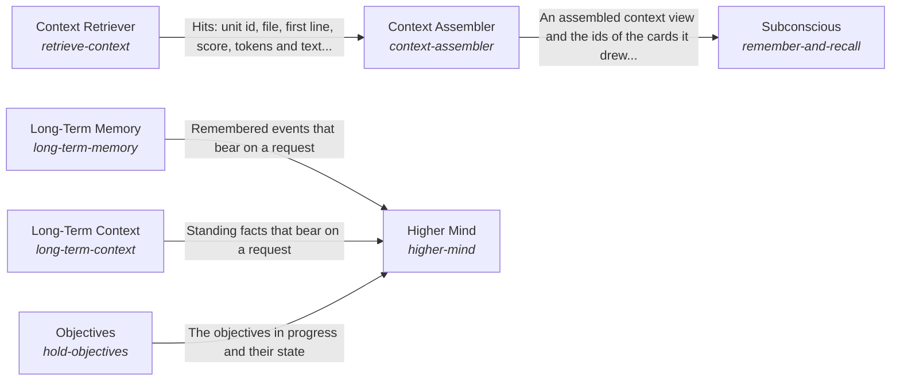

# Processing information for one request

One request is answered from what the AI can see for it: the information is found and prepared, the answer is reasoned and held to its evidence, and the long view is kept across requests.

*ESOI records of this intent (evolvable structure that optimizes intent), generated from the CSV files beside this page by `esoi readmes`. Edit the CSV files, not this page.*

This sub-intent arises as the implementation `the-intelligence:composition` of its parent intent [`hub-of-hubs`](../../esoi/README.md). Opportunities: Long-term memory, long-term context and objectives, and what comes to mind unasked, are opportunities beyond the parts that answer one request. Each can be measured and improved without changing how a single request is answered.

## How the solutions fit together

Intelligence turns what is known into one answer for one request. Mind is what the planning and responding AI can see for that request and how it outputs plans, requests and communications, and it asks a model through Model Tier Chooser and Model Call. Subconscious finds and prepares information for the answering AI, drawing the cards a request needs through Context Assembler. Intuition offers what surfaces for a request unasked. Context Retriever picks the pieces of a folder's files that a task needs within a token budget. Higher Mind keeps the long view through Long-Term Memory, Long-Term Context and Objectives. Critical Thinking holds an answer to the evidence behind it.

## Diagram

An arrow runs from the solution that provides to the solution that builds on it; its label is what the provider outputs.

## Solutions at a glance

| Solution | Handle | Entry call | Selected implementation | Metric |
|---|---|---|---|---|
| Critical Thinking | `think-critically` | `hubofhubs.run("think-critically", ...)` | Links held to their evidence (`evidence_check`) | Requests with a named problem, ideal and metric |
| Subconscious | `remember-and-recall` | `hubofhubs.run("remember-and-recall", 'rust release')` | Cards drawn by relevance from a store (`card_recall`) | Right context admitted, none from another scope |
| Context Assembler | `context-assembler` | `hubofhubs.run("context-assembler", 'where does the card store tidy itself?')` | `bm25@analyzer=english` | Relevant passage in the top five |
| Context Retriever | `retrieve-context` | `hubofhubs.run("retrieve-context", ...)` | Hybrid that can say nothing (`abstaining_hybrid`) | Balanced score of retrieval on file, topic, orientation, no-context, memory, public-repository and grouping requests, with the index size and the cost of reading sources |
| Mind | `reason-and-answer` | `hubofhubs.run("reason-and-answer", ...)` | Answers through the measured model for the tier (`model_calls`) | Answer quality per dollar and per second |
| Higher Mind | `higher-mind` | no entry declared | Composition of the long view (`composition`) | The long view survives between requests |
| Long-Term Memory | `long-term-memory` | no entry declared | none selected | A later request uses what an earlier one learned |
| Long-Term Context | `long-term-context` | no entry declared | none selected | A request starts from standing facts |
| Objectives | `hold-objectives` | no entry declared | none selected | An objective persists until it is met |
| Intuition | `offer-intuition` | no entry declared | none selected | Unasked items are taken and useful |

## Problems and ideals

**Problems**

- A task is shown too much of a codebase, the wrong part of it, or context it never needed, so the model pays for noise or misses the file that matters. (`hprob-context-too-broad-or-missing`)
- What the Mind sees for a request comes from two sources, the system's internal context and the outside, and each product wires both to the Mind its own way. (`hprob-mind-has-two-intakes-wired-by-hand`)
- An answer claims more than the evidence behind it supports, and the reader cannot tell which claim is unsupported. (`hprob-answers-outrun-their-evidence`)
- Each request starts from nothing: what happened before, what stays true and what the AI is working toward are lost between requests. (`hprob-long-view-lost-between-requests`)

**Ideals**

- The context a task needs, and little else (`hideal-context-needed-and-little-else`): A task is shown the pieces it needs, in order of need, within a budget, and nothing when it needs nothing.
- One intake, two sources (`hideal-one-intake-two-sources`): The Mind has one intake fed by the system's internal context and by the outside.
- Answers stay within their evidence (`hideal-answers-stay-within-evidence`): Every claim in an answer is supported by evidence the reader can open, or is marked as unsupported.
- The long view is kept (`hideal-the-long-view-is-kept`): What happened, what stays true and what the AI is working toward survive from one request to the next.

## Metrics and their leaders

- Requests with a named problem, ideal and metric (`metric-think-critically`)
- Answer quality per dollar and per second (`metric-reason-and-answer`)
- Right context admitted, none from another scope (`metric-remember-and-recall`)
- Relevant passage in the top five (`metric-context-assembler`): leader `bm25@analyzer=english`, 208 of 323 cases
- Balanced score of retrieval on file, topic, orientation, no-context, memory, public-repository and grouping requests, with the index size and the cost of reading sources (`metric-retrieve-context`): leader `bm25_body`, 203 of 395 cases
- The long view survives between requests (`metric-higher-mind`)
- A later request uses what an earlier one learned (`metric-long-term-memory`)
- A request starts from standing facts (`metric-long-term-context`)
- An objective persists until it is met (`metric-hold-objectives`)
- Unasked items are taken and useful (`metric-offer-intuition`)

## Where to go next

- Parent intent: [The best parts for AI intelligence, assembled and proven](../../esoi/README.md)
- Repository: [top README](../../README.md)
- Records: [intent.csv](intent.csv), [problems.csv](problems.csv), [ideals.csv](ideals.csv), [solutions.csv](solutions.csv), [implementations.csv](implementations.csv), [metrics.csv](metrics.csv)
- Diagram page: [diagram.md](diagram.md)

---

## The full record

### Problems

- A task is shown too much of a codebase, the wrong part of it, or context it never needed, so the model pays for noise or misses the file that matters. (`hprob-context-too-broad-or-missing`)
- What the Mind sees for a request comes from two sources, the system's internal context and the outside, and each product wires both to the Mind its own way. (`hprob-mind-has-two-intakes-wired-by-hand`)
- An answer claims more than the evidence behind it supports, and the reader cannot tell which claim is unsupported. (`hprob-answers-outrun-their-evidence`)
- Each request starts from nothing: what happened before, what stays true and what the AI is working toward are lost between requests. (`hprob-long-view-lost-between-requests`)

### Ideals

- The context a task needs, and little else (`hideal-context-needed-and-little-else`): A task is shown the pieces it needs, in order of need, within a budget, and nothing when it needs nothing.
- One intake, two sources (`hideal-one-intake-two-sources`): The Mind has one intake fed by the system's internal context and by the outside.
- Answers stay within their evidence (`hideal-answers-stay-within-evidence`): Every claim in an answer is supported by evidence the reader can open, or is marked as unsupported.
- The long view is kept (`hideal-the-long-view-is-kept`): What happened, what stays true and what the AI is working toward survive from one request to the next.

### Solutions

| Solution | Handle | Selected | Metric |
|---|---|---|---|
| Critical Thinking | `think-critically` | Links held to their evidence (`evidence_check`) | Requests with a named problem, ideal and metric |
| Subconscious | `remember-and-recall` | Cards drawn by relevance from a store (`card_recall`) | Right context admitted, none from another scope |
| Context Assembler | `context-assembler` | `bm25@analyzer=english` | Relevant passage in the top five |
| Context Retriever | `retrieve-context` | Hybrid that can say nothing (`abstaining_hybrid`) | Balanced score of retrieval on file, topic, orientation, no-context, memory, public-repository and grouping requests, with the index size and the cost of reading sources |
| Mind | `reason-and-answer` | Answers through the measured model for the tier (`model_calls`) | Answer quality per dollar and per second |
| Higher Mind | `higher-mind` | Composition of the long view (`composition`) | The long view survives between requests |
| Long-Term Memory | `long-term-memory` | none selected | A later request uses what an earlier one learned |
| Long-Term Context | `long-term-context` | none selected | A request starts from standing facts |
| Objectives | `hold-objectives` | none selected | An objective persists until it is met |
| Intuition | `offer-intuition` | none selected | Unasked items are taken and useful |

### Implementations

| Implementation | Handle | Where | Sub-intent |
|---|---|---|---|
| Links held to their evidence | `think-critically:evidence_check` | [hubofhubs/critique/evidence_check.py](../critique/evidence_check.py) |  |
| Answers through the measured model for the tier | `reason-and-answer:model_calls` | [hubofhubs/areas.py](../areas.py) |  |
| Composite retrieval | `context-assembler:composite` | [hubofhubs/recall/composite_assembler.py](../recall/composite_assembler.py) |  |
| BM25 over file text | `context-assembler:bm25` | [hubofhubs/recall/bm25_store.py](../recall/bm25_store.py) |  |
| Hybrid fusion | `context-assembler:hybrid` | [hubofhubs/recall/hybrid_assembler.py](../recall/hybrid_assembler.py) |  |
| Vector search | `context-assembler:vector` | [hubofhubs/recall/vector_assembler.py](../recall/vector_assembler.py) |  |
| Cards drawn by relevance from a store | `remember-and-recall:card_recall` | [hubofhubs/recall/card_recall.py](../recall/card_recall.py) |  |
| Files through the context retriever | `context-assembler:file_retrieval` | [hubofhubs/recall/file_retrieval_assembler.py](../recall/file_retrieval_assembler.py) |  |
| BM25 over chunk text | `retrieve-context:bm25_body` | [hubofhubs/retrieval/lexical.py](../retrieval/lexical.py) |  |
| BM25F over path, title and body | `retrieve-context:bm25_fielded` | [hubofhubs/retrieval/lexical.py](../retrieval/lexical.py) |  |
| BM25F over whole files | `retrieve-context:bm25_whole_files` | [hubofhubs/retrieval/lexical.py](../retrieval/lexical.py) |  |
| Latent semantic index | `retrieve-context:lsi` | [hubofhubs/retrieval/dense.py](../retrieval/dense.py) |  |
| Dense bge-small vectors | `retrieve-context:dense_bge_small` | [hubofhubs/retrieval/dense.py](../retrieval/dense.py) |  |
| BM25F and dense by rank fusion | `retrieve-context:hybrid_rrf` | [hubofhubs/retrieval/fusion.py](../retrieval/fusion.py) |  |
| Local feature reranker | `retrieve-context:feature_rerank` | [hubofhubs/retrieval/fusion.py](../retrieval/fusion.py) |  |
| Feature reranker without priors | `retrieve-context:feature_rerank_no_priors` | [hubofhubs/retrieval/fusion.py](../retrieval/fusion.py) |  |
| Learned reranker | `retrieve-context:learned_rerank` | [hubofhubs/retrieval/learned.py](../retrieval/learned.py) |  |
| Hybrid that can say nothing | `retrieve-context:abstaining_hybrid` | [hubofhubs/retrieval/abstain.py](../retrieval/abstain.py) |  |
| Learned reranker that can say nothing | `retrieve-context:abstaining_learned` | [hubofhubs/retrieval/abstain.py](../retrieval/abstain.py) |  |
| Model reranker | `retrieve-context:llm_rerank` | [hubofhubs/retrieval/abstain.py](../retrieval/abstain.py) |  |
| Hybrid that prefers newer items | `retrieve-context:abstaining_recency` | [hubofhubs/retrieval/aware.py](../retrieval/aware.py) |  |
| Hybrid with soft affinity to the request's focus | `retrieve-context:abstaining_affinity` | [hubofhubs/retrieval/aware.py](../retrieval/aware.py) |  |
| Hybrid with recency, affinity and supersession | `retrieve-context:abstaining_aware` | [hubofhubs/retrieval/aware.py](../retrieval/aware.py) |  |
| Hybrid behind a hard focus fence | `retrieve-context:abstaining_fenced` | [hubofhubs/retrieval/aware.py](../retrieval/aware.py) |  |
| Scan of the live sources | `retrieve-context:live_scan` | [hubofhubs/retrieval/aware.py](../retrieval/aware.py) |  |
| Composition of the long view | `higher-mind:composition` |  |  |

### Metrics

- Requests with a named problem, ideal and metric (`metric-think-critically`): `none`
- Answer quality per dollar and per second (`metric-reason-and-answer`): `none`
- Right context admitted, none from another scope (`metric-remember-and-recall`): `none`
- Relevant passage in the top five (`metric-context-assembler`): `esoi run context_assembler --impl bm25; esoi run context_assembler --impl vector; esoi run context_assembler --impl hybrid; esoi run context_assembler --impl composite`
- Balanced score of retrieval on file, topic, orientation, no-context, memory, public-repository and grouping requests, with the index size and the cost of reading sources (`metric-retrieve-context`): `esoi run context_retrieval --impl bm25_body; esoi run context_retrieval --impl bm25_fielded; esoi run context_retrieval --impl bm25_whole_files; esoi run context_retrieval --impl lsi; esoi run context_retrieval --impl dense_bge_small; esoi run context_retrieval --impl hybrid_rrf; esoi run context_retrieval --impl feature_rerank; esoi run context_retrieval --impl feature_rerank_no_priors; esoi run context_retrieval --impl learned_rerank; esoi run context_retrieval --impl abstaining_hybrid; esoi run context_retrieval --impl abstaining_learned; esoi run context_retrieval --impl abstaining_recency; esoi run context_retrieval --impl abstaining_affinity; esoi run context_retrieval --impl abstaining_aware; esoi run context_retrieval --impl abstaining_fenced; esoi run context_retrieval --impl live_scan; esoi run context_retrieval --impl llm_rerank`
- The long view survives between requests (`metric-higher-mind`): `none`
- A later request uses what an earlier one learned (`metric-long-term-memory`): `none`
- A request starts from standing facts (`metric-long-term-context`): `none`
- An objective persists until it is met (`metric-hold-objectives`): `none`
- Unasked items are taken and useful (`metric-offer-intuition`): `none`
