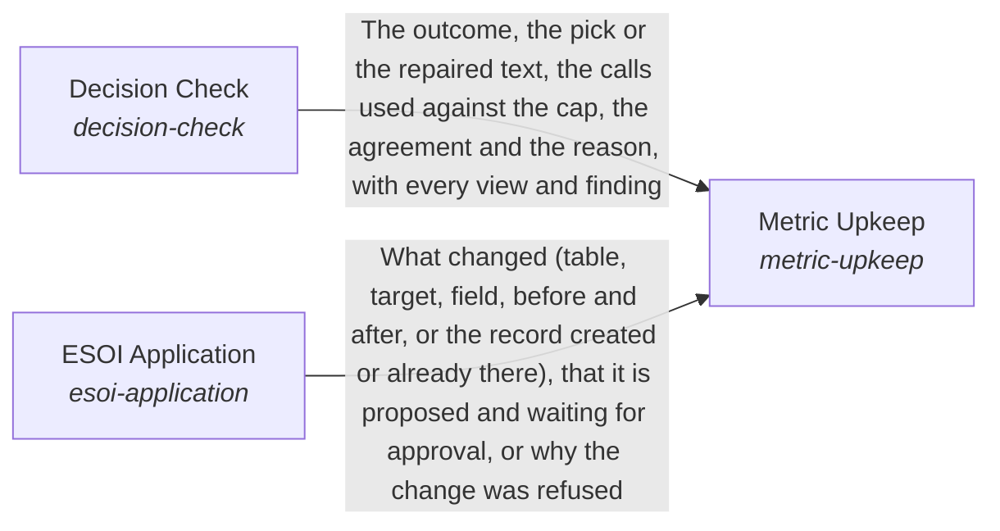

# Holding a request to a measure

**Vision statement:** Every request is held to a measure until its goal is met.

Breadcrumb: [Top](../../../esoi/README.md) > [How the AI processes information](../README.md) > Holding a request to a measure

This sub-intent arises as the implementation `critical-thinking:composition` of its parent intent [`the_intelligence`](../README.md). Opportunities: Translating a request into a metric, creating and editing the specs and metrics, judging goal completion, replanning an unmet goal and judging response quality and checking a draft decision with independent views are six ML tasks, each improvable on its own accuracy. Judging a request separately for each solution it concerns is a seventh task, improvable on whether the record that decides a case reaches the right pass.

## How the solutions fit together

Critical Thinking holds a request to a measure. Metric Translation turns the request into a metric with a target value or improvement and a budget, adjustable while the work runs. ESOI Application records that metric as a spec and applies the principles, creating and editing specs and metrics. Goal Completion says whether the goal's condition was met against its done-standard, and whether iteration the person did not ask for should go on (continue, stop when met, stop when good enough or not worth its cost, or ask the person), within what the person stated and the policy that bounds it. When it was not, the composition's pursue step uses the untried read-only means within a budget before the response is sent, says once that the rest is still being worked on when the work is long, and otherwise reports what was tried and what is missing. Response Quality judges the response against the quality profile resolved for the request. Decision Check tests a draft decision (a pick among options, or a reply) with small independent checks that each see only their own evidence and run in parallel: where they agree the draft stands, where they disagree one call decides from quoted evidence or the check abstains, and only a failing part of a reply is repaired; the mistakes it finds become known-mistake lines that the checks carry only while their metric says they pay. Metric Upkeep keeps a milestone's metrics able to show progress: it decides each metric's state from its fields and reads what it can. When the milestone's own metric moves only through a person, Metric Upkeep first has an intermediate metric the AI can move proposed, then relies on Decision Check to agree that this metric tracks the done test, and on ESOI Application to write it. The composition's progress step runs Metric Upkeep, picks the first rung of the increment ladder that applies, measures it before, does it, has pursue refuse a result that is bookkeeping alone, and measures it after with a check that is not the writer. Solution Passes gives each solution the request concerns its own cheap pass on the prompt its records form, then a narrower pass for each scope above until one finds no effect on how its children combine, and a narrow pass for each solution relying on it. The targets those passes read from each solution's own metric are what the goal is held to, piece by piece, and what the passes and the checks taught is recorded for the next request. Structure in Conversation decides what structure a reply to a person carries: from the move the turn calls for it shows the problem, ideal, solution, alternatives, metric and milestone the records already hold, proposes only what is missing, and makes at most one offer that ESOI Application later applies as ensure-one additions, so a plain turn stays plain and what a reply proposes is built on in the next conversation.

## Diagram

An arrow runs from the solution that provides to the solution that builds on it; its label is what the provider outputs.

## One level below

This intent is implemented by the sub-intents and solutions below it; each shows whether it goes deeper.

- [Decision Check](decision_check/README.md) (solution with implementations): Give a draft decision to small independent checks that check each other's work, within a declared number of calls.
- [ESOI Application](esoi_application/README.md) (solution with implementations): Apply a proposed edit to the system's own specs and metrics exactly as proposed: an AI is the author of the specs, and the edit is applied directly unless Judgment Calls decides to ask.
- [Goal Completion](goal_completion/README.md) (solution with implementations): Check that the goal was met, and that unasked iteration stops when it should.
- [Metric Translation](metric_translation/README.md) (solution with implementations): Make what success means for a request explicit and measurable as a goal record: the metric, its target, the done-standard and the budget (attempts, pieces and model calls) that Delegation and Model Plumbing enforce.
- [Metric Upkeep](metric_upkeep/README.md) (solution with implementations): Keep every milestone measurable by the AI's own work, so a turn asked to make progress never has the excuse of waiting on a person.
- [Response Quality](response_quality/README.md) (solution with implementations): Judge a response against the quality profile that applies to this request.
- [Solution Passes](solution_passes/README.md) (solution with implementations): Make every relevant solution judge a request against its own records, at every level of the hierarchy, so durable memory and expertise are never skipped.
- [Structure in conversation](structure_in_conversation/README.md) (solution with implementations): Give a person grounded clarity in a conversation by building the reply on the structure of their intent, and stay out of the way when a turn needs none.

## Solutions at a glance

| Solution | Handle | Entry call | Selected implementation | Metric |
|---|---|---|---|---|
| Decision Check | `decision-check` | `hubofhubs.run("decision-check")` | Independent views, adjudicated on disagreement (`agreement_check`) | Decisions right within a call cap |
| ESOI Application | `esoi-application` | `hubofhubs.run("esoi-application", {'change': {}})` | Record field edit (`record_field_edit`) | Edits change exactly the field proposed |
| Goal Completion | `goal-completion` | `hubofhubs.run("goal-completion", ...)` | Independent review, then the stop rule (`independent_review`) | Goals judged met only when they are, and iteration stopped when it should be |
| Metric Translation | `metric-translation` | `hubofhubs.run("metric-translation", {'request': 'what is the latest Rust version?'})` | Goal record with default budget (`goal_record`) | A goal record with a target and a budget |
| Metric Upkeep | `metric-upkeep` | `hubofhubs.run("metric-upkeep", ...)` | Record fields (`record_fields`) | Metric states and intermediates are right |
| Response Quality | `response-quality` | `hubofhubs.run("response-quality", ...)` | Links held to their evidence (`evidence_check`) | Balanced score of a response against its quality profile |
| Solution Passes | `solution-passes` | `hubofhubs.run("solution-passes", ...)` | Network passes (`network_passes`) | Record-held answers reached and followed, Work done right because each touched solution was considered, at a priced cost |
| Structure in conversation | `structure-in-conversation` | `hubofhubs.run("structure-in-conversation", {'turn': {'move': 'none'}})` | Structure move (`structure_move`) | Replies make the structure move their turn calls for |

## Problems and ideals

**Problems**

- Goal not turned into a metric (`hprob-goal-not-turned-into-a-metric`): Most requests are answered without a stated target, so it is hard to say whether the goal was met or whether a second try was better.
- Answer sent while the goal is unmet (`hprob-answer-sent-while-goal-unmet`): A draft that does not meet the goal condition is sent as final after one pass, or hands the work back to the person, although means that could meet it were never tried.
- Solution skipped or judged broadly (`hprob-solution-skipped-or-judged-broadly`): Work that touches several solutions is judged in one broad pass from general knowledge, or a relevant solution, a scope above it or a solution relying on it is never considered at all.
- Reply ignores the structure held (`hprob-reply-ignores-the-structure-held`): A reply to a person's question lists general options and ignores the structure the system already holds for what they are working toward: what stands in the way, what good looks like, which alternatives are being compared, how they would tell which works and the next milestone.
- Cheap model decisions are unreliable (`hprob-cheap-model-decisions-unreliable`): A cheap model asked for a decision in one prompt that mixes every kind of evidence (rules, past examples, descriptions, tool records) often picks wrongly, and the pick is seldom checked against the evidence it should rest on.
- The same mistakes repeat (`hprob-same-mistakes-repeat`): A check makes the same kind of mistake again and again, though each one was found (an eval failure, a person's correction, a disagreement that was settled), because the lesson stays in a log and does not reach the prompt.
- Quality judged by one fixed standard (`hprob-one-quality-standard-for-everyone`): Response quality is usually judged by one fixed standard, though what counts as high quality depends on the person, the situation and the goals above the request.

**Ideals**

- Every request has a target (`hideal-every-request-has-a-target`): For every request and sub-goal, the AI and the person can tell whether the goal was met and how close it came, in terms that roll up to the objective it serves.
- A goal is pursued until met or honestly reported (`hideal-a-goal-is-pursued-until-met-or-honestly-reported`): A request is worked on until its goal is met, and when it cannot be, the person is told exactly what was tried and what is missing.
- Each solution considered on its own records (`hideal-each-solution-considered-on-its-own-records`): Every relevant solution, every scope above it that the change affects and every solution relying on it gets its own consideration, reading its own records first.
- A reply builds on the structure held (`hideal-a-reply-builds-on-the-structure-held`): A reply that serves a person's intent uses the problem, ideal, solution, alternatives, metric and milestone the system already holds, in sentences that stand on their own, proposes only what is missing, offers at most one way to keep it, and stays plain where structure would only get in the way.
- Decisions held by independent checks (`hideal-decisions-held-by-independent-checks`): A decision is accepted when small checks that each saw only their own evidence agree, and is settled from quoted evidence or not at all when they do not.
- Found mistakes not repeated (`hideal-found-mistakes-not-repeated`): A mistake found once becomes a short lesson in the check that made it, kept only while the metric says it pays.
- Quality is judged per profile (`hideal-quality-is-per-profile`): A response is high quality by the standard of the person and situation it serves, and good by default for someone who has said nothing yet.

## Metrics and their leaders

- Decisions right within a call cap (`metric-decision-check`): leader `agreement_check`, 20 of 21 cases
- Edits change exactly the field proposed (`metric-esoi-application`): leader `record_field_edit`, 10 of 10 cases
- Goals judged met only when they are, and iteration stopped when it should be (`metric-goal-completion`): leader `independent_review`, 65 of 65 cases
- A goal record with a target and a budget (`metric-metric-translation`)
- Metric states and intermediates are right (`metric-metric-upkeep`)
- Balanced score of a response against its quality profile (`metric-response-quality`): leader `date_arithmetic`, 15 of 15 cases
- Record-held answers reached and followed (`metric-solution-passes`): leader `network_passes`, 10 of 11 cases
- Work done right because each touched solution was considered, at a priced cost (`metric-solution-passes-work-outcome`): leader `network_passes`, 10 of 11 cases
- Replies make the structure move their turn calls for (`metric-structure-in-conversation`): leader `structure_move`, 36 of 36 cases

## Where to go next

- Parent intent: [How the AI processes information](../README.md)
- Repository: [top README](../../../README.md)
- Records beside the code: [hubofhubs/the_intelligence/critical_thinking/decision_check](decision_check/README.md), [hubofhubs/the_intelligence/critical_thinking/esoi_application](esoi_application/README.md), [hubofhubs/the_intelligence/critical_thinking/goal_completion](goal_completion/README.md), [hubofhubs/the_intelligence/critical_thinking/metric_translation](metric_translation/README.md), [hubofhubs/the_intelligence/critical_thinking/metric_upkeep](metric_upkeep/README.md), [hubofhubs/the_intelligence/critical_thinking/response_quality](response_quality/README.md), [hubofhubs/the_intelligence/critical_thinking/solution_passes](solution_passes/README.md), [hubofhubs/the_intelligence/critical_thinking/structure_in_conversation](structure_in_conversation/README.md)
- Records: [intent.csv](intent.csv), [problems.csv](problems.csv), [ideals.csv](ideals.csv)
- Diagram page: [diagram.md](diagram.md)

---

## The full record

### Problems

- Goal not turned into a metric (`hprob-goal-not-turned-into-a-metric`): Most requests are answered without a stated target, so it is hard to say whether the goal was met or whether a second try was better.
- Answer sent while the goal is unmet (`hprob-answer-sent-while-goal-unmet`): A draft that does not meet the goal condition is sent as final after one pass, or hands the work back to the person, although means that could meet it were never tried.
- Solution skipped or judged broadly (`hprob-solution-skipped-or-judged-broadly`): Work that touches several solutions is judged in one broad pass from general knowledge, or a relevant solution, a scope above it or a solution relying on it is never considered at all.
- Reply ignores the structure held (`hprob-reply-ignores-the-structure-held`): A reply to a person's question lists general options and ignores the structure the system already holds for what they are working toward: what stands in the way, what good looks like, which alternatives are being compared, how they would tell which works and the next milestone.
- Cheap model decisions are unreliable (`hprob-cheap-model-decisions-unreliable`): A cheap model asked for a decision in one prompt that mixes every kind of evidence (rules, past examples, descriptions, tool records) often picks wrongly, and the pick is seldom checked against the evidence it should rest on.
- The same mistakes repeat (`hprob-same-mistakes-repeat`): A check makes the same kind of mistake again and again, though each one was found (an eval failure, a person's correction, a disagreement that was settled), because the lesson stays in a log and does not reach the prompt.
- Quality judged by one fixed standard (`hprob-one-quality-standard-for-everyone`): Response quality is usually judged by one fixed standard, though what counts as high quality depends on the person, the situation and the goals above the request.

### Ideals

- Every request has a target (`hideal-every-request-has-a-target`): For every request and sub-goal, the AI and the person can tell whether the goal was met and how close it came, in terms that roll up to the objective it serves.
- A goal is pursued until met or honestly reported (`hideal-a-goal-is-pursued-until-met-or-honestly-reported`): A request is worked on until its goal is met, and when it cannot be, the person is told exactly what was tried and what is missing.
- Each solution considered on its own records (`hideal-each-solution-considered-on-its-own-records`): Every relevant solution, every scope above it that the change affects and every solution relying on it gets its own consideration, reading its own records first.
- A reply builds on the structure held (`hideal-a-reply-builds-on-the-structure-held`): A reply that serves a person's intent uses the problem, ideal, solution, alternatives, metric and milestone the system already holds, in sentences that stand on their own, proposes only what is missing, offers at most one way to keep it, and stays plain where structure would only get in the way.
- Decisions held by independent checks (`hideal-decisions-held-by-independent-checks`): A decision is accepted when small checks that each saw only their own evidence agree, and is settled from quoted evidence or not at all when they do not.
- Found mistakes not repeated (`hideal-found-mistakes-not-repeated`): A mistake found once becomes a short lesson in the check that made it, kept only while the metric says it pays.
- Quality is judged per profile (`hideal-quality-is-per-profile`): A response is high quality by the standard of the person and situation it serves, and good by default for someone who has said nothing yet.

### Solutions

| Solution | Handle | Selected | Metric |
|---|---|---|---|
| Decision Check | `decision-check` | Independent views, adjudicated on disagreement (`agreement_check`) | Decisions right within a call cap |
| ESOI Application | `esoi-application` | Record field edit (`record_field_edit`) | Edits change exactly the field proposed |
| Goal Completion | `goal-completion` | Independent review, then the stop rule (`independent_review`) | Goals judged met only when they are, and iteration stopped when it should be |
| Metric Translation | `metric-translation` | Goal record with default budget (`goal_record`) | A goal record with a target and a budget |
| Metric Upkeep | `metric-upkeep` | Record fields (`record_fields`) | Metric states and intermediates are right |
| Response Quality | `response-quality` | Links held to their evidence (`evidence_check`) | Balanced score of a response against its quality profile |
| Solution Passes | `solution-passes` | Network passes (`network_passes`) | Record-held answers reached and followed, Work done right because each touched solution was considered, at a priced cost |
| Structure in conversation | `structure-in-conversation` | Structure move (`structure_move`) | Replies make the structure move their turn calls for |

### Implementations

| Implementation | Handle | Where | Sub-intent |
|---|---|---|---|
| Independent views, adjudicated on disagreement | `decision-check:agreement_check` | [hubofhubs/the_intelligence/critical_thinking/decision_check/agreement.py](decision_check/agreement.py) |  |
| Independent views, decided by majority | `decision-check:majority_vote` | [hubofhubs/the_intelligence/critical_thinking/decision_check/agreement.py](decision_check/agreement.py) |  |
| Independent views with known mistakes | `decision-check:agreement_with_known_mistakes` | [hubofhubs/the_intelligence/critical_thinking/decision_check/agreement.py](decision_check/agreement.py) |  |
| One verify call over all the evidence | `decision-check:single_verify` | [hubofhubs/the_intelligence/critical_thinking/decision_check/agreement.py](decision_check/agreement.py) |  |
| Draft as given | `decision-check:draft_as_given` | [hubofhubs/the_intelligence/critical_thinking/decision_check/agreement.py](decision_check/agreement.py) |  |
| Append to description | `esoi-application:append_to_description` | [hubofhubs/the_intelligence/critical_thinking/esoi_application/apply.py](esoi_application/apply.py) |  |
| Record field edit | `esoi-application:record_field_edit` | [hubofhubs/the_intelligence/critical_thinking/esoi_application/apply.py](esoi_application/apply.py) |  |
| Evidence standard | `goal-completion:evidence_standard` | [hubofhubs/the_intelligence/critical_thinking/goal_completion/goal_completion.py](goal_completion/goal_completion.py) |  |
| Outcome is not empty | `goal-completion:nonempty` | [hubofhubs/the_intelligence/critical_thinking/goal_completion/goal_completion.py](goal_completion/goal_completion.py) |  |
| Pragmatic stop rule | `goal-completion:pragmatic_stop` | [hubofhubs/the_intelligence/critical_thinking/goal_completion/goal_completion.py](goal_completion/goal_completion.py) |  |
| Independent review, then the stop rule | `goal-completion:independent_review` | [hubofhubs/the_intelligence/critical_thinking/goal_completion/goal_completion.py](goal_completion/goal_completion.py) |  |
| Fast-tier model judgment of the stop | `goal-completion:fast_tier_stop` | [hubofhubs/the_intelligence/critical_thinking/goal_completion/goal_completion.py](goal_completion/goal_completion.py) |  |
| Goal record with default budget | `metric-translation:goal_record` | [hubofhubs/the_intelligence/critical_thinking/metric_translation/translation.py](metric_translation/translation.py) |  |
| Record fields | `metric-upkeep:record_fields` | [hubofhubs/the_intelligence/critical_thinking/metric_upkeep/upkeep.py](metric_upkeep/upkeep.py) |  |
| Links held to their evidence | `response-quality:evidence_check` | [hubofhubs/the_intelligence/critical_thinking/response_quality/evidence_check.py](response_quality/evidence_check.py) |  |
| Day counts that match the calendar | `response-quality:date_arithmetic` | [hubofhubs/the_intelligence/critical_thinking/response_quality/date_arithmetic.py](response_quality/date_arithmetic.py) |  |
| No em dash | `response-quality:em_dash_free` | [hubofhubs/the_intelligence/critical_thinking/response_quality/em_dash_free.py](response_quality/em_dash_free.py) |  |
| Figures held to their evidence | `response-quality:grounded_figures` | [hubofhubs/the_intelligence/critical_thinking/response_quality/figure_grounding.py](response_quality/figure_grounding.py) |  |
| Network passes | `solution-passes:network_passes` | [hubofhubs/the_intelligence/critical_thinking/solution_passes/passes.py](solution_passes/passes.py) |  |
| No structure | `structure-in-conversation:none` | [hubofhubs/the_intelligence/critical_thinking/structure_in_conversation/moves.py](structure_in_conversation/moves.py) |  |
| Structure move | `structure-in-conversation:structure_move` | [hubofhubs/the_intelligence/critical_thinking/structure_in_conversation/moves.py](structure_in_conversation/moves.py) |  |

### Metrics

- Decisions right within a call cap (`metric-decision-check`): `esoi run decision_check --impl draft_as_given; esoi run decision_check --impl agreement_check --max-calls 100; esoi run decision_check --impl single_verify --max-calls 50`
- Edits change exactly the field proposed (`metric-esoi-application`): `esoi run esoi_application --impl record_field_edit; esoi run esoi_application --impl append_to_description`
- Goals judged met only when they are, and iteration stopped when it should be (`metric-goal-completion`): `esoi run goal_completion --impl evidence_standard; esoi run goal_completion --impl nonempty; esoi run goal_completion --impl pragmatic_stop; esoi run goal_completion --impl independent_review`
- A goal record with a target and a budget (`metric-metric-translation`): `python3 -m pytest tests/test_orchestrate_parts.py`
- Metric states and intermediates are right (`metric-metric-upkeep`): `none`
- Balanced score of a response against its quality profile (`metric-response-quality`): `esoi run response_quality --impl evidence_check; esoi run response_quality --impl grounded_figures; esoi run response_quality --impl em_dash_free; esoi run response_quality --impl date_arithmetic`
- Record-held answers reached and followed (`metric-solution-passes`): `esoi run solution_passes --impl network_passes`
- Work done right because each touched solution was considered, at a priced cost (`metric-solution-passes-work-outcome`): `esoi run solution_passes --impl network_passes`
- Replies make the structure move their turn calls for (`metric-structure-in-conversation`): `esoi run structure_in_conversation --impl none; esoi run structure_in_conversation --impl structure_move`

*Generated from the CSV files beside this page by `esoi readmes`. Edit the CSV files, not this page.*
