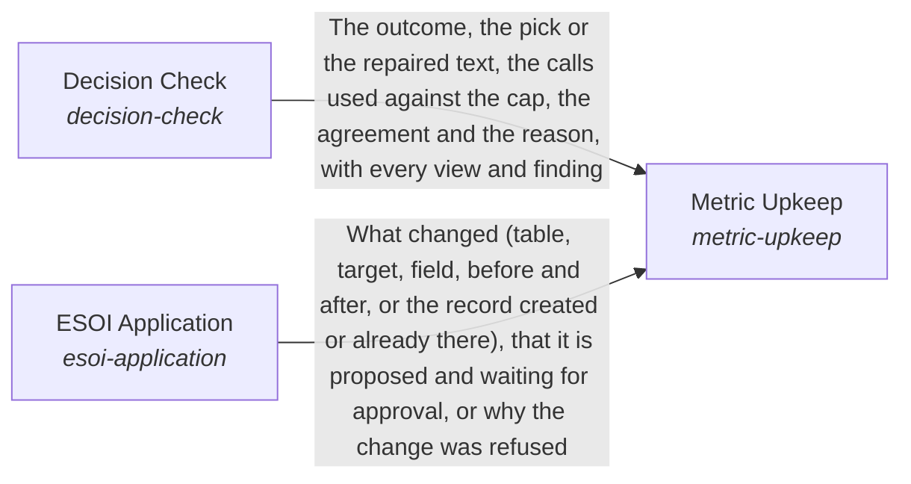

These are ESOI records rendered as a diagram (evolvable structure that optimizes intent). This page is generated from the solutions' outputs and the implementations' `uses_solution_ids` by `esoi diagram`; edit those records, not this page.

# Solution diagram: Holding a request to a measure

Critical Thinking holds a request to a measure. Metric Translation turns the request into a metric with a target value or improvement and a budget, adjustable while the work runs. ESOI Application records that metric as a spec and applies the principles, creating and editing specs and metrics. Goal Completion says whether the goal's condition was met against its done-standard. When it was not, the composition's pursue step uses the untried read-only means within a budget before the response is sent, says once that the rest is still being worked on when the work is long, and otherwise reports what was tried and what is missing. Response Quality judges the response against the quality profile resolved for the request. Decision Check tests a draft decision (a pick among options, or a reply) with small independent checks that each see only their own evidence and run in parallel: where they agree the draft stands, where they disagree one call decides from quoted evidence or the check abstains, and only a failing part of a reply is repaired; the mistakes it finds become known-mistake lines that the checks carry only while their metric says they pay. Metric Upkeep keeps a milestone's metrics able to show progress: it decides each metric's state from its fields, reads what it can, and adds one intermediate metric the AI can move when the milestone's own metric moves only through a person, after Decision Check agrees it tracks the done test, writing through ESOI Application. The composition's progress step runs Metric Upkeep, picks the first rung of the increment ladder that applies, measures it before, does it, has pursue refuse a result that is bookkeeping alone, and measures it after with a check that is not the writer.

An arrow runs from the solution that provides to the solution that builds on it; its label is what the provider outputs.

