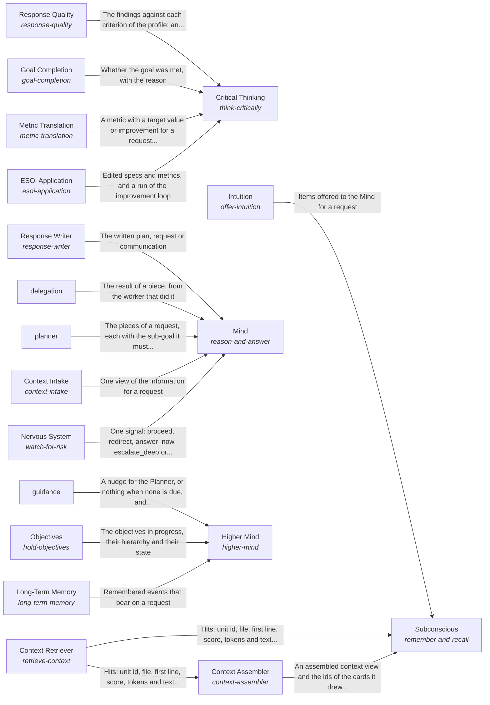

These are ESOI records rendered as a diagram (evolvable structure that optimizes intent). This page is generated from the solutions' outputs and the implementations' `uses_solution_ids` by `esoi diagram`; edit those records, not this page.

# Solution diagram: Processing information for one request

Intelligence turns one request into a response. Higher Mind keeps the long view through Long-Term Memory, Objectives and Guidance, which gives an infrequent longer-term nudge. Critical Thinking turns the request into a target through Metric Translation, records it through ESOI Application, and holds the result to it through Goal Completion and Response Quality. Subconscious finds and prepares information through Intuition, Context Assembler and Context Retriever. Mind takes the request in through Context Intake, breaks it into pieces through Planner, passes each piece to a worker through Delegation and writes the response through Response Writer. Mind also asks for a signal before a risky piece from Nervous System, and for the decision for the person from Judgment Calls.

An arrow runs from the solution that provides to the solution that builds on it; its label is what the provider outputs.

