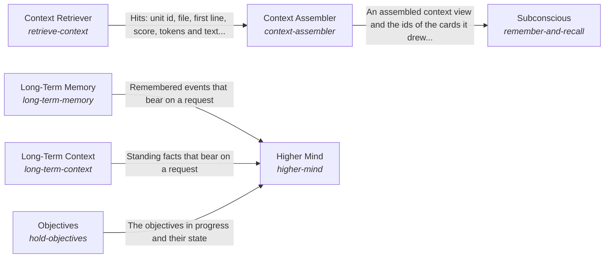

These are ESOI records rendered as a diagram (evolvable structure that optimizes intent). This page is generated from the solutions' outputs and the implementations' `uses_solution_ids` by `esoi diagram`; edit those records, not this page.

# Solution diagram: Processing information for one request

Intelligence turns what is known into one answer for one request. Mind is what the planning and responding AI can see for that request and how it outputs plans, requests and communications, and it asks a model through Model Tier Chooser and Model Call. Subconscious finds and prepares information for the answering AI, drawing the cards a request needs through Context Assembler. Intuition offers what surfaces for a request unasked. Context Retriever picks the pieces of a folder's files that a task needs within a token budget. Higher Mind keeps the long view through Long-Term Memory, Long-Term Context and Objectives. Critical Thinking holds an answer to the evidence behind it.

An arrow runs from the solution that provides to the solution that builds on it; its label is what the provider outputs.

