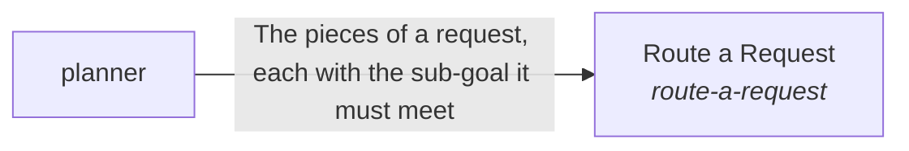

These are ESOI records rendered as a diagram (evolvable structure that optimizes intent). This page is generated from the solutions' outputs and the implementations' `uses_solution_ids` by `esoi diagram`; edit those records, not this page.

# Solution diagram: What the Mind sees and does for one request

Context Intake takes in what was prepared for a request and what the workers brought back, as one view. Planner breaks the request into pieces, each with the sub-goal it must meet. For each piece, Nervous System gives a risk signal before the piece is passed on. Judgment Calls then decides for the person whether to proceed or ask. Delegation passes each allowed piece to the worker its category names, only when a worker is needed, with the Representative's authority and the done-standard of the sub-goal. Response Writer writes the plan, request or communication from the results, to the quality profile.

An arrow runs from the solution that provides to the solution that builds on it; its label is what the provider outputs.

