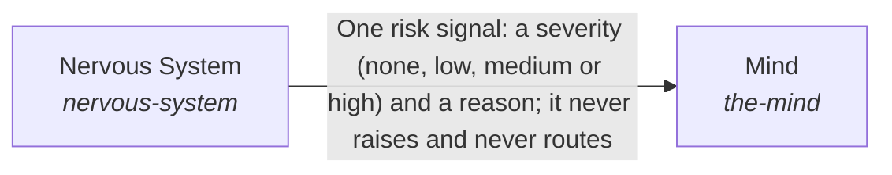

# Proactivity

*ESOI records kept beside the code in `hubofhubs/the_intelligence/proactivity`, generated from the CSV files in this folder by `esoi readmes`. Edit the CSV files, not this page.*

One request is answered from what the AI can see for it: the long view is read, the request becomes a target, the information is found and prepared, the response is planned and written, and the result is checked for goal completion and response quality.

These are the solutions of [Processing information for one request](../README.md).

## How the solutions fit together

Intelligence turns one request into a response. Higher Mind keeps the long view through Long-Term Memory, Objectives and Guidance, which gives an infrequent longer-term nudge. Critical Thinking turns the request into a target with a budget through Metric Translation, records it through ESOI Application, and holds the result to it through Goal Completion and Response Quality. Subconscious finds and prepares information through Cards From Files, Context Retriever and Intuition. Mind takes the request in through Context Intake, breaks it into pieces through Planner, passes each piece to a worker through Delegation and writes the response through Response Writer. Mind asks for a signal before a risky piece from Nervous System, and for the decision for the person from Judgment Calls. An unmet goal sends the flow back to the planning step within the request's budget, and when the budget or the authority runs out the flow goes to Judgment Calls. Proactivity says what is due without being asked.

## Overview diagram

An arrow runs from the solution that provides to the solution that builds on it; its label is what the provider outputs.

## Proactivity (`proactivity`)

Let the system start its standing work when it is due, without being asked.

- Entry call: `hubofhubs.run("proactivity", {'schedules': [], 'now': '2026-07-12T09:00:00Z'})`
- Selected implementation: Calendar periods and events (`calendar_and_events`)
- Metric: Schedules due when they should be
- Implemented by: [`hubofhubs/the_intelligence/__init__.py`](../__init__.py), [`hubofhubs/the_intelligence/critical_thinking/__init__.py`](../critical_thinking/__init__.py), [`hubofhubs/the_intelligence/critical_thinking/esoi_application/__init__.py`](../critical_thinking/esoi_application/__init__.py), [`hubofhubs/the_intelligence/critical_thinking/esoi_application/interface.py`](../critical_thinking/esoi_application/interface.py), [`hubofhubs/the_intelligence/critical_thinking/flow.py`](../critical_thinking/flow.py), [`hubofhubs/the_intelligence/critical_thinking/goal_completion/__init__.py`](../critical_thinking/goal_completion/__init__.py), [`hubofhubs/the_intelligence/critical_thinking/goal_completion/done_evidence.py`](../critical_thinking/goal_completion/done_evidence.py), [`hubofhubs/the_intelligence/critical_thinking/goal_completion/goal_completion.py`](../critical_thinking/goal_completion/goal_completion.py) and 137 more

## Implementations

| Implementation | Handle | Code | Selected |
|---|---|---|---|
| Calendar periods and events | `proactivity:calendar_and_events` | [`hubofhubs/the_intelligence/proactivity/triggers.py`](triggers.py) | selected |
| Elapsed hours | `proactivity:elapsed_hours` | [`hubofhubs/the_intelligence/proactivity/triggers.py`](triggers.py) |  |

## Metrics

- Schedules due when they should be (`metric-proactivity`): leader `calendar_and_events`, 18 of 18 cases

## Problems

- The system only reacts (`hprob-system-waits-to-be-asked`): An AI that acts only when asked misses the standing work (a daily review, a weekly report) and the moment something changed, so people must remember to ask.

## Ideals

- The system acts on time (`hideal-the-system-acts-on-time`): The system starts its standing work when it is due, by calendar period in the person's own zone, when a run is requested, or when something happened.

## Where to go next

- Up: [hubofhubs](../../README.md)
- Intent: [Processing information for one request](../README.md)
- Repository: [top README](../../../README.md)
