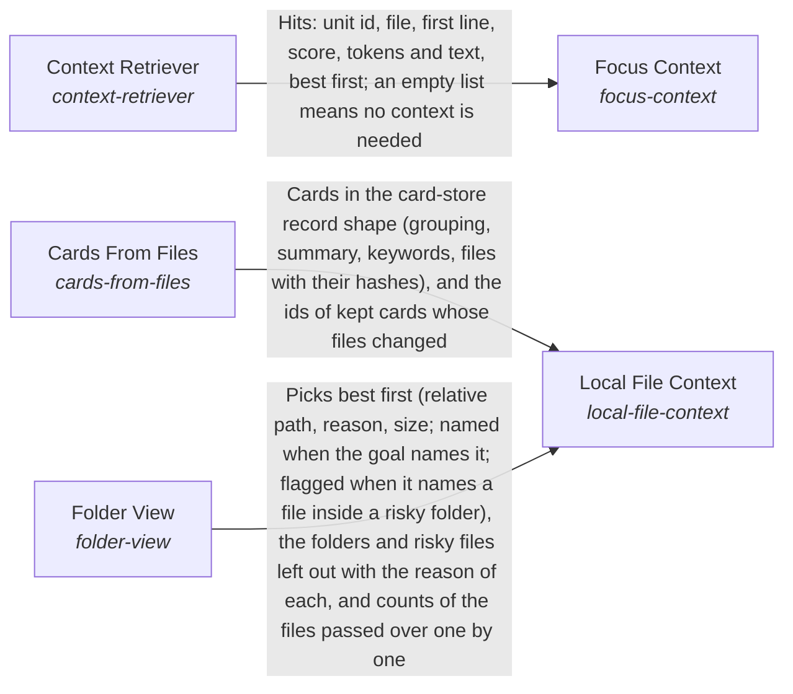

# Finding and preparing information for the Mind

**Vision statement:** The information a request needs is found and prepared before the Mind asks for it, from the system's own cards, its files and what comes to mind unasked.

Breadcrumb: [Top](../../../esoi/README.md) > [How the AI processes information](../README.md) > Finding and preparing information for the Mind

This sub-intent arises as the implementation `the-subconscious:card_recall` of its parent intent [`the_intelligence`](../README.md). Opportunities: How cards are built from files, how the right ones are picked for a request and what comes to mind unasked can each be improved on one measure without changing the Mind.

## How the solutions fit together

This part finds and prepares information before it is asked for. Local File Context makes the files of a working folder usable as context. It builds the cards of the folder through Cards From Files. It chooses which files of the folder a piece of work sees first and which folders are left out through Folder View. Context Retriever picks the cards and file units that bear on the request. Focus Context gathers the notes a person saved about their own named focus, ranks that focus first through the Context Retriever and writes the brief and the one line a session starts with. Intuition offers what occurs to the system unasked. Relevant Solutions names the consumer's ESOI solutions a request concerns, with the scopes above each and the solutions relying on each.

## Diagram

An arrow runs from the solution that provides to the solution that builds on it; its label is what the provider outputs.

## One level below

This intent is implemented by the sub-intents and solutions below it; each shows whether it goes deeper.

- [Context Retriever](context_retriever/README.md) (solution with implementations): Pick, from a corpus of files, cards or memory, the pieces of text a task needs within a token budget.
- [Focus Context](focus_context/README.md) (solution with implementations): Start a session from what the person already knows about their own focus, so "my practice" is answered from it first and files are searched only for the rest.
- [Intuition](intuition/README.md) (solution with implementations): Let useful information surface unasked.
- [Local File Context](local_file_context/README.md) (solution with implementations and parts below it): Make the files a piece of work sits in available as context, as cards and as the files to show first, without reading what is risky or useless.
- [Relevant Solutions](relevant_solutions/README.md) (solution with implementations): Find, for any request, every solution of the consumer's records that deserves its own consideration, so none is skipped.

## Solutions at a glance

| Solution | Handle | Entry call | Selected implementation | Metric |
|---|---|---|---|---|
| Context Retriever | `context-retriever` | `hubofhubs.run("context-retriever", ...)` | BM25 over chunk text (`bm25_body`) | Balanced score of retrieval on file, topic, orientation, no-context, memory, public-repository and grouping requests, with the index size and the cost of reading sources |
| Focus Context | `focus-context` | `hubofhubs.run("focus-context", ...)` | The configured focus first (`configured_focus_context`) | The person's own notes reach the brief, little else, nothing outside the scope |
| Intuition | `the-intuition` | `hubofhubs.run("the-intuition", {'request': 'what is the latest Rust version?'})` | What was taken for similar requests (`co_taken`) | Unasked items are taken and useful |
| Local File Context | `local-file-context` | `hubofhubs.run("local-file-context", ...)` | Folder view and card builder, called as they are selected (`composition`) | A working folder is ready as context |
| Relevant Solutions | `relevant-solutions` | `hubofhubs.run("relevant-solutions", ...)` | Records index (`records_index`) | Solutions needing consideration named, recall first |
| Cards From Files | `cards-from-files` | `hubofhubs.run("cards-from-files", {'root': '.', 'files': [], 'existing': {}})` | Import graph topic cards (`import_graph_topic_cards`) | Balanced score of a builder's cards on file-finding, topic and orientation cases, with the store's size |
| Folder View | `folder-view` | `hubofhubs.run("folder-view", ...)` | Folders judged by evidence, files ranked by what the work points at (`evidence_ranked`) | Needed files shown within the budget, nothing risky or useless read, what was left out said |

## Problems and ideals

**Problems**

- Context too broad or missing (`hprob-context-too-broad-or-missing`): A task is shown too much of a codebase, the wrong part of it, or context it never needed, so the model pays for noise or misses the file that matters.
- Work starts without the person's own context (`hprob-work-starts-without-the-persons-own-context`): A person asks a session about their own practice, hobby or project ("find something interesting about my practice") and the session searches the files for the request's words, so the answer is built from whatever files share the word (a lookalike folder, another business's material) while the notes the person already saved about that focus are never read.
- Local files are not yet context (`hprob-local-files-are-not-yet-context`): A piece of work in a local folder has files but no cards for them and no view of which files matter, so it reads too much, reads what is risky, or misses what it needs.
- Files without cards (`hprob-files-without-cards`): A consumer whose knowledge lives in files has no cards for it until something writes them, and cards written once go stale as the files change.
- Work starts on noise or risky files (`hprob-work-starts-on-noise-or-risky-files`): A piece of work in a folder of thousands of files is shown files from dependency, build and cache folders or notes that share a word with the goal, and can be shown files that hold credentials, backups or other people's private data, while the file it needs is missed.

**Ideals**

- The person's own context first (`hideal-the-persons-own-context-first`): A session about the person's own focus starts from what they already saved about it, and files are searched only for what that context does not say.
- A working folder is ready as context (`hideal-a-working-folder-is-ready-as-context`): A folder of local files is ready to be used as context: its cards are proportionate and current and the work starts on the files it needs.
- The right files in view, nothing risky read (`hideal-the-right-files-in-view-nothing-risky-read`): A piece of work starts with the files it needs in view and nothing that is dependency, build output, cache or a secret.

## Metrics and their leaders

- Balanced score of retrieval on file, topic, orientation, no-context, memory, public-repository and grouping requests, with the index size and the cost of reading sources (`metric-context-retriever`): leader `bm25_body`, 203 of 395 cases
- The person's own notes reach the brief, little else, nothing outside the scope (`metric-focus-context`): leader `configured_focus_context`, 19 of 20 cases
- Unasked items are taken and useful (`metric-the-intuition`): leader `co_taken`, 20 of 20 cases
- A working folder is ready as context (`metric-local-file-context`)
- Solutions needing consideration named, recall first (`metric-relevant-solutions`): leader `records_index`, 49 of 62 cases
- Balanced score of a builder's cards on file-finding, topic and orientation cases, with the store's size (`metric-cards-from-files`): leader `import_graph_topic_cards`, 112 of 252 cases
- Needed files shown within the budget, nothing risky or useless read, what was left out said (`metric-folder-view`): leader `evidence_ranked`, 39 of 41 cases

## Where to go next

- Parent intent: [How the AI processes information](../README.md)
- Repository: [top README](../../../README.md)
- Records beside the code: [hubofhubs/the_intelligence/subconscious/context_retriever](context_retriever/README.md), [hubofhubs/the_intelligence/subconscious/focus_context](focus_context/README.md), [hubofhubs/the_intelligence/subconscious/intuition](intuition/README.md), [hubofhubs/the_intelligence/subconscious/local_file_context](local_file_context/README.md), [hubofhubs/the_intelligence/subconscious/relevant_solutions](relevant_solutions/README.md), [hubofhubs/the_intelligence/subconscious/local_file_context/cards_from_files](local_file_context/cards_from_files/README.md), [hubofhubs/the_intelligence/subconscious/local_file_context/folder_view](local_file_context/folder_view/README.md)
- Records: [intent.csv](intent.csv), [problems.csv](problems.csv)
- Diagram page: [diagram.md](diagram.md)

---

## The full record

### Problems

- Context too broad or missing (`hprob-context-too-broad-or-missing`): A task is shown too much of a codebase, the wrong part of it, or context it never needed, so the model pays for noise or misses the file that matters.
- Work starts without the person's own context (`hprob-work-starts-without-the-persons-own-context`): A person asks a session about their own practice, hobby or project ("find something interesting about my practice") and the session searches the files for the request's words, so the answer is built from whatever files share the word (a lookalike folder, another business's material) while the notes the person already saved about that focus are never read.
- Local files are not yet context (`hprob-local-files-are-not-yet-context`): A piece of work in a local folder has files but no cards for them and no view of which files matter, so it reads too much, reads what is risky, or misses what it needs.
- Files without cards (`hprob-files-without-cards`): A consumer whose knowledge lives in files has no cards for it until something writes them, and cards written once go stale as the files change.
- Work starts on noise or risky files (`hprob-work-starts-on-noise-or-risky-files`): A piece of work in a folder of thousands of files is shown files from dependency, build and cache folders or notes that share a word with the goal, and can be shown files that hold credentials, backups or other people's private data, while the file it needs is missed.

### Ideals

- The person's own context first (`hideal-the-persons-own-context-first`): A session about the person's own focus starts from what they already saved about it, and files are searched only for what that context does not say.
- A working folder is ready as context (`hideal-a-working-folder-is-ready-as-context`): A folder of local files is ready to be used as context: its cards are proportionate and current and the work starts on the files it needs.
- The right files in view, nothing risky read (`hideal-the-right-files-in-view-nothing-risky-read`): A piece of work starts with the files it needs in view and nothing that is dependency, build output, cache or a secret.

### Solutions

| Solution | Handle | Selected | Metric |
|---|---|---|---|
| Context Retriever | `context-retriever` | BM25 over chunk text (`bm25_body`) | Balanced score of retrieval on file, topic, orientation, no-context, memory, public-repository and grouping requests, with the index size and the cost of reading sources |
| Focus Context | `focus-context` | The configured focus first (`configured_focus_context`) | The person's own notes reach the brief, little else, nothing outside the scope |
| Intuition | `the-intuition` | What was taken for similar requests (`co_taken`) | Unasked items are taken and useful |
| Local File Context | `local-file-context` | Folder view and card builder, called as they are selected (`composition`) | A working folder is ready as context |
| Relevant Solutions | `relevant-solutions` | Records index (`records_index`) | Solutions needing consideration named, recall first |
| Cards From Files | `cards-from-files` | Import graph topic cards (`import_graph_topic_cards`) | Balanced score of a builder's cards on file-finding, topic and orientation cases, with the store's size |
| Folder View | `folder-view` | Folders judged by evidence, files ranked by what the work points at (`evidence_ranked`) | Needed files shown within the budget, nothing risky or useless read, what was left out said |

### Implementations

| Implementation | Handle | Where | Sub-intent |
|---|---|---|---|
| BM25 over chunk text | `context-retriever:bm25_body` | [hubofhubs/the_intelligence/subconscious/context_retriever/lexical.py](context_retriever/lexical.py) |  |
| BM25F over path, title and body | `context-retriever:bm25_fielded` | [hubofhubs/the_intelligence/subconscious/context_retriever/lexical.py](context_retriever/lexical.py) |  |
| BM25F over whole files | `context-retriever:bm25_whole_files` | [hubofhubs/the_intelligence/subconscious/context_retriever/lexical.py](context_retriever/lexical.py) |  |
| Latent semantic index | `context-retriever:lsi` | [hubofhubs/the_intelligence/subconscious/context_retriever/dense.py](context_retriever/dense.py) |  |
| Dense bge-small vectors | `context-retriever:dense_bge_small` | [hubofhubs/the_intelligence/subconscious/context_retriever/dense.py](context_retriever/dense.py) |  |
| BM25F and dense by rank fusion | `context-retriever:hybrid_rrf` | [hubofhubs/the_intelligence/subconscious/context_retriever/fusion.py](context_retriever/fusion.py) |  |
| Local feature reranker | `context-retriever:feature_rerank` | [hubofhubs/the_intelligence/subconscious/context_retriever/fusion.py](context_retriever/fusion.py) |  |
| Feature reranker without priors | `context-retriever:feature_rerank_no_priors` | [hubofhubs/the_intelligence/subconscious/context_retriever/fusion.py](context_retriever/fusion.py) |  |
| Learned reranker | `context-retriever:learned_rerank` | [hubofhubs/the_intelligence/subconscious/context_retriever/learned.py](context_retriever/learned.py) |  |
| Hybrid that can say nothing | `context-retriever:abstaining_hybrid` | [hubofhubs/the_intelligence/subconscious/context_retriever/abstain.py](context_retriever/abstain.py) |  |
| Learned reranker that can say nothing | `context-retriever:abstaining_learned` | [hubofhubs/the_intelligence/subconscious/context_retriever/abstain.py](context_retriever/abstain.py) |  |
| Model reranker | `context-retriever:llm_rerank` | [hubofhubs/the_intelligence/subconscious/context_retriever/abstain.py](context_retriever/abstain.py) |  |
| Hybrid that prefers newer items | `context-retriever:abstaining_recency` | [hubofhubs/the_intelligence/subconscious/context_retriever/aware.py](context_retriever/aware.py) |  |
| Hybrid with soft affinity to the request's focus | `context-retriever:abstaining_affinity` | [hubofhubs/the_intelligence/subconscious/context_retriever/aware.py](context_retriever/aware.py) |  |
| Hybrid with recency, affinity and supersession | `context-retriever:abstaining_aware` | [hubofhubs/the_intelligence/subconscious/context_retriever/aware.py](context_retriever/aware.py) |  |
| Hybrid behind a hard focus fence | `context-retriever:abstaining_fenced` | [hubofhubs/the_intelligence/subconscious/context_retriever/aware.py](context_retriever/aware.py) |  |
| Scan of the live sources | `context-retriever:live_scan` | [hubofhubs/the_intelligence/subconscious/context_retriever/aware.py](context_retriever/aware.py) |  |
| Whole-item BM25F with the request's focus first | `context-retriever:focus_first` | [hubofhubs/the_intelligence/subconscious/context_retriever/focus_first.py](context_retriever/focus_first.py) |  |
| Nothing gathered | `focus-context:no_context` | [hubofhubs/the_intelligence/subconscious/focus_context/arms.py](focus_context/arms.py) |  |
| Notes found by the request's words | `focus-context:filesystem_search` | [hubofhubs/the_intelligence/subconscious/focus_context/arms.py](focus_context/arms.py) |  |
| The configured focus first | `focus-context:configured_focus_context` | [hubofhubs/the_intelligence/subconscious/focus_context/arms.py](focus_context/arms.py) |  |
| Nearest items by wording | `the-intuition:nearest_cards` | [hubofhubs/the_intelligence/subconscious/intuition/nearest_cards.py](intuition/nearest_cards.py) |  |
| What was taken for similar requests | `the-intuition:co_taken` | [hubofhubs/the_intelligence/subconscious/intuition/co_taken.py](intuition/co_taken.py) |  |
| Folder view and card builder, called as they are selected | `local-file-context:composition` | [hubofhubs/the_intelligence/subconscious/local_file_context/flow.py](local_file_context/flow.py) |  |
| Records index | `relevant-solutions:records_index` | [hubofhubs/the_intelligence/subconscious/relevant_solutions/records_index.py](relevant_solutions/records_index.py) |  |
| Records index, then a cheap model | `relevant-solutions:records_then_model` | [hubofhubs/the_intelligence/subconscious/relevant_solutions/records_then_model.py](relevant_solutions/records_then_model.py) |  |
| Model-written topic cards | `cards-from-files:llm_topic_cards` | [hubofhubs/the_intelligence/subconscious/local_file_context/cards_from_files/cards_from_files.py](local_file_context/cards_from_files/cards_from_files.py) |  |
| One card per file | `cards-from-files:per_file_symbols` | [hubofhubs/the_intelligence/subconscious/local_file_context/cards_from_files/cards_from_files.py](local_file_context/cards_from_files/cards_from_files.py) |  |
| Graphify file groups | `cards-from-files:graphify_files` | [hubofhubs/the_intelligence/subconscious/local_file_context/cards_from_files/cards_from_graphify.py](local_file_context/cards_from_files/cards_from_graphify.py) |  |
| File plus topic cards | `cards-from-files:file_plus_topic_cards` | [hubofhubs/the_intelligence/subconscious/local_file_context/cards_from_files/cards_from_files.py](local_file_context/cards_from_files/cards_from_files.py) |  |
| Topic cards replay | `cards-from-files:topic_cards_replay` | [hubofhubs/the_intelligence/subconscious/local_file_context/cards_from_files/cards_from_files.py](local_file_context/cards_from_files/cards_from_files.py) |  |
| Cochange topic cards | `cards-from-files:cochange_topic_cards` | [hubofhubs/the_intelligence/subconscious/local_file_context/cards_from_files/cards_from_topics.py](local_file_context/cards_from_files/cards_from_topics.py) |  |
| Import graph topic cards | `cards-from-files:import_graph_topic_cards` | [hubofhubs/the_intelligence/subconscious/local_file_context/cards_from_files/cards_from_topics.py](local_file_context/cards_from_files/cards_from_topics.py) |  |
| Names, whole folder, shared words (the harness as it was) | `folder-view:ported_baseline` | [hubofhubs/the_intelligence/subconscious/local_file_context/folder_view/ported_baseline.py](local_file_context/folder_view/ported_baseline.py) |  |
| Folders judged by evidence, files ranked by what the work points at | `folder-view:evidence_ranked` | [hubofhubs/the_intelligence/subconscious/local_file_context/folder_view/evidence_ranked.py](local_file_context/folder_view/evidence_ranked.py) |  |
| Evidence candidates, then one cheap model call | `folder-view:model_pick` | [hubofhubs/the_intelligence/subconscious/local_file_context/folder_view/model_pick.py](local_file_context/folder_view/model_pick.py) |  |

### Metrics

- Balanced score of retrieval on file, topic, orientation, no-context, memory, public-repository and grouping requests, with the index size and the cost of reading sources (`metric-context-retriever`): `esoi run context_retrieval --impl bm25_body; esoi run context_retrieval --impl bm25_fielded; esoi run context_retrieval --impl bm25_whole_files; esoi run context_retrieval --impl lsi; esoi run context_retrieval --impl dense_bge_small; esoi run context_retrieval --impl hybrid_rrf; esoi run context_retrieval --impl feature_rerank; esoi run context_retrieval --impl feature_rerank_no_priors; esoi run context_retrieval --impl learned_rerank; esoi run context_retrieval --impl abstaining_hybrid; esoi run context_retrieval --impl abstaining_learned; esoi run context_retrieval --impl abstaining_recency; esoi run context_retrieval --impl abstaining_affinity; esoi run context_retrieval --impl abstaining_aware; esoi run context_retrieval --impl abstaining_fenced; esoi run context_retrieval --impl live_scan; esoi run context_retrieval --impl llm_rerank`
- The person's own notes reach the brief, little else, nothing outside the scope (`metric-focus-context`): `esoi run focus_context --impl no_context; esoi run focus_context --impl filesystem_search; esoi run focus_context --impl configured_focus_context`
- Unasked items are taken and useful (`metric-the-intuition`): `esoi run intuition --impl nearest_cards; esoi run intuition --impl co_taken`
- A working folder is ready as context (`metric-local-file-context`): `none`
- Solutions needing consideration named, recall first (`metric-relevant-solutions`): `esoi run relevant_solutions --impl records_index; esoi run relevant_solutions --impl records_then_model`
- Balanced score of a builder's cards on file-finding, topic and orientation cases, with the store's size (`metric-cards-from-files`): `esoi run cards_from_files --impl llm_topic_cards; esoi run cards_from_files --impl topic_cards_replay; esoi run cards_from_files --impl cochange_topic_cards; esoi run cards_from_files --impl import_graph_topic_cards; esoi run cards_from_files --impl file_plus_topic_cards; esoi run cards_from_files --impl per_file_symbols; esoi run cards_from_files --impl graphify_files`
- Needed files shown within the budget, nothing risky or useless read, what was left out said (`metric-folder-view`): `esoi run folder_view --impl ported_baseline; esoi run folder_view --impl evidence_ranked; esoi run folder_view --impl model_pick`

*Generated from the CSV files beside this page by `esoi readmes`. Edit the CSV files, not this page.*
