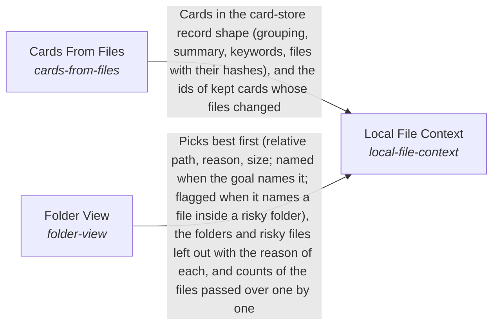

These are ESOI records rendered as a diagram (evolvable structure that optimizes intent). This page is generated from the solutions' outputs and the implementations' `uses_solution_ids` by `esoi diagram`; edit those records, not this page.

# Solution diagram: Finding and preparing information for the Mind

This part finds and prepares information before it is asked for. Local File Context makes the files of a working folder usable as context. It builds the cards of the folder through Cards From Files. It chooses which files of the folder a piece of work sees first and which folders are left out through Folder View. Context Retriever picks the cards and file units that bear on the request. Intuition offers what occurs to the system unasked. Relevant Solutions names the consumer's ESOI solutions a request concerns, with the scopes above each and the solutions relying on each.

An arrow runs from the solution that provides to the solution that builds on it; its label is what the provider outputs.

