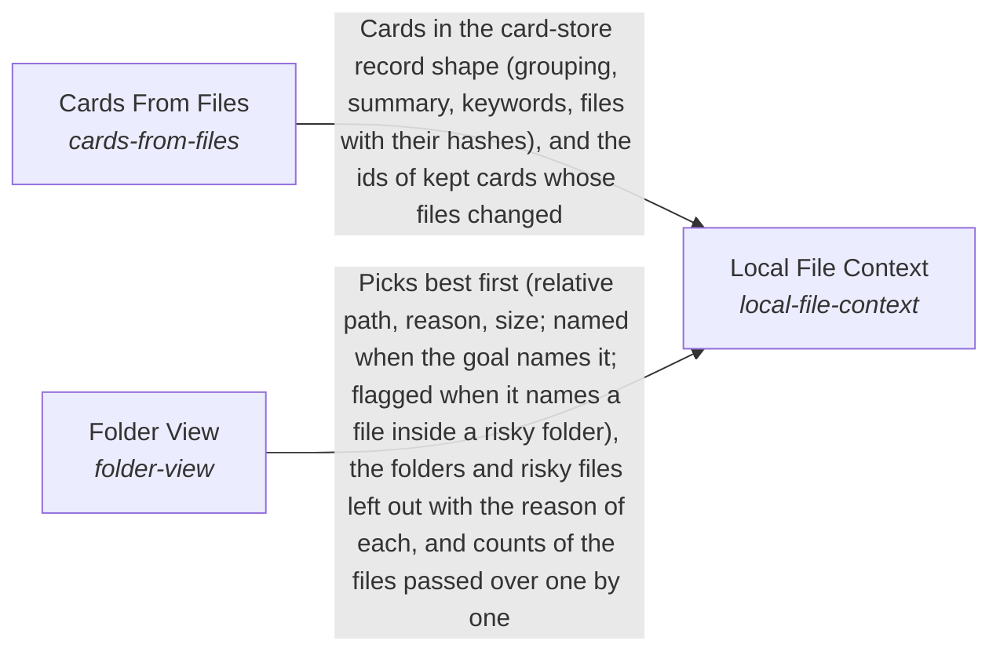

# Local File Context

**Purpose:** Make the files a piece of work sits in available as context, as cards and as the files to show first, without reading what is risky or useless.

Breadcrumb: [Top](../../../../esoi/README.md) > [How the AI processes information](../../README.md) > [Finding and preparing information for the Mind](../README.md) > Local File Context

Part of [Finding and preparing information for the Mind](../README.md)

## Local File Context (`local-file-context`)

- Out of scope: Ranking text for an answer within a token budget from a corpus already read (Context Retriever), keeping cards (Card Store) and reading or writing files in general (Read Files and File Editing).
- Delegates to: cards-from-files, folder-view
- Entry call: `hubofhubs.run("local-file-context", ...)`
- Selected implementation: Folder view and card builder, called as they are selected (`composition`)
- Metric: A working folder is ready as context
- Implemented by: [`hubofhubs/the_intelligence/__init__.py`](../../__init__.py), [`hubofhubs/the_intelligence/critical_thinking/__init__.py`](../../critical_thinking/__init__.py), [`hubofhubs/the_intelligence/critical_thinking/decision_check/__init__.py`](../../critical_thinking/decision_check/__init__.py), [`hubofhubs/the_intelligence/critical_thinking/decision_check/agreement.py`](../../critical_thinking/decision_check/agreement.py), [`hubofhubs/the_intelligence/critical_thinking/decision_check/checks.py`](../../critical_thinking/decision_check/checks.py), [`hubofhubs/the_intelligence/critical_thinking/decision_check/interface.py`](../../critical_thinking/decision_check/interface.py), [`hubofhubs/the_intelligence/critical_thinking/decision_check/mistakes.py`](../../critical_thinking/decision_check/mistakes.py), [`hubofhubs/the_intelligence/critical_thinking/decision_check/remainder.py`](../../critical_thinking/decision_check/remainder.py) and 243 more

## One level below

- [Cards From Files](cards_from_files/README.md) (solution with implementations): Propose the cards a folder of files needs, in the card store record shape, for the Subconscious to keep and recall.
- [Folder View](folder_view/README.md) (solution with implementations): Choose the files of a working folder a piece of work should be shown first, and never read what is risky or unlikely to help, for any programming language and tool.

## Diagram

An arrow runs from the solution that provides to the solution that builds on it; its label is what the provider outputs.

## Implementations

| Implementation | Handle | Purpose | Code | Selected |
|---|---|---|---|---|
| Folder view and card builder, called as they are selected | `local-file-context:composition` | Prepares a working folder by calling the selected Folder View for the files to show first and the folders left out, and hands card building to the selected Cards From Files. | [`hubofhubs/the_intelligence/subconscious/local_file_context/flow.py`](flow.py) | selected |

## Metrics

- A working folder is ready as context (`metric-local-file-context`)

## Problems

- Local files are not yet context (`hprob-local-files-are-not-yet-context`): A piece of work in a local folder has files but no cards for them and no view of which files matter, so it reads too much, reads what is risky, or misses what it needs.

## Ideals

- A working folder is ready as context (`hideal-a-working-folder-is-ready-as-context`): A folder of local files is ready to be used as context: its cards are proportionate and current and the work starts on the files it needs.

## Where to go next

- Up: [hubofhubs](../../../README.md)
- Intent: [Finding and preparing information for the Mind](../README.md)
- Down: [hubofhubs/the_intelligence/subconscious/local_file_context/cards_from_files](cards_from_files/README.md)
- Down: [hubofhubs/the_intelligence/subconscious/local_file_context/folder_view](folder_view/README.md)
- Repository: [top README](../../../../README.md)

*Generated from the CSV files in this folder by `esoi readmes`. Edit the CSV files, not this page.*
