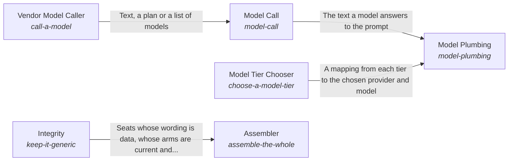

# The parts working as one whole

The parts of the system work as one whole: each part knows its role, what the system claims matches its evidence, its records match its code, and one call builds the parts from configuration.

*ESOI records of this intent (evolvable structure that optimizes intent), generated from the CSV files beside this page by `esoi readmes`. Edit the CSV files, not this page.*

This sub-intent arises as the implementation `the-self:parts` of its parent intent [`hub-of-hubs`](../../esoi/README.md). Opportunities: A system can check itself, each part can state what it is for, and every part can share one measured way of asking a model, none of which the assembly alone asks for. Whoever builds on the hub gets the integration without writing it.

## How the solutions fit together

The Self keeps the parts of the system working as one whole, and Role Understanding states what each part is for so that no part does another's work. The Assembler builds the whole from configuration in one call and asks Integrity whether the hub still stays generic, with claims that match evidence and records that match code. Model Plumbing is how every part asks a model, and it picks the model for each tier through Model Tier Chooser and asks that model through Model Call. Model Call reaches each vendor through Vendor Model Caller, which steps to the next provider when one fails.

## Diagram

An arrow runs from the solution that provides to the solution that builds on it; its label is what the provider outputs.

## Solutions at a glance

| Solution | Handle | Entry call | Selected implementation | Metric |
|---|---|---|---|---|
| Model Call | `model-call` | `hubofhubs.run("model-call", ...)` | Built on the vendor model caller (`via_call_a_model`) | Model call answers for the tier |
| Vendor Model Caller | `call-a-model` | `hubofhubs.run("call-a-model", ...)` | Claude Code CLI (`claude_cli`) | Provider failover |
| Model Tier Chooser | `choose-a-model-tier` | `hubofhubs.run("choose-a-model-tier", {'available': ['anthropic']})` | Passing work per cost selector (`tier_selector`) | Tier choice by passing work per cost, Tier passing work per cost, Model quality on hard maths, Vendor arms answer |
| Assembler | `assemble-the-whole` | `hubofhubs.run("assemble-the-whole", 'what is the latest Rust release?')` | One-call assembly of the whole hub (`zero_config`) | Whole assembly, Capability of the whole from the user's seat, Consent floor, Honesty floor |
| Integrity | `keep-it-generic` | `hubofhubs.run("keep-it-generic", ['examplevendor'])` | Audit of vendor wording, staleness and configuration (`prompts_as_data`) | Consumer-specific strings found by scan, Intents whose solutions one paragraph and one diagram explain as the code builds them |
| Role Understanding | `role-understanding` | no entry declared | none selected | Behaviour matches the stated role |
| Model Plumbing | `model-plumbing` | no entry declared | Composition of the model path (`composition`) | Every part asks a model through one path |

## Problems and ideals

**Problems**

- One product's prompts and settings leak into shared code, so it cannot be reused by anyone else. (`HP6`)
- An assembled system is judged part by part, so nobody checks that it behaves like one capable assistant from where the user sits: asked for something real, it should know what it may do, ask before... (`hprob-assembly-not-jarvis-from-the-users-seat`)
- Parts assembled together drift: one does another part's work, hides its own failure or claims more than its evidence shows, and nobody owns the coherence of the whole. (`hprob-parts-forget-their-role`)
- Each part that needs a model chooses and calls it its own way, so tier choice, cost and failover are repeated and drift apart. (`hprob-every-part-picks-its-own-model`)

**Ideals**

- Capable from the user's seat (`hideal-jarvis-from-the-users-seat`): The assembled hub is judged as the user meets it: one capable assistant that gets real work done, asks before it does anything that cannot be undone, and reports only what it did.
- Every part knows its role (`hideal-every-part-knows-its-role`): Each part knows what it is for, what it hands on and what it leaves to the others.

## Metrics and their leaders

- Tier choice by passing work per cost (`metric-choose-a-model-tier`): leader `tier_selector`, 36 of 36 cases
- Whole assembly (`metric-assemble-the-whole`)
- Consumer-specific strings found by scan (`metric-keep-it-generic`)
- Tier passing work per cost (`metric-tier-passing-work-per-cost`)
- Capability of the whole from the user's seat (`metric-hub-jarvis-ness`)
- Consent floor (`metric-hub-jarvis-floor-consent`)
- Honesty floor (`metric-hub-jarvis-floor-honesty`)
- Intents whose solutions one paragraph and one diagram explain as the code builds them (`metric-solution-coherence`)
- Model quality on hard maths (`metric-model-quality`): leader `deepseek_v4_pro`, 3 of 3 cases
- Vendor arms answer (`metric-vendor-answers`): leader `claude_cli`, 3 of 3 cases
- and 4 more: all 14 are in [metrics](#metrics) of the full record below

## Where to go next

- Parent intent: [The best parts for AI intelligence, assembled and proven](../../esoi/README.md)
- Repository: [top README](../../README.md)
- Records: [intent.csv](intent.csv), [problems.csv](problems.csv), [ideals.csv](ideals.csv), [solutions.csv](solutions.csv), [implementations.csv](implementations.csv), [metrics.csv](metrics.csv)
- Diagram page: [diagram.md](diagram.md)

---

## The full record

### Problems

- One product's prompts and settings leak into shared code, so it cannot be reused by anyone else. (`HP6`)
- An assembled system is judged part by part, so nobody checks that it behaves like one capable assistant from where the user sits: asked for something real, it should know what it may do, ask before anything irreversible and say truthfully what it did. (`hprob-assembly-not-jarvis-from-the-users-seat`)
- Parts assembled together drift: one does another part's work, hides its own failure or claims more than its evidence shows, and nobody owns the coherence of the whole. (`hprob-parts-forget-their-role`)
- Each part that needs a model chooses and calls it its own way, so tier choice, cost and failover are repeated and drift apart. (`hprob-every-part-picks-its-own-model`)

### Ideals

- Capable from the user's seat (`hideal-jarvis-from-the-users-seat`): The assembled hub is judged as the user meets it: one capable assistant that gets real work done, asks before it does anything that cannot be undone, and reports only what it did.
- Every part knows its role (`hideal-every-part-knows-its-role`): Each part knows what it is for, what it hands on and what it leaves to the others.

### Solutions

| Solution | Handle | Selected | Metric |
|---|---|---|---|
| Model Call | `model-call` | Built on the vendor model caller (`via_call_a_model`) | Model call answers for the tier |
| Vendor Model Caller | `call-a-model` | Claude Code CLI (`claude_cli`) | Provider failover |
| Model Tier Chooser | `choose-a-model-tier` | Passing work per cost selector (`tier_selector`) | Tier choice by passing work per cost, Tier passing work per cost, Model quality on hard maths, Vendor arms answer |
| Assembler | `assemble-the-whole` | One-call assembly of the whole hub (`zero_config`) | Whole assembly, Capability of the whole from the user's seat, Consent floor, Honesty floor |
| Integrity | `keep-it-generic` | Audit of vendor wording, staleness and configuration (`prompts_as_data`) | Consumer-specific strings found by scan, Intents whose solutions one paragraph and one diagram explain as the code builds them |
| Role Understanding | `role-understanding` | none selected | Behaviour matches the stated role |
| Model Plumbing | `model-plumbing` | Composition of the model path (`composition`) | Every part asks a model through one path |

### Implementations

| Implementation | Handle | Where | Sub-intent |
|---|---|---|---|
| Passing work per cost selector | `choose-a-model-tier:tier_selector` | [hubofhubs/tiers.py](../tiers.py) |  |
| One-call assembly of the whole hub | `assemble-the-whole:zero_config` | [hubofhubs/whole.py](../whole.py) |  |
| Audit of vendor wording, staleness and configuration | `keep-it-generic:prompts_as_data` | [hubofhubs/areas.py](../areas.py) |  |
| Anthropic provider | `call-a-model:anthropic` | [hubofhubs/models/anthropic.py](../models/anthropic.py) |  |
| DeepSeek provider | `call-a-model:deepseek` | [hubofhubs/models/openai.py](../models/openai.py) |  |
| Gemini provider | `call-a-model:gemini` | [hubofhubs/models/gemini.py](../models/gemini.py) |  |
| Multi-provider router | `call-a-model:multi_provider` | [hubofhubs/models/router.py](../models/router.py) |  |
| OpenAI provider | `call-a-model:openai` | [hubofhubs/models/openai.py](../models/openai.py) |  |
| Built on the vendor model caller | `model-call:via_call_a_model` | [hubofhubs/models/via_provider.py](../models/via_provider.py) |  |
| Claude Code CLI | `call-a-model:claude_cli` | [hubofhubs/models/claude_cli.py](../models/claude_cli.py) |  |
| Composition of the model path | `model-plumbing:composition` |  |  |

### Metrics

- Tier choice by passing work per cost (`metric-choose-a-model-tier`): `esoi run reason_and_answer --impl tier_selector`
- Whole assembly (`metric-assemble-the-whole`): `none`
- Consumer-specific strings found by scan (`metric-keep-it-generic`): `none`
- Tier passing work per cost (`metric-tier-passing-work-per-cost`): `python3 -m pytest tests/test_tiers.py`
- Capability of the whole from the user's seat (`metric-hub-jarvis-ness`): `none`
- Consent floor (`metric-hub-jarvis-floor-consent`): `none`
- Honesty floor (`metric-hub-jarvis-floor-honesty`): `none`
- Intents whose solutions one paragraph and one diagram explain as the code builds them (`metric-solution-coherence`): `python3 -m esoi.coherence --gate`
- Model quality on hard maths (`metric-model-quality`): `esoi run model_quality_aime --impl claude_haiku; esoi run model_quality_aime --impl claude_sonnet; esoi run model_quality_aime --impl claude_opus; esoi run model_quality_aime --impl gemini_2_5_flash_lite; esoi run model_quality_aime --impl gemini_2_5_flash; esoi run model_quality_aime --impl gpt_5_nano; esoi run model_quality_aime --impl gpt_5_mini; esoi run model_quality_aime --impl deepseek_flash`
- Vendor arms answer (`metric-vendor-answers`): `esoi run call_a_model --impl gemini; esoi run call_a_model --impl openai; esoi run call_a_model --impl deepseek; esoi run call_a_model --impl claude_cli`
- Model call answers for the tier (`metric-model-call`): `esoi run model_call --impl via_call_a_model`
- Provider failover (`metric-call-a-model`): `esoi run provider_failover --impl multi_provider`
- Behaviour matches the stated role (`metric-role-understanding`): `none`
- Every part asks a model through one path (`metric-model-plumbing`): `none`
