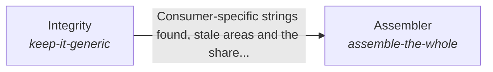

# The parts working as one whole

The parts of the system work as one whole: each part knows its role, what the system claims matches its evidence, its records match its code, and one call builds the parts from configuration.

*ESOI records of this intent (evolvable structure that optimizes intent), generated from the CSV files beside this page by `esoi readmes`. Edit the CSV files, not this page.*

This sub-intent arises as the implementation `the-self:parts` of its parent intent [`hub-of-hubs`](../../esoi/README.md). Opportunities: A system can check itself, each part can state what it is for, and every part can share one measured way of asking a model, none of which the assembly alone asks for. Whoever builds on the hub gets the integration without writing it.

## How the solutions fit together

The Self keeps the parts of the system working as one whole, and Role Understanding states what each part is for so that no part does another's work. The Assembler builds the whole from configuration in one call and answers a request with the arms the hub selected, and it asks Integrity whether the hub still stays generic, with claims that match evidence and records that match code.

## Diagram

An arrow runs from the solution that provides to the solution that builds on it; its label is what the provider outputs.

## Solutions at a glance

| Solution | Handle | Entry call | Selected implementation | Metric |
|---|---|---|---|---|
| Assembler | `assemble-the-whole` | `hubofhubs.run("assemble-the-whole", 'what is the latest Rust release?')` | One-call assembly of the whole hub (`zero_config`) | Whole assembly, Capability of the whole from the user's seat, Consent floor, Honesty floor |
| Integrity | `keep-it-generic` | `hubofhubs.run("keep-it-generic", ['examplevendor'])` | Audit of vendor wording, staleness and configuration (`prompts_as_data`) | Consumer-specific strings found by scan, Intents whose solutions one paragraph and one diagram explain as the code builds them |
| Role Understanding | `role-understanding` | `hubofhubs.run("role-understanding", 'assemble-the-whole')` | none selected | Behaviour matches the stated role |

## Problems and ideals

**Problems**

- One product's prompts and settings leak into shared code, so it cannot be reused by anyone else. (`HP6`)
- An assembled system is judged part by part, so nobody checks that it behaves like one capable assistant from where the user sits: asked for something real, it should know what it may do, ask before... (`hprob-assembly-not-jarvis-from-the-users-seat`)
- Parts assembled together drift: one does another part's work, hides its own failure or claims more than its evidence shows, and nobody owns the coherence of the whole. (`hprob-parts-forget-their-role`)

**Ideals**

- Capable from the user's seat (`hideal-jarvis-from-the-users-seat`): The assembled hub is judged as the user meets it: one capable assistant that gets real work done, asks before it does anything that cannot be undone, and reports only what it did.
- Every part knows its role (`hideal-every-part-knows-its-role`): Each part knows what it is for, what it hands on and what it leaves to the others.

## Metrics and their leaders

- Whole assembly (`metric-assemble-the-whole`)
- Consumer-specific strings found by scan (`metric-keep-it-generic`)
- Capability of the whole from the user's seat (`metric-hub-jarvis-ness`)
- Consent floor (`metric-hub-jarvis-floor-consent`)
- Honesty floor (`metric-hub-jarvis-floor-honesty`)
- Intents whose solutions one paragraph and one diagram explain as the code builds them (`metric-solution-coherence`)
- Behaviour matches the stated role (`metric-role-understanding`)

## Where to go next

- Parent intent: [The best parts for AI intelligence, assembled and proven](../../esoi/README.md)
- Repository: [top README](../../README.md)
- Records: [intent.csv](intent.csv), [problems.csv](problems.csv), [ideals.csv](ideals.csv), [solutions.csv](solutions.csv), [implementations.csv](implementations.csv), [metrics.csv](metrics.csv)
- Diagram page: [diagram.md](diagram.md)

---

## The full record

### Problems

- One product's prompts and settings leak into shared code, so it cannot be reused by anyone else. (`HP6`)
- An assembled system is judged part by part, so nobody checks that it behaves like one capable assistant from where the user sits: asked for something real, it should know what it may do, ask before anything irreversible and say truthfully what it did. (`hprob-assembly-not-jarvis-from-the-users-seat`)
- Parts assembled together drift: one does another part's work, hides its own failure or claims more than its evidence shows, and nobody owns the coherence of the whole. (`hprob-parts-forget-their-role`)

### Ideals

- Capable from the user's seat (`hideal-jarvis-from-the-users-seat`): The assembled hub is judged as the user meets it: one capable assistant that gets real work done, asks before it does anything that cannot be undone, and reports only what it did.
- Every part knows its role (`hideal-every-part-knows-its-role`): Each part knows what it is for, what it hands on and what it leaves to the others.

### Solutions

| Solution | Handle | Selected | Metric |
|---|---|---|---|
| Assembler | `assemble-the-whole` | One-call assembly of the whole hub (`zero_config`) | Whole assembly, Capability of the whole from the user's seat, Consent floor, Honesty floor |
| Integrity | `keep-it-generic` | Audit of vendor wording, staleness and configuration (`prompts_as_data`) | Consumer-specific strings found by scan, Intents whose solutions one paragraph and one diagram explain as the code builds them |
| Role Understanding | `role-understanding` | none selected | Behaviour matches the stated role |

### Implementations

| Implementation | Handle | Where | Sub-intent |
|---|---|---|---|
| One-call assembly of the whole hub | `assemble-the-whole:zero_config` | [hubofhubs/whole.py](../whole.py) |  |
| Audit of vendor wording, staleness and configuration | `keep-it-generic:prompts_as_data` | [hubofhubs/areas.py](../areas.py) |  |

### Metrics

- Whole assembly (`metric-assemble-the-whole`): `none`
- Consumer-specific strings found by scan (`metric-keep-it-generic`): `none`
- Capability of the whole from the user's seat (`metric-hub-jarvis-ness`): `none`
- Consent floor (`metric-hub-jarvis-floor-consent`): `none`
- Honesty floor (`metric-hub-jarvis-floor-honesty`): `none`
- Intents whose solutions one paragraph and one diagram explain as the code builds them (`metric-solution-coherence`): `python3 -m esoi.coherence --gate`
- Behaviour matches the stated role (`metric-role-understanding`): `none`
